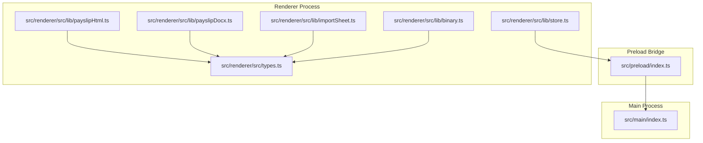
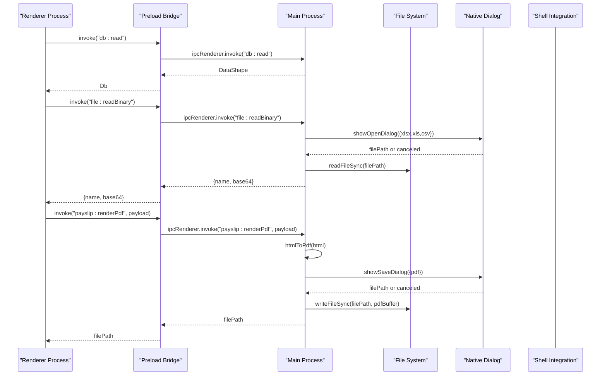
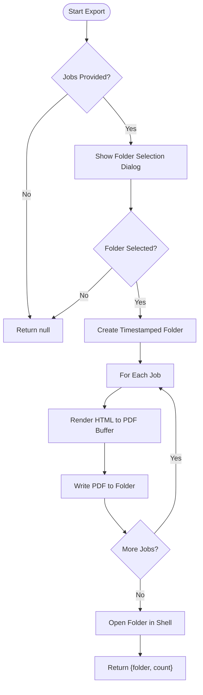
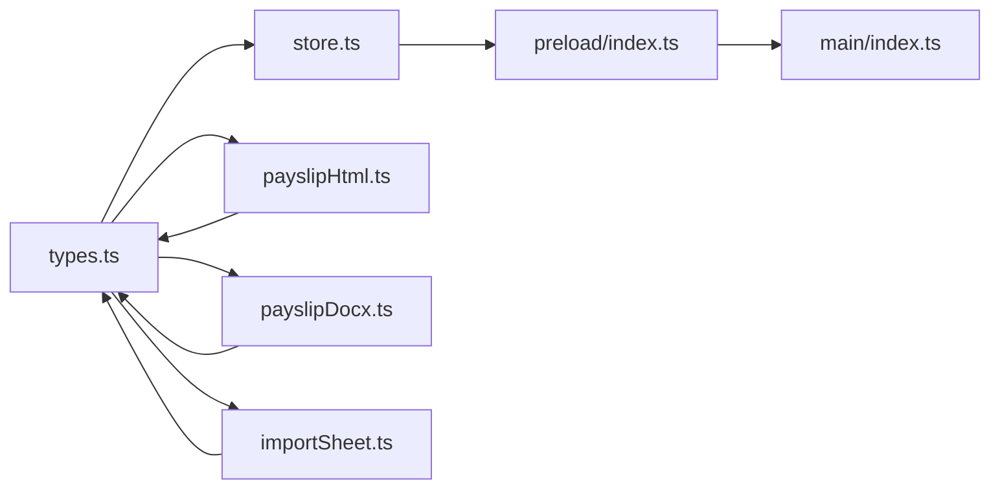

# API Reference

<cite>
**Referenced Files in This Document**   
- [src/main/index.ts](file://src/main/index.ts)
- [src/preload/index.ts](file://src/preload/index.ts)
- [src/renderer/src/types.ts](file://src/renderer/src/types.ts)
- [src/renderer/src/lib/store.ts](file://src/renderer/src/lib/store.ts)
- [src/renderer/src/lib/payslipHtml.ts](file://src/renderer/src/lib/payslipHtml.ts)
- [src/renderer/src/lib/payslipDocx.ts](file://src/renderer/src/lib/payslipDocx.ts)
- [src/renderer/src/lib/importSheet.ts](file://src/renderer/src/lib/importSheet.ts)
- [src/renderer/src/lib/binary.ts](file://src/renderer/src/lib/binary.ts)
- [package.json](file://package.json)
</cite>

## Table of Contents
1. [Introduction](#introduction)
2. [Project Structure](#project-structure)
3. [Core Components](#core-components)
4. [Architecture Overview](#architecture-overview)
5. [Detailed Component Analysis](#detailed-component-analysis)
6. [Dependency Analysis](#dependency-analysis)
7. [Performance Considerations](#performance-considerations)
8. [Troubleshooting Guide](#troubleshooting-guide)
9. [Conclusion](#conclusion)

## Introduction
This document provides a comprehensive API reference for the Mabtech Payslip Generator’s inter-process communication (IPC) interfaces and renderer-side utility functions. It covers:
- IPC methods exposed to the renderer process for database operations, file system access, dialog management, and window control.
- Method signatures, parameters, return values, and error handling patterns.
- Examples of calling main process functions from the renderer process, including asynchronous operation handling and security context usage.
- Renderer-side utilities for calculations, formatting, data import/export, and validation.
- Protocol-specific details for message passing, event handling, and state synchronization between Electron processes.

The application is an offline desktop app built with Electron, using a secure preload bridge to expose a minimal API surface to the renderer process.

## Project Structure
At a high level:
- The main process implements IPC handlers for persistence, file dialogs, PDF generation, and shell integration.
- The preload script exposes a typed API object to the renderer via `contextBridge`.
- The renderer uses this API to load/save application state, open spreadsheets, export PDFs/DOCX, and manage user interactions.
- Renderer libraries provide calculation helpers, HTML/DOCX payslip builders, spreadsheet parsing, and binary conversion utilities.

**Diagram sources**
- [src/main/index.ts:1-200](file://src/main/index.ts#L1-L200)
- [src/preload/index.ts:1-25](file://src/preload/index.ts#L1-L25)
- [src/renderer/src/lib/store.ts:1-33](file://src/renderer/src/lib/store.ts#L1-L33)
- [src/renderer/src/types.ts:1-61](file://src/renderer/src/types.ts#L1-L61)
- [src/renderer/src/lib/payslipHtml.ts:1-164](file://src/renderer/src/lib/payslipHtml.ts#L1-L164)
- [src/renderer/src/lib/payslipDocx.ts:1-130](file://src/renderer/src/lib/payslipDocx.ts#L1-L130)
- [src/renderer/src/lib/importSheet.ts:1-87](file://src/renderer/src/lib/importSheet.ts#L1-L87)
- [src/renderer/src/lib/binary.ts:1-17](file://src/renderer/src/lib/binary.ts#L1-L17)

**Section sources**
- [src/main/index.ts:1-200](file://src/main/index.ts#L1-L200)
- [src/preload/index.ts:1-25](file://src/preload/index.ts#L1-L25)
- [package.json:1-59](file://package.json#L1-L59)

## Core Components
- Main process IPC handlers:
  - Database read/write and backup import/export.
  - File system access through native dialogs.
  - PDF rendering pipeline and bulk export.
  - Shell integration for opening folders and showing items.
- Preload bridge:
  - Exposes a safe API object to the renderer via `contextBridge.exposeInMainWorld('api', api)`.
- Renderer utilities:
  - State store for loading/saving DB and managing month sheets.
  - Payslip HTML builder with amount-in-words and INR formatting.
  - DOCX builder for printable documents.
  - Spreadsheet parser with flexible header mapping.
  - Binary conversion helpers.

**Section sources**
- [src/main/index.ts:91-195](file://src/main/index.ts#L91-L195)
- [src/preload/index.ts:3-22](file://src/preload/index.ts#L3-L22)
- [src/renderer/src/lib/store.ts:8-32](file://src/renderer/src/lib/store.ts#L8-L32)
- [src/renderer/src/lib/payslipHtml.ts:12-28](file://src/renderer/src/lib/payslipHtml.ts#L12-L28)
- [src/renderer/src/lib/payslipDocx.ts:50-129](file://src/renderer/src/lib/payslipDocx.ts#L50-L129)
- [src/renderer/src/lib/importSheet.ts:41-80](file://src/renderer/src/lib/importSheet.ts#L41-L80)
- [src/renderer/src/lib/binary.ts:1-16](file://src/renderer/src/lib/binary.ts#L1-L16)

## Architecture Overview
The renderer calls into the preload API, which forwards messages to the main process over IPC. The main process performs privileged operations (file I/O, dialogs, PDF generation) and returns results back to the renderer.

**Diagram sources**
- [src/preload/index.ts:4-19](file://src/preload/index.ts#L4-L19)
- [src/main/index.ts:95-186](file://src/main/index.ts#L95-L186)

## Detailed Component Analysis

### IPC API Surface (Renderer → Main)
The preload script exposes the following methods to the renderer via `window.api`:

- Database operations
  - `readData()`: Promise resolving to `{ sheets: MonthSheet[], settings: Settings }`.
  - `writeData(data: Db)`: Promise resolving to boolean indicating success.
  - `exportBackup()`: Promise resolving to saved file path or null if canceled.
  - `importBackup()`: Promise resolving to updated Db or null if canceled; throws on invalid backup structure.

- File system access
  - `openSpreadsheet()`: Promise resolving to `{ name: string; data: string }` where data is base64-encoded spreadsheet content, or null if canceled.
  - `saveFile(payload: { name: string; base64: string; filters?: ... })`: Promise resolving to saved file path or null if canceled.
  - `pickFolder()`: Promise resolving to selected folder path or null if canceled.

- Payslip export
  - `renderPdf(payload: { fileName: string; html: string })`: Promise resolving to saved PDF path or null if canceled.
  - `bulkExport(jobs: { fileName: string; html: string }[])`: Promise resolving to `{ folder: string; count: number }` or null if canceled.

- Application utilities
  - `paths()`: Promise resolving to `{ dataFile: string; folder: string }`.
  - `openDataFolder()`: Promise resolving to void (opens data directory).
  - `showItem(p: string)`: Promise resolving to void (shows item in file explorer).
  - `logo()`: Promise resolving to data URL string for embedded logo image.

Error handling patterns:
- Most methods return null when the user cancels a dialog.
- Import backup validates JSON structure and throws an error if not a valid backup.
- All IPC calls are asynchronous; callers should handle rejections and null returns appropriately.

Example call pattern from renderer:
- Load database:
  - Call `window.api.readData()` and await result.
  - Use returned Db to populate UI state.
- Open spreadsheet:
  - Call `window.api.openSpreadsheet()` and await result.
  - If non-null, parse base64 content with spreadsheet library.
- Export single PDF:
  - Build HTML via renderer utility, then call `window.api.renderPdf({ fileName, html })`.
  - Await path; if null, user canceled.

Security context:
- The preload bridge is the only way for the renderer to access main process capabilities.
- Direct Node.js APIs are not exposed to the renderer.
- The main process creates windows with sandbox disabled for the app window but uses offscreen BrowserWindow for PDF rendering.

**Section sources**
- [src/preload/index.ts:3-22](file://src/preload/index.ts#L3-L22)
- [src/main/index.ts:95-189](file://src/main/index.ts#L95-L189)

### Database Persistence API
Main process implementation:
- Reads/writes a JSON file under the app’s userData directory.
- Uses atomic writes by writing to a temporary file and renaming it.
- Provides backup import/export via native save/open dialogs.

Data model:
- Db: `{ sheets: MonthSheet[], settings: Settings }`.
- MonthSheet: `{ period: string; workingDays: number; rows: SalaryRow[] }`.
- SalaryRow: fields include employee identifiers, salary components, and leave balances.
- Settings: company metadata, bank details, footer text, signatory.

Renderer store:
- `loadDb()`: Loads Db from main process and merges defaults for settings.
- `saveDb(db)`: Persists Db to main process.
- `findSheet(db, period)`: Returns existing sheet or default sheet for period.
- `upsertSheet(db, sheet)`: Inserts or updates sheet and sorts by period.

Validation and defaults:
- Default settings are merged into loaded settings.
- Sheets without matching period are created with default working days and empty rows.

**Section sources**
- [src/main/index.ts:22-41](file://src/main/index.ts#L22-L41)
- [src/main/index.ts:95-125](file://src/main/index.ts#L95-L125)
- [src/renderer/src/types.ts:1-38](file://src/renderer/src/types.ts#L1-L38)
- [src/renderer/src/lib/store.ts:8-32](file://src/renderer/src/lib/store.ts#L8-L32)

### File System Access API
Methods:
- `openSpreadsheet()`: Opens native dialog filtering xlsx/xls/csv, reads file into base64, returns filename and base64 content.
- `saveFile(payload)`: Opens save dialog with optional filters, writes base64-decoded buffer to disk.
- `pickFolder()`: Opens directory selection dialog allowing creation of new directories.

Error handling:
- Returns null on cancel.
- For `saveFile`, ensures filters default to PDF if none provided.

Usage example:
- After importing a spreadsheet, convert bytes to base64 using renderer utility and pass to `saveFile`.

**Section sources**
- [src/main/index.ts:127-154](file://src/main/index.ts#L127-L154)
- [src/renderer/src/lib/binary.ts:1-16](file://src/renderer/src/lib/binary.ts#L1-L16)

### Payslip Rendering and Export API
Single PDF export:
- `renderPdf(payload)`: Renders HTML to PDF using an offscreen BrowserWindow, prompts for save location, writes PDF buffer.

Bulk export:
- `bulkExport(jobs)`: Iterates jobs, renders each HTML to PDF, writes to a timestamped folder, opens folder in shell.

HTML generation:
- Renderer utility builds HTML with earnings/deductions tables, net payable/recoverable logic, amount in words, and company branding.

DOCX generation:
- Renderer utility builds a formatted DOCX document with tables, headers, and signature lines.

Error handling:
- Both export methods return null if user cancels dialog.
- Bulk export returns folder path and count of written files.

**Diagram sources**
- [src/main/index.ts:156-174](file://src/main/index.ts#L156-L174)

**Section sources**
- [src/main/index.ts:45-61](file://src/main/index.ts#L45-L61)
- [src/main/index.ts:176-186](file://src/main/index.ts#L176-L186)
- [src/renderer/src/lib/payslipHtml.ts:41-164](file://src/renderer/src/lib/payslipHtml.ts#L41-L164)
- [src/renderer/src/lib/payslipDocx.ts:50-129](file://src/renderer/src/lib/payslipDocx.ts#L50-L129)

### Utility Functions

#### Calculations and Formatting
- `grossOf(row)`: Computes gross pay as salary + overtime - bankAdvance - cashAdvance.
- `amountInWords(amount)`: Converts numeric amount to words in Indian numbering format (Crore/Lakh/Thousand), returning “Zero Rupees Only” for zero.
- `inr(n)`: Formats number as INR currency string with two decimal places.
- `periodLabel(period)`: Converts YYYY-MM to human-readable month/year label.

These are used across HTML and DOCX payslip builders to ensure consistent presentation.

**Section sources**
- [src/renderer/src/types.ts:52-60](file://src/renderer/src/types.ts#L52-L60)
- [src/renderer/src/lib/payslipHtml.ts:12-28](file://src/renderer/src/lib/payslipHtml.ts#L12-L28)

#### Data Validation and Import
- `parseSalaryWorkbook(base64)`: Parses XLSX workbook into normalized SalaryRow array, skipping invalid rows and counting skipped entries.
  - Header mapping supports multiple aliases for each field.
  - Ignores columns containing reserved keywords like gross/total/net/payable.
  - Numeric fields are parsed robustly, ignoring non-numeric characters.
- `rowsToCsv(rows)`: Exports SalaryRow array to CSV string with standard headers.

Validation rules:
- Rows without a name are skipped.
- Empty rows are ignored.
- Duplicate mapped columns are deduplicated.

**Section sources**
- [src/renderer/src/lib/importSheet.ts:4-37](file://src/renderer/src/lib/importSheet.ts#L4-L37)
- [src/renderer/src/lib/importSheet.ts:41-80](file://src/renderer/src/lib/importSheet.ts#L41-L80)
- [src/renderer/src/lib/importSheet.ts:82-86](file://src/renderer/src/lib/importSheet.ts#L82-L86)

#### Binary Conversion
- `bytesToBase64(bytes)`: Converts Uint8Array to base64 string.
- `dataUrlToBytes(dataUrl)`: Extracts base64 portion from data URL and converts to Uint8Array.

Used to bridge between renderer binary buffers and main process file I/O.

**Section sources**
- [src/renderer/src/lib/binary.ts:1-16](file://src/renderer/src/lib/binary.ts#L1-L16)

### Window Control and Shell Integration
- `app:paths`: Returns paths for data storage.
- `app:openDataFolder`: Opens data directory in file explorer.
- `app:showItem(p)`: Shows specific file/folder in file explorer.
- `app:logo`: Returns embedded logo data URL.

These methods allow the renderer to interact with the OS shell without direct filesystem access.

**Section sources**
- [src/main/index.ts:100-101](file://src/main/index.ts#L100-L101)
- [src/main/index.ts:188-189](file://src/main/index.ts#L188-L189)

## Dependency Analysis
Renderer dependencies:
- Types define core data structures shared across modules.
- Store depends on preload API for persistence.
- Payslip builders depend on types and formatting utilities.
- Import module depends on XLSX library and types.
- Binary utilities are independent helpers.

Main process dependencies:
- Electron APIs for IPC, dialogs, shell, and BrowserWindow.
- Node fs for file operations.
- Path utilities for constructing file paths.

**Diagram sources**
- [src/renderer/src/types.ts:1-61](file://src/renderer/src/types.ts#L1-L61)
- [src/renderer/src/lib/store.ts:1-33](file://src/renderer/src/lib/store.ts#L1-L33)
- [src/renderer/src/lib/payslipHtml.ts:1-164](file://src/renderer/src/lib/payslipHtml.ts#L1-L164)
- [src/renderer/src/lib/payslipDocx.ts:1-130](file://src/renderer/src/lib/payslipDocx.ts#L1-L130)
- [src/renderer/src/lib/importSheet.ts:1-87](file://src/renderer/src/lib/importSheet.ts#L1-L87)
- [src/preload/index.ts:1-25](file://src/preload/index.ts#L1-L25)
- [src/main/index.ts:1-200](file://src/main/index.ts#L1-L200)

**Section sources**
- [src/renderer/src/types.ts:1-61](file://src/renderer/src/types.ts#L1-L61)
- [src/renderer/src/lib/store.ts:1-33](file://src/renderer/src/lib/store.ts#L1-L33)
- [src/preload/index.ts:1-25](file://src/preload/index.ts#L1-L25)
- [src/main/index.ts:1-200](file://src/main/index.ts#L1-L200)

## Performance Considerations
- PDF rendering uses an offscreen BrowserWindow per render; avoid excessive concurrent renders to prevent memory pressure.
- Bulk export writes files sequentially; consider batching large job sets and providing progress feedback in the renderer.
- Atomic file writes reduce corruption risk during crashes.
- Spreadsheet parsing operates on base64 strings; ensure efficient decoding and minimal intermediate allocations.

[No sources needed since this section provides general guidance]

## Troubleshooting Guide
Common issues and resolutions:
- Backup import fails:
  - Ensure the JSON contains a `sheets` array; otherwise, an error is thrown.
- PDF export returns null:
  - User likely canceled the save dialog; handle null gracefully.
- Spreadsheet import yields no rows:
  - Verify headers match supported aliases; check that at least one row includes a name.
- Logo not displayed:
  - Confirm resource file exists; logo data URL will be empty if missing.

Error handling patterns:
- Always check for null returns from IPC methods that involve user dialogs.
- Wrap async calls in try/catch to handle unexpected errors from main process.

**Section sources**
- [src/main/index.ts:114-125](file://src/main/index.ts#L114-L125)
- [src/main/index.ts:127-154](file://src/main/index.ts#L127-L154)
- [src/renderer/src/lib/importSheet.ts:41-80](file://src/renderer/src/lib/importSheet.ts#L41-L80)

## Conclusion
The Mabtech Payslip Generator provides a secure, well-defined IPC interface between renderer and main processes. Renderer utilities encapsulate business logic for payslip generation, while the main process handles privileged operations such as file I/O, dialogs, and PDF rendering. By adhering to the documented API surface and error handling patterns, developers can extend functionality safely and maintain consistency across the application.

[No sources needed since this section summarizes without analyzing specific files]