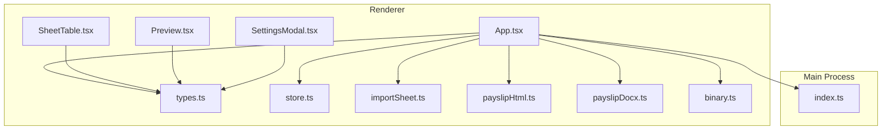
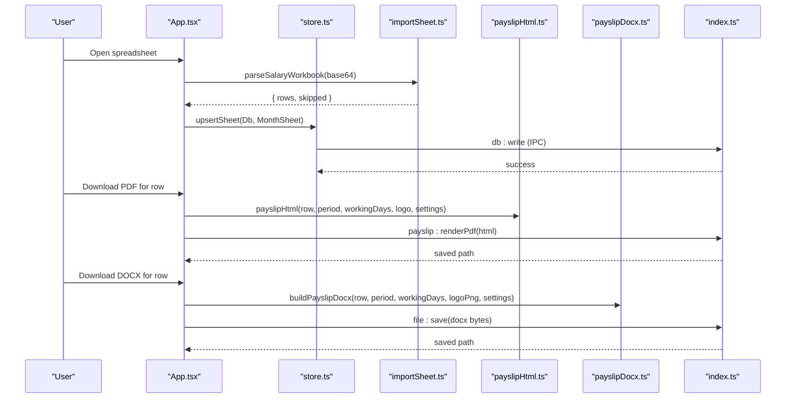
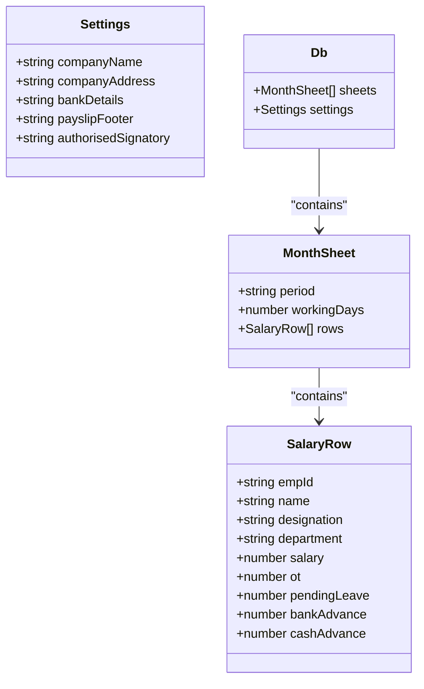
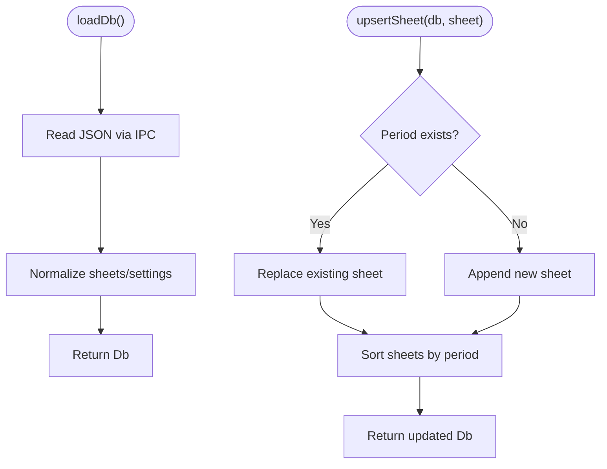
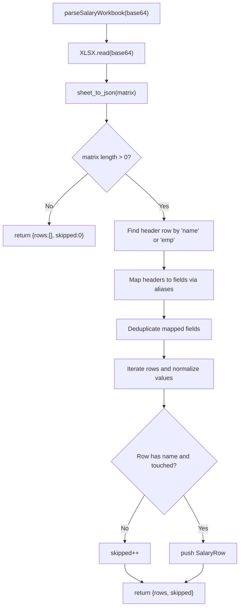
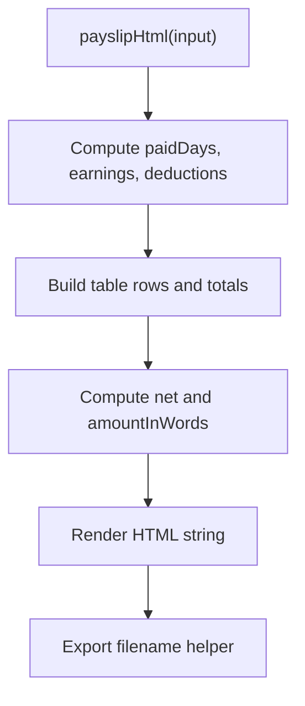
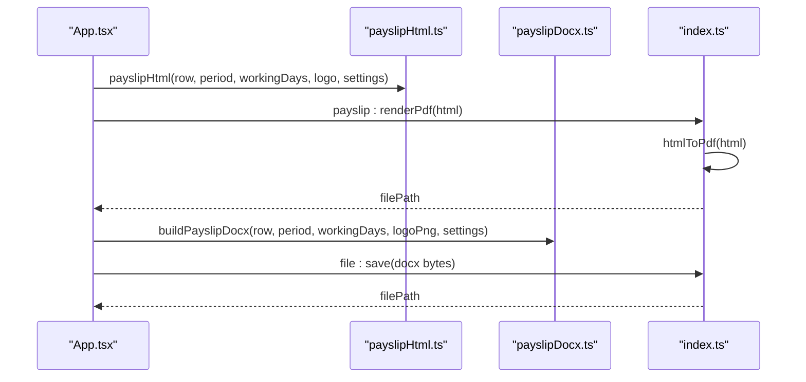
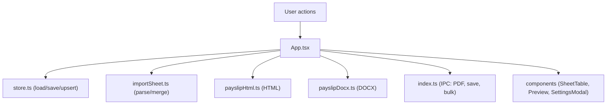
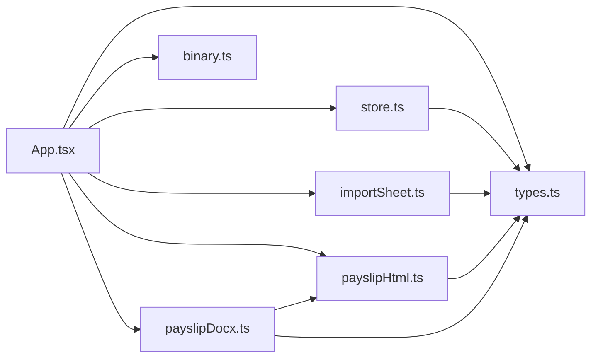

# Core Modules

<cite>
**Referenced Files in This Document**
- [types.ts](file://src/renderer/src/types.ts)
- [store.ts](file://src/renderer/src/lib/store.ts)
- [importSheet.ts](file://src/renderer/src/lib/importSheet.ts)
- [payslipHtml.ts](file://src/renderer/src/lib/payslipHtml.ts)
- [payslipDocx.ts](file://src/renderer/src/lib/payslipDocx.ts)
- [binary.ts](file://src/renderer/src/lib/binary.ts)
- [App.tsx](file://src/renderer/src/App.tsx)
- [Preview.tsx](file://src/renderer/src/components/Preview.tsx)
- [SettingsModal.tsx](file://src/renderer/src/components/SettingsModal.tsx)
- [SheetTable.tsx](file://src/renderer/src/components/SheetTable.tsx)
- [index.ts](file://src/main/index.ts)
- [README.md](file://README.md)
</cite>

## Table of Contents
1. [Introduction](#introduction)
2. [Project Structure](#project-structure)
3. [Core Components](#core-components)
4. [Architecture Overview](#architecture-overview)
5. [Detailed Component Analysis](#detailed-component-analysis)
6. [Dependency Analysis](#dependency-analysis)
7. [Performance Considerations](#performance-considerations)
8. [Troubleshooting Guide](#troubleshooting-guide)
9. [Conclusion](#conclusion)

## Introduction
This document explains the core modules of the Mabtech Payslip Generator: data persistence and state management, Excel/CSV import with intelligent field mapping, HTML template generation for professional payslips, and document generation supporting PDF and DOCX outputs. It covers module interfaces, data structures, processing pipelines, integration patterns, error handling, validation, and performance considerations. The application is an offline Electron + React desktop app that transforms raw employee salary data into formatted payslips without requiring a server or internet connection.

## Project Structure
The renderer layer contains the UI and business logic; the main process handles file I/O, PDF rendering, and IPC bridges. Key directories:
- src/renderer/src/lib: Core libraries (data store, import, HTML/DOCX generators, binary utilities)
- src/renderer/src/components: React components (table editor, preview, settings modal)
- src/main: Electron main process (IPC handlers, file dialogs, PDF export)
- src/renderer/src: App shell and types

**Diagram sources**
- [App.tsx:1-20](file://src/renderer/src/App.tsx#L1-L20)
- [index.ts:1-20](file://src/main/index.ts#L1-L20)

**Section sources**
- [README.md:1-16](file://README.md#L1-L16)
- [App.tsx:1-20](file://src/renderer/src/App.tsx#L1-L20)

## Core Components
- Data model and shared types define the shape of employee records, monthly sheets, settings, and database snapshot.
- Store module provides load/save and sheet operations over the persisted Db.
- Import module parses Excel/CSV files and maps headers to typed rows.
- HTML generator builds a styled, print-ready payslip page per employee.
- DOCX generator builds a Word document using docx primitives.
- Binary utilities convert between Uint8Array and base64/data URLs.
- Main process exposes IPC endpoints for file access, PDF rendering, and bulk export.

**Section sources**
- [types.ts:1-61](file://src/renderer/src/types.ts#L1-L61)
- [store.ts:1-33](file://src/renderer/src/lib/store.ts#L1-L33)
- [importSheet.ts:1-87](file://src/renderer/src/lib/importSheet.ts#L1-L87)
- [payslipHtml.ts:1-164](file://src/renderer/src/lib/payslipHtml.ts#L1-L164)
- [payslipDocx.ts:1-130](file://src/renderer/src/lib/payslipDocx.ts#L1-L130)
- [binary.ts:1-17](file://src/renderer/src/lib/binary.ts#L1-L17)
- [index.ts:1-200](file://src/main/index.ts#L1-L200)

## Architecture Overview
The renderer orchestrates user actions, updates the in-memory Db, persists changes, and renders payslips. The main process performs secure file operations and converts HTML to PDF.

**Diagram sources**
- [App.tsx:103-184](file://src/renderer/src/App.tsx#L103-L184)
- [store.ts:8-30](file://src/renderer/src/lib/store.ts#L8-L30)
- [importSheet.ts:41-80](file://src/renderer/src/lib/importSheet.ts#L41-L80)
- [payslipHtml.ts:41-164](file://src/renderer/src/lib/payslipHtml.ts#L41-L164)
- [payslipDocx.ts:50-129](file://src/renderer/src/lib/payslipDocx.ts#L50-L129)
- [index.ts:127-186](file://src/main/index.ts#L127-L186)

## Detailed Component Analysis

### Data Model and Shared Types
Defines the canonical shapes used across modules:
- SalaryRow: Employee record fields including identifiers, personal info, earnings, deductions, and leave days.
- MonthSheet: Aggregates rows for a given period plus working days.
- Settings: Company branding and footer/signatory text.
- Db: Top-level persistence unit containing sheets and settings.
- Helpers: emptyRow, grossOf, periodLabel.

Complexity: O(1) for helpers; grossOf is constant time.

**Diagram sources**
- [types.ts:1-61](file://src/renderer/src/types.ts#L1-L61)

**Section sources**
- [types.ts:1-61](file://src/renderer/src/types.ts#L1-L61)

### Data Store Module (Persistence and State Management)
Responsibilities:
- Load Db from persistent storage via IPC.
- Save Db back to disk atomically through IPC.
- Find or create a MonthSheet by period.
- Upsert a MonthSheet while preserving sort order.

Key behaviors:
- Merges default settings with loaded settings.
- Normalizes missing sheets to defaults.
- Debounced saves in the UI layer avoid excessive writes.

**Diagram sources**
- [store.ts:8-30](file://src/renderer/src/lib/store.ts#L8-L30)

**Section sources**
- [store.ts:1-33](file://src/renderer/src/lib/store.ts#L1-L33)
- [index.ts:27-41](file://src/main/index.ts#L27-L41)

### File Import System (Excel/CSV Parsing and Intelligent Field Mapping)
Responsibilities:
- Parse workbook content provided as base64.
- Detect header row intelligently.
- Map varied column names to canonical fields using aliases.
- Sanitize numeric values and skip invalid rows.
- Export rows to CSV for backup/export.

Processing pipeline:
- Read workbook and first sheet.
- Convert sheet to matrix.
- Identify header row by presence of key terms.
- Map each header to a known field or ignore it.
- Deduplicate mapped columns.
- Iterate rows, normalize values, validate presence of name, and collect valid rows.

**Diagram sources**
- [importSheet.ts:41-80](file://src/renderer/src/lib/importSheet.ts#L41-L80)

Validation and error handling:
- Numeric normalization coerces strings to numbers safely.
- Rows without a name are skipped.
- Ignored columns include computed totals and remarks.

Integration points:
- App imports files via IPC, passes base64 to parser, merges imported rows with existing ones, and persists the updated sheet immediately.

**Section sources**
- [importSheet.ts:1-87](file://src/renderer/src/lib/importSheet.ts#L1-L87)
- [App.tsx:103-136](file://src/renderer/src/App.tsx#L103-L136)

### HTML Template Engine (Professional Payslip Formatting)
Responsibilities:
- Generate a complete HTML document for a single employee’s payslip.
- Compute paid days, earnings, deductions, net pay, and amount in words.
- Render structured sections: header, metadata strip, earnings/deductions table, net line, amount-in-words, optional bank details, signature lines, and footer.
- Provide filename helper for consistent naming.

Key features:
- INR formatting and locale-aware number display.
- Escaping of user-provided text to prevent XSS in generated HTML.
- Negative net detection and visual distinction.

**Diagram sources**
- [payslipHtml.ts:41-164](file://src/renderer/src/lib/payslipHtml.ts#L41-L164)

**Section sources**
- [payslipHtml.ts:1-164](file://src/renderer/src/lib/payslipHtml.ts#L1-L164)

### Document Generation System (PDF and DOCX Output)
PDF output:
- Renderer calls main process to render HTML to PDF using an offscreen BrowserWindow.
- Main process loads HTML via data URL and prints to PDF with A4 sizing and zero margins.

DOCX output:
- Renderer constructs a docx Document programmatically with tables, headings, and styling.
- Uses shared helpers for amount formatting and words conversion.
- Converts logo data URL to bytes for embedding.

**Diagram sources**
- [App.tsx:141-160](file://src/renderer/src/App.tsx#L141-L160)
- [payslipHtml.ts:41-164](file://src/renderer/src/lib/payslipHtml.ts#L41-L164)
- [payslipDocx.ts:50-129](file://src/renderer/src/lib/payslipDocx.ts#L50-L129)
- [index.ts:45-61](file://src/main/index.ts#L45-L61)
- [index.ts:176-186](file://src/main/index.ts#L176-L186)

**Section sources**
- [index.ts:45-61](file://src/main/index.ts#L45-L61)
- [index.ts:176-186](file://src/main/index.ts#L176-L186)
- [payslipDocx.ts:1-130](file://src/renderer/src/lib/payslipDocx.ts#L1-L130)
- [binary.ts:1-17](file://src/renderer/src/lib/binary.ts#L1-L17)

### Application Orchestration and UI Integration
App.tsx coordinates:
- Loading and initializing Db and current period.
- Debounced persistence with a single write path to avoid race conditions.
- Importing spreadsheets, merging rows, and updating state.
- Generating HTML previews and exporting PDFs/DOCX.
- Bulk export of all employees’ payslips to a folder.
- Backup and restore of the entire Db.

UI components:
- SheetTable: Editable grid for SalaryRow entries with inline validation cues.
- Preview: Scaled iframe preview of generated HTML.
- SettingsModal: Editable company settings persisted to Db.

**Diagram sources**
- [App.tsx:13-200](file://src/renderer/src/App.tsx#L13-L200)
- [SheetTable.tsx:30-71](file://src/renderer/src/components/SheetTable.tsx#L30-L71)
- [Preview.tsx:5-29](file://src/renderer/src/components/Preview.tsx#L5-L29)
- [SettingsModal.tsx:11-43](file://src/renderer/src/components/SettingsModal.tsx#L11-L43)

**Section sources**
- [App.tsx:13-200](file://src/renderer/src/App.tsx#L13-L200)
- [SheetTable.tsx:1-71](file://src/renderer/src/components/SheetTable.tsx#L1-L71)
- [Preview.tsx:1-29](file://src/renderer/src/components/Preview.tsx#L1-L29)
- [SettingsModal.tsx:1-43](file://src/renderer/src/components/SettingsModal.tsx#L1-L43)

## Dependency Analysis
High-level dependencies:
- App depends on store, importSheet, payslipHtml, payslipDocx, binary, and types.
- Main process depends on Electron APIs and fs/path.
- HTML and DOCX generators depend on types and shared helpers.

**Diagram sources**
- [App.tsx:1-11](file://src/renderer/src/App.tsx#L1-L11)
- [store.ts:1-2](file://src/renderer/src/lib/store.ts#L1-L2)
- [importSheet.ts:1-2](file://src/renderer/src/lib/importSheet.ts#L1-L2)
- [payslipHtml.ts:1-1](file://src/renderer/src/lib/payslipHtml.ts#L1-L1)
- [payslipDocx.ts:1-6](file://src/renderer/src/lib/payslipDocx.ts#L1-L6)

**Section sources**
- [App.tsx:1-11](file://src/renderer/src/App.tsx#L1-L11)
- [payslipDocx.ts:1-6](file://src/renderer/src/lib/payslipDocx.ts#L1-L6)

## Performance Considerations
- Debounced persistence: App.tsx batches writes with a short timeout to reduce disk I/O during rapid edits.
- Single write path: Mutations update a ref-backed current state before setting React state to avoid stale closures and clobbering.
- Efficient parsing: importSheet uses XLSX utilities and early exits for empty matrices; numeric normalization avoids repeated parsing overhead.
- Minimal DOM work: Preview scales an iframe rather than re-rendering heavy content repeatedly.
- Bulk PDF export: Main process writes each PDF sequentially to avoid memory spikes; consider batching or streaming for very large datasets.

[No sources needed since this section provides general guidance]

## Troubleshooting Guide
Common issues and resolutions:
- No rows imported: Ensure headers include recognizable terms like EMP ID and NAME. The importer skips rows without a name.
- Incorrect mappings: Verify column names match supported aliases; ignored columns include total/gross/net/payable.
- Negative net payable: Advances exceed earnings; correct values or carry forward adjustments.
- Missing employee code: Rows without empId trigger warnings; add codes before export.
- PDF not saving: Check file dialog permissions and target folder availability.
- Logo not appearing: Confirm resource file exists at expected path; otherwise fallback to company name.

Operational notes:
- Data location: Database stored under app-specific data directory; use Backup/Restore to move data between machines.
- Bulk export: Creates a dated folder with one PDF per employee.

**Section sources**
- [importSheet.ts:16-31](file://src/renderer/src/lib/importSheet.ts#L16-L31)
- [importSheet.ts:59-79](file://src/renderer/src/lib/importSheet.ts#L59-L79)
- [App.tsx:237-248](file://src/renderer/src/App.tsx#L237-L248)
- [index.ts:103-125](file://src/main/index.ts#L103-L125)
- [index.ts:156-174](file://src/main/index.ts#L156-L174)
- [README.md:7-15](file://README.md#L7-L15)

## Conclusion
The Mabtech Payslip Generator cleanly separates concerns across modules: a typed data model, a robust store for persistence, an intelligent import pipeline, a professional HTML template engine, and dual output generators for PDF and DOCX. The renderer orchestrates workflows while delegating system-level tasks to the main process. Together, these modules provide a reliable, offline solution for transforming raw salary data into polished payslips with strong validation, clear error handling, and practical performance optimizations.