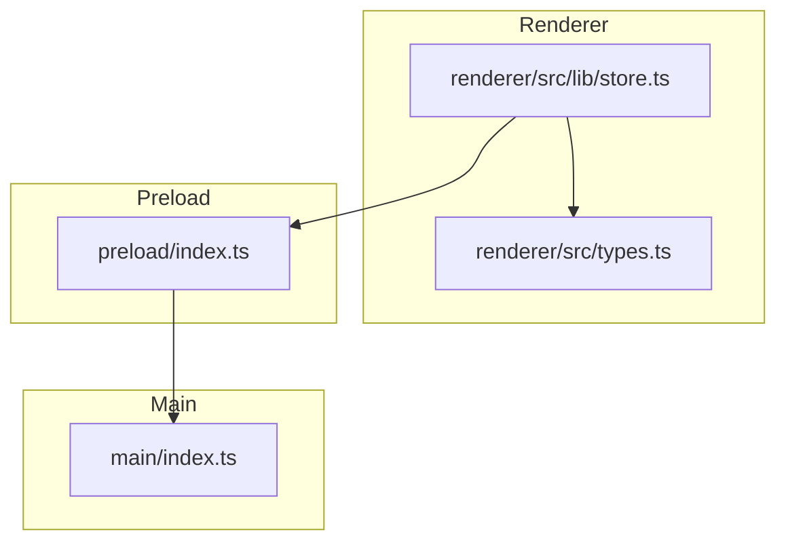
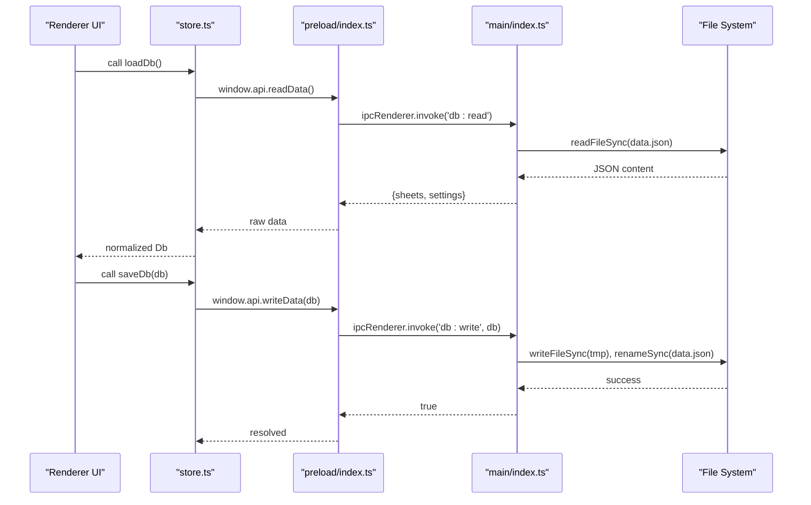
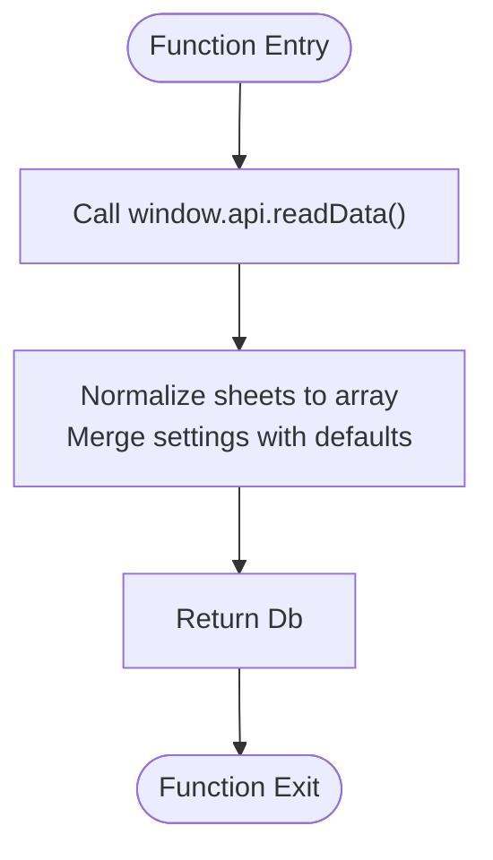
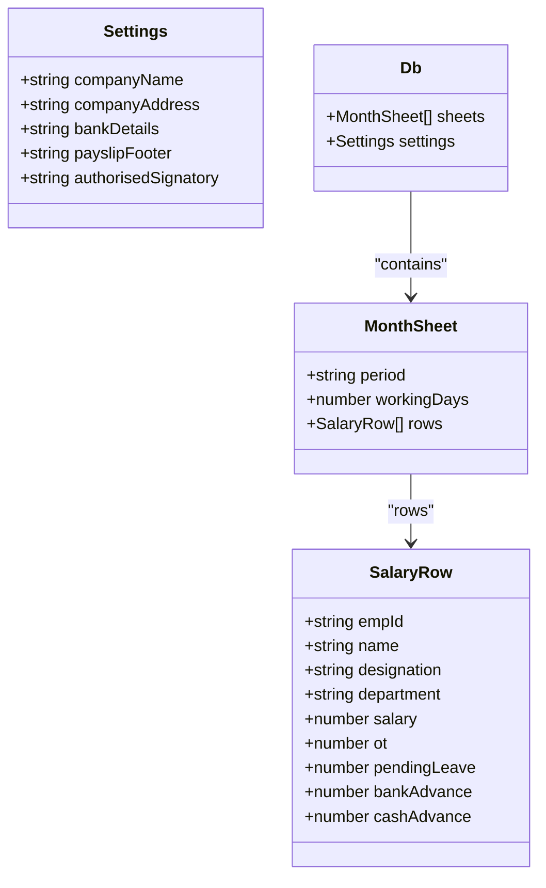
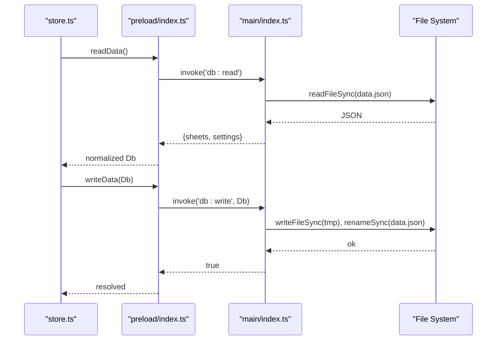
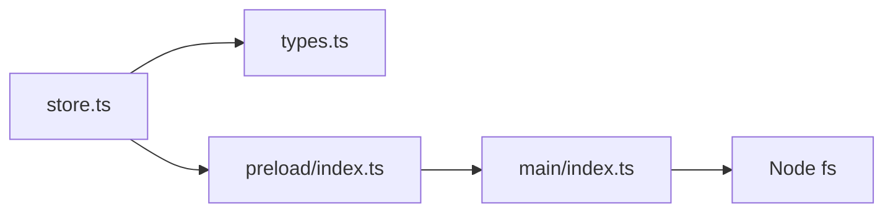

# Data Store Module

<cite>
**Referenced Files in This Document**
- [store.ts](file://src/renderer/src/lib/store.ts)
- [types.ts](file://src/renderer/src/types.ts)
- [preload/index.ts](file://src/preload/index.ts)
- [main/index.ts](file://src/main/index.ts)
</cite>

## Table of Contents
1. [Introduction](#introduction)
2. [Project Structure](#project-structure)
3. [Core Components](#core-components)
4. [Architecture Overview](#architecture-overview)
5. [Detailed Component Analysis](#detailed-component-analysis)
6. [Dependency Analysis](#dependency-analysis)
7. [Performance Considerations](#performance-considerations)
8. [Troubleshooting Guide](#troubleshooting-guide)
9. [Conclusion](#conclusion)

## Introduction
This document explains the Data Store Module responsible for application state management and data persistence. It covers:
- Database load and save operations via IPC communication between the renderer and Electron main process
- Period-based employee sheet retrieval with findSheet()
- Creating or updating monthly sheets with upsertSheet()
- The MonthSheet structure and period management logic
- Integration points with the file system through the main process
- Examples of CRUD operations, error handling patterns, and performance considerations for large datasets

## Project Structure
The Data Store Module spans three layers:
- Renderer layer: business logic for loading, saving, finding, and upserting sheets
- Preload bridge: exposes a safe API to the renderer over IPC
- Main process: performs secure file system operations and IPC handlers



**Diagram sources**
- [store.ts:1-33](file://src/renderer/src/lib/store.ts#L1-L33)
- [types.ts:13-30](file://src/renderer/src/types.ts#L13-L30)
- [preload/index.ts:1-25](file://src/preload/index.ts#L1-L25)
- [main/index.ts:91-125](file://src/main/index.ts#L91-L125)

**Section sources**
- [store.ts:1-33](file://src/renderer/src/lib/store.ts#L1-L33)
- [types.ts:13-30](file://src/renderer/src/types.ts#L13-L30)
- [preload/index.ts:1-25](file://src/preload/index.ts#L1-L25)
- [main/index.ts:91-125](file://src/main/index.ts#L91-L125)

## Core Components
- Db and MonthSheet types define the persisted shape and per-month employee rows
- store.ts provides:
  - loadDb(): loads database from disk via IPC
  - saveDb(): persists database to disk via IPC
  - findSheet(): retrieves or creates a default sheet for a given period
  - upsertSheet(): inserts or updates a sheet by period
  - defaultPeriod(): returns current year-month as a string key

Key responsibilities:
- Normalize and validate loaded data
- Manage period keys (YYYY-MM)
- Maintain sorted order of sheets by period
- Provide safe defaults when data is missing

**Section sources**
- [types.ts:13-30](file://src/renderer/src/types.ts#L13-L30)
- [store.ts:3-32](file://src/renderer/src/lib/store.ts#L3-L32)

## Architecture Overview
The Data Store Module uses a layered architecture:
- Renderer calls window.api methods exposed by preload
- Preload forwards calls to main process IPC channels
- Main reads/writes JSON files under the app’s userData directory



**Diagram sources**
- [store.ts:8-18](file://src/renderer/src/lib/store.ts#L8-L18)
- [preload/index.ts:3-5](file://src/preload/index.ts#L3-L5)
- [main/index.ts:27-41](file://src/main/index.ts#L27-L41)
- [main/index.ts:95-99](file://src/main/index.ts#L95-L99)

## Detailed Component Analysis

### Database Load and Save via IPC
- loadDb()
  - Invokes window.api.readData()
  - Normalizes sheets to an array and merges settings with defaults
  - Returns a validated Db object
- saveDb()
  - Invokes window.api.writeData(db)
  - Main writes atomically using a temp file and rename

IPC channels:
- 'db:read' returns {sheets, settings}
- 'db:write' accepts Db and persists it

Error handling:
- Main read catches parse errors and returns empty data
- Write ensures directory exists and uses atomic rename



**Diagram sources**
- [store.ts:8-14](file://src/renderer/src/lib/store.ts#L8-L14)
- [main/index.ts:27-34](file://src/main/index.ts#L27-L34)

**Section sources**
- [store.ts:8-18](file://src/renderer/src/lib/store.ts#L8-L18)
- [preload/index.ts:3-5](file://src/preload/index.ts#L3-L5)
- [main/index.ts:27-41](file://src/main/index.ts#L27-L41)
- [main/index.ts:95-99](file://src/main/index.ts#L95-L99)

### Period-Based Sheet Retrieval: findSheet()
- Purpose: Retrieve a sheet for a specific period; if not found, return a default sheet with the requested period, default working days, and empty rows
- Behavior:
  - Searches db.sheets by period equality
  - Falls back to a default sheet when missing

Complexity: O(n) where n is number of sheets

```mermaid
flowchart TD
Start([findSheet(db, period)]) --> Search["Find sheet by period"]
Search --> Found{"Found?"}
Found --> |Yes| ReturnSheet["Return existing sheet"]
Found --> |No| Default["Create default sheet with period,<br/>workingDays=26, rows=[]"]
Default --> ReturnDefault["Return default sheet"]
ReturnSheet --> End([Exit])
ReturnDefault --> End
```

**Diagram sources**
- [store.ts:20-22](file://src/renderer/src/lib/store.ts#L20-L22)

**Section sources**
- [store.ts:20-22](file://src/renderer/src/lib/store.ts#L20-L22)

### Upserting Monthly Sheets: upsertSheet()
- Purpose: Insert a new sheet or update an existing one based on period
- Behavior:
  - Checks if a sheet with the same period exists
  - If exists: replaces that sheet
  - If not exists: appends the new sheet and sorts all sheets by period lexicographically

Complexity: O(n) for existence check and mapping/sorting

```mermaid
flowchart TD
Start([upsertSheet(db, sheet)]) --> Exists{"Sheet with same period exists?"}
Exists --> |Yes| Replace["Map sheets and replace matching period"]
Exists --> |No| Append["Append new sheet then sort by period"]
Replace --> ReturnNewDb["Return updated Db"]
Append --> ReturnNewDb
ReturnNewDb --> End([Exit])
```

**Diagram sources**
- [store.ts:24-30](file://src/renderer/src/lib/store.ts#L24-L30)

**Section sources**
- [store.ts:24-30](file://src/renderer/src/lib/store.ts#L24-L30)

### MonthSheet Structure and Period Management
- MonthSheet fields:
  - period: string key in YYYY-MM format
  - workingDays: number used for payroll calculations
  - rows: array of SalaryRow entries
- Period utilities:
  - currentPeriod(): generates current year-month string
  - defaultPeriod: alias to currentPeriod
  - periodLabel(): converts period to human-readable label like "January 2025"



**Diagram sources**
- [types.ts:1-30](file://src/renderer/src/types.ts#L1-L30)

**Section sources**
- [types.ts:1-30](file://src/renderer/src/types.ts#L1-L30)
- [store.ts:3-6](file://src/renderer/src/lib/store.ts#L3-L6)
- [store.ts:32-32](file://src/renderer/src/lib/store.ts#L32-L32)
- [types.ts:55-60](file://src/renderer/src/types.ts#L55-L60)

### IPC Bridge and File System Integration
- Preload exposes:
  - readData() -> 'db:read'
  - writeData(data) -> 'db:write'
- Main handles:
  - 'db:read': reads JSON file and returns {sheets, settings}
  - 'db:write': writes JSON atomically using a temporary file and rename
  - Additional helpers for backup import/export and file dialogs



**Diagram sources**
- [preload/index.ts:3-5](file://src/preload/index.ts#L3-L5)
- [main/index.ts:95-99](file://src/main/index.ts#L95-L99)
- [main/index.ts:27-41](file://src/main/index.ts#L27-L41)

**Section sources**
- [preload/index.ts:3-5](file://src/preload/index.ts#L3-L5)
- [main/index.ts:95-99](file://src/main/index.ts#L95-L99)
- [main/index.ts:27-41](file://src/main/index.ts#L27-L41)

## Dependency Analysis
- Renderer store depends on:
  - Types for data shapes
  - Preload API for IPC
- Preload depends on:
  - Electron contextBridge and ipcRenderer
- Main depends on:
  - Electron APIs for IPC, dialogs, shell
  - Node fs for file operations



**Diagram sources**
- [store.ts:1-33](file://src/renderer/src/lib/store.ts#L1-L33)
- [types.ts:1-30](file://src/renderer/src/types.ts#L1-L30)
- [preload/index.ts:1-25](file://src/preload/index.ts#L1-L25)
- [main/index.ts:1-5](file://src/main/index.ts#L1-L5)

**Section sources**
- [store.ts:1-33](file://src/renderer/src/lib/store.ts#L1-L33)
- [types.ts:1-30](file://src/renderer/src/types.ts#L1-L30)
- [preload/index.ts:1-25](file://src/preload/index.ts#L1-L25)
- [main/index.ts:1-5](file://src/main/index.ts#L1-L5)

## Performance Considerations
- findSheet()
  - Time complexity: O(n) due to linear search by period
  - Optimization opportunity: index sheets by period for O(1) lookup if dataset grows large
- upsertSheet()
  - Time complexity: O(n) for existence check and map/sort
  - Optimization opportunity: maintain a Map<period, sheet> alongside arrays for faster lookups and updates
- Sorting by period
  - Lexicographic sort works correctly for YYYY-MM strings but can be optimized with numeric comparison if needed
- I/O operations
  - Atomic write pattern reduces corruption risk
  - For very large datasets, consider chunked writes or streaming to reduce memory pressure
- Rendering PDFs
  - Bulk export spawns offscreen BrowserWindow instances; ensure resource cleanup and avoid concurrent heavy workloads

[No sources needed since this section provides general guidance]

## Troubleshooting Guide
Common issues and resolutions:
- Corrupted or invalid database file
  - Main read catches JSON parse errors and returns empty data; verify file integrity and restore from backup
- Missing settings
  - Defaults are merged into settings; ensure settings schema matches expected fields
- Backup import failures
  - Import validates sheets array; ensure backup file contains valid structure before importing
- File permission errors
  - Ensure user has write access to userData directory; use provided dialog helpers to open folder or show item

Operational tips:
- Use export/import backup features to safeguard data
- Validate period strings (YYYY-MM) before creating/updating sheets
- Monitor memory usage during bulk PDF exports

**Section sources**
- [main/index.ts:27-34](file://src/main/index.ts#L27-L34)
- [main/index.ts:114-125](file://src/main/index.ts#L114-L125)

## Conclusion
The Data Store Module provides a clear separation of concerns across renderer, preload, and main layers. It offers robust load/save operations via IPC, safe defaults, and straightforward CRUD operations for monthly sheets. With careful attention to scaling lookups and sorting, and leveraging atomic file writes, the module remains reliable and maintainable.

[No sources needed since this section summarizes without analyzing specific files]