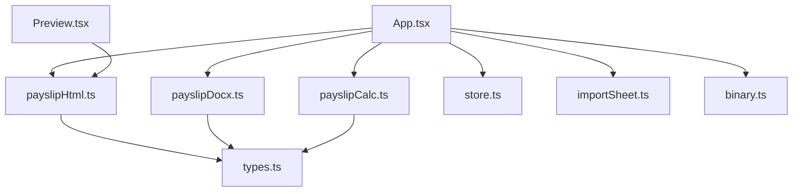
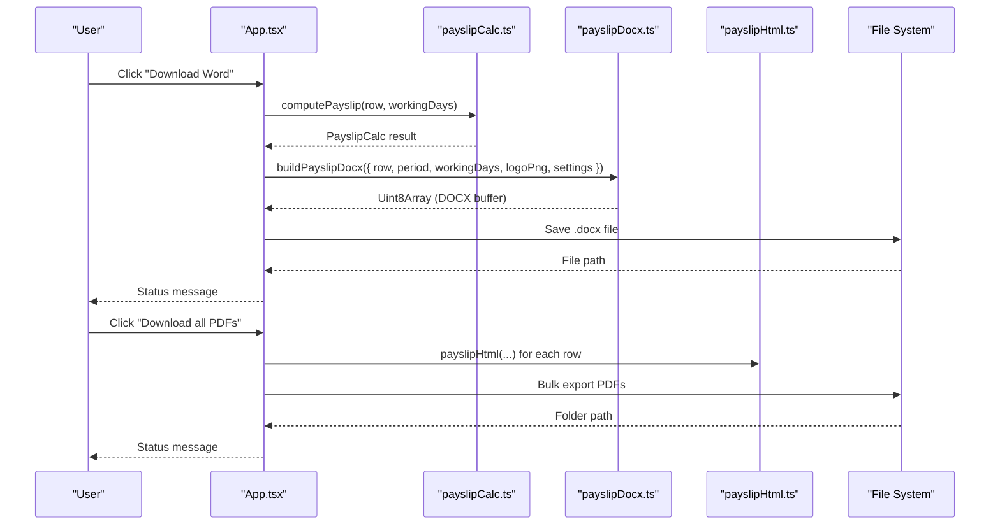
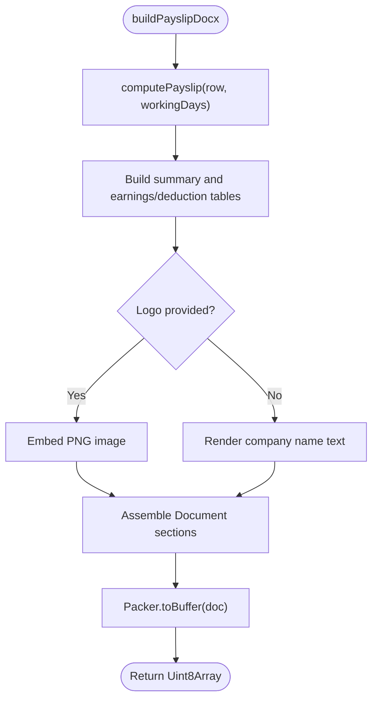
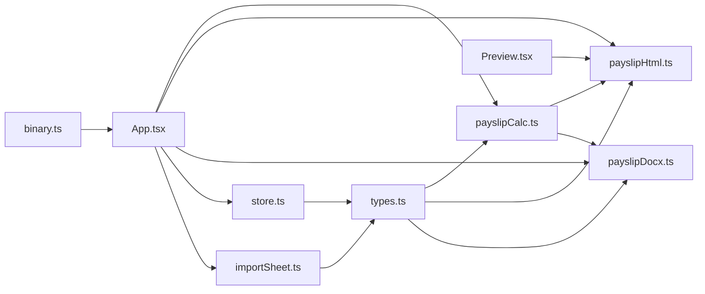

# Document Generation System

<cite>
**Referenced Files in This Document**
- [payslipDocx.ts](file://src/renderer/src/lib/payslipDocx.ts)
- [payslipHtml.ts](file://src/renderer/src/lib/payslipHtml.ts)
- [payslipCalc.ts](file://src/renderer/src/lib/payslipCalc.ts)
- [types.ts](file://src/renderer/src/types.ts)
- [store.ts](file://src/renderer/src/lib/store.ts)
- [importSheet.ts](file://src/renderer/src/lib/importSheet.ts)
- [binary.ts](file://src/renderer/src/lib/binary.ts)
- [App.tsx](file://src/renderer/src/App.tsx)
- [Preview.tsx](file://src/renderer/src/components/Preview.tsx)
- [README.md](file://README.md)
</cite>

## Table of Contents
1. [Introduction](#introduction)
2. [Project Structure](#project-structure)
3. [Core Components](#core-components)
4. [Architecture Overview](#architecture-overview)
5. [Detailed Component Analysis](#detailed-component-analysis)
6. [Dependency Analysis](#dependency-analysis)
7. [Performance Considerations](#performance-considerations)
8. [Troubleshooting Guide](#troubleshooting-guide)
9. [Conclusion](#conclusion)
10. [Appendices](#appendices)

## Introduction
This document explains the Document Generation System that creates professional DOCX payslips from structured payroll data. The system computes payslip components once, then renders them into two output formats: a Word document using the docx library and an HTML template for PDF rendering. It supports image embedding (company logo), table formatting, consistent styling, and batch processing for multiple employees. The design ensures that both outputs share the same calculation logic so they never diverge.

The application is an offline Electron + React desktop app that imports Excel or CSV salary sheets, previews payslips live, and exports one payslip per employee as PDF or Word. Data is stored locally on disk.

**Section sources**
- [README.md:1-71](file://README.md#L1-L71)

## Project Structure
The document generation pipeline lives primarily in the renderer layer:

- Calculation engine: [payslipCalc.ts](file://src/renderer/src/lib/payslipCalc.ts)
- Word generator: [payslipDocx.ts](file://src/renderer/src/lib/payslipDocx.ts)
- HTML generator (for PDF): [payslipHtml.ts](file://src/renderer/src/lib/payslipHtml.ts)
- Shared types and settings: [types.ts](file://src/renderer/src/types.ts)
- Data normalization and persistence helpers: [store.ts](file://src/renderer/src/lib/store.ts)
- Spreadsheet import and mapping: [importSheet.ts](file://src/renderer/src/lib/importSheet.ts)
- Binary utilities for images and file transfer: [binary.ts](file://src/renderer/src/lib/binary.ts)
- Main UI orchestration and export actions: [App.tsx](file://src/renderer/src/App.tsx)
- Preview component used by the UI: [Preview.tsx](file://src/renderer/src/components/Preview.tsx)

**Diagram sources**
- [App.tsx:1-289](file://src/renderer/src/App.tsx#L1-L289)
- [payslipCalc.ts:1-122](file://src/renderer/src/lib/payslipCalc.ts#L1-L122)
- [payslipDocx.ts:1-150](file://src/renderer/src/lib/payslipDocx.ts#L1-L150)
- [payslipHtml.ts:1-145](file://src/renderer/src/lib/payslipHtml.ts#L1-L145)
- [types.ts:1-117](file://src/renderer/src/types.ts#L1-L117)
- [store.ts:1-62](file://src/renderer/src/lib/store.ts#L1-L62)
- [importSheet.ts:1-134](file://src/renderer/src/lib/importSheet.ts#L1-L134)
- [binary.ts:1-17](file://src/renderer/src/lib/binary.ts#L1-L17)
- [Preview.tsx:1-29](file://src/renderer/src/components/Preview.tsx#L1-L29)

**Section sources**
- [App.tsx:1-289](file://src/renderer/src/App.tsx#L1-L289)
- [README.md:1-71](file://README.md#L1-L71)

## Core Components
- Payslip calculation engine: Computes earnings, deductions, net pay, paid days, and amount-in-words. Both Word and HTML renderers consume this single source of truth.
- Word document builder: Uses the docx library to construct sections, paragraphs, tables, cells, borders, shading, and embedded images.
- HTML template generator: Produces a styled HTML string for PDF rendering with identical content and totals.
- Data model and settings: Defines SalaryRow, MonthSheet, Settings, and default values.
- Spreadsheet importer: Maps flexible column headers to typed fields and sanitizes numeric values.
- Binary utilities: Convert between base64 and Uint8Array for image embedding and file saving.
- Application orchestrator: Wires import, preview, single-file export, and bulk export flows.

Key responsibilities:
- Single computation path prevents drift between PDF and Word outputs.
- Consistent table structure and styling across outputs.
- Safe handling of missing or legacy data through normalization.
- Batch export support for multiple employees.

**Section sources**
- [payslipCalc.ts:1-122](file://src/renderer/src/lib/payslipCalc.ts#L1-L122)
- [payslipDocx.ts:1-150](file://src/renderer/src/lib/payslipDocx.ts#L1-L150)
- [payslipHtml.ts:1-145](file://src/renderer/src/lib/payslipHtml.ts#L1-L145)
- [types.ts:1-117](file://src/renderer/src/types.ts#L1-L117)
- [importSheet.ts:1-134](file://src/renderer/src/lib/importSheet.ts#L1-L134)
- [binary.ts:1-17](file://src/renderer/src/lib/binary.ts#L1-L17)
- [App.tsx:1-289](file://src/renderer/src/App.tsx#L1-L289)

## Architecture Overview
The system follows a layered architecture:

- Presentation layer: React UI, preview iframe, and user actions.
- Orchestration layer: App coordinates data loading, import, preview, and export.
- Computation layer: Centralized payslip calculations.
- Rendering layer: Two parallel renderers (Word via docx; HTML for PDF).
- Data layer: Local JSON database with normalization and persistence helpers.

**Diagram sources**
- [App.tsx:141-173](file://src/renderer/src/App.tsx#L141-L173)
- [payslipCalc.ts:77-121](file://src/renderer/src/lib/payslipCalc.ts#L77-L121)
- [payslipDocx.ts:50-149](file://src/renderer/src/lib/payslipDocx.ts#L50-L149)
- [payslipHtml.ts:17-141](file://src/renderer/src/lib/payslipHtml.ts#L17-L141)

## Detailed Component Analysis

### Word Document Builder (DOCX)
The Word builder constructs a single-page A4 document with:
- Section margins and page layout
- Optional company logo image or company name header
- Title, period label, optional address
- Summary table with employee details and line items
- Earnings/Deductions table with aligned amounts and totals
- Net payable/recoverable line and amount-in-words
- Optional bank details and signature lines
- Footer text

It uses the docx library’s Document, Packer, Paragraph, TextRun, Table, TableRow, TableCell, WidthType, AlignmentType, BorderStyle, and ImageRun. Styling includes:
- Custom colors and fonts
- Cell shading for headers
- Controlled spacing and alignment
- Conditional footer and bank details blocks

Image embedding:
- Accepts a PNG byte array and embeds it at fixed dimensions.
- If no logo is provided, the company name is rendered as styled text.

Table formatting:
- Two primary tables: summary metadata and earnings/deductions breakdown.
- Header rows use shaded backgrounds and white text.
- Amount columns are right-aligned with tabular numbers.
- Borders are minimized for a clean look while preserving structure.

Template variable substitution:
- No external template files are used. Variables are substituted directly during construction from computed payslip data and settings.

Batch processing:
- The UI triggers single DOCX export per employee.
- Bulk PDF export is supported; DOCX bulk export can be added by iterating over rows similarly to the PDF flow.

Quality optimization techniques:
- Reuse shared calculation results to ensure consistency.
- Avoid unnecessary nested structures; keep tables flat and minimal.
- Use percentage widths for responsive table sizing within A4.
- Limit image size to reduce file size.

File size considerations:
- Embedding large logos increases DOCX size. Prefer small PNGs.
- Avoid embedding high-resolution images unless necessary.
- Keep text-based fallbacks for logos when possible.

Compatibility:
- DOCX generated via the docx library is compatible with modern Microsoft Word versions.
- For older Word versions, avoid advanced features not supported by those versions. The current implementation uses standard paragraph/table constructs.

**Diagram sources**
- [payslipDocx.ts:50-149](file://src/renderer/src/lib/payslipDocx.ts#L50-L149)
- [payslipCalc.ts:77-121](file://src/renderer/src/lib/payslipCalc.ts#L77-L121)

**Section sources**
- [payslipDocx.ts:1-150](file://src/renderer/src/lib/payslipDocx.ts#L1-L150)

### HTML Template Generator (PDF Path)
The HTML generator produces a self-contained HTML string with embedded CSS for PDF rendering. It mirrors the Word output structure:
- Header with logo or company name
- Period and address
- Employee metadata strip
- Earnings/Deductions table
- Net payable/recoverable and amount-in-words
- Optional bank details and signature lines
- Footer with generated date

Styling preservation:
- Uses consistent color palette and typography.
- Ensures A4 page size and margins for print/PDF.
- Aligns amounts and labels consistently.

Template variable substitution:
- Substitutes computed values and settings directly into HTML strings.

Batch processing:
- The UI generates HTML for each row and sends them to the backend for bulk PDF export.

Quality optimization techniques:
- Minimal DOM structure.
- Inline styles to avoid external dependencies.
- Tabular numbers for aligned currency values.

Compatibility:
- Designed for reliable PDF rendering via Electron’s PDF API.

**Section sources**
- [payslipHtml.ts:1-145](file://src/renderer/src/lib/payslipHtml.ts#L1-L145)

### Calculation Engine
The calculation engine centralizes payroll logic:
- Determines monthly salary label based on presence of salary vs basic-only sheets.
- Builds earnings lines and deduction lines, skipping zero values.
- Adds sub-lines for Basic/HRA/Other Allowance under Monthly Salary without double-counting.
- Computes total earnings, total deductions, net pay, negative flag, and paid days.
- Converts amounts to Indian Rupee format and English words.

Complex payroll handling:
- Supports overtime, commission, Sunday work, leave balance, advances, ESI, PF.
- Deductions are always positive reductions even if input contains negative signs.
- Handles legacy sheets where BASIC SALARY represents the full monthly pay.

Optimization:
- Single pass over field arrays to build lines and totals.
- Deterministic ordering based on defined field lists.

**Section sources**
- [payslipCalc.ts:1-122](file://src/renderer/src/lib/payslipCalc.ts#L1-L122)

### Data Model and Settings
Types define:
- SalaryRow: All payroll fields including earnings, deductions, and break-up components.
- MonthSheet: Period, working days, and rows.
- Settings: Company name, address, bank details, footer, authorized signatory.
- Defaults provide safe initial values.

Normalization:
- Store normalization fills missing keys with zeros and coerces types to prevent NaN propagation.
- Working days default to 26 if missing.

**Section sources**
- [types.ts:1-117](file://src/renderer/src/types.ts#L1-L117)
- [store.ts:1-62](file://src/renderer/src/lib/store.ts#L1-L62)

### Spreadsheet Importer
Importer capabilities:
- Flexible header mapping with aliases for common column names.
- Ignores computed columns like gross/total/net/payable.
- Detects unmapped and duplicate headers to prevent silent data loss.
- Sanitizes numeric values and enforces deduction semantics.
- Exports standardized CSV headers for re-import.

Error handling:
- Skips invalid rows lacking required identifiers.
- Reports skipped rows and unmapped columns.

**Section sources**
- [importSheet.ts:1-134](file://src/renderer/src/lib/importSheet.ts#L1-L134)

### Binary Utilities
Utilities handle:
- Base64 encoding for file saves.
- Decoding data URLs to byte arrays for image embedding.

These are essential for:
- Saving DOCX buffers returned by Packer.toBuffer.
- Embedding company logos into Word documents.

**Section sources**
- [binary.ts:1-17](file://src/renderer/src/lib/binary.ts#L1-L17)

### Application Orchestrator
App.tsx wires:
- Loading and normalizing local database.
- Managing periods and working days.
- Importing spreadsheets and merging existing data.
- Generating HTML for preview and PDF export.
- Building DOCX for Word export.
- Bulk exporting PDFs for all employees.
- Backup and restore operations.

Export flows:
- Single DOCX: builds bytes, converts to base64, and saves via Electron API.
- Bulk PDF: maps rows to HTML payloads and delegates to backend bulk export.

**Section sources**
- [App.tsx:1-289](file://src/renderer/src/App.tsx#L1-L289)

## Dependency Analysis
The following diagram shows how modules depend on each other:

**Diagram sources**
- [types.ts:1-117](file://src/renderer/src/types.ts#L1-L117)
- [payslipCalc.ts:1-122](file://src/renderer/src/lib/payslipCalc.ts#L1-L122)
- [payslipHtml.ts:1-145](file://src/renderer/src/lib/payslipHtml.ts#L1-L145)
- [payslipDocx.ts:1-150](file://src/renderer/src/lib/payslipDocx.ts#L1-L150)
- [store.ts:1-62](file://src/renderer/src/lib/store.ts#L1-L62)
- [importSheet.ts:1-134](file://src/renderer/src/lib/importSheet.ts#L1-L134)
- [binary.ts:1-17](file://src/renderer/src/lib/binary.ts#L1-L17)
- [App.tsx:1-289](file://src/renderer/src/App.tsx#L1-L289)
- [Preview.tsx:1-29](file://src/renderer/src/components/Preview.tsx#L1-L29)

**Section sources**
- [App.tsx:1-289](file://src/renderer/src/App.tsx#L1-L289)
- [payslipCalc.ts:1-122](file://src/renderer/src/lib/payslipCalc.ts#L1-L122)
- [payslipDocx.ts:1-150](file://src/renderer/src/lib/payslipDocx.ts#L1-L150)
- [payslipHtml.ts:1-145](file://src/renderer/src/lib/payslipHtml.ts#L1-L145)

## Performance Considerations
- Computation reuse: computePayslip is called once per employee before rendering, ensuring consistent totals and avoiding redundant arithmetic.
- Table construction: Linear iteration over earnings and deduction arrays; complexity O(n) per employee.
- Image embedding: Keep logo PNG small (e.g., width ~190px, height ~50px) to control DOCX size.
- Batch exports: Generate HTML payloads in memory and delegate bulk PDF creation to the backend to avoid blocking the UI thread.
- Memory management: Avoid holding large base64 strings longer than needed; convert to bytes only when saving or embedding.
- Font usage: Calibri is used in Word; ensure availability or consider embedding fonts if distributing to environments without it.

[No sources needed since this section provides general guidance]

## Troubleshooting Guide
Common issues and resolutions:
- Missing or legacy fields:
  - Normalize rows to fill missing keys with zeros; store normalization handles this automatically.
  - Check warnings about missing employee IDs or negative net pay in the UI.
- Incorrect column mapping:
  - Review unmapped and duplicate headers reported by the importer.
  - Ensure headers match known aliases or rename them to standard names.
- Negative net pay:
  - Indicates deductions exceed earnings; review advances and allowances.
  - UI highlights affected employees and warns about recoverable amounts.
- Large DOCX file size:
  - Reduce logo resolution or remove logo to fall back to company name text.
  - Avoid embedding additional images beyond the logo.
- PDF vs Word mismatch:
  - Verify that computePayslip is the single source of truth; templates should not alter components or totals.
  - Confirm settings (company address, bank details, footer) are consistent.

**Section sources**
- [store.ts:8-24](file://src/renderer/src/lib/store.ts#L8-L24)
- [importSheet.ts:23-48](file://src/renderer/src/lib/importSheet.ts#L23-L48)
- [App.tsx:237-247](file://src/renderer/src/App.tsx#L237-L247)

## Conclusion
The Document Generation System provides a robust, maintainable pipeline for producing professional DOCX and PDF payslips. By centralizing payroll calculations and sharing them across renderers, it guarantees consistency between outputs. The Word builder leverages the docx library to create well-structured documents with controlled styling, table formatting, and optional image embedding. The HTML generator mirrors the same structure for PDF rendering. Normalization and flexible import mapping make the system resilient to varied data inputs. Batch processing enables efficient export for multiple employees, while careful attention to image size and layout keeps file sizes manageable and compatibility broad across Word versions.

[No sources needed since this section summarizes without analyzing specific files]

## Appendices

### Customizing Document Layouts
- Change company branding:
  - Update Settings.companyName and Settings.companyAddress.
  - Provide a PNG logo to embed instead of text.
- Adjust table appearance:
  - Modify cell borders, shading, and alignment in the Word builder.
  - Adjust font sizes and colors for emphasis.
- Add or remove sections:
  - Insert additional paragraphs or tables after the earnings/deductions block.
  - Toggle bank details and signature lines based on Settings.

Implementation references:
- Word builder styling and structure: [payslipDocx.ts:8-40](file://src/renderer/src/lib/payslipDocx.ts#L8-L40), [payslipDocx.ts:92-149](file://src/renderer/src/lib/payslipDocx.ts#L92-L149)
- Settings model: [types.ts:26-45](file://src/renderer/src/types.ts#L26-L45)

### Handling Complex Payroll Calculations
- Break-up components:
  - Basic/HRA/Other Allowance are displayed as sub-lines under Monthly Salary and are not summed again.
- Legacy sheets:
  - If only BASIC SALARY exists, it is treated as the full monthly pay.
- Deductions:
  - Always subtracted as positive values regardless of sign in input.
- Leave adjustments:
  - Paid days are calculated by subtracting pending leave from working days.

Implementation references:
- Calculation logic: [payslipCalc.ts:77-121](file://src/renderer/src/lib/payslipCalc.ts#L77-L121)
- Field definitions: [types.ts:80-91](file://src/renderer/src/types.ts#L80-L91)

### Integration with the docx Library
- Imports:
  - Document, Packer, Paragraph, TextRun, Table, TableRow, TableCell, WidthType, AlignmentType, BorderStyle, ImageRun.
- Construction:
  - Create a Document with a single section containing paragraphs and tables.
  - Use Packer.toBuffer to produce a Uint8Array for saving.
- Image embedding:
  - Pass PNG bytes to ImageRun with transformation dimensions.

Implementation references:
- Imports and constants: [payslipDocx.ts:1-11](file://src/renderer/src/lib/payslipDocx.ts#L1-L11)
- Document assembly: [payslipDocx.ts:92-149](file://src/renderer/src/lib/payslipDocx.ts#L92-L149)

### Batch Processing for Multiple Employees
- Single DOCX export:
  - Build DOCX bytes per employee and save via Electron API.
- Bulk PDF export:
  - Map rows to HTML payloads and call backend bulk export.
- Extending to bulk DOCX:
  - Iterate over rows similar to the PDF flow, building DOCX bytes and saving each file.

Implementation references:
- Single DOCX export: [App.tsx:146-160](file://src/renderer/src/App.tsx#L146-L160)
- Bulk PDF export: [App.tsx:162-173](file://src/renderer/src/App.tsx#L162-L173)