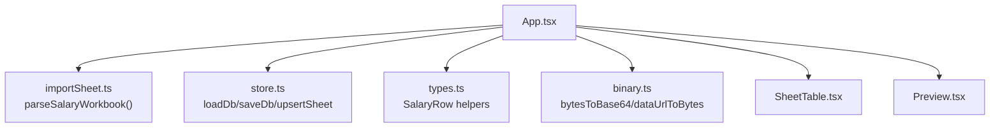
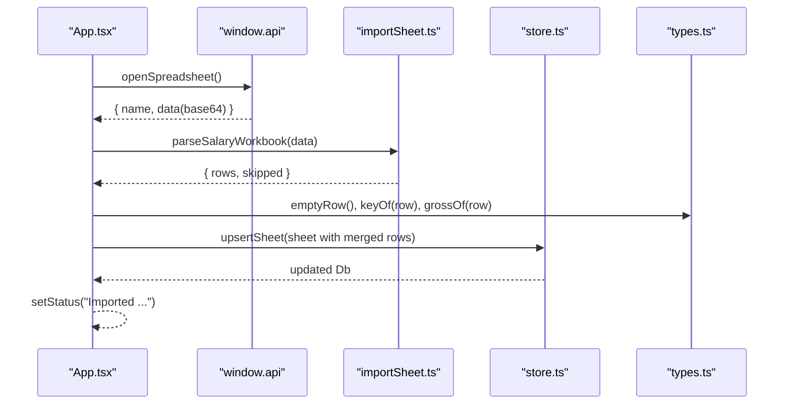
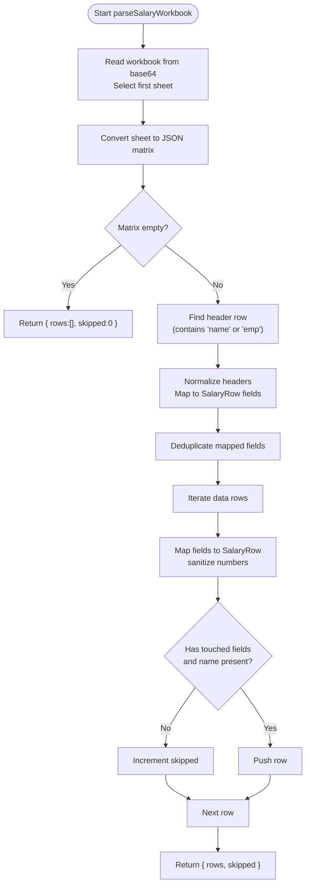
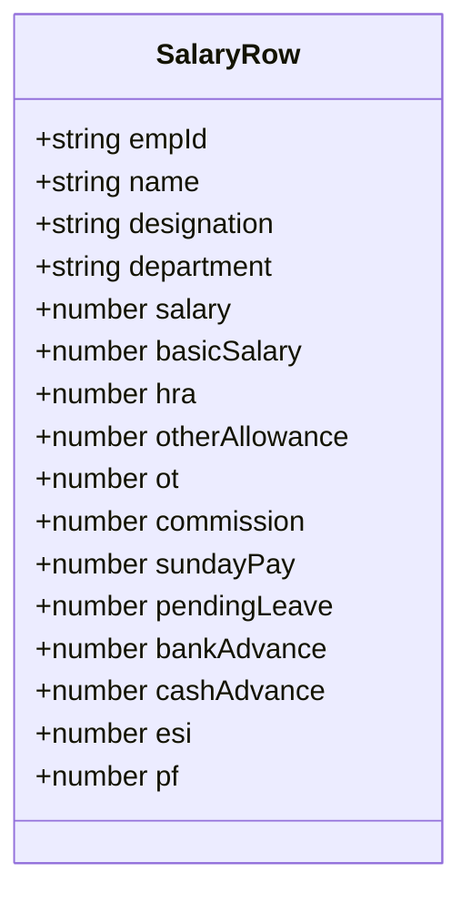
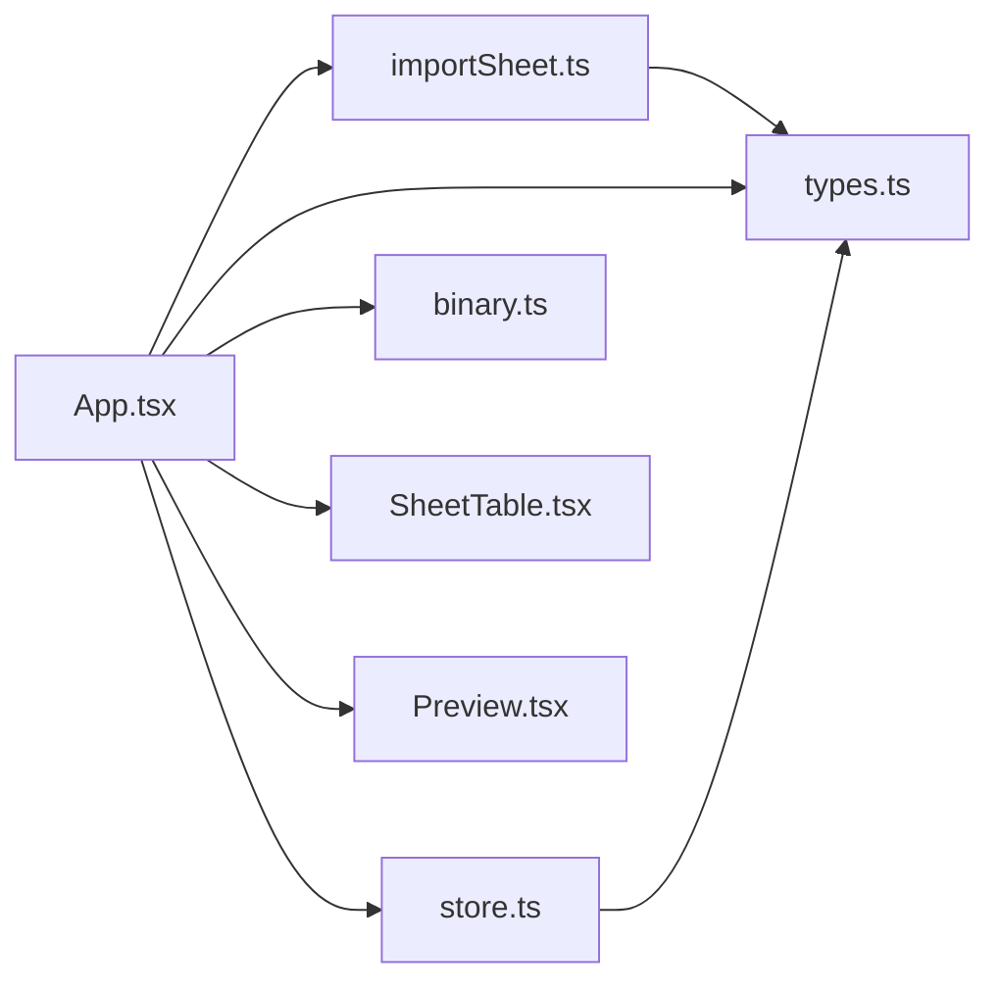

# File Import System

<cite>
**Referenced Files in This Document**
- [importSheet.ts](file://src/renderer/src/lib/importSheet.ts)
- [types.ts](file://src/renderer/src/types.ts)
- [App.tsx](file://src/renderer/src/App.tsx)
- [store.ts](file://src/renderer/src/lib/store.ts)
- [binary.ts](file://src/renderer/src/lib/binary.ts)
- [SheetTable.tsx](file://src/renderer/src/components/SheetTable.tsx)
- [Preview.tsx](file://src/renderer/src/components/Preview.tsx)
- [README.md](file://README.md)
</cite>

## Table of Contents
1. [Introduction](#introduction)
2. [Project Structure](#project-structure)
3. [Core Components](#core-components)
4. [Architecture Overview](#architecture-overview)
5. [Detailed Component Analysis](#detailed-component-analysis)
6. [Dependency Analysis](#dependency-analysis)
7. [Performance Considerations](#performance-considerations)
8. [Troubleshooting Guide](#troubleshooting-guide)
9. [Conclusion](#conclusion)

## Introduction
This document explains the File Import System that processes Excel and CSV salary sheets, maps varied column headers to a standardized SalaryRow structure, and integrates with the React UI for user feedback during import. It covers supported formats, header recognition logic, parsing algorithms, data transformation pipelines, validation rules, error handling, bulk import capabilities, and how the UI reflects import status and results.

## Project Structure
The file import functionality is implemented primarily in the renderer layer:
- Spreadsheet parsing and mapping: src/renderer/src/lib/importSheet.ts
- Data model and helpers: src/renderer/src/types.ts
- User workflow orchestration (import, merge, export): src/renderer/src/App.tsx
- Persistence utilities: src/renderer/src/lib/store.ts
- Binary conversion helpers: src/renderer/src/lib/binary.ts
- UI components for table editing and preview: src/renderer/src/components/SheetTable.tsx, src/renderer/src/components/Preview.tsx
- User-facing documentation: README.md

**Diagram sources**
- [App.tsx:103-136](file://src/renderer/src/App.tsx#L103-L136)
- [importSheet.ts:41-80](file://src/renderer/src/lib/importSheet.ts#L41-L80)
- [store.ts:8-32](file://src/renderer/src/lib/store.ts#L8-L32)
- [types.ts:1-117](file://src/renderer/src/types.ts#L1-L117)
- [binary.ts:1-17](file://src/renderer/src/lib/binary.ts#L1-L17)
- [SheetTable.tsx:1-71](file://src/renderer/src/components/SheetTable.tsx#L1-L71)
- [Preview.tsx:1-29](file://src/renderer/src/components/Preview.tsx#L1-L29)

**Section sources**
- [App.tsx:1-289](file://src/renderer/src/App.tsx#L1-L289)
- [importSheet.ts:1-87](file://src/renderer/src/lib/importSheet.ts#L1-L87)
- [types.ts:1-117](file://src/renderer/src/types.ts#L1-L117)
- [store.ts:1-33](file://src/renderer/src/lib/store.ts#L1-L33)
- [binary.ts:1-17](file://src/renderer/src/lib/binary.ts#L1-L17)
- [SheetTable.tsx:1-71](file://src/renderer/src/components/SheetTable.tsx#L1-L71)
- [Preview.tsx:1-29](file://src/renderer/src/components/Preview.tsx#L1-L29)
- [README.md:39-59](file://README.md#L39-L59)

## Core Components
- Spreadsheet parser and mapper: parseSalaryWorkbook reads an Excel workbook from base64, detects the header row, maps columns to SalaryRow fields using aliases, normalizes numeric values, skips invalid rows, and returns parsed rows plus a skipped count.
- Data model: SalaryRow defines all employee fields; helpers define earning/deduction categories, net calculation, and mismatch detection between salary and its breakdown.
- Application controller: App orchestrates file selection, parsing, merging with existing sheet data, persistence, and user feedback via status messages.
- Persistence: store provides load/save and month-sheet management.
- Binary utilities: convert between bytes and base64 for file I/O.
- UI: SheetTable displays editable rows and computed gross; Preview shows generated payslip HTML.

**Section sources**
- [importSheet.ts:1-87](file://src/renderer/src/lib/importSheet.ts#L1-L87)
- [types.ts:1-117](file://src/renderer/src/types.ts#L1-L117)
- [App.tsx:103-136](file://src/renderer/src/App.tsx#L103-L136)
- [store.ts:8-32](file://src/renderer/src/lib/store.ts#L8-L32)
- [binary.ts:1-17](file://src/renderer/src/lib/binary.ts#L1-L17)
- [SheetTable.tsx:15-71](file://src/renderer/src/components/SheetTable.tsx#L15-L71)
- [Preview.tsx:1-29](file://src/renderer/src/components/Preview.tsx#L1-L29)

## Architecture Overview
The import flow starts in the UI, calls into the Electron API to open a spreadsheet file, then parses it with the importer, merges results with the current month’s sheet, persists changes, and updates the UI with status feedback.

**Diagram sources**
- [App.tsx:103-136](file://src/renderer/src/App.tsx#L103-L136)
- [importSheet.ts:41-80](file://src/renderer/src/lib/importSheet.ts#L41-L80)
- [store.ts:20-30](file://src/renderer/src/lib/store.ts#L20-L30)
- [types.ts:47-64](file://src/renderer/src/types.ts#L47-L64)

## Detailed Component Analysis

### Spreadsheet Parsing and Header Recognition
- Supported input: Excel workbooks provided as base64 strings. The first worksheet is used.
- Header detection:
  - If any cell equals “name” or contains “emp” after normalization, that row is treated as the header row.
  - Otherwise, the first row is assumed to be the header.
- Column mapping:
  - A normalized alias map matches many common header variants to SalaryRow fields.
  - Ignored columns include terms like gross, total, net, payable, remarks, note.
  - Two-pass matching: exact alias match first, then substring match for longer tokens to reduce false positives.
- Numeric normalization:
  - Monetary fields are sanitized by stripping non-numeric characters except minus and dot, then parsed to numbers; invalid values become zero.
- Row processing:
  - Each row is mapped to a new SalaryRow using emptyRow defaults.
  - Only non-empty mapped fields are applied.
  - Rows without any touched fields or missing name are skipped and counted.
- Output:
  - Returns an array of valid SalaryRow objects and a count of skipped rows.

**Diagram sources**
- [importSheet.ts:41-80](file://src/renderer/src/lib/importSheet.ts#L41-L80)

**Section sources**
- [importSheet.ts:4-37](file://src/renderer/src/lib/importSheet.ts#L4-L37)
- [importSheet.ts:41-80](file://src/renderer/src/lib/importSheet.ts#L41-L80)

### Field Mapping Strategy
- Alias map includes multiple acceptable names per field:
  - Employee ID: empid, employeeid, empcode, employeecode, code, id, empno, employeeno
  - Name: name, employeename, employee, fullname
  - Designation: designation, post, role, title
  - Department: department, dept, section
  - Salary: salary, basicsalary, monthlysalary, wages
  - Overtime: ot, overtime, otamount, overtimeamount, otrs
  - Pending Leave: pendingleave, leave, leaves, leavebalance, lop, absent, absentdays
  - Bank Advance: bankadvance, bank, advance, bankdeduction
  - Cash Advance: cashadvance, cash, cashdeduction, advancecash
- Normalization:
  - Lowercase and remove non-alphanumeric characters before matching.
- Ignore list:
  - Columns containing gross, total, net, payable, remarks, note are ignored.

**Section sources**
- [importSheet.ts:4-19](file://src/renderer/src/lib/importSheet.ts#L4-L19)
- [importSheet.ts:21-31](file://src/renderer/src/lib/importSheet.ts#L21-L31)

### Data Transformation Pipeline
- Input: base64-encoded Excel workbook.
- Steps:
  - Parse workbook to matrix.
  - Detect header row.
  - Normalize and map headers to SalaryRow keys.
  - Iterate rows, sanitize numeric fields, skip invalid rows.
  - Merge imported rows with existing sheet rows using empId or name as key.
  - Persist updated sheet.
- Output:
  - Updated MonthSheet.rows and user-visible status message.

**Diagram sources**
- [importSheet.ts:41-80](file://src/renderer/src/lib/importSheet.ts#L41-L80)
- [App.tsx:103-136](file://src/renderer/src/App.tsx#L103-L136)
- [store.ts:20-30](file://src/renderer/src/lib/store.ts#L20-L30)

**Section sources**
- [importSheet.ts:41-80](file://src/renderer/src/lib/importSheet.ts#L41-L80)
- [App.tsx:103-136](file://src/renderer/src/App.tsx#L103-L136)
- [store.ts:20-30](file://src/renderer/src/lib/store.ts#L20-L30)

### SalaryRow Structure and Validation Rules
- Fields:
  - Text: empId, name, designation, department
  - Numeric: salary, basicSalary, hra, otherAllowance, ot, commission, sundayPay, pendingLeave, bankAdvance, cashAdvance, esi, pf
- Helpers:
  - Earning fields: salary, ot, commission, sundayPay
  - Deduction fields: bankAdvance, cashAdvance, esi, pf
  - Breakup fields: basicSalary, hra, otherAllowance
  - Net calculation sums earnings and subtracts deductions.
  - Breakup mismatch checks whether basicSalary + hra + otherAllowance equals salary within tolerance.
- Validation during import:
  - Numeric fields are sanitized; invalid values default to zero.
  - Rows without a name or any mapped fields are skipped.

**Diagram sources**
- [types.ts:1-18](file://src/renderer/src/types.ts#L1-L18)

**Section sources**
- [types.ts:1-117](file://src/renderer/src/types.ts#L1-L117)

### Bulk Import Capabilities
- Single-file import:
  - Opens a spreadsheet file, parses it, merges with the current month’s sheet, and updates the UI with counts of added/updated/skipped rows.
- CSV export:
  - Exports the current sheet to CSV using a fixed header order and standard field names.
- PDF/DOCX generation:
  - Per-row and bulk export options are available; bulk export uses Electron API to generate multiple files at once.

**Section sources**
- [App.tsx:103-136](file://src/renderer/src/App.tsx#L103-L136)
- [App.tsx:162-184](file://src/renderer/src/App.tsx#L162-L184)
- [importSheet.ts:82-86](file://src/renderer/src/lib/importSheet.ts#L82-L86)

### Integration with React UI
- Status feedback:
  - On successful import, shows counts of new, updated, and skipped rows.
  - On failure, shows the error message from the parser.
- Table view:
  - Displays text and numeric fields, computed Gross, and actions (PDF, DOCX, delete).
- Preview:
  - Renders generated payslip HTML in an iframe with responsive scaling.

**Section sources**
- [App.tsx:103-136](file://src/renderer/src/App.tsx#L103-L136)
- [SheetTable.tsx:15-71](file://src/renderer/src/components/SheetTable.tsx#L15-L71)
- [Preview.tsx:1-29](file://src/renderer/src/components/Preview.tsx#L1-L29)

## Dependency Analysis
- importSheet.ts depends on:
  - xlsx library for reading Excel workbooks.
  - types.ts for SalaryRow and emptyRow.
- App.tsx depends on:
  - importSheet.ts for parsing.
  - store.ts for persistence.
  - types.ts for models and helpers.
  - binary.ts for base64 conversions.
  - UI components for rendering and interaction.
- store.ts depends on:
  - types.ts for Db and MonthSheet structures.

**Diagram sources**
- [importSheet.ts:1-3](file://src/renderer/src/lib/importSheet.ts#L1-L3)
- [App.tsx:1-11](file://src/renderer/src/App.tsx#L1-L11)
- [store.ts:1-2](file://src/renderer/src/lib/store.ts#L1-L2)
- [binary.ts:1-17](file://src/renderer/src/lib/binary.ts#L1-L17)
- [SheetTable.tsx:1-3](file://src/renderer/src/components/SheetTable.tsx#L1-L3)
- [Preview.tsx:1-1](file://src/renderer/src/components/Preview.tsx#L1-L1)

**Section sources**
- [importSheet.ts:1-87](file://src/renderer/src/lib/importSheet.ts#L1-L87)
- [App.tsx:1-289](file://src/renderer/src/App.tsx#L1-L289)
- [store.ts:1-33](file://src/renderer/src/lib/store.ts#L1-L33)
- [binary.ts:1-17](file://src/renderer/src/lib/binary.ts#L1-L17)
- [SheetTable.tsx:1-71](file://src/renderer/src/components/SheetTable.tsx#L1-L71)
- [Preview.tsx:1-29](file://src/renderer/src/components/Preview.tsx#L1-L29)

## Performance Considerations
- Parsing complexity:
  - Reading workbook and converting to matrix is linear in number of cells.
  - Header mapping is constant-time per column due to alias lookup.
  - Row processing is linear in number of rows with constant-time field mapping.
- Memory usage:
  - Entire sheet is loaded into memory; large workbooks may increase memory consumption.
- Optimization opportunities:
  - Stream-based parsing for very large files (not currently implemented).
  - Early exit if no header detected to avoid unnecessary processing.
  - Batch UI updates to minimize re-renders during bulk operations.

[No sources needed since this section provides general guidance]

## Troubleshooting Guide
Common issues and resolutions:
- No employee rows found:
  - Ensure the file has recognized headers such as EMP ID, NAME, SALARY.
  - Check that the header row is not preceded by unrelated rows; the importer expects either a header row containing “name” or “emp”, otherwise uses the first row.
- Skipped rows:
  - Rows without a name or any mapped fields are skipped. Add required fields or correct column mappings.
- Invalid numeric values:
  - Non-numeric characters in monetary fields are stripped; if parsing fails, the value becomes zero. Clean the source data to avoid unexpected zeros.
- Merged duplicates:
  - Imported rows are merged by empId or name. If duplicates exist, the latest imported values overwrite existing ones except for specific fields preserved from existing rows.
- Error messages:
  - Any exception during parsing is surfaced to the user via status message. Inspect the file format and content based on the reported error.

**Section sources**
- [App.tsx:103-136](file://src/renderer/src/App.tsx#L103-L136)
- [importSheet.ts:41-80](file://src/renderer/src/lib/importSheet.ts#L41-L80)

## Conclusion
The File Import System provides robust Excel and CSV processing with flexible header recognition and intelligent field mapping to a standardized SalaryRow model. It supports bulk imports, merges with existing data, and offers clear user feedback through the React UI. The design emphasizes simplicity and reliability, with well-defined validation rules and error handling to ensure accurate payroll data processing.

[No sources needed since this section summarizes without analyzing specific files]