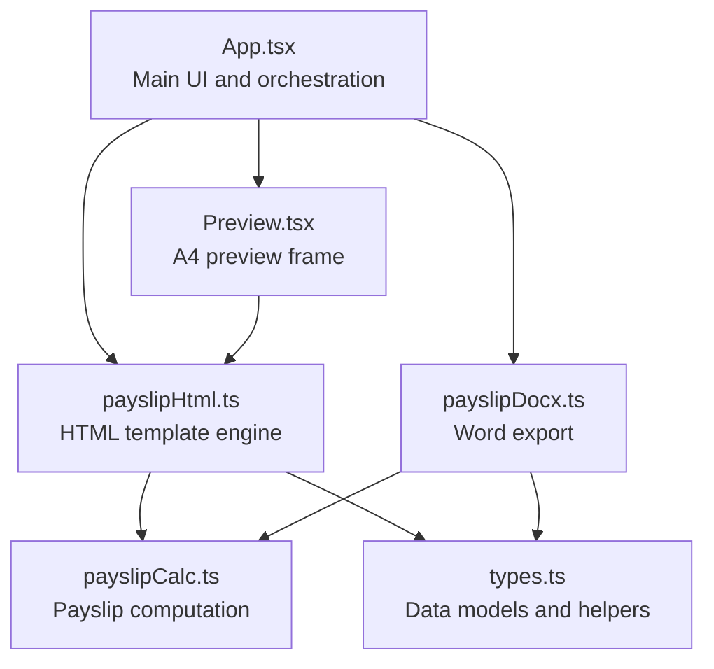
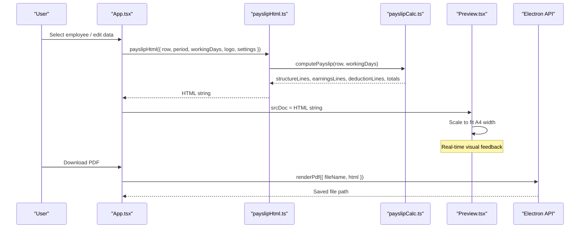
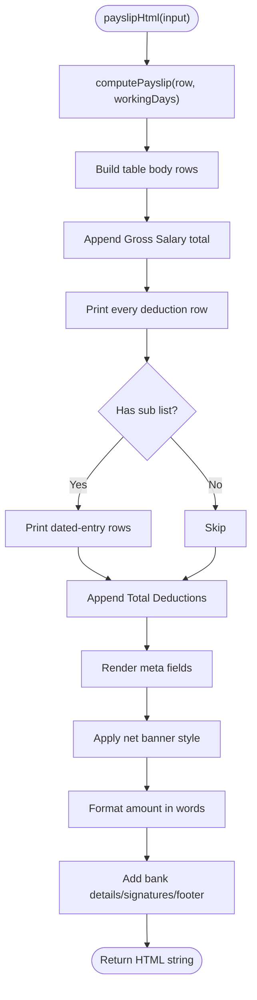
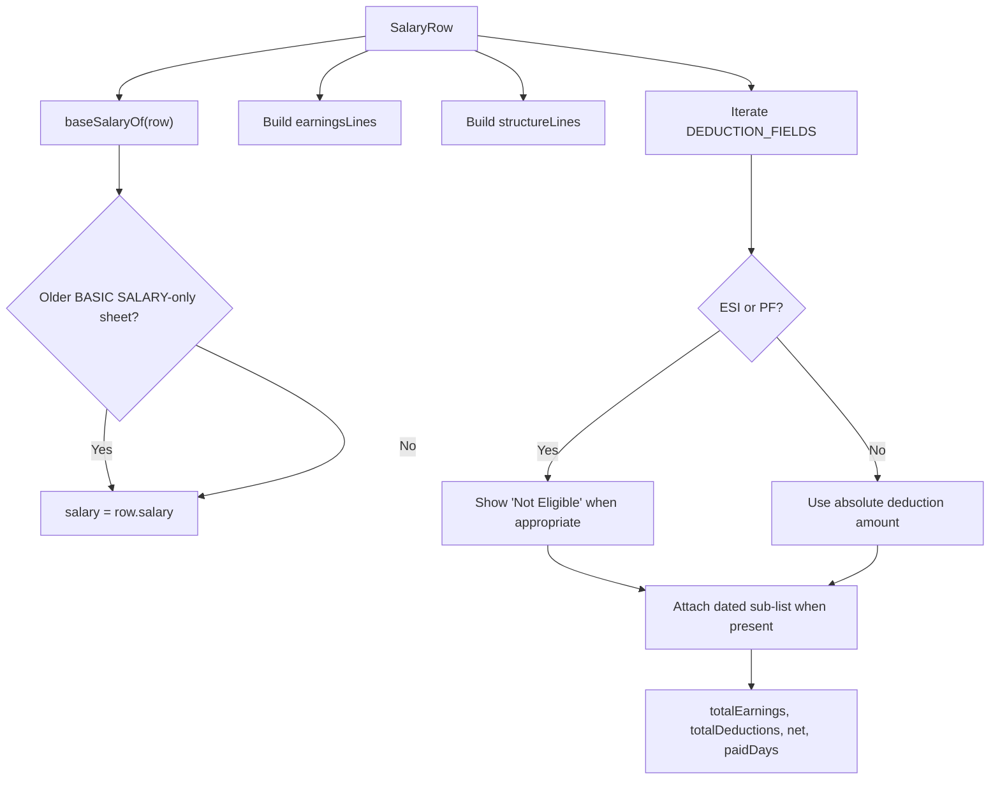
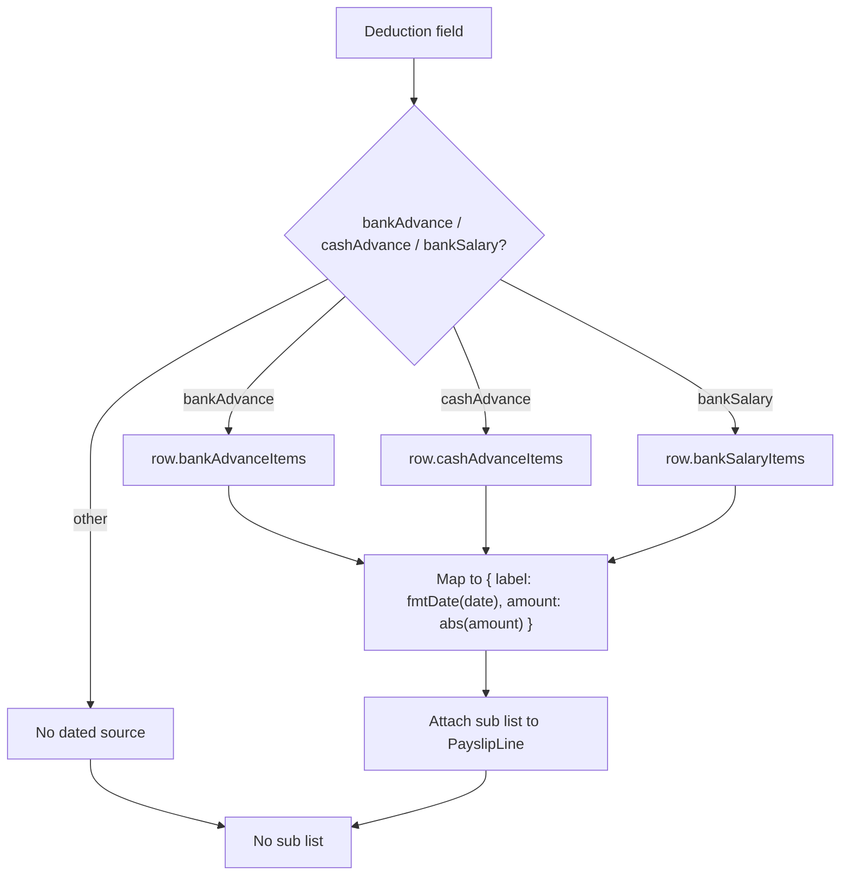
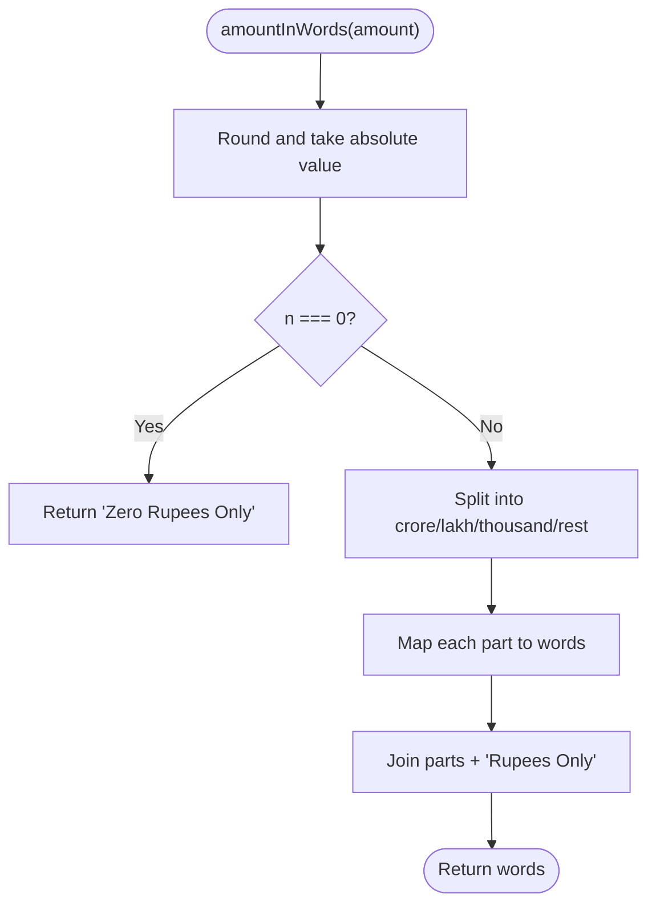
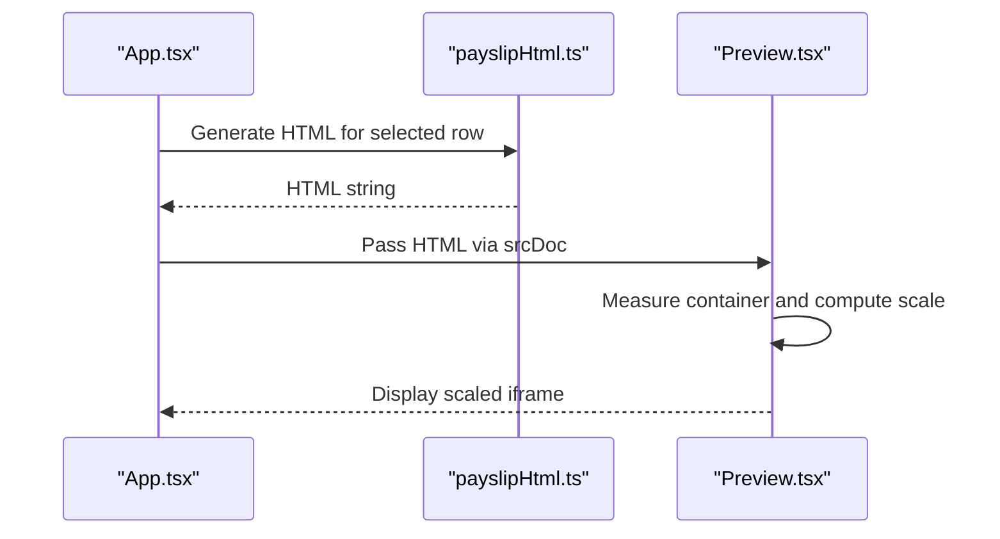
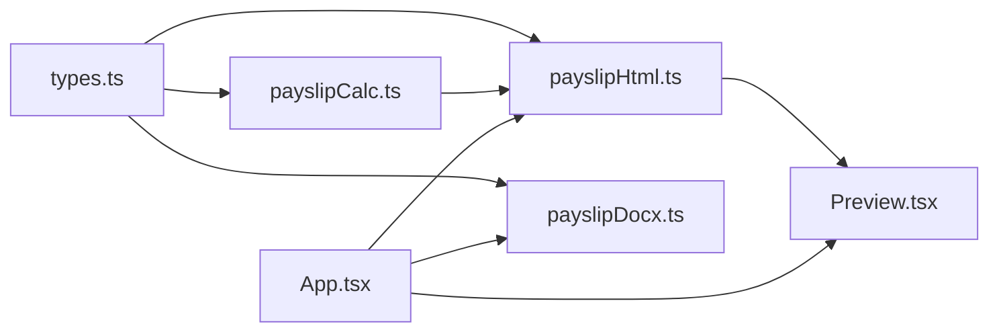

# Payslip Template Engine

<cite>
**Referenced Files in This Document**
- [README.md](file://README.md)
- [App.tsx](file://src/renderer/src/App.tsx)
- [Preview.tsx](file://src/renderer/src/components/Preview.tsx)
- [payslipHtml.ts](file://src/renderer/src/lib/payslipHtml.ts)
- [payslipCalc.ts](file://src/renderer/src/lib/payslipCalc.ts)
- [payslipDocx.ts](file://src/renderer/src/lib/payslipDocx.ts)
- [types.ts](file://src/renderer/src/types.ts)
</cite>

## Table of Contents
1. [Introduction](#introduction)
2. [Project Structure](#project-structure)
3. [Core Components](#core-components)
4. [Architecture Overview](#architecture-overview)
5. [Detailed Component Analysis](#detailed-component-analysis)
6. [Dependency Analysis](#dependency-analysis)
7. [Performance Considerations](#performance-considerations)
8. [Troubleshooting Guide](#troubleshooting-guide)
9. [Conclusion](#conclusion)

## Introduction
This document explains the Payslip Template Engine that generates professional HTML-based payslips for an offline Electron desktop application. It covers the template rendering pipeline, dynamic content insertion, styling system, Indian currency amount-to-words conversion, responsive preview behavior, and customization options for company branding. It also documents how the preview system integrates with the main application to provide real-time visualization of generated payslips.

The engine is part of a larger tool that imports monthly salary sheets, computes pay values, previews individual payslips, and exports them as PDF or Word documents.

**Section sources**
- [README.md:1-71](file://README.md#L1-L71)

## Project Structure
The renderer layer is built with React and TypeScript. The template engine lives under the renderer library and is consumed by the main application component and export utilities.

**Diagram sources**
- [App.tsx:1-289](file://src/renderer/src/App.tsx#L1-L289)
- [Preview.tsx:1-29](file://src/renderer/src/components/Preview.tsx#L1-L29)
- [payslipHtml.ts:1-178](file://src/renderer/src/lib/payslipHtml.ts#L1-L178)
- [payslipCalc.ts:1-150](file://src/renderer/src/lib/payslipCalc.ts#L1-L150)
- [payslipDocx.ts:1-130](file://src/renderer/src/lib/payslipDocx.ts#L1-L130)
- [types.ts:1-117](file://src/renderer/src/types.ts#L1-L117)

**Section sources**
- [App.tsx:1-289](file://src/renderer/src/App.tsx#L1-L289)
- [payslipHtml.ts:1-178](file://src/renderer/src/lib/payslipHtml.ts#L1-L178)
- [payslipDocx.ts:1-130](file://src/renderer/src/lib/payslipDocx.ts#L1-L130)
- [types.ts:1-117](file://src/renderer/src/types.ts#L1-L117)

## Core Components
- **Template Engine (HTML)**: Generates a complete HTML document per employee using typed inputs, including computed totals, formatted amounts, optional negative-salary warnings, and dated breakdowns under deduction rows.
- **Payslip Calculator**: Centralizes all arithmetic and line construction so the HTML and Word templates cannot drift apart. Templates must not invent components or perform their own calculations.
- **Amount Utilities**: Converts numeric amounts into Indian Rupees formatting and English words following Indian numbering conventions (lakh/crore).
- **Preview Component**: Renders the generated HTML inside a scaled A4-sized iframe for real-time preview.
- **Type System**: Defines salary rows, settings, month sheets, and helper functions used across components.
- **Document Export**: Builds a Word document mirroring the HTML layout and reuses amount formatting utilities.

Key responsibilities:
- Compute earnings, deductions, and net pay through `computePayslip`.
- Escape user-supplied text to prevent injection.
- Format numbers according to Indian locale rules.
- Render a print-friendly A4 page with embedded CSS.
- Provide a scalable preview container.

**Section sources**
- [payslipHtml.ts:1-178](file://src/renderer/src/lib/payslipHtml.ts#L1-L178)
- [payslipCalc.ts:1-150](file://src/renderer/src/lib/payslipCalc.ts#L1-L150)
- [types.ts:1-117](file://src/renderer/src/types.ts#L1-L117)
- [Preview.tsx:1-29](file://src/renderer/src/components/Preview.tsx#L1-L29)
- [payslipDocx.ts:1-130](file://src/renderer/src/lib/payslipDocx.ts#L1-L130)

## Architecture Overview
The rendering pipeline starts from the main application state and produces a self-contained HTML string for each employee. The preview component displays it immediately, while export actions send the HTML to the Electron API for PDF generation.

**Diagram sources**
- [App.tsx:138-144](file://src/renderer/src/App.tsx#L138-L144)
- [payslipHtml.ts:14-22](file://src/renderer/src/lib/payslipHtml.ts#L14-L22)
- [payslipCalc.ts:88-150](file://src/renderer/src/lib/payslipCalc.ts#L88-L150)
- [Preview.tsx:5-28](file://src/renderer/src/components/Preview.tsx#L5-L28)

## Detailed Component Analysis

### HTML Template Engine
The HTML template engine builds a full HTML document per employee. It delegates every label, order, and total to `computePayslip`, then lays out:
- `structureLines` as the fixed monthly salary breakdown.
- `earningsLines` as the month's cash column.
- `deductionLines` as the deductions column.
- Total rows for gross salary and total deductions.
- Net-pay banner, amount-in-words, optional bank details, signatures, and footer.

Important rendering behavior:
- Every deduction row is printed, even when its amount is zero; HR requires a fixed template so components do not disappear.
- Deductions with a `sub` list print one indented dated-entry row per item beneath the deduction row.
- Missing lines are rendered muted rather than omitted.
- Negative net pay changes the banner label to “Net Salary Recoverable” and applies red styling.
- All user-provided strings are escaped before insertion.

**Diagram sources**
- [payslipHtml.ts:14-22](file://src/renderer/src/lib/payslipHtml.ts#L14-L22)
- [payslipHtml.ts:24-67](file://src/renderer/src/lib/payslipHtml.ts#L24-L67)
- [payslipHtml.ts:68-178](file://src/renderer/src/lib/payslipHtml.ts#L68-L178)

**Section sources**
- [payslipHtml.ts:1-178](file://src/renderer/src/lib/payslipHtml.ts#L1-L178)

### Payslip Computation Rules
All structural decisions live in `computePayslip`. The HTML and Word engines only consume its output.

Computed outputs:
- `structureLines`: Basic Salary, HRA, and Other Allowance exactly as stored on the sheet.
- `salary`: The month’s base pay, treating older sheets containing only BASIC SALARY as the full month figure.
- `earningsLines`: Base salary plus overtime, commission, and Sunday Work.
- `deductionLines`: Bank Advance, Cash Advance, Bank Salary, ESI, and PF.
- `totalEarnings`, `totalDeductions`, `net`, `negative`, and `paidDays`.

Rules verified against implementation:
- `Bank Salary` is included in `DEDUCTION_LABELS` and therefore appears as a standard deduction row.
- Every deduction field in `DEDUCTION_FIELDS` is iterated, so no deduction disappears when its value is zero.
- Statutory deductions (`esi`, `pf`) show the text “Not Eligible” instead of ₹0.00 when the employee is marked not eligible or when the computed amount is zero.
- Non-statutory advances keep ₹0.00 when there is no advance.
- Paid days are derived from working days minus pending leave, clamped at zero.

Templates must not invent components or arithmetic — they may only lay out `structureLines`, `earningsLines`, `deductionLines`, totals, `paidDays`, and optional `line.sub` lists.

**Diagram sources**
- [payslipCalc.ts:88-150](file://src/renderer/src/lib/payslipCalc.ts#L88-L150)

**Section sources**
- [payslipCalc.ts:1-150](file://src/renderer/src/lib/payslipCalc.ts#L1-L150)

### Dated-Entry Breakdowns Under Deductions
Several deduction types can carry multiple dated entries. The calculator attaches a `sub` array to the corresponding `PayslipLine`; the HTML template prints each entry as an indented row with a date label and absolute amount.

Supported sources:
- `bankAdvanceItems` for Bank Advance.
- `cashAdvanceItems` for Cash Advance.
- `bankSalaryItems` for Bank Salary.

Date formatting:
- Entries are stored as ISO `YYYY-MM-DD`.
- `fmtDate` converts them to `DD/MM/YYYY` for display.
- Any value that does not match the ISO pattern is passed through unchanged.

Breakdown semantics:
- The deduction row itself still shows the summed deduction amount.
- Each sub-entry shows the absolute value of the original amount.
- If no dated items exist for a deduction, no sub-list is printed.

**Diagram sources**
- [payslipCalc.ts:116-126](file://src/renderer/src/lib/payslipCalc.ts#L116-L126)
- [payslipCalc.ts:40-46](file://src/renderer/src/lib/payslipCalc.ts#L40-L46)
- [payslipHtml.ts:46-56](file://src/renderer/src/lib/payslipHtml.ts#L46-L56)

**Section sources**
- [payslipCalc.ts:40-46](file://src/renderer/src/lib/payslipCalc.ts#L40-L46)
- [payslipCalc.ts:116-126](file://src/renderer/src/lib/payslipCalc.ts#L116-L126)
- [payslipHtml.ts:46-56](file://src/renderer/src/lib/payslipHtml.ts#L46-L56)

### Amount-to-Words Conversion (Indian Currency)
The engine converts numeric amounts into English words using Indian numbering units:
- Crore
- Lakh
- Thousand
- Hundred

Behavior:
- Rounds the absolute value before conversion.
- Returns “Zero Rupees Only” for zero.
- Joins non-empty parts with spaces and appends “Rupees Only”.

Formatting:
- Numeric amounts are formatted with two decimal places using the Indian locale.
- The `money` utility prefixes amounts with the rupee symbol.

Complexity:
- Time complexity is O(1) relative to input magnitude since it splits into fixed segments (crore/lakh/thousand/rest).
- Space complexity is O(1) aside from output string construction.

**Diagram sources**
- [payslipCalc.ts:18-38](file://src/renderer/src/lib/payslipCalc.ts#L18-L38)

**Section sources**
- [payslipCalc.ts:18-38](file://src/renderer/src/lib/payslipCalc.ts#L18-L38)

### Styling System
The template embeds CSS optimized for A4 printing:
- Page size and margins configured via `@page`.
- Fixed-width page container matching A4 dimensions.
- Branding band at the top with gradient colors.
- Header with logo or company name, title, period, and address.
- Employee strip showing code, name, department, designation, working days, and leave balance.
- Two-column metadata area for designation, period, working days, paid days, leave balance, and overtime.
- Earnings/deductions table with aligned columns and tabular numerics.
- Total row with distinct background and borders.
- Net pay banner with conditional styling for negative values.
- Amount-in-words box with optional warning for recoverable amounts.
- Optional bank details block.
- Signature lines for employee and authorized signatory.
- Footer with disclaimer and generation date.

Customization:
- Company name and address come from settings.
- Logo can be injected if provided; otherwise, company name is displayed.
- Bank details and footer text are configurable through settings.

Deduction styling:
- Deduction headers use a red accent color.
- Dated sub-entries use smaller gray labels and monospace amounts.
- Sub rows have reduced vertical padding to keep breakdowns compact.

**Section sources**
- [payslipHtml.ts:68-178](file://src/renderer/src/lib/payslipHtml.ts#L68-L178)

### Dynamic Content Insertion Mechanisms
Dynamic insertion is performed by constructing HTML fragments and interpolating escaped values:
- Employee identifiers and names are inserted safely.
- Period labels are derived from the selected month/year.
- Working days and paid days are computed and inserted.
- Earnings and deductions are dynamically generated based on presence of values.
- Net pay label changes between payable and recoverable depending on sign.
- Optional sections like bank details and authorized signatory are conditionally rendered.
- Dated sub-entries are printed under deductions only when the calculator attached a `sub` list.

Security:
- All user-provided strings are escaped to prevent HTML injection.

**Section sources**
- [payslipHtml.ts:24-67](file://src/renderer/src/lib/payslipHtml.ts#L24-L67)
- [payslipHtml.ts:68-178](file://src/renderer/src/lib/payslipHtml.ts#L68-L178)

### Preview System Integration
The preview component renders the generated HTML in an iframe:
- Uses a fixed A4 width constant to match the template’s page width.
- Scales the iframe content to fit the available container width.
- Observes container resize events to recalculate scale.
- Provides a scroll-free preview experience.

Integration flow:
- Main app calls the template engine to generate HTML for the selected employee.
- The resulting HTML is passed as `srcDoc` to the preview component.
- The preview scales and displays the payslip in real time.

**Diagram sources**
- [App.tsx:138-139](file://src/renderer/src/App.tsx#L138-L139)
- [Preview.tsx:5-28](file://src/renderer/src/components/Preview.tsx#L5-L28)

**Section sources**
- [Preview.tsx:1-29](file://src/renderer/src/components/Preview.tsx#L1-L29)
- [App.tsx:138-139](file://src/renderer/src/App.tsx#L138-L139)

### Data Models and Helpers
Types define the shape of salary data, settings, and month sheets:
- `SalaryRow`: Employee-level financial and personal fields.
- `MonthSheet`: Aggregates rows and working days for a given period.
- `Settings`: Global branding and footer configuration.
- Helper functions compute gross/net pay, detect mismatched salary breakdowns, and format period labels.

Important behaviors:
- Earning and deduction field lists control which fields contribute to totals.
- Deduction values are treated as positive magnitudes even if stored with signs.
- Breakup fields represent subcomponents of monthly salary and are not double-counted.
- `computePayslip` is the single authority for what a payslip contains; HTML and Word consumers must not duplicate its logic.

**Section sources**
- [types.ts:1-117](file://src/renderer/src/types.ts#L1-L117)
- [payslipCalc.ts:1-17](file://src/renderer/src/lib/payslipCalc.ts#L1-L17)

### Word Export Reuse
The Word export module mirrors the HTML layout and reuses shared utilities:
- Imports amount formatting and amount-in-words functions from the HTML module.
- Builds paragraphs, tables, and cells with consistent styling.
- Applies company branding, period labeling, and settings-driven content.
- Outputs a binary buffer suitable for saving as a `.docx` file.

**Section sources**
- [payslipDocx.ts:1-130](file://src/renderer/src/lib/payslipDocx.ts#L1-L130)

## Dependency Analysis
The template engine depends on typed data structures and helper functions. The main application orchestrates data updates, template generation, and export flows.

**Diagram sources**
- [types.ts:1-117](file://src/renderer/src/types.ts#L1-L117)
- [payslipCalc.ts:1-150](file://src/renderer/src/lib/payslipCalc.ts#L1-L150)
- [payslipHtml.ts:1-178](file://src/renderer/src/lib/payslipHtml.ts#L1-L178)
- [payslipDocx.ts:1-130](file://src/renderer/src/lib/payslipDocx.ts#L1-L130)
- [Preview.tsx:1-29](file://src/renderer/src/components/Preview.tsx#L1-L29)
- [App.tsx:1-289](file://src/renderer/src/App.tsx#L1-L289)

**Section sources**
- [App.tsx:1-289](file://src/renderer/src/App.tsx#L1-L289)
- [payslipHtml.ts:1-178](file://src/renderer/src/lib/payslipHtml.ts#L1-L178)
- [payslipCalc.ts:1-150](file://src/renderer/src/lib/payslipCalc.ts#L1-L150)
- [payslipDocx.ts:1-130](file://src/renderer/src/lib/payslipDocx.ts#L1-L130)
- [types.ts:1-117](file://src/renderer/src/types.ts#L1-L117)

## Performance Considerations
- Template generation is lightweight and operates on a single employee row; it constructs HTML strings without heavy DOM manipulation.
- `computePayslip` performs a fixed number of reductions over known arrays, making it O(n) over declared fields but effectively constant for payroll layouts.
- Amount formatting and word conversion are O(1) operations with minimal allocations.
- Preview scaling uses ResizeObserver to adjust only when container size changes, avoiding excessive recalculations.
- Bulk PDF export batches multiple employees; consider rate-limiting or chunking if exporting very large datasets to avoid UI blocking.

[No sources needed since this section provides general guidance]

## Troubleshooting Guide
Common issues and resolutions:
- Negative net salary:
  - The template highlights negative net pay and labels it as recoverable. Review advances and corrections before exporting.
- Missing employee code:
  - The application warns about rows without employee codes; ensure every row has a valid identifier.
- Import errors:
  - If importing fails, verify headers match expected names such as EMP ID, NAME, SALARY, OT, PENDING LEAVE, BANK ADVANCE, CASH ADVANCE.
- Preview not updating:
  - Ensure the selected employee row exists and the generated HTML is passed to the preview component.
- Logo not displaying:
  - Confirm the logo is loaded from the Electron API and provided to the template engine.
- Deduction rows missing:
  - Verify that the row contains data for the expected deduction fields. The engine now always prints Bank Advance, Cash Advance, Bank Salary, ESI, and PF — zero values remain visible rather than disappearing.
- Dated entries not appearing:
  - Dated breakdowns appear only when the corresponding `bankAdvanceItems`, `cashAdvanceItems`, or `bankSalaryItems` array contains entries.
- Unexpected date format:
  - Dates are converted from ISO `YYYY-MM-DD` to `DD/MM/YYYY`. Non-matching strings are passed through unchanged.

Operational references:
- Settings affect printed content such as company address, bank details, footer, and authorized signatory.
- Backup and restore operations manage the local JSON database.

**Section sources**
- [README.md:39-71](file://README.md#L39-L71)
- [App.tsx:237-247](file://src/renderer/src/App.tsx#L237-L247)
- [payslipHtml.ts:146-178](file://src/renderer/src/lib/payslipHtml.ts#L146-L178)
- [payslipCalc.ts:88-150](file://src/renderer/src/lib/payslipCalc.ts#L88-L150)

## Conclusion
The Payslip Template Engine delivers a robust, print-ready HTML generator tailored for Indian payroll contexts. It centralizes payroll arithmetic in `computePayslip`, adds Bank Salary alongside other statutory and advance deductions, and supports dated breakdowns for bank advances, cash advances, and bank salary collections. The HTML engine focuses exclusively on layout: it renders `structureLines`, `earningsLines`, `deductionLines`, totals, `paidDays`, and optional sub lists without inventing new components or performing independent calculations. Combined with secure dynamic content insertion, Indian currency formatting, and a responsive A4 preview, the system provides consistent visual and printed output for production payroll workflows.

[No sources needed since this section summarizes without analyzing specific files]