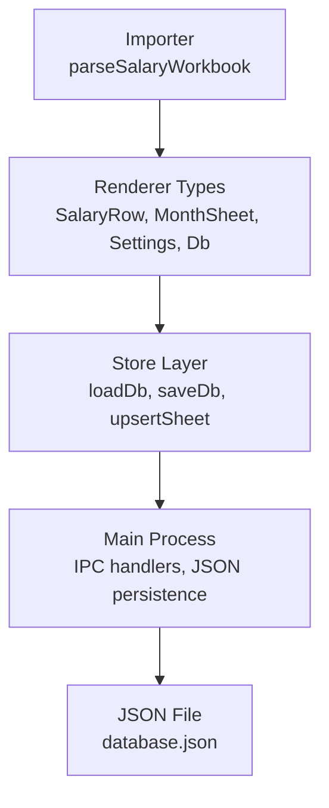
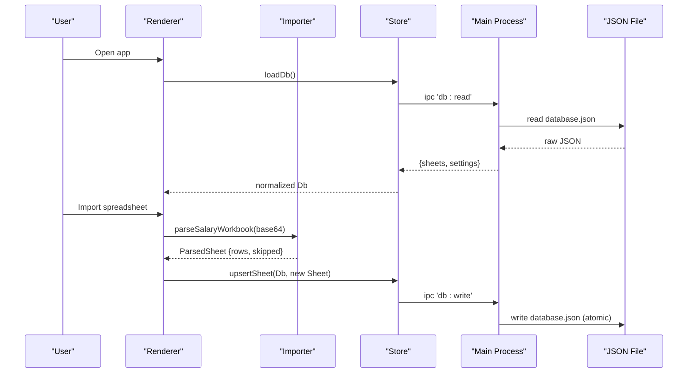
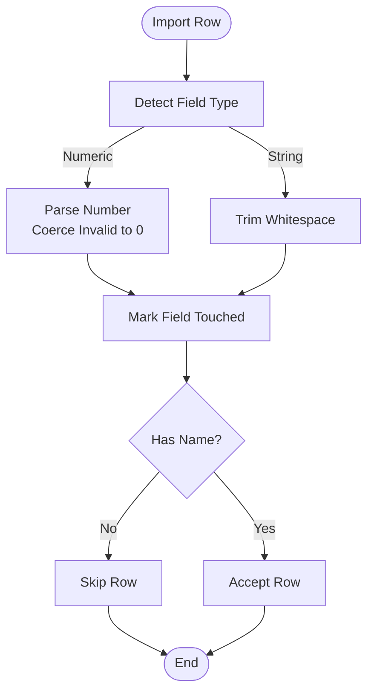
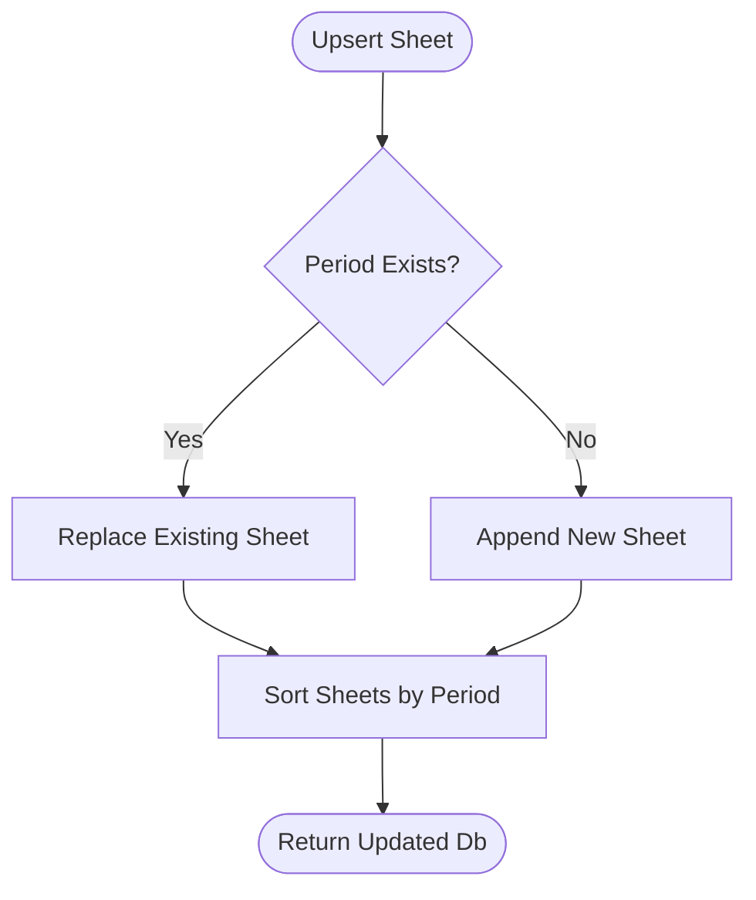
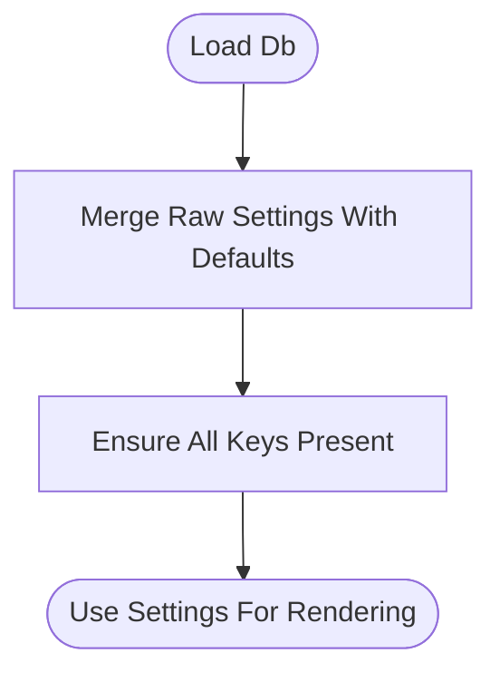
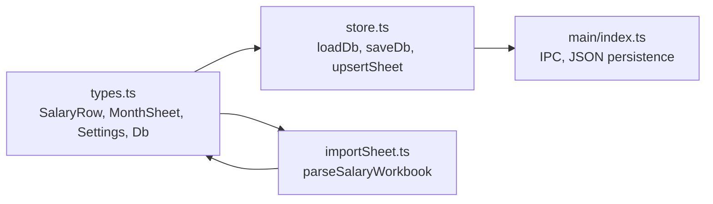

# Data Models

<cite>
**Referenced Files in This Document**
- [types.ts](file://src/renderer/src/types.ts)
- [store.ts](file://src/renderer/src/lib/store.ts)
- [importSheet.ts](file://src/renderer/src/lib/importSheet.ts)
- [index.ts](file://src/main/index.ts)
- [README.md](file://README.md)
</cite>

## Table of Contents
1. [Introduction](#introduction)
2. [Project Structure](#project-structure)
3. [Core Components](#core-components)
4. [Architecture Overview](#architecture-overview)
5. [Detailed Component Analysis](#detailed-component-analysis)
6. [Dependency Analysis](#dependency-analysis)
7. [Performance Considerations](#performance-considerations)
8. [Troubleshooting Guide](#troubleshooting-guide)
9. [Conclusion](#conclusion)

## Introduction
This document describes the data models and persistence layer for the Mabtech Payslip Generator. It focuses on:
- The TypeScript interfaces that define application data: SalaryRow, MonthSheet, Settings, and Db.
- The JSON schema used to persist all application state.
- Validation rules, field semantics, and relationships between entities.
- How data flows from spreadsheet import through transformation into persisted storage.
- Examples of serialization formats and migration patterns for backups and upgrades.

The goal is to provide a clear, code-grounded reference for developers and maintainers working with the app’s data model.

## Project Structure
At runtime, the renderer defines the canonical TypeScript types, while the main process persists them to a local JSON file. Import utilities transform spreadsheets into typed rows before they are stored.

**Diagram sources**
- [types.ts:1-30](file://src/renderer/src/types.ts#L1-L30)
- [store.ts:1-33](file://src/renderer/src/lib/store.ts#L1-L33)
- [importSheet.ts:1-87](file://src/renderer/src/lib/importSheet.ts#L1-L87)
- [index.ts:17-41](file://src/main/index.ts#L17-L41)

**Section sources**
- [types.ts:1-30](file://src/renderer/src/types.ts#L1-L30)
- [store.ts:1-33](file://src/renderer/src/lib/store.ts#L1-L33)
- [importSheet.ts:1-87](file://src/renderer/src/lib/importSheet.ts#L1-L87)
- [index.ts:17-41](file://src/main/index.ts#L17-L41)

## Core Components
This section documents the core data structures and their roles.

### SalaryRow
Represents one employee record within a payroll period.

- empId: string — Employee identifier.
- name: string — Employee full name; required for a row to be considered valid during import.
- designation: string — Job title or role.
- department: string — Organizational unit.
- salary: number — Base monthly salary.
- ot: number — Overtime amount.
- pendingLeave: number — Leave days or absence count.
- bankAdvance: number — Bank advance deduction.
- cashAdvance: number — Cash advance deduction.

Validation and computation:
- During import, numeric fields are coerced to numbers; non-numeric values become zero.
- Rows without a name or with no touched fields are skipped.
- Gross pay is computed as salary + ot − bankAdvance − cashAdvance.

Complexity:
- Creating an empty row is O(1).
- Computing gross is O(1).

Relationships:
- A SalaryRow belongs to exactly one MonthSheet via the rows array.

**Section sources**
- [types.ts:1-11](file://src/renderer/src/types.ts#L1-L11)
- [types.ts:40-53](file://src/renderer/src/types.ts#L40-L53)
- [importSheet.ts:39-79](file://src/renderer/src/lib/importSheet.ts#L39-L79)

### MonthSheet
Organizes employees for a single payroll period.

- period: string — Payroll period label (for example, YYYY-MM).
- workingDays: number — Working days for the period.
- rows: SalaryRow[] — Employees included in this month.

Behavior:
- When a sheet for a period does not exist, the store returns a default sheet with workingDays set to 26 and an empty rows array.
- Upserting a sheet replaces an existing period or appends and sorts sheets by period.

Complexity:
- findSheet is O(n) over db.sheets.
- upsertSheet is O(n) due to mapping and sorting.

Relationships:
- Contains multiple SalaryRow entries.
- Identified uniquely by period.

**Section sources**
- [types.ts:13-17](file://src/renderer/src/types.ts#L13-L17)
- [store.ts:20-30](file://src/renderer/src/lib/store.ts#L20-L30)

### Settings
Holds company-wide configuration printed on payslips.

- companyName: string — Company legal name.
- companyAddress: string — Company address.
- bankDetails: string — Optional bank or payment line.
- payslipFooter: string — Footer text shown on each payslip.
- authorisedSignatory: string — Signatory label.

Defaults:
- DEFAULT_SETTINGS provides sensible defaults for all fields.
- On load, settings are merged with defaults so missing keys are filled.

Complexity:
- Merging settings is O(k) where k is the number of settings fields.

Relationships:
- Settings is independent of sheets but applied globally when rendering payslips.

**Section sources**
- [types.ts:19-25](file://src/renderer/src/types.ts#L19-L25)
- [types.ts:32-38](file://src/renderer/src/types.ts#L32-L38)
- [store.ts:8-14](file://src/renderer/src/lib/store.ts#L8-L14)

### Db
Top-level application data container.

- sheets: MonthSheet[] — All payroll periods and their employee rows.
- settings: Settings — Global company configuration.

Constraints:
- sheets must be an array; if missing, it becomes an empty array on load.
- settings may be null on disk; on load it is normalized to a Settings object merged with defaults.

Persistence format:
- Serialized to JSON with pretty printing.
- Written atomically using a temporary file and rename.

**Section sources**
- [types.ts:27-30](file://src/renderer/src/types.ts#L27-L30)
- [index.ts:17-41](file://src/main/index.ts#L17-L41)
- [store.ts:8-18](file://src/renderer/src/lib/store.ts#L8-L18)

## Architecture Overview
The data architecture spans three layers:
- Renderer types define the canonical model.
- Importer transforms spreadsheets into typed rows.
- Store coordinates loading, saving, and updating sheets.
- Main process persists data to a JSON file and exposes IPC endpoints.

**Diagram sources**
- [store.ts:8-18](file://src/renderer/src/lib/store.ts#L8-L18)
- [store.ts:20-30](file://src/renderer/src/lib/store.ts#L20-L30)
- [importSheet.ts:41-79](file://src/renderer/src/lib/importSheet.ts#L41-L79)
- [index.ts:91-125](file://src/main/index.ts#L91-L125)

## Detailed Component Analysis

### SalaryRow Field Semantics and Validation
- String fields are trimmed during import.
- Numeric fields are parsed robustly: non-numeric strings become zero.
- Rows without a name or with no populated fields are skipped during import.
- Gross pay is derived and never imported directly.

**Diagram sources**
- [importSheet.ts:33-37](file://src/renderer/src/lib/importSheet.ts#L33-L37)
- [importSheet.ts:59-79](file://src/renderer/src/lib/importSheet.ts#L59-L79)

**Section sources**
- [importSheet.ts:33-37](file://src/renderer/src/lib/importSheet.ts#L33-L37)
- [importSheet.ts:59-79](file://src/renderer/src/lib/importSheet.ts#L59-L79)
- [types.ts:40-53](file://src/renderer/src/types.ts#L40-L53)

### MonthSheet Lifecycle and Integrity
- Default sheet creation ensures a workingDays value even when a period is new.
- Upsert maintains uniqueness by period and keeps sheets sorted chronologically.

**Diagram sources**
- [store.ts:24-30](file://src/renderer/src/lib/store.ts#L24-L30)

**Section sources**
- [store.ts:20-30](file://src/renderer/src/lib/store.ts#L20-L30)

### Settings Normalization and Defaults
- On load, settings are merged with DEFAULT_SETTINGS.
- Missing keys are filled automatically.
- This guarantees that UI and export logic always have valid settings.

**Diagram sources**
- [store.ts:8-14](file://src/renderer/src/lib/store.ts#L8-L14)
- [types.ts:32-38](file://src/renderer/src/types.ts#L32-L38)

**Section sources**
- [store.ts:8-14](file://src/renderer/src/lib/store.ts#L8-L14)
- [types.ts:32-38](file://src/renderer/src/types.ts#L32-L38)

### Db Persistence Schema and Atomic Writes
- The top-level JSON contains sheets and settings.
- Sheets is an array of MonthSheet objects.
- Settings is an object conforming to Settings.
- Writes use a temp file followed by rename for atomicity.

Serialization example (conceptual):
- Top-level object with two keys: sheets and settings.
- Each sheet has period, workingDays, and rows.
- Each row has the SalaryRow fields.

Integrity constraints:
- sheets must be an array; otherwise, it is normalized to an empty array.
- settings may be null on disk; it is normalized to a Settings object.

**Section sources**
- [index.ts:17-41](file://src/main/index.ts#L17-L41)
- [types.ts:27-30](file://src/renderer/src/types.ts#L27-L30)
- [store.ts:8-18](file://src/renderer/src/lib/store.ts#L8-L18)

## Dependency Analysis
The following diagram shows how modules depend on each other regarding data.

**Diagram sources**
- [types.ts:1-30](file://src/renderer/src/types.ts#L1-L30)
- [store.ts:1-33](file://src/renderer/src/lib/store.ts#L1-L33)
- [importSheet.ts:1-87](file://src/renderer/src/lib/importSheet.ts#L1-L87)
- [index.ts:17-41](file://src/main/index.ts#L17-L41)

**Section sources**
- [types.ts:1-30](file://src/renderer/src/types.ts#L1-L30)
- [store.ts:1-33](file://src/renderer/src/lib/store.ts#L1-L33)
- [importSheet.ts:1-87](file://src/renderer/src/lib/importSheet.ts#L1-L87)
- [index.ts:17-41](file://src/main/index.ts#L17-L41)

## Performance Considerations
- Spreadsheet parsing reads the first worksheet and maps headers once per import.
- Numeric coercion is linear in the number of cells.
- Upsert operations scan and sort sheets; performance scales linearly with the number of months.
- Atomic writes avoid partial corruption but add a small overhead; acceptable for typical desktop usage.

[No sources needed since this section provides general guidance]

## Troubleshooting Guide
Common issues and resolutions:

- Imported rows are missing or skipped:
  - Ensure the header row includes a recognizable name column.
  - Verify numeric columns contain valid numbers; invalid values become zero.
  - Rows without a name are intentionally skipped.

- Settings appear blank:
  - On first run, defaults are applied automatically.
  - If restoring from backup, ensure the backup contains a settings object.

- Database file corruption:
  - The app normalizes sheets to an array and settings to an object on load.
  - Use Backup/Restore to recover a known-good snapshot.

- Export failures:
  - PDF generation uses an offscreen window; ensure the HTML payload is valid.

**Section sources**
- [importSheet.ts:41-79](file://src/renderer/src/lib/importSheet.ts#L41-L79)
- [index.ts:27-41](file://src/main/index.ts#L27-L41)
- [index.ts:103-125](file://src/main/index.ts#L103-L125)

## Conclusion
The data model centers on four well-defined types: SalaryRow, MonthSheet, Settings, and Db. The importer normalizes spreadsheet inputs into typed rows, the store manages period-based organization and persistence, and the main process ensures safe, atomic writes to a JSON file. Together, these components provide a robust, predictable data lifecycle from import to storage, with clear validation rules and integrity constraints.

[No sources needed since this section summarizes without analyzing specific files]