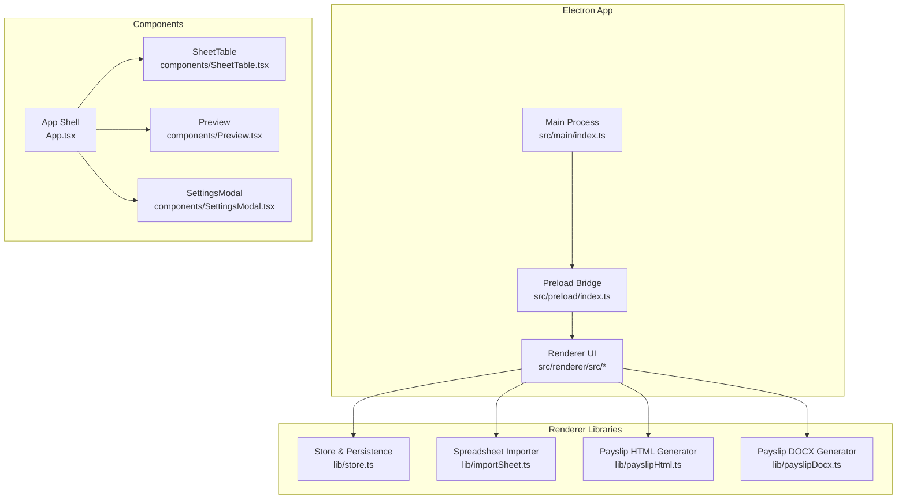
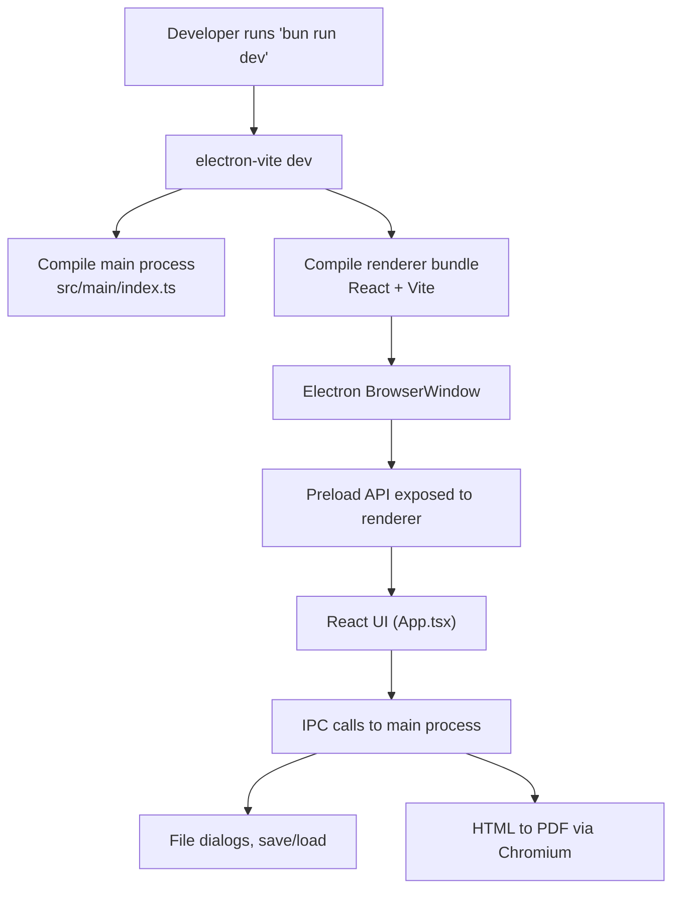
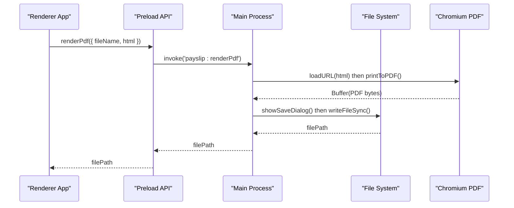
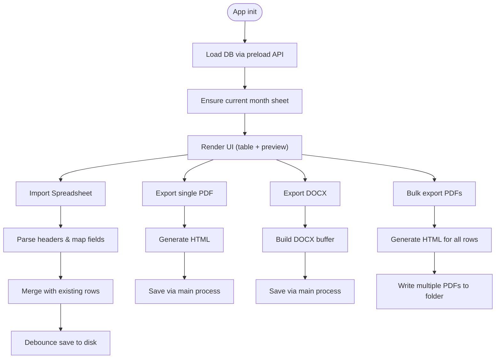
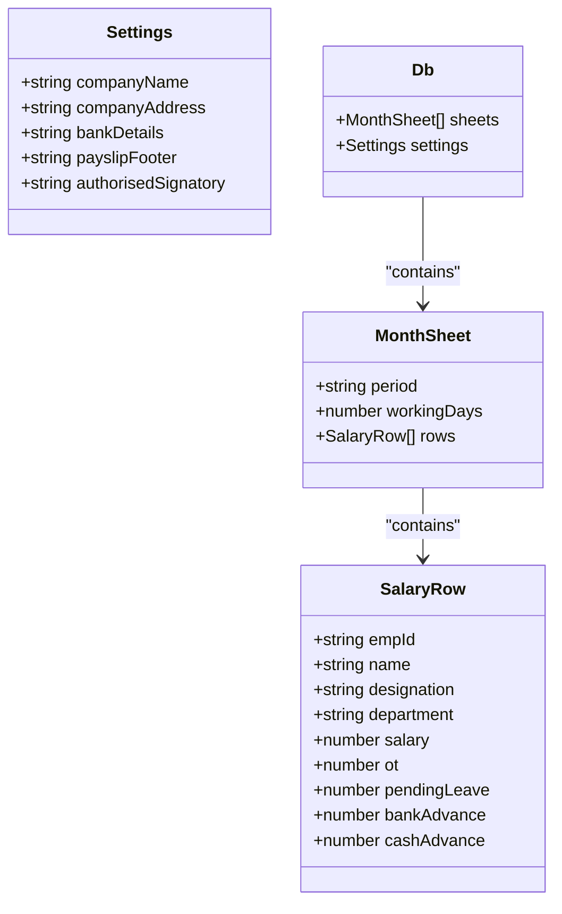
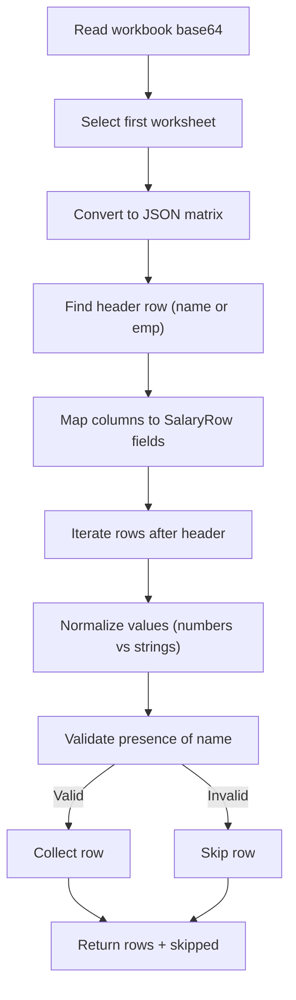
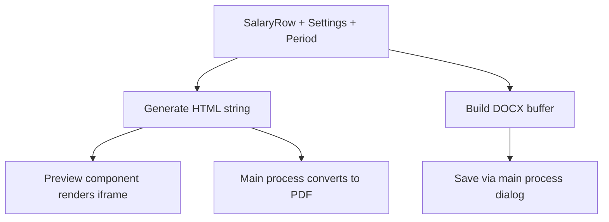
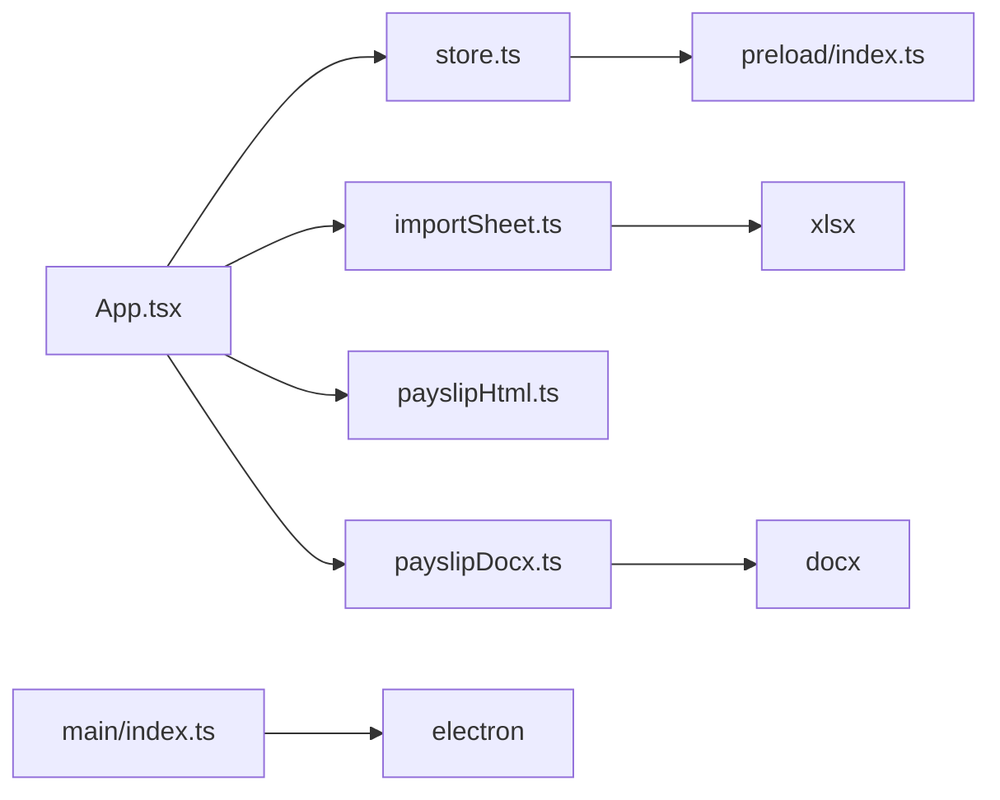

# Development Guide

<cite>
**Referenced Files in This Document**
- [README.md](file://README.md)
- [package.json](file://package.json)
- [electron.vite.config.ts](file://electron.vite.config.ts)
- [tsconfig.json](file://tsconfig.json)
- [tsconfig.node.json](file://tsconfig.node.json)
- [tsconfig.web.json](file://tsconfig.web.json)
- [src/main/index.ts](file://src/main/index.ts)
- [src/preload/index.ts](file://src/preload/index.ts)
- [src/renderer/src/main.tsx](file://src/renderer/src/main.tsx)
- [src/renderer/src/App.tsx](file://src/renderer/src/App.tsx)
- [src/renderer/src/types.ts](file://src/renderer/src/types.ts)
- [src/renderer/src/lib/store.ts](file://src/renderer/src/lib/store.ts)
- [src/renderer/src/lib/importSheet.ts](file://src/renderer/src/lib/importSheet.ts)
- [src/renderer/src/lib/payslipHtml.ts](file://src/renderer/src/lib/payslipHtml.ts)
- [src/renderer/src/lib/payslipDocx.ts](file://src/renderer/src/lib/payslipDocx.ts)
- [src/renderer/src/components/Preview.tsx](file://src/renderer/src/components/Preview.tsx)
- [src/renderer/src/components/SettingsModal.tsx](file://src/renderer/src/components/SettingsModal.tsx)
- [src/renderer/src/components/SheetTable.tsx](file://src/renderer/src/components/SheetTable.tsx)
</cite>

## Table of Contents
1. Introduction
2. Project Structure
3. Core Components
4. Architecture Overview
5. Detailed Component Analysis
6. Dependency Analysis
7. Performance Considerations
8. Troubleshooting Guide
9. Conclusion

## Introduction
This guide explains how to set up the development environment, run and debug the app, build production installers, extend features, and follow best practices for contributing to the Mabtech Payslip Generator. The project is an offline Windows desktop application built with Electron and React, using Vite for bundling and TypeScript across both Node.js and web contexts. It imports monthly salary sheets (Excel/CSV), renders live payslip previews, and exports individual or bulk PDFs and Word documents.

## Project Structure
The repository follows a clear separation between Electron main process, preload bridge, and renderer UI:
- Main process: system-level tasks like file dialogs, data persistence, and PDF rendering via Chromium’s print-to-PDF.
- Preload bridge: exposes a typed API to the renderer over IPC.
- Renderer: React application with components for table editing, settings, and preview; libraries for importing spreadsheets, generating HTML/DOCX payslips, and managing local state.

**Diagram sources**
- [src/main/index.ts:1-200](file://src/main/index.ts#L1-L200)
- [src/preload/index.ts:1-25](file://src/preload/index.ts#L1-L25)
- [src/renderer/src/App.tsx:1-289](file://src/renderer/src/App.tsx#L1-L289)
- [src/renderer/src/lib/store.ts:1-33](file://src/renderer/src/lib/store.ts#L1-L33)
- [src/renderer/src/lib/importSheet.ts:1-87](file://src/renderer/src/lib/importSheet.ts#L1-L87)
- [src/renderer/src/lib/payslipHtml.ts:1-164](file://src/renderer/src/lib/payslipHtml.ts#L1-L164)
- [src/renderer/src/lib/payslipDocx.ts:1-130](file://src/renderer/src/lib/payslipDocx.ts#L1-L130)
- [src/renderer/src/components/SheetTable.tsx:1-71](file://src/renderer/src/components/SheetTable.tsx#L1-L71)
- [src/renderer/src/components/Preview.tsx:1-29](file://src/renderer/src/components/Preview.tsx#L1-L29)
- [src/renderer/src/components/SettingsModal.tsx:1-43](file://src/renderer/src/components/SettingsModal.tsx#L1-L43)

**Section sources**
- [README.md:1-71](file://README.md#L1-L71)
- [package.json:1-59](file://package.json#L1-L59)

## Core Components
- Main process (Electron): Creates the app window, manages IPC handlers for database read/write, file operations, backup/restore, and PDF generation. Loads the renderer from dev URL or built index.html.
- Preload bridge: Exposes a safe API surface to the renderer via contextBridge.
- Renderer App: Orchestrates user actions, state management, import/export flows, and integrates with the main process through the preload API.
- Data model: Types define SalaryRow, MonthSheet, Settings, and Db, plus helpers for gross calculation and period labeling.
- Libraries:
  - store.ts: Load/save DB via preload API; manage current month sheet and default settings.
  - importSheet.ts: Parse Excel/CSV into normalized rows with flexible header mapping.
  - payslipHtml.ts: Generate printable HTML/CSS for each employee’s payslip.
  - payslipDocx.ts: Build DOCX files using docx library.
- Components:
  - SheetTable.tsx: Editable grid for employees and payroll fields.
  - Preview.tsx: Scaled iframe preview of generated HTML payslip.
  - SettingsModal.tsx: Company configuration editor.

**Section sources**
- [src/main/index.ts:1-200](file://src/main/index.ts#L1-L200)
- [src/preload/index.ts:1-25](file://src/preload/index.ts#L1-L25)
- [src/renderer/src/App.tsx:1-289](file://src/renderer/src/App.tsx#L1-L289)
- [src/renderer/src/types.ts:1-61](file://src/renderer/src/types.ts#L1-L61)
- [src/renderer/src/lib/store.ts:1-33](file://src/renderer/src/lib/store.ts#L1-L33)
- [src/renderer/src/lib/importSheet.ts:1-87](file://src/renderer/src/lib/importSheet.ts#L1-L87)
- [src/renderer/src/lib/payslipHtml.ts:1-164](file://src/renderer/src/lib/payslipHtml.ts#L1-L164)
- [src/renderer/src/lib/payslipDocx.ts:1-130](file://src/renderer/src/lib/payslipDocx.ts#L1-L130)
- [src/renderer/src/components/SheetTable.tsx:1-71](file://src/renderer/src/components/SheetTable.tsx#L1-L71)
- [src/renderer/src/components/Preview.tsx:1-29](file://src/renderer/src/components/Preview.tsx#L1-L29)
- [src/renderer/src/components/SettingsModal.tsx:1-43](file://src/renderer/src/components/SettingsModal.tsx#L1-L43)

## Architecture Overview
The app uses Electron-Vite to compile main and renderer bundles. The renderer runs React with Vite plugin support. TypeScript is configured separately for Node and web targets.

**Diagram sources**
- [package.json:9-14](file://package.json#L9-L14)
- [electron.vite.config.ts:1-11](file://electron.vite.config.ts#L1-L11)
- [src/main/index.ts:63-89](file://src/main/index.ts#L63-L89)
- [src/preload/index.ts:1-25](file://src/preload/index.ts#L1-L25)
- [src/renderer/src/main.tsx:1-10](file://src/renderer/src/main.tsx#L1-L10)

**Section sources**
- [package.json:9-14](file://package.json#L9-L14)
- [electron.vite.config.ts:1-11](file://electron.vite.config.ts#L1-L11)

## Detailed Component Analysis

### Development Environment Setup
- Install dependencies using Bun:
  - Run `bun install` to install all dependencies and native modules.
- Start development server:
  - Run `bun run dev` to launch the app with hot reloading for the renderer.
- If your terminal has `ELECTRON_RUN_AS_NODE=1`, prefix the command with `env -u ELECTRON_RUN_AS_NODE` to avoid running Electron as Node.

Data storage location:
- Windows: `%APPDATA%\mabtech-payslip\data\database.json`
- Linux: `~/.config/mabtech-payslip/data/database.json`

**Section sources**
- [README.md:17-26](file://README.md#L17-L26)
- [README.md:7-15](file://README.md#L7-L15)

### Build System and TypeScript Configuration
- Build system:
  - electron-vite orchestrates building main and renderer processes.
  - React plugin is enabled for the renderer.
- TypeScript:
  - Root tsconfig references node and web configs.
  - Node config includes main and preload code paths and extends Electron toolchain defaults.
  - Web config includes renderer code paths, enables JSX transform, and sets path aliases.

Key scripts:
- dev: Launches development mode.
- build: Compiles production bundles.
- preview: Previews built output.
- dist:win: Builds and packages NSIS installer for Windows x64.

**Section sources**
- [electron.vite.config.ts:1-11](file://electron.vite.config.ts#L1-L11)
- [tsconfig.json:1-8](file://tsconfig.json#L1-L8)
- [tsconfig.node.json:1-9](file://tsconfig.node.json#L1-L9)
- [tsconfig.web.json:1-13](file://tsconfig.web.json#L1-L13)
- [package.json:9-14](file://package.json#L9-L14)

### Main Process Responsibilities
- Window lifecycle and security:
  - Creates BrowserWindow with preload script and external link handling.
  - Loads dev URL when available, otherwise loads built renderer index.html.
- IPC handlers:
  - Database read/write with atomic writes using temp file rename.
  - Backup export/import with JSON validation.
  - File open/save dialogs for spreadsheets, PDFs, DOCX, and folders.
  - Bulk export of multiple payslips to a folder.
  - Logo asset loading as base64 data URL.
- PDF generation:
  - Uses offscreen BrowserWindow and Chromium’s printToPDF to convert HTML to PDF.

**Diagram sources**
- [src/renderer/src/App.tsx:141-144](file://src/renderer/src/App.tsx#L141-L144)
- [src/preload/index.ts:14-15](file://src/preload/index.ts#L14-L15)
- [src/main/index.ts:176-186](file://src/main/index.ts#L176-L186)

**Section sources**
- [src/main/index.ts:1-200](file://src/main/index.ts#L1-L200)

### Renderer Application Flow
- Initialization:
  - Loads DB from main process, ensures current month sheet exists, and fetches logo asset.
- State management:
  - Centralized mutation function debounces saves to disk.
  - Auto-flush on visibility change and beforeunload.
- Import flow:
  - Opens spreadsheet via main process dialog, parses headers flexibly, merges with existing rows, updates status.
- Export flows:
  - Single PDF: generate HTML, call main process to save PDF.
  - DOCX: build document buffer, save via main process dialog.
  - Bulk PDF: generate HTML for all rows, ask main process to write multiple PDFs to a folder.
  - CSV export: encode rows to CSV bytes and save via main process dialog.
- Settings:
  - Modal edits company details; changes persist immediately.

**Diagram sources**
- [src/renderer/src/App.tsx:25-48](file://src/renderer/src/App.tsx#L25-L48)
- [src/renderer/src/App.tsx:103-136](file://src/renderer/src/App.tsx#L103-L136)
- [src/renderer/src/App.tsx:138-184](file://src/renderer/src/App.tsx#L138-L184)
- [src/renderer/src/lib/importSheet.ts:41-80](file://src/renderer/src/lib/importSheet.ts#L41-L80)
- [src/renderer/src/lib/payslipHtml.ts:41-159](file://src/renderer/src/lib/payslipHtml.ts#L41-L159)
- [src/renderer/src/lib/payslipDocx.ts:50-128](file://src/renderer/src/lib/payslipDocx.ts#L50-L128)

**Section sources**
- [src/renderer/src/App.tsx:1-289](file://src/renderer/src/App.tsx#L1-L289)

### Data Model and Helpers
- SalaryRow: Employee record fields including identifiers, compensation, leave, and advances.
- MonthSheet: Monthly collection of rows plus working days.
- Settings: Company branding and footer/signatory text.
- Db: Top-level container for sheets and settings.
- Helpers:
  - grossOf: Computes net payable/recoverable amount.
  - periodLabel: Formats YYYY-MM into readable month/year label.

**Diagram sources**
- [src/renderer/src/types.ts:1-61](file://src/renderer/src/types.ts#L1-L61)

**Section sources**
- [src/renderer/src/types.ts:1-61](file://src/renderer/src/types.ts#L1-L61)

### Spreadsheet Import Logic
- Header mapping:
  - Flexible aliasing for common column names; ignores computed columns like gross/total/net.
  - Normalizes headers by stripping non-alphanumeric characters and matching against known aliases.
- Row parsing:
  - Converts numeric fields safely; skips empty or invalid rows; requires at least a name field.
- Output:
  - Returns normalized SalaryRow array and count of skipped rows.

**Diagram sources**
- [src/renderer/src/lib/importSheet.ts:41-80](file://src/renderer/src/lib/importSheet.ts#L41-L80)

**Section sources**
- [src/renderer/src/lib/importSheet.ts:1-87](file://src/renderer/src/lib/importSheet.ts#L1-L87)

### Payslip Generation (HTML and DOCX)
- HTML generator:
  - Produces A4-sized printable HTML with earnings/deductions tables, net pay line, amount-in-words, optional bank details, signature lines, and footer.
  - Handles negative net amounts with distinct styling and messaging.
- DOCX generator:
  - Builds structured Word document with formatted tables, headings, and optional logo image.
  - Reuses amount-in-words formatting and INR currency formatting.

**Diagram sources**
- [src/renderer/src/lib/payslipHtml.ts:41-159](file://src/renderer/src/lib/payslipHtml.ts#L41-L159)
- [src/renderer/src/lib/payslipDocx.ts:50-128](file://src/renderer/src/lib/payslipDocx.ts#L50-L128)
- [src/renderer/src/components/Preview.tsx:1-29](file://src/renderer/src/components/Preview.tsx#L1-L29)

**Section sources**
- [src/renderer/src/lib/payslipHtml.ts:1-164](file://src/renderer/src/lib/payslipHtml.ts#L1-L164)
- [src/renderer/src/lib/payslipDocx.ts:1-130](file://src/renderer/src/lib/payslipDocx.ts#L1-L130)
- [src/renderer/src/components/Preview.tsx:1-29](file://src/renderer/src/components/Preview.tsx#L1-L29)

### Code Organization Principles and Naming Conventions
- Separation of concerns:
  - Main process handles OS-level operations and IPC.
  - Preload exposes a minimal, typed API to the renderer.
  - Renderer contains UI components and business logic libraries.
- Naming:
  - Use descriptive module names reflecting responsibility (store, importSheet, payslipHtml, payslipDocx).
  - Component files use PascalCase and match exported component names.
  - Types are grouped in types.ts with clear domain semantics.
- Path aliases:
  - Renderer supports @renderer/* alias for cleaner imports within the web bundle.

**Section sources**
- [tsconfig.web.json:4-11](file://tsconfig.web.json#L4-L11)
- [src/renderer/src/types.ts:1-61](file://src/renderer/src/types.ts#L1-L61)

### Contribution Guidelines
- Workflow:
  - Fork the repository, create feature branches, and submit pull requests with clear descriptions.
  - Keep commits focused and messages descriptive.
- Testing:
  - Manually test import/export flows, settings changes, and bulk operations.
  - Validate edge cases: missing IDs, negative net amounts, large datasets.
- Documentation:
  - Update README or inline comments when adding new features or changing behaviors.
- Security:
  - Avoid exposing unnecessary APIs in preload; validate inputs in main process.

[No sources needed since this section provides general guidance]

### Building Production Installers
- Windows installer:
  - Run `bun run dist:win` on a Windows machine to produce a self-contained NSIS installer under release.
  - On Linux, you can build via Wine by installing wine64 and running the same script.
- Output:
  - Installer file named with product version and setup suffix.

**Section sources**
- [README.md:27-37](file://README.md#L27-L37)
- [README.md:67-71](file://README.md#L67-L71)
- [package.json:37-57](file://package.json#L37-L57)

### Testing Procedures
- Manual testing checklist:
  - Import various Excel/CSV formats and verify header mapping.
  - Add/edit/delete rows and confirm auto-save behavior.
  - Generate single PDF/DOCX per employee and verify formatting.
  - Perform bulk PDF export and confirm folder creation and file naming.
  - Backup/restore database and ensure integrity.
- Validation:
  - Check warnings for negative net amounts and missing employee codes.
  - Confirm that gross calculations match expected formulas.

**Section sources**
- [src/renderer/src/App.tsx:237-248](file://src/renderer/src/App.tsx#L237-L248)
- [src/renderer/src/types.ts:52-53](file://src/renderer/src/types.ts#L52-L53)

### Deployment Strategies
- Distribution:
  - Share the generated Windows installer; it is self-contained and does not require internet access.
- Data portability:
  - Use Backup/Restore to move data between machines.
- Offline operation:
  - No server or hosting required; all processing happens locally.

**Section sources**
- [README.md:1-6](file://README.md#L1-L6)
- [README.md:67-71](file://README.md#L67-L71)

## Dependency Analysis
External dependencies:
- Electron ecosystem: electron, electron-builder, electron-vite, @electron-toolkit/* utilities.
- UI stack: react, react-dom, vite, @vitejs/plugin-react.
- Data processing: xlsx (spreadsheet parsing), papaparse (CSV parsing), docx (Word document generation).

**Diagram sources**
- [src/renderer/src/App.tsx:1-11](file://src/renderer/src/App.tsx#L1-L11)
- [src/renderer/src/lib/store.ts:1-33](file://src/renderer/src/lib/store.ts#L1-L33)
- [src/renderer/src/lib/importSheet.ts:1-87](file://src/renderer/src/lib/importSheet.ts#L1-L87)
- [src/renderer/src/lib/payslipDocx.ts:1-130](file://src/renderer/src/lib/payslipDocx.ts#L1-L130)
- [src/main/index.ts:1-5](file://src/main/index.ts#L1-L5)
- [package.json:16-35](file://package.json#L16-L35)

**Section sources**
- [package.json:16-35](file://package.json#L16-L35)

## Performance Considerations
- Debounced persistence:
  - Renderer debounces saves to reduce frequent disk writes during rapid edits.
- Efficient imports:
  - Spreadsheet parser normalizes and validates rows efficiently, skipping invalid entries.
- PDF generation:
  - Offscreen BrowserWindow minimizes UI overhead during PDF conversion.
- Rendering optimization:
  - Preview component scales iframe content to fit container without reflows.

Recommendations:
- Batch operations where possible (e.g., bulk export already implemented).
- Avoid heavy computations in render loops; keep them in libraries.
- Monitor memory usage when processing very large spreadsheets.

**Section sources**
- [src/renderer/src/App.tsx:38-48](file://src/renderer/src/App.tsx#L38-L48)
- [src/renderer/src/lib/importSheet.ts:41-80](file://src/renderer/src/lib/importSheet.ts#L41-L80)
- [src/main/index.ts:45-61](file://src/main/index.ts#L45-L61)
- [src/renderer/src/components/Preview.tsx:1-29](file://src/renderer/src/components/Preview.tsx#L1-L29)

## Troubleshooting Guide
Common issues and resolutions:
- Terminal environment variable conflict:
  - If `ELECTRON_RUN_AS_NODE=1` is set, prefix dev command with `env -u ELECTRON_RUN_AS_NODE`.
- Missing data directory:
  - Main process creates the data directory automatically on first write.
- Invalid backup file:
  - Restore validates structure; ensure the file contains a valid sheets array.
- Spreadsheet import errors:
  - Verify headers match supported aliases; check for blank or malformed rows.
- PDF generation failures:
  - Ensure HTML is well-formed; Chromium’s printToPDF requires valid markup.

**Section sources**
- [README.md:24-25](file://README.md#L24-L25)
- [src/main/index.ts:27-41](file://src/main/index.ts#L27-L41)
- [src/main/index.ts:114-125](file://src/main/index.ts#L114-L125)
- [src/renderer/src/lib/importSheet.ts:41-80](file://src/renderer/src/lib/importSheet.ts#L41-L80)

## Conclusion
This guide provided a comprehensive overview of setting up the development environment, understanding the architecture, and following best practices for contributing to the Mabtech Payslip Generator. By adhering to the outlined workflows, naming conventions, and performance tips, contributors can extend the application confidently while maintaining reliability and usability.