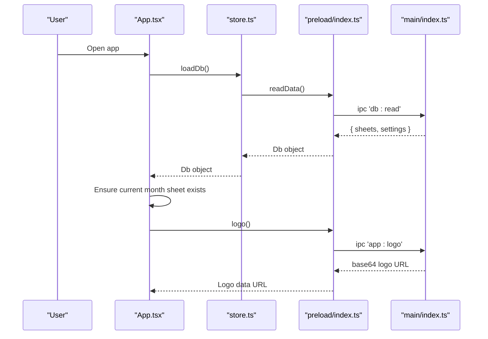
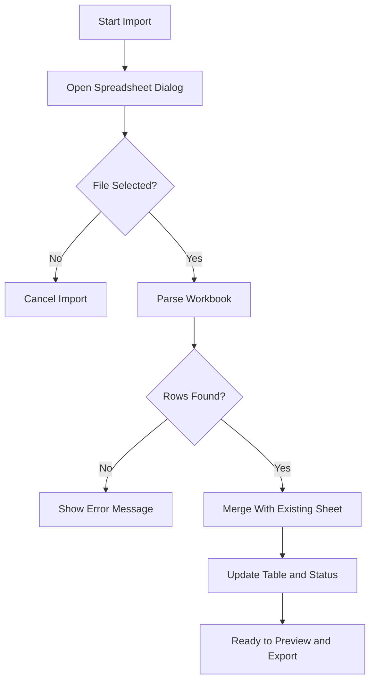
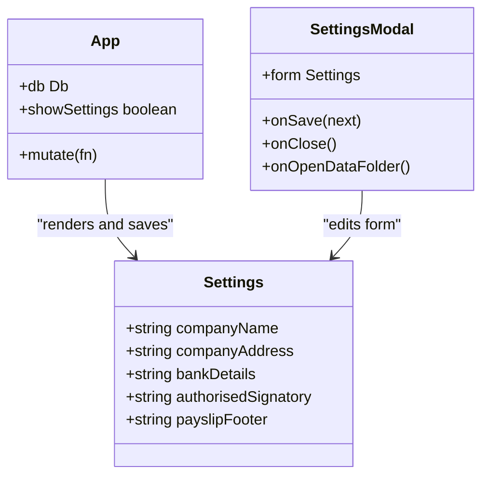
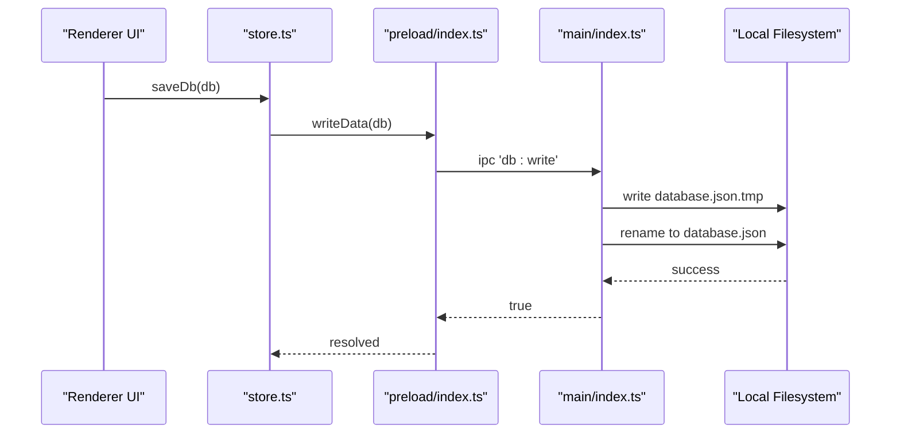

# Getting Started

<cite>
**Referenced Files in This Document**
- [README.md](file://README.md)
- [package.json](file://package.json)
- [electron.vite.config.js](file://electron.vite.config.js)
- [src/main/index.ts](file://src/main/index.ts)
- [src/preload/index.ts](file://src/preload/index.ts)
- [src/renderer/src/App.tsx](file://src/renderer/src/App.tsx)
- [src/renderer/src/lib/store.ts](file://src/renderer/src/lib/store.ts)
- [src/renderer/src/lib/importSheet.ts](file://src/renderer/src/lib/importSheet.ts)
- [src/renderer/src/components/SettingsModal.tsx](file://src/renderer/src/components/SettingsModal.tsx)
- [src/renderer/src/types.ts](file://src/renderer/src/types.ts)
</cite>

## Table of Contents
1. [Introduction](#introduction)
2. [System Requirements and Supported Platforms](#system-requirements-and-supported-platforms)
3. [Installation with Bun](#installation-with-bun)
4. [First Launch and Initial Setup](#first-launch-and-initial-setup)
5. [Basic Workflow: Create Your First Payslip](#basic-workflow-create-your-first-payslip)
6. [Company Settings and Branding](#company-settings-and-branding)
7. [Data Storage, Backup, and Restore](#data-storage-backup-and-restore)
8. [Troubleshooting Common Issues](#troubleshooting-common-issues)
9. [Next Steps](#next-steps)

## Introduction
Mabtech Payslip Generator is an offline Windows desktop application built with Electron and React. It imports monthly salary sheets from Excel or CSV files, shows a live payslip preview for each employee, and exports individual payslips as PDF or Word documents. The app does not require internet access, external servers, or hosting.

Key capabilities include:
- Importing monthly salary data from `.xlsx`, `.xls`, or `.csv` files.
- Editing employee rows directly in the table.
- Previewing each employee’s payslip in real time.
- Exporting one payslip at a time as PDF or Word.
- Bulk exporting all current month’s payslips as PDFs into a folder.
- Saving company branding and payment details to printed payslips.
- Backing up and restoring your local database.

**Section sources**
- [README.md:1-6](file://README.md#L1-L6)
- [README.md:39-65](file://README.md#L39-L65)

## System Requirements and Supported Platforms
- **Primary platform:** Windows desktop.
- **Runtime:** Node.js toolchain managed by Bun.
- **Development build:** Uses Electron and Vite through `electron-vite`.
- **Packaging target:** Windows NSIS installer (`x64`).

The project metadata defines the app name, Electron runtime, React frontend, and Windows installer configuration. The README also states that this is an offline Windows desktop app.

**Section sources**
- [README.md:1-5](file://README.md#L1-L5)
- [package.json:1-14](file://package.json#L1-L14)
- [package.json:37-57](file://package.json#L37-L57)

## Installation with Bun
You can install dependencies and run the app using Bun.

### Install dependencies
Run:
```bash
bun install
```

This installs Electron, React, TypeScript, Vite, Excel/CSV parsing libraries, and other project dependencies declared in the package configuration.

### Run the development server
Run:
```bash
bun run dev
```

This launches the Electron window and loads the React renderer. If you start it from a terminal where `ELECTRON_RUN_AS_NODE=1` is set, prefix the command with `env -u ELECTRON_RUN_AS_NODE` as documented.

### Build the Windows installer
On a Windows machine, run:
```bash
bun install
bun run dist:win
```

This builds the app and produces a self-contained Windows installer under the release directory. Building from Linux requires Wine.

**Section sources**
- [README.md:17-37](file://README.md#L17-L37)
- [README.md:67-70](file://README.md#L67-L70)
- [package.json:9-14](file://package.json#L9-L14)
- [package.json:37-57](file://package.json#L37-L57)
- [electron.vite.config.js:1-9](file://electron.vite.config.js#L1-L9)

## First Launch and Initial Setup
When you launch the app for the first time:
1. The main window opens with the current month selected.
2. A default empty sheet is created if no sheet exists for the current period.
3. The app loads company settings with sensible defaults.
4. You can open the data folder from the Settings modal to inspect the local JSON database.

At startup, the renderer loads the database through the preload bridge, ensures a sheet exists for the current month, and fetches the embedded Mabtech logo.



**Diagram sources**
- [src/renderer/src/App.tsx:25-36](file://src/renderer/src/App.tsx#L25-L36)
- [src/renderer/src/lib/store.ts:8-18](file://src/renderer/src/lib/store.ts#L8-L18)
- [src/preload/index.ts:3-22](file://src/preload/index.ts#L3-L22)
- [src/main/index.ts:91-101](file://src/main/index.ts#L91-L101)
- [src/main/index.ts:188-189](file://src/main/index.ts#L188-L189)

After launch, verify:
- The top bar shows the current salary month.
- The table area is ready for import or manual entry.
- The preview pane is waiting for an employee row.

**Section sources**
- [src/renderer/src/App.tsx:25-36](file://src/renderer/src/App.tsx#L25-L36)
- [src/renderer/src/lib/store.ts:20-32](file://src/renderer/src/lib/store.ts#L20-L32)

## Basic Workflow: Create Your First Payslip
Follow these steps to create your first payslip within minutes.

### Step 1: Prepare your salary sheet
Prepare an Excel or CSV file with employee data. The importer auto-matches headers such as:
- Employee code
- Employee name
- Designation
- Department
- Monthly salary
- Overtime amount
- Leave days
- Bank advance deduction
- Cash advance deduction

Gross salary or total columns are ignored because the app computes net values using the formula:
`Salary + Overtime − Bank Advance − Cash Advance`.

Each month should be represented by its own sheet when importing.

**Section sources**
- [README.md:39-59](file://README.md#L39-L59)
- [src/renderer/src/lib/importSheet.ts:4-17](file://src/renderer/src/lib/importSheet.ts#L4-L17)
- [src/renderer/src/types.ts:1-17](file://src/renderer/src/types.ts#L1-L17)

### Step 2: Import employee data
1. Select the correct **Salary month** in the top bar.
2. Click **Import Excel / CSV**.
3. Choose your spreadsheet file.
4. Review the imported rows in the table.
5. Use the status message to confirm how many employees were added or updated.

If no rows are found, check that the file contains recognizable headers like `EMP ID`, `NAME`, and `SALARY`.



**Diagram sources**
- [src/renderer/src/App.tsx:103-136](file://src/renderer/src/App.tsx#L103-L136)
- [src/renderer/src/lib/importSheet.ts:41-79](file://src/renderer/src/lib/importSheet.ts#L41-L79)

### Step 3: Edit employee rows
You can edit any cell directly in the table. Changes are saved automatically after a short delay. You can also:
- Add a new employee row.
- Delete an existing row.
- Change the number of working days for the month.

Warnings appear if:
- Advances exceed salary, making the net payable negative.
- Some rows are missing an employee code.

**Section sources**
- [src/renderer/src/App.tsx:76-101](file://src/renderer/src/App.tsx#L76-L101)
- [src/renderer/src/App.tsx:237-248](file://src/renderer/src/App.tsx#L237-L248)

### Step 4: Preview the payslip
Select an employee row to see a live payslip preview. The preview uses the current month, working days, company settings, and embedded logo.

**Section sources**
- [src/renderer/src/App.tsx:138-143](file://src/renderer/src/App.tsx#L138-L143)
- [src/renderer/src/App.tsx:265-271](file://src/renderer/src/App.tsx#L265-L271)

### Step 5: Export a single payslip
Choose one export format:
- **PDF:** Renders HTML to PDF using Electron’s print-to-PDF API and saves the file.
- **Word:** Builds a DOCX document and saves it through the save dialog.

**Section sources**
- [src/renderer/src/App.tsx:141-160](file://src/renderer/src/App.tsx#L141-L160)
- [src/main/index.ts:176-186](file://src/main/index.ts#L176-L186)

### Step 6: Export all payslips as PDF
Click **Download all payslips (PDF)** to export every employee in the current month. The app asks for a destination folder and creates a dated folder containing one PDF per employee.

**Section sources**
- [src/renderer/src/App.tsx:162-173](file://src/renderer/src/App.tsx#L162-L173)
- [src/main/index.ts:156-174](file://src/main/index.ts#L156-L174)

## Company Settings and Branding
Open **Settings** to configure:
- Company name shown on the payslip.
- Company address.
- Optional payment or bank details line.
- Authorized signatory label.
- Payslip footer disclaimer.

These settings are stored with the rest of the database and applied to generated payslips.



**Diagram sources**
- [src/renderer/src/types.ts:19-38](file://src/renderer/src/types.ts#L19-L38)
- [src/renderer/src/components/SettingsModal.tsx:11-41](file://src/renderer/src/components/SettingsModal.tsx#L11-L41)
- [src/renderer/src/App.tsx:274-285](file://src/renderer/src/App.tsx#L274-L285)

**Section sources**
- [src/renderer/src/components/SettingsModal.tsx:11-41](file://src/renderer/src/components/SettingsModal.tsx#L11-L41)
- [src/renderer/src/types.ts:19-38](file://src/renderer/src/types.ts#L19-L38)
- [src/renderer/src/App.tsx:274-285](file://src/renderer/src/App.tsx#L274-L285)

## Data Storage, Backup, and Restore
All application data is stored locally on your computer in a JSON file. The README lists the default locations for Windows and Linux. The main process manages reading, writing, backing up, and restoring this data.

Important behaviors:
- Database reads return sheets and settings.
- Writes use a temporary file and rename operation for safer persistence.
- Backup exports the current database to a JSON file.
- Restore validates that the backup contains a valid sheets array before replacing the local database.
- The Settings modal provides a link to open the data folder.



**Diagram sources**
- [src/renderer/src/lib/store.ts:16-18](file://src/renderer/src/lib/store.ts#L16-L18)
- [src/preload/index.ts:3-6](file://src/preload/index.ts#L3-L6)
- [src/main/index.ts:36-41](file://src/main/index.ts#L36-L41)

For backups:
- Use **Backup** to export the database to a JSON file.
- Use **Restore** to load a previously exported backup.
- Use **Open data folder** to locate the local database file.

**Section sources**
- [README.md:7-15](file://README.md#L7-L15)
- [src/main/index.ts:22-41](file://src/main/index.ts#L22-L41)
- [src/main/index.ts:103-125](file://src/main/index.ts#L103-L125)
- [src/renderer/src/components/SettingsModal.tsx:31-34](file://src/renderer/src/components/SettingsModal.tsx#L31-L34)

## Troubleshooting Common Issues
- **No employees imported:** Check that the file contains recognizable headers such as `EMP ID`, `NAME`, and `SALARY`. The importer skips rows without a name or meaningful fields.
- **Negative net salary:** When advances exceed salary, the app marks the net as recoverable and highlights affected employees. Correct deductions or carry forward balances before exporting.
- **Missing employee codes:** Rows without an employee code trigger a warning. Fill in the employee code column to avoid warnings.
- **App does not start from a terminal with `ELECTRON_RUN_AS_NODE=1`:** Prefix the dev command with `env -u ELECTRON_RUN_AS_NODE`.
- **Cannot build the Windows installer from Linux:** Install Wine and then run the Windows distribution script.
- **Need to find the database file:** Open the Settings modal and click **Open data folder**.

**Section sources**
- [README.md:24-25](file://README.md#L24-L25)
- [README.md:36-37](file://README.md#L36-L37)
- [README.md:61-65](file://README.md#L61-L65)
- [src/renderer/src/App.tsx:109-132](file://src/renderer/src/App.tsx#L109-L132)
- [src/renderer/src/App.tsx:237-248](file://src/renderer/src/App.tsx#L237-L248)

## Next Steps
After creating your first payslip:
- Organize one sheet per month in your source spreadsheets.
- Keep employee codes consistent so imports merge correctly.
- Configure company settings once and reuse them across months.
- Export individual payslips for HR records or bulk-export all PDFs for payroll distribution.
- Use Backup and Restore to move data between computers or keep safe copies.

With these steps, you should be able to run Mabtech Payslip Generator, import employee data, configure company branding, and generate professional payslips quickly.