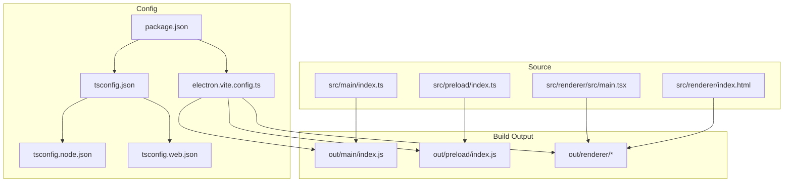
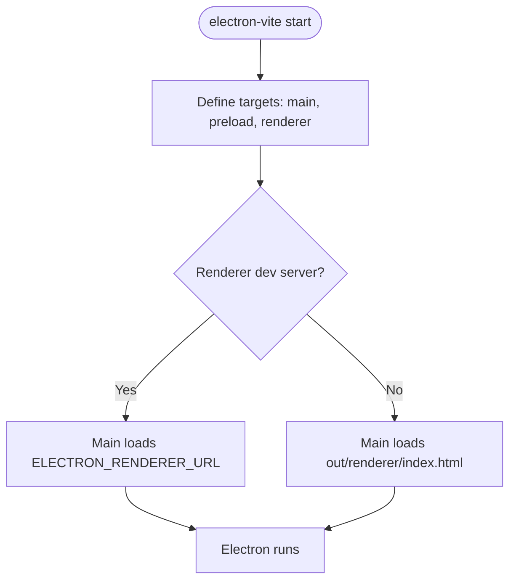
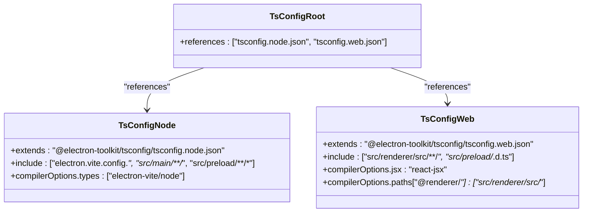
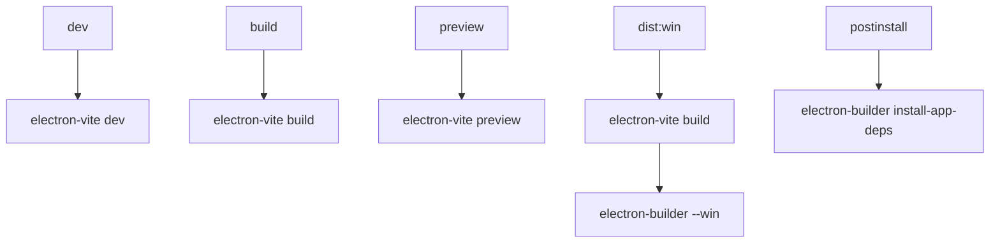
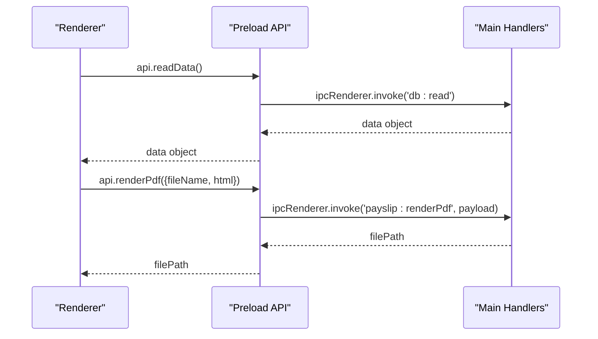
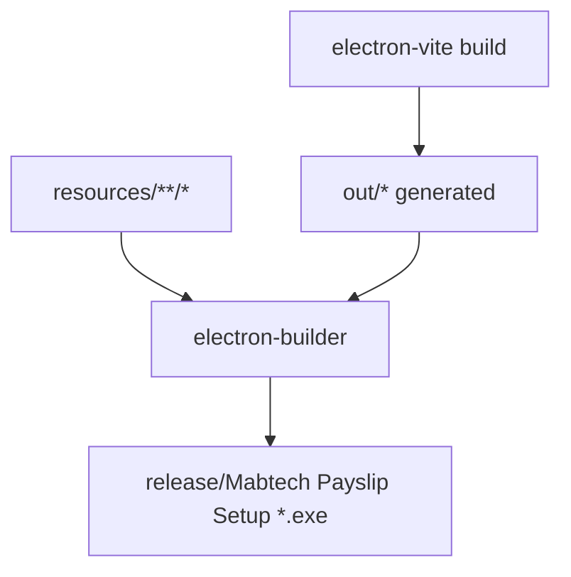
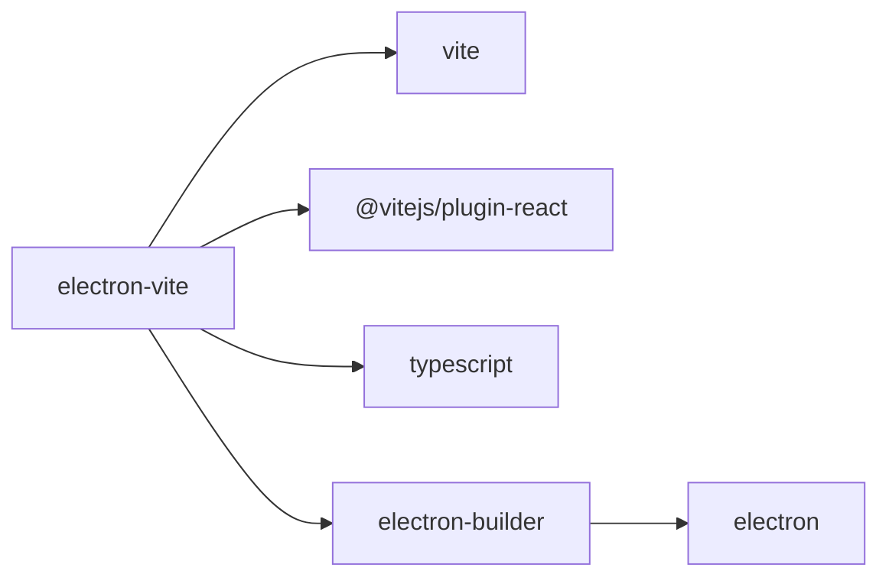

# Build System Configuration

<cite>
**Referenced Files in This Document**   
- [package.json](file://package.json)
- [electron.vite.config.ts](file://electron.vite.config.ts)
- [tsconfig.json](file://tsconfig.json)
- [tsconfig.node.json](file://tsconfig.node.json)
- [tsconfig.web.json](file://tsconfig.web.json)
- [src/main/index.ts](file://src/main/index.ts)
- [src/preload/index.ts](file://src/preload/index.ts)
- [src/renderer/src/main.tsx](file://src/renderer/src/main.tsx)
- [src/renderer/index.html](file://src/renderer/index.html)
- [README.md](file://README.md)
</cite>

## Table of Contents
1. [Introduction](#introduction)
2. [Project Structure](#project-structure)
3. [Core Components](#core-components)
4. [Architecture Overview](#architecture-overview)
5. [Detailed Component Analysis](#detailed-component-analysis)
6. [Dependency Analysis](#dependency-analysis)
7. [Performance Considerations](#performance-considerations)
8. [Troubleshooting Guide](#troubleshooting-guide)
9. [Conclusion](#conclusion)

## Introduction
This document explains the build system and configuration architecture for an Electron application built with Vite and TypeScript. It covers:
- How Vite is configured to build separate main, preload, and renderer bundles
- Development server behavior and production output
- TypeScript configuration across node, web, and shared type contexts
- Package scripts for development, building, previewing, and distribution
- Asset handling, code splitting, and bundle optimization
- Environment-specific settings, debugging setup, and common issues
- The end-to-end workflow from source to packaged installer using electron-vite and electron-builder

## Project Structure
The project follows a standard Electron layout with clear separation between processes:
- Main process: Node.js entry point that creates windows and handles IPC
- Preload script: Secure bridge exposing a typed API to the renderer
- Renderer process: React-based UI bundled by Vite
- Configuration files: Vite config, multiple TypeScript configs, and package metadata



**Diagram sources**
- [package.json:10-14](file://package.json#L10-L14)
- [electron.vite.config.ts:1-11](file://electron.vite.config.ts#L1-L11)
- [tsconfig.json:1-8](file://tsconfig.json#L1-L8)
- [tsconfig.node.json:1-9](file://tsconfig.node.json#L1-L9)
- [tsconfig.web.json:1-13](file://tsconfig.web.json#L1-L13)
- [src/main/index.ts:1-200](file://src/main/index.ts#L1-L200)
- [src/preload/index.ts:1-25](file://src/preload/index.ts#L1-L25)
- [src/renderer/src/main.tsx:1-10](file://src/renderer/src/main.tsx#L1-L10)
- [src/renderer/index.html:1-13](file://src/renderer/index.html#L1-L13)

**Section sources**
- [package.json:1-59](file://package.json#L1-L59)
- [electron.vite.config.ts:1-11](file://electron.vite.config.ts#L1-L11)
- [tsconfig.json:1-8](file://tsconfig.json#L1-L8)
- [tsconfig.node.json:1-9](file://tsconfig.node.json#L1-L9)
- [tsconfig.web.json:1-13](file://tsconfig.web.json#L1-L13)
- [src/main/index.ts:1-200](file://src/main/index.ts#L1-L200)
- [src/preload/index.ts:1-25](file://src/preload/index.ts#L1-L25)
- [src/renderer/src/main.tsx:1-10](file://src/renderer/src/main.tsx#L1-L10)
- [src/renderer/index.html:1-13](file://src/renderer/index.html#L1-L13)

## Core Components
- Vite configuration via electron-vite defines three targets: main, preload, and renderer. The renderer target includes the React plugin.
- TypeScript uses a root composite config referencing two environment-specific configs:
  - tsconfig.node.json for Node-side code (main and preload)
  - tsconfig.web.json for browser-side code (renderer)
- Package scripts orchestrate development, building, previewing, and packaging with electron-builder.

Key responsibilities:
- electron-vite compiles each target into out/ and serves the dev server for the renderer while launching Electron pointing at the dev URL.
- TypeScript ensures type checking across environments and enables path aliases for the renderer.
- electron-builder packages the compiled assets and resources into platform installers.

**Section sources**
- [electron.vite.config.ts:1-11](file://electron.vite.config.ts#L1-L11)
- [tsconfig.json:1-8](file://tsconfig.json#L1-L8)
- [tsconfig.node.json:1-9](file://tsconfig.node.json#L1-L9)
- [tsconfig.web.json:1-13](file://tsconfig.web.json#L1-L13)
- [package.json:10-14](file://package.json#L10-L14)

## Architecture Overview
The build pipeline integrates three tools:
- electron-vite: orchestrates Vite builds per Electron target and provides a dev server
- TypeScript: performs type-checking and emits declarations for both Node and Web targets
- electron-builder: packages the final app and produces installers

```mermaid
sequenceDiagram
participant Dev as "Developer"
participant Scripts as "npm/yarn/bun scripts"
participant EVite as "electron-vite"
participant Vite as "Vite"
participant TS as "TypeScript"
participant EBuilder as "electron-builder"
participant App as "Electron App"
Dev->>Scripts : run dev/build/dist
Scripts->>EVite : invoke electron-vite
EVite->>TS : type-check (composite projects)
EVite->>Vite : build main/preload/renderer
Vite-->>EVite : emit out/*
EVite-->>App : launch Electron with dev URL or built files
Note over EVite,App : Dev server serves renderer; main loads it
Scripts->>EBuilder : package out/* and resources
EBuilder-->>Dev : produce installers in release/
```

**Diagram sources**
- [package.json:10-14](file://package.json#L10-L14)
- [electron.vite.config.ts:1-11](file://electron.vite.config.ts#L1-L11)
- [tsconfig.json:1-8](file://tsconfig.json#L1-L8)

## Detailed Component Analysis

### Vite Configuration for Electron
- electron-vite config declares three targets:
  - main: Node process entry
  - preload: Bridge script
  - renderer: Browser UI with React plugin enabled
- During development, the main process loads the renderer from the dev server URL when available; otherwise it loads the built HTML file.



**Diagram sources**
- [electron.vite.config.ts:1-11](file://electron.vite.config.ts#L1-L11)
- [src/main/index.ts:84-88](file://src/main/index.ts#L84-L88)

**Section sources**
- [electron.vite.config.ts:1-11](file://electron.vite.config.ts#L1-L11)
- [src/main/index.ts:84-88](file://src/main/index.ts#L84-L88)

### TypeScript Configuration Across Environments
- Root tsconfig.json references two composite projects:
  - tsconfig.node.json: extends toolkit defaults for Node, includes main and preload sources, sets types for electron-vite/node
  - tsconfig.web.json: extends toolkit defaults for Web, includes renderer sources and preload type declarations, enables React JSX transform and path alias @renderer/*
- Composite mode allows incremental builds and IDE integration across both environments.



**Diagram sources**
- [tsconfig.json:1-8](file://tsconfig.json#L1-L8)
- [tsconfig.node.json:1-9](file://tsconfig.node.json#L1-L9)
- [tsconfig.web.json:1-13](file://tsconfig.web.json#L1-L13)

**Section sources**
- [tsconfig.json:1-8](file://tsconfig.json#L1-L8)
- [tsconfig.node.json:1-9](file://tsconfig.node.json#L1-L9)
- [tsconfig.web.json:1-13](file://tsconfig.web.json#L1-L13)

### Package Scripts and Distribution
- Development:
  - dev: starts electron-vite dev server and launches Electron
  - preview: previews the built renderer without Electron
- Building:
  - build: compiles all targets into out/
- Distribution:
  - dist:win: builds then packages with electron-builder for Windows NSIS installer
  - postinstall: installs native dependencies required by electron-builder



**Diagram sources**
- [package.json:10-14](file://package.json#L10-L14)

**Section sources**
- [package.json:10-14](file://package.json#L1-L14)
- [package.json:37-57](file://package.json#L37-L57)

### Renderer Entry and Asset Handling
- The renderer HTML defines a CSP policy and mounts the React app via a module script.
- The main process loads either the dev server URL or the built index.html depending on environment.
- Assets such as images are referenced relative to the renderer build and can be served via data URLs or local paths.

```mermaid
sequenceDiagram
participant Main as "Main Process"
participant Dev as "Dev Server"
participant Renderer as "Renderer Bundle"
participant HTML as "index.html"
Main->>HTML : loadFile("out/renderer/index.html") or loadURL(dev URL)
HTML->>Renderer : import "/src/main.tsx"
Renderer->>Renderer : render React App
Note over Main,Renderer : CSP restricts external sources; inline styles allowed
```

**Diagram sources**
- [src/renderer/index.html:1-13](file://src/renderer/index.html#L1-L13)
- [src/renderer/src/main.tsx:1-10](file://src/renderer/src/main.tsx#L1-L10)
- [src/main/index.ts:84-88](file://src/main/index.ts#L84-L88)

**Section sources**
- [src/renderer/index.html:1-13](file://src/renderer/index.html#L1-L13)
- [src/renderer/src/main.tsx:1-10](file://src/renderer/src/main.tsx#L1-L10)
- [src/main/index.ts:84-88](file://src/main/index.ts#L84-L88)

### IPC Bridge Between Renderer and Main
- The preload script exposes a typed API to the renderer via contextBridge.
- The main process registers handlers for database operations, file dialogs, PDF generation, and folder access.



**Diagram sources**
- [src/preload/index.ts:1-25](file://src/preload/index.ts#L1-L25)
- [src/main/index.ts:95-189](file://src/main/index.ts#L95-L189)

**Section sources**
- [src/preload/index.ts:1-25](file://src/preload/index.ts#L1-L25)
- [src/main/index.ts:95-189](file://src/main/index.ts#L95-L189)

### Production Packaging with electron-builder
- The build section in package.json configures:
  - Application ID and product name
  - Output directory set to release/
  - Included files: out/**/* and resources/**/*
  - Windows NSIS installer options
- The dist:win script chains electron-vite build and electron-builder to produce a self-contained installer.



**Diagram sources**
- [package.json:37-57](file://package.json#L37-L57)
- [package.json:13](file://package.json#L13)

**Section sources**
- [package.json:37-57](file://package.json#L37-L57)
- [package.json:13](file://package.json#L13)

## Dependency Analysis
The build depends on:
- electron-vite to coordinate Vite builds per Electron target
- vite and @vitejs/plugin-react for bundling the renderer
- TypeScript for type checking and declaration emission
- electron-builder for packaging and installer creation



**Diagram sources**
- [package.json:24-35](file://package.json#L24-L35)
- [package.json:30-35](file://package.json#L30-L35)

**Section sources**
- [package.json:24-35](file://package.json#L24-L35)

## Performance Considerations
- Code splitting:
  - Vite splits the renderer bundle by default; React components can be further split via dynamic imports if needed.
- Bundle size:
  - Only necessary dependencies should be included in the renderer.
  - Large libraries (e.g., spreadsheet parsers) should be loaded lazily if possible.
- Asset handling:
  - Prefer small inline assets (data URLs) for logos used in PDFs to avoid extra network requests.
- Development performance:
  - Use the dev server for fast reloads; keep hot module replacement minimal by avoiding heavy transforms in main/preload.
- Production optimizations:
  - Ensure unused code is tree-shaken by keeping imports explicit.
  - Avoid unnecessary polyfills in the renderer unless required.

[No sources needed since this section provides general guidance]

## Troubleshooting Guide
Common issues and resolutions:
- Renderer does not load during development:
  - Verify that ELECTRON_RENDERER_URL is set and the dev server is running.
  - Confirm main process loads the dev URL when in dev mode.
- Type errors in main/preload:
  - Ensure tsconfig.node.json includes the correct types and paths.
  - Run type checks using the composite project references.
- Renderer cannot access Node APIs:
  - Access only through the preload API exposed via contextBridge.
- File dialog or PDF export fails:
  - Check that main handlers are registered and return expected values.
- Packaging fails:
  - Ensure out/* and resources/**/* are included in electron-builder config.
  - On non-Windows machines, use Wine as documented to build Windows installers.

**Section sources**
- [src/main/index.ts:84-88](file://src/main/index.ts#L84-L88)
- [tsconfig.node.json:1-9](file://tsconfig.node.json#L1-L9)
- [src/preload/index.ts:1-25](file://src/preload/index.ts#L1-L25)
- [src/main/index.ts:95-189](file://src/main/index.ts#L95-L189)
- [package.json:37-57](file://package.json#L37-L57)
- [README.md:27-37](file://README.md#L27-L37)

## Conclusion
This project uses a clean separation of concerns across Electron’s main, preload, and renderer processes, orchestrated by electron-vite and TypeScript. The configuration supports fast development with a dedicated dev server, robust type safety across environments, and reliable production packaging with electron-builder. By following the documented scripts and configurations, developers can iterate quickly, maintain strong typing, and distribute stable installers.

[No sources needed since this section summarizes without analyzing specific files]