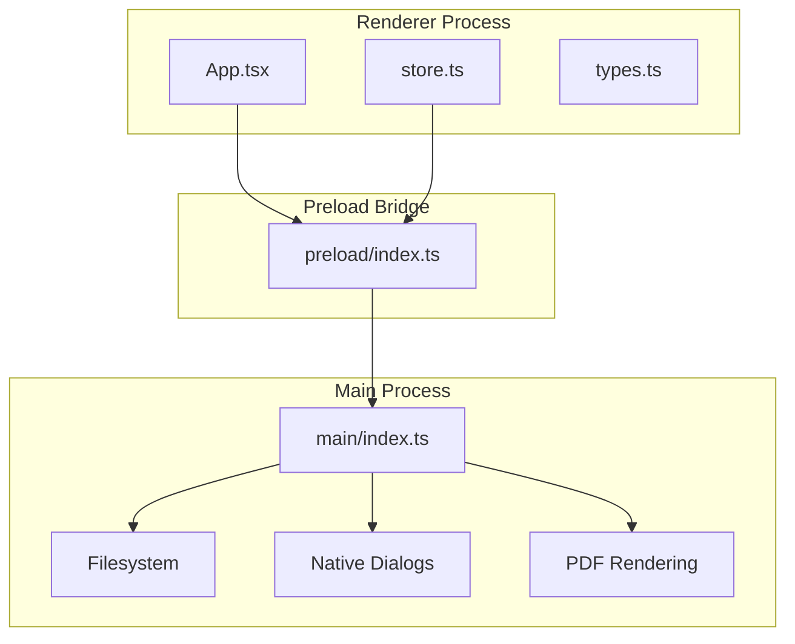
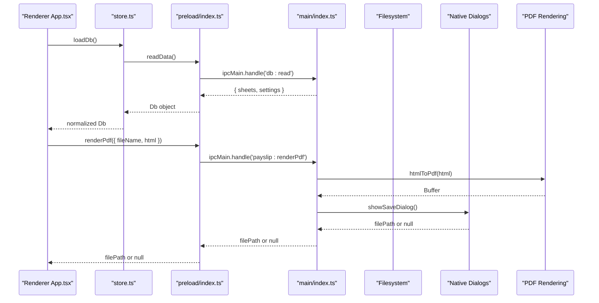
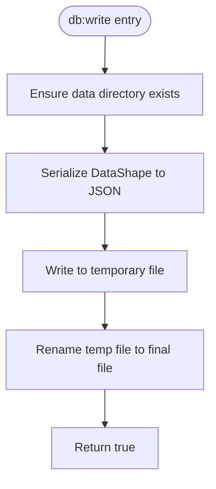
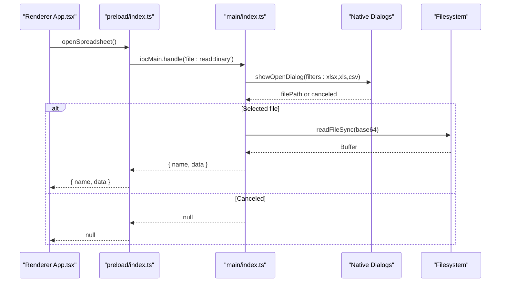
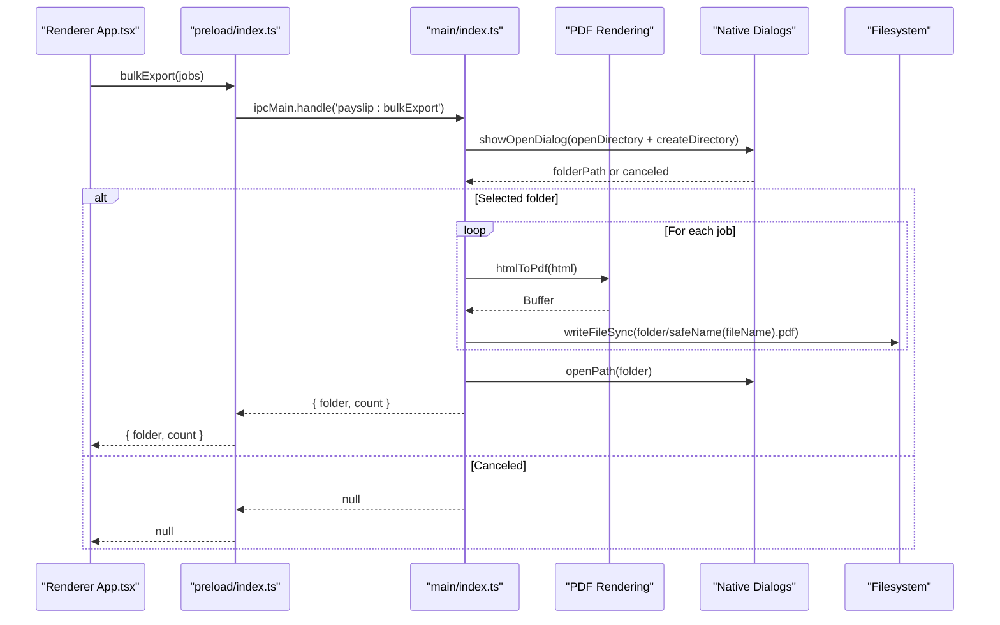
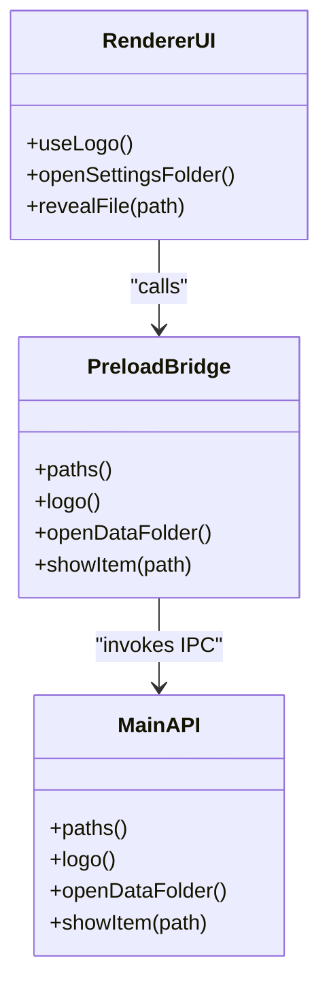
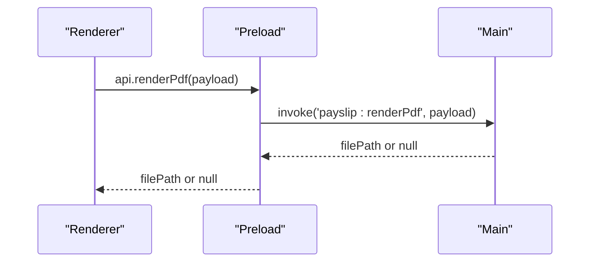
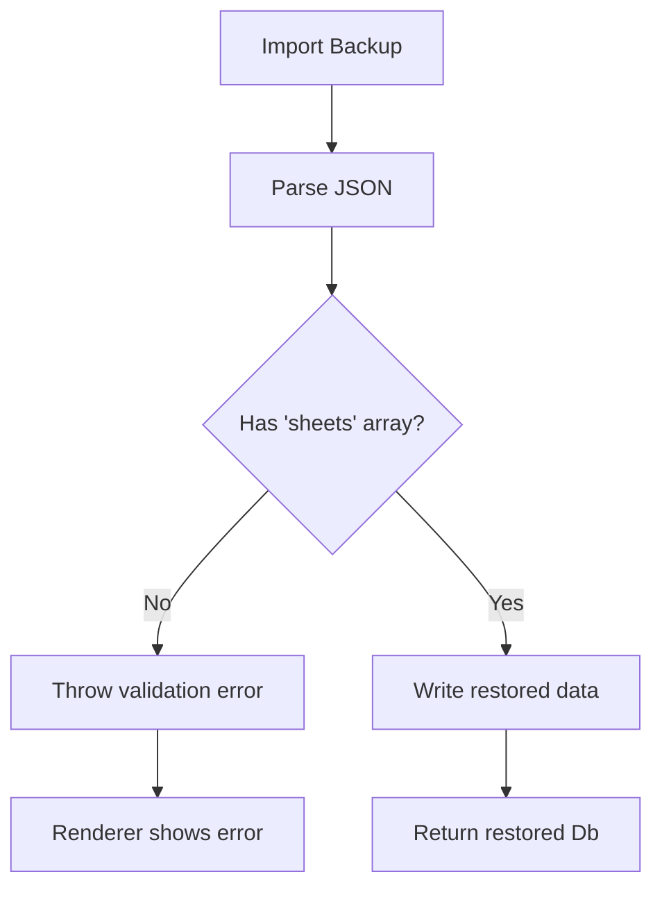
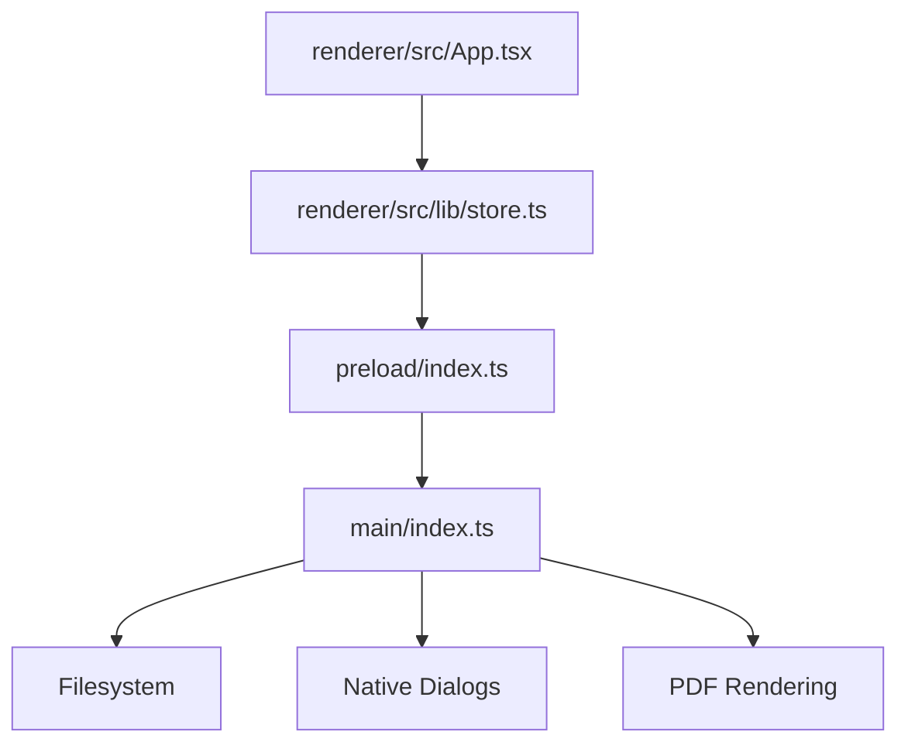

# IPC Communication Patterns

<cite>
**Referenced Files in This Document**
- [src/main/index.ts](file://src/main/index.ts)
- [src/preload/index.ts](file://src/preload/index.ts)
- [src/renderer/src/App.tsx](file://src/renderer/src/App.tsx)
- [src/renderer/src/lib/store.ts](file://src/renderer/src/lib/store.ts)
- [src/renderer/src/types.ts](file://src/renderer/src/types.ts)
</cite>

## Table of Contents
1. [Introduction](#introduction)
2. [Project Structure](#project-structure)
3. [Core Components](#core-components)
4. [Architecture Overview](#architecture-overview)
5. [Detailed Component Analysis](#detailed-component-analysis)
6. [Dependency Analysis](#dependency-analysis)
7. [Performance Considerations](#performance-considerations)
8. [Troubleshooting Guide](#troubleshooting-guide)
9. [Conclusion](#conclusion)

## Introduction
This document explains the Inter-Process Communication (IPC) patterns used between the Electron main process and renderer processes in this payslip application. It covers:
- All IPC channels for database operations, file system access, payslip generation, and application utilities.
- The message passing protocol using `ipcRenderer.invoke` and `ipcMain.handle`.
- Parameter validation, error handling strategies, and response formats.
- The security model enforced by the preload script, which exposes a minimal API surface to the renderer while preventing direct access to Node.js modules.
- Practical examples of calling IPC from both sides, async/await usage, and best practices for maintaining clean separation of concerns.

The goal is to make the IPC design understandable for developers who need to extend or maintain the application without accidentally breaking security boundaries or data integrity.

## Project Structure
The IPC boundary is split across three layers:
- Main process: owns filesystem access, dialog prompts, PDF rendering, and persistent storage.
- Preload script: bridges only selected APIs to the renderer through `window.api`.
- Renderer process: UI logic that calls `window.api` methods and handles responses.

**Diagram sources**
- [src/renderer/src/App.tsx:103-188](file://src/renderer/src/App.tsx#L103-L188)
- [src/renderer/src/lib/store.ts:37-47](file://src/renderer/src/lib/store.ts#L37-L47)
- [src/preload/index.ts:3-22](file://src/preload/index.ts#L3-L22)
- [src/main/index.ts:91-189](file://src/main/index.ts#L91-L189)

**Section sources**
- [src/main/index.ts:1-200](file://src/main/index.ts#L1-L200)
- [src/preload/index.ts:1-25](file://src/preload/index.ts#L1-L25)
- [src/renderer/src/App.tsx:1-289](file://src/renderer/src/App.tsx#L1-L289)
- [src/renderer/src/lib/store.ts:1-62](file://src/renderer/src/lib/store.ts#L1-L62)
- [src/renderer/src/types.ts:1-117](file://src/renderer/src/types.ts#L1-L117)

## Core Components
This section summarizes the IPC channels and their responsibilities.

| Channel | Direction | Purpose | Parameters | Response | Notes |
|---|---|---|---|---|---|
| `db:read` | Renderer → Main | Load persisted salary sheets and settings | None | `{ sheets: MonthSheet[], settings: Settings }` | Returns safe defaults if the file is missing or malformed. |
| `db:write` | Renderer → Main | Persist updated salary sheets and settings | `DataShape` with `sheets` and `settings` | `boolean` success flag | Uses atomic write via temporary file and rename. |
| `app:paths` | Renderer → Main | Get application data paths | None | `{ dataFile: string, folder: string }` | Useful for diagnostics and opening folders. |
| `app:openDataFolder` | Renderer → Main | Open the application data directory | None | OS-specific result | Uses shell integration. |
| `db:exportBackup` | Renderer → Main | Export backup JSON file | None | File path or `null` | Prompts user for save location. |
| `db:importBackup` | Renderer → Main | Import and restore backup JSON | None | Restored `Db` object or `null` | Validates that the backup contains an array of sheets. |
| `file:readBinary` | Renderer → Main | Open spreadsheet files and return base64 payload | None | `{ name: string, data: string }` or `null` | Filters for `.xlsx`, `.xls`, `.csv`. |
| `file:save` | Renderer → Main | Save arbitrary binary content as base64 | `{ name, base64, filters? }` | File path or `null` | Default filter is PDF unless overridden. |
| `file:pickFolder` | Renderer → Main | Choose export directory | None | Folder path or `null` | Allows creating directories. |
| `payslip:renderPdf` | Renderer → Main | Render single HTML to PDF and save | `{ fileName, html }` | File path or `null` | Creates offscreen window, renders PDF, then prompts save. |
| `payslip:bulkExport` | Renderer → Main | Batch-render multiple HTML pages to PDFs | Array of `{ fileName, html }` | `{ folder, count }` or `null` | Creates timestamped folder and opens it after writing. |
| `app:showItem` | Renderer → Main | Show file in native explorer | File path string | OS-specific result | Used to reveal generated files. |
| `app:logo` | Renderer → Main | Return embedded logo data URL | None | Data URL string or empty string | Cached on first load. |

**Section sources**
- [src/main/index.ts:95-189](file://src/main/index.ts#L95-L189)
- [src/preload/index.ts:3-22](file://src/preload/index.ts#L3-L22)

## Architecture Overview
The application follows a secure bridge pattern:
- The renderer never imports Node.js modules directly.
- The preload script exposes only the necessary methods through `window.api`.
- The main process validates inputs, performs privileged operations, and returns structured results.

**Diagram sources**
- [src/renderer/src/App.tsx:25-36](file://src/renderer/src/App.tsx#L25-L36)
- [src/renderer/src/lib/store.ts:37-47](file://src/renderer/src/lib/store.ts#L37-L47)
- [src/preload/index.ts:3-19](file://src/preload/index.ts#L3-L19)
- [src/main/index.ts:95-189](file://src/main/index.ts#L95-L189)

## Detailed Component Analysis

### Database Operations: `db:read` and `db:write`
The database layer persists salary sheets and application settings in a JSON file under the Electron user data directory.

Key behaviors:
- Read operation returns normalized data with safe defaults when the file is missing or corrupted.
- Write operation ensures atomic persistence by writing to a temporary file and renaming it.
- Renderer normalizes incoming data to prevent NaN values and ensure consistent numeric fields.

**Diagram sources**
- [src/main/index.ts:36-41](file://src/main/index.ts#L36-L41)

Validation and normalization:
- Main process trusts the shape passed by the renderer but guards against invalid JSON during read.
- Renderer normalizes rows and sheets to enforce expected types and default values.

**Section sources**
- [src/main/index.ts:27-41](file://src/main/index.ts#L27-L41)
- [src/renderer/src/lib/store.ts:13-47](file://src/renderer/src/lib/store.ts#L13-L47)

### File System Access: `file:readBinary`, `file:save`, `file:pickFolder`
These channels provide controlled access to the filesystem through native dialogs.

- `file:readBinary`: Opens a file picker restricted to spreadsheet formats and returns a base64-encoded payload along with the original filename.
- `file:save`: Saves base64 content to disk, allowing custom MIME filters; defaults to PDF.
- `file:pickFolder`: Lets users choose or create a directory for bulk exports.

**Diagram sources**
- [src/main/index.ts:127-135](file://src/main/index.ts#L127-L135)
- [src/preload/index.ts:10-11](file://src/preload/index.ts#L10-L11)
- [src/renderer/src/App.tsx:103-136](file://src/renderer/src/App.tsx#L103-L136)

**Section sources**
- [src/main/index.ts:127-154](file://src/main/index.ts#L127-L154)
- [src/preload/index.ts:10-13](file://src/preload/index.ts#L10-L13)
- [src/renderer/src/App.tsx:103-136](file://src/renderer/src/App.tsx#L103-L136)

### Payslip Generation: `payslip:renderPdf` and `payslip:bulkExport`
Payslip PDF generation happens in the main process to avoid exposing browser printing APIs and to centralize PDF creation.

- Single PDF rendering: Converts HTML to PDF using an offscreen BrowserWindow, then prompts the user to save the file.
- Bulk export: Iterates over jobs, renders each HTML page to PDF, writes files into a timestamped folder, and opens the folder afterward.

**Diagram sources**
- [src/main/index.ts:156-174](file://src/main/index.ts#L156-L174)
- [src/preload/index.ts:16-17](file://src/preload/index.ts#L16-L17)
- [src/renderer/src/App.tsx:162-173](file://src/renderer/src/App.tsx#L162-L173)

**Section sources**
- [src/main/index.ts:45-61](file://src/main/index.ts#L45-L61)
- [src/main/index.ts:156-186](file://src/main/index.ts#L156-L186)
- [src/renderer/src/App.tsx:141-173](file://src/renderer/src/App.tsx#L141-L173)

### Application Utilities: `app:paths`, `app:logo`, `app:openDataFolder`, `app:showItem`
Utility channels expose safe application-level capabilities:
- `app:paths`: Returns data file and folder paths for diagnostics or external tools.
- `app:logo`: Returns a cached base64 data URL for the company logo.
- `app:openDataFolder`: Opens the application data directory in the native file explorer.
- `app:showItem`: Reveals a specific file in the native file explorer.

**Diagram sources**
- [src/main/index.ts:100-101](file://src/main/index.ts#L100-L101)
- [src/main/index.ts:188-189](file://src/main/index.ts#L188-L189)
- [src/preload/index.ts:6-8](file://src/preload/index.ts#L6-L8)
- [src/preload/index.ts:18-19](file://src/preload/index.ts#L18-L19)
- [src/renderer/src/App.tsx:35](file://src/renderer/src/App.tsx#L35)
- [src/renderer/src/App.tsx:283](file://src/renderer/src/App.tsx#L283)

**Section sources**
- [src/main/index.ts:100-101](file://src/main/index.ts#L100-L101)
- [src/main/index.ts:188-189](file://src/main/index.ts#L188-L189)
- [src/preload/index.ts:6-8](file://src/preload/index.ts#L6-L8)
- [src/preload/index.ts:18-19](file://src/preload/index.ts#L18-L19)
- [src/renderer/src/App.tsx:35](file://src/renderer/src/App.tsx#L35)
- [src/renderer/src/App.tsx:283](file://src/renderer/src/App.tsx#L283)

### Message Passing Protocol
The protocol uses asynchronous request-response messaging:
- Renderer calls `window.api.method(...)` which internally invokes `ipcRenderer.invoke(channel, payload)`.
- Main registers handlers with `ipcMain.handle(channel, handler)`.
- Handlers return values or throw errors; the renderer receives resolved promises.

Best practices observed:
- Use explicit channel names grouped by feature (`db:*`, `file:*`, `payslip:*`, `app:*`).
- Keep payloads small and typed; pass only what is needed.
- Handle cancellation gracefully by returning `null` when users cancel dialogs.

**Diagram sources**
- [src/preload/index.ts:14-15](file://src/preload/index.ts#L14-L15)
- [src/main/index.ts:176-186](file://src/main/index.ts#L176-L186)
- [src/renderer/src/App.tsx:141-144](file://src/renderer/src/App.tsx#L141-L144)

**Section sources**
- [src/preload/index.ts:3-22](file://src/preload/index.ts#L3-L22)
- [src/main/index.ts:95-189](file://src/main/index.ts#L95-L189)

### Parameter Validation and Error Handling
Validation strategy:
- Main process validates critical structures such as backup files before writing them back to disk.
- Renderer normalizes loaded data to ensure numeric fields are finite numbers and sheet metadata is valid.
- Dialog cancellations are treated as successful user actions resulting in `null` responses rather than exceptions.

Error handling patterns:
- Try/catch around JSON parsing and file reads to return safe defaults.
- Explicit error messages thrown for invalid backups.
- Renderer catches errors from import operations and displays user-friendly status messages.

**Diagram sources**
- [src/main/index.ts:114-125](file://src/main/index.ts#L114-L125)
- [src/renderer/src/lib/store.ts:37-47](file://src/renderer/src/lib/store.ts#L37-L47)

**Section sources**
- [src/main/index.ts:27-41](file://src/main/index.ts#L27-L41)
- [src/main/index.ts:114-125](file://src/main/index.ts#L114-L125)
- [src/renderer/src/lib/store.ts:13-47](file://src/renderer/src/lib/store.ts#L13-L47)
- [src/renderer/src/App.tsx:131-135](file://src/renderer/src/App.tsx#L131-L135)

### Security Model: Preload Script Exposure
The preload script defines a narrow API surface:
- Only selected methods are exposed through `contextBridge.exposeInMainWorld('api', ...)`.
- Direct access to Node.js modules from the renderer is prevented.
- Each method maps to a specific IPC channel, making the contract explicit and auditable.

Security benefits:
- Reduces attack surface by limiting renderer capabilities.
- Centralizes privilege escalation points in the main process where they can be validated and logged.
- Keeps renderer code framework-agnostic regarding Electron internals.

**Diagram sources**
- [src/preload/index.ts:3-22](file://src/preload/index.ts#L3-L22)
- [src/main/index.ts:95-189](file://src/main/index.ts#L95-L189)

**Section sources**
- [src/preload/index.ts:1-25](file://src/preload/index.ts#L1-L25)

### Examples of IPC Calls

#### Renderer calling database read/write
- Load database:
  - Renderer calls `loadDb()` which invokes `window.api.readData()`.
  - Main returns normalized sheets and settings.
- Save database:
  - Renderer calls `saveDb(db)` which invokes `window.api.writeData(db)`.
  - Main persists data atomically.

**Section sources**
- [src/renderer/src/lib/store.ts:37-47](file://src/renderer/src/lib/store.ts#L37-L47)
- [src/main/index.ts:95-99](file://src/main/index.ts#L95-L99)

#### Renderer generating a single payslip PDF
- Renderer calls `window.api.renderPdf({ fileName, html })`.
- Main renders HTML to PDF and prompts the user to save the file.
- Renderer updates status based on returned file path.

**Section sources**
- [src/renderer/src/App.tsx:141-144](file://src/renderer/src/App.tsx#L141-L144)
- [src/main/index.ts:176-186](file://src/main/index.ts#L176-L186)

#### Renderer exporting multiple payslips
- Renderer builds jobs array with filenames and HTML.
- Renderer calls `window.api.bulkExport(jobs)`.
- Main creates a timestamped folder, renders each PDF, and opens the folder.

**Section sources**
- [src/renderer/src/App.tsx:162-173](file://src/renderer/src/App.tsx#L162-L173)
- [src/main/index.ts:156-174](file://src/main/index.ts#L156-L174)

#### Renderer importing a spreadsheet
- Renderer calls `window.api.openSpreadsheet()`.
- Main opens a file dialog filtered to supported formats and returns base64 data.
- Renderer parses the workbook and merges rows into the current sheet.

**Section sources**
- [src/renderer/src/App.tsx:103-136](file://src/renderer/src/App.tsx#L103-L136)
- [src/main/index.ts:127-135](file://src/main/index.ts#L127-L135)

#### Renderer saving generic files
- Renderer encodes bytes to base64 and calls `window.api.saveFile({ name, base64, filters })`.
- Main prompts for save location and writes the file.

**Section sources**
- [src/renderer/src/App.tsx:146-160](file://src/renderer/src/App.tsx#L146-L160)
- [src/main/index.ts:137-146](file://src/main/index.ts#L137-L146)

## Dependency Analysis
The IPC dependencies form a clear chain from renderer to main, mediated by preload.

Coupling observations:
- Renderer depends on preload API surface, not on Electron internals.
- Main owns all privileged operations and returns structured results.
- Preload has no business logic beyond mapping renderer methods to IPC channels.

Potential risks:
- If preload exposes additional methods, the renderer could gain unintended capabilities.
- If main handlers accept untrusted payloads without validation, data corruption or unexpected behavior may occur.

Mitigations present in the codebase:
- Minimal preload API.
- Input validation for backups and data normalization in renderer.
- Safe defaults for missing or malformed data.

**Section sources**
- [src/renderer/src/App.tsx:1-289](file://src/renderer/src/App.tsx#L1-L289)
- [src/renderer/src/lib/store.ts:1-62](file://src/renderer/src/lib/store.ts#L1-L62)
- [src/preload/index.ts:1-25](file://src/preload/index.ts#L1-L25)
- [src/main/index.ts:1-200](file://src/main/index.ts#L1-L200)

## Performance Considerations
- PDF rendering uses an offscreen BrowserWindow per conversion; bulk export iterates sequentially, which is simple but can be slow for large batches.
- Base64 encoding/decoding adds memory overhead; consider streaming or chunking for very large files.
- Database writes use atomic rename to reduce corruption risk; batching writes at the renderer level reduces disk I/O frequency.
- Logo data URL is cached in main to avoid repeated file reads.

Recommendations:
- Consider worker threads or queued PDF rendering for large bulk exports.
- Monitor memory usage when handling large spreadsheets or many payslips.
- Debounce frequent saves already implemented in renderer to reduce write pressure.

[No sources needed since this section provides general guidance]

## Troubleshooting Guide
Common issues and resolutions:
- Backup import fails:
  - Cause: Missing `sheets` array in backup JSON.
  - Resolution: Validate backup structure before import; ensure exported files were created by this application.
- Database loads with empty sheets:
  - Cause: Corrupted or missing database file.
  - Resolution: Restore from backup; check data directory paths using `app:paths`.
- PDF save cancelled:
  - Cause: User canceled the save dialog.
  - Resolution: Treat `null` response as cancellation; update UI accordingly.
- Spreadsheet import returns no rows:
  - Cause: Unsupported format or missing headers.
  - Resolution: Verify file type and column names; check status messages shown by renderer.

Operational tips:
- Use `app:openDataFolder` to inspect stored data.
- Use `app:showItem` to reveal generated files quickly.
- Check renderer status messages for human-readable feedback.

**Section sources**
- [src/main/index.ts:114-125](file://src/main/index.ts#L114-L125)
- [src/main/index.ts:100-101](file://src/main/index.ts#L100-L101)
- [src/main/index.ts:188-189](file://src/main/index.ts#L188-L189)
- [src/renderer/src/App.tsx:131-135](file://src/renderer/src/App.tsx#L131-L135)

## Conclusion
This IPC design cleanly separates renderer UI logic from privileged main process operations. The preload script acts as a secure bridge, exposing only necessary APIs. Channels are grouped by domain, parameters are validated where appropriate, and responses are structured for predictable handling. Following these patterns helps maintain security, reliability, and clarity as the application evolves.

[No sources needed since this section summarizes without analyzing specific files]