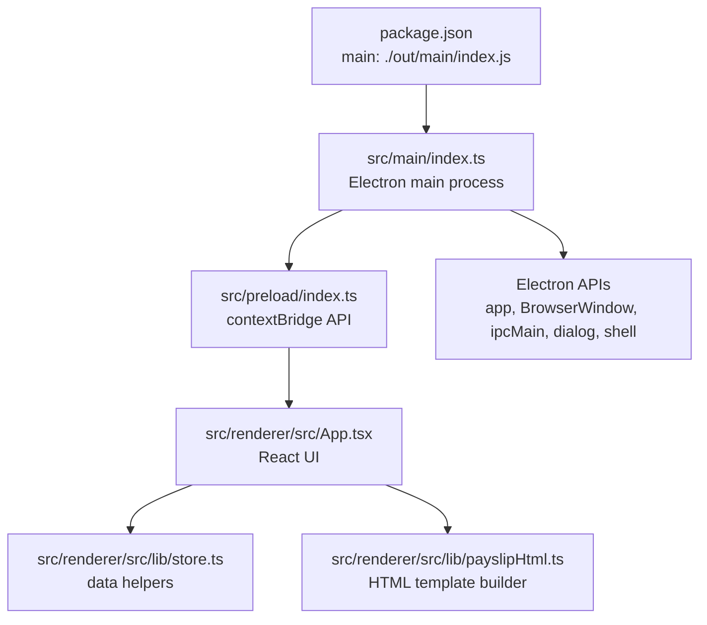
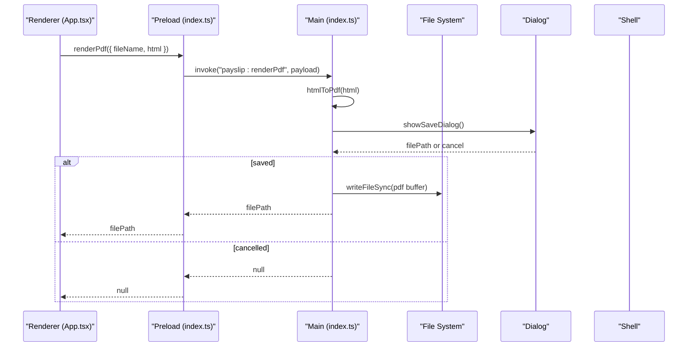
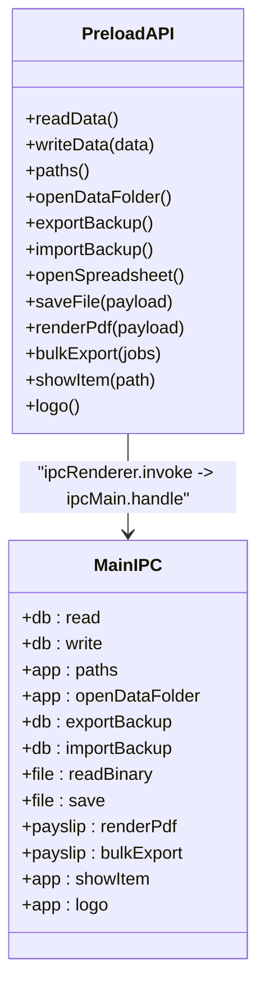
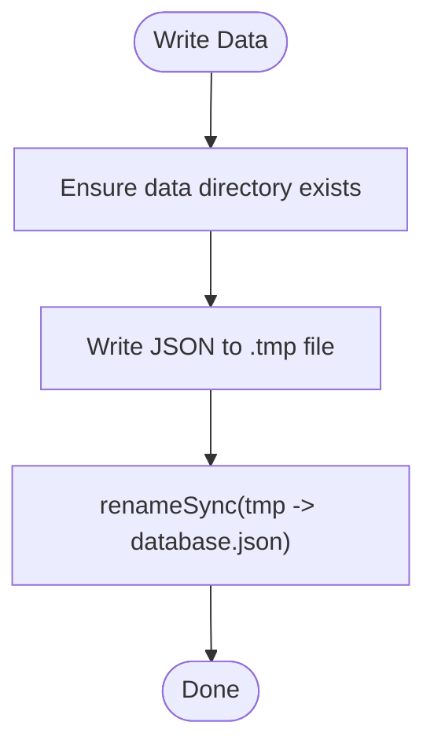
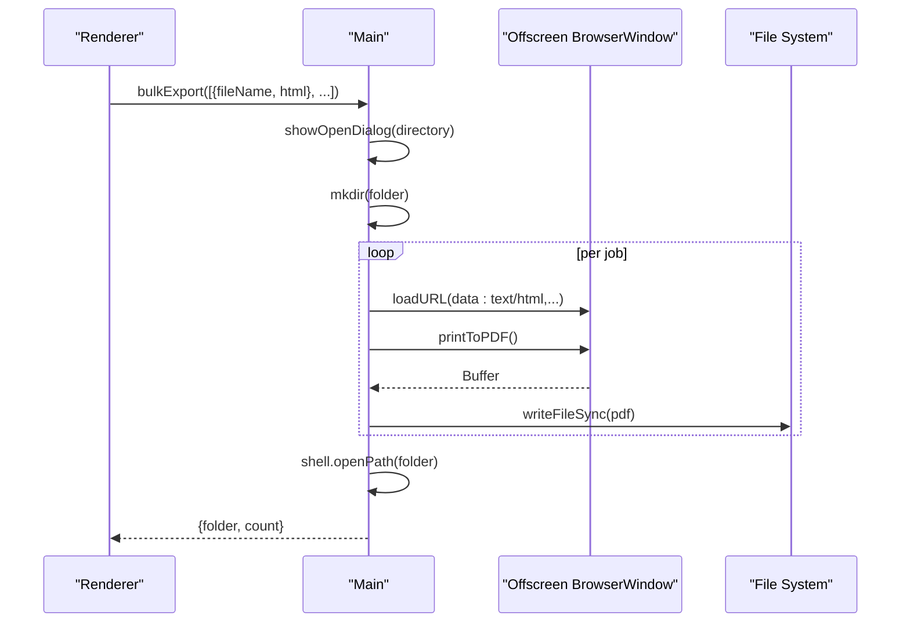
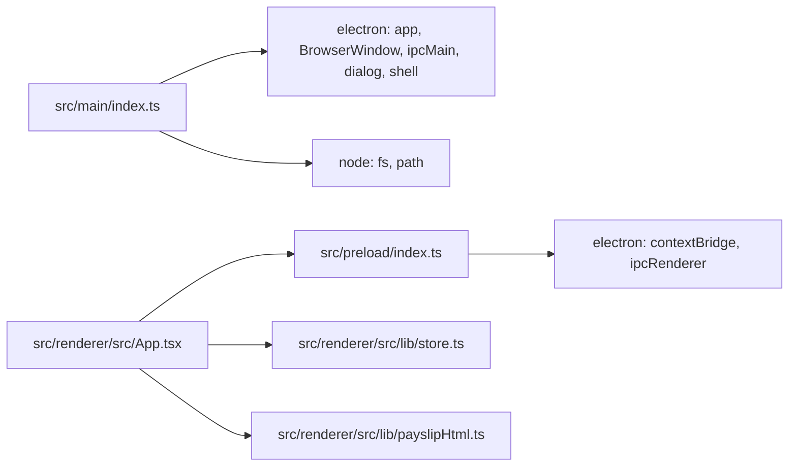

# Main Process Architecture

<cite>
**Referenced Files in This Document**
- [src/main/index.ts](file://src/main/index.ts)
- [src/preload/index.ts](file://src/preload/index.ts)
- [package.json](file://package.json)
- [electron.vite.config.js](file://electron.vite.config.js)
- [src/renderer/src/lib/store.ts](file://src/renderer/src/lib/store.ts)
- [src/renderer/src/App.tsx](file://src/renderer/src/App.tsx)
- [src/renderer/src/lib/payslipHtml.ts](file://src/renderer/src/lib/payslipHtml.ts)
</cite>

## Table of Contents
1. [Introduction](#introduction)
2. [Project Structure](#project-structure)
3. [Core Components](#core-components)
4. [Architecture Overview](#architecture-overview)
5. [Detailed Component Analysis](#detailed-component-analysis)
6. [Dependency Analysis](#dependency-analysis)
7. [Performance Considerations](#performance-considerations)
8. [Troubleshooting Guide](#troubleshooting-guide)
9. [Conclusion](#conclusion)

## Introduction
This document explains the Electron main process architecture for the payslip generator application. It covers application lifecycle management, window creation and configuration, IPC channel setup, file system operations, native API access, data persistence using JSON with atomic writes, backup/restore functionality, PDF generation via offscreen BrowserWindow and printToPDF, and security considerations such as sandboxing, external URL handling, and file dialog restrictions.

## Project Structure
The Electron app is built with electron-vite and TypeScript. The main entry point compiles to out/main/index.js and is referenced by package.json. The preload script exposes a narrow API to the renderer. The renderer uses React and calls into the main process through the preload bridge.

**Diagram sources**
- [package.json:1-59](file://package.json#L1-L59)
- [src/main/index.ts:1-200](file://src/main/index.ts#L1-L200)
- [src/preload/index.ts:1-25](file://src/preload/index.ts#L1-L25)
- [src/renderer/src/App.tsx:1-289](file://src/renderer/src/App.tsx#L1-L289)
- [src/renderer/src/lib/store.ts:1-33](file://src/renderer/src/lib/store.ts#L1-L33)
- [src/renderer/src/lib/payslipHtml.ts:1-164](file://src/renderer/src/lib/payslipHtml.ts#L1-L164)

**Section sources**
- [package.json:1-59](file://package.json#L1-L59)
- [electron.vite.config.js:1-10](file://electron.vite.config.js#L1-L10)

## Core Components
- Main process (src/main/index.ts): Application lifecycle, BrowserWindow initialization, IPC handlers, file I/O, PDF generation, and native dialogs.
- Preload bridge (src/preload/index.ts): Exposes a typed API to the renderer via contextBridge.
- Renderer integration (src/renderer/src/App.tsx, src/renderer/src/lib/store.ts): Uses window.api to persist data, open files, save outputs, and generate PDFs.
- HTML template builder (src/renderer/src/lib/payslipHtml.ts): Builds printable HTML for each payslip.

Key responsibilities:
- Lifecycle: App ready, activate, window-all-closed.
- Window: Single main window with preload, dev/prod routing, external link handling.
- IPC: Read/write database, export/import backups, file open/save, folder selection, logo retrieval, show item in folder.
- Persistence: JSON database under userData/data/database.json with atomic write via temp file + rename.
- PDF pipeline: Offscreen BrowserWindow loads HTML data URL and prints to PDF.

**Section sources**
- [src/main/index.ts:1-200](file://src/main/index.ts#L1-L200)
- [src/preload/index.ts:1-25](file://src/preload/index.ts#L1-L25)
- [src/renderer/src/App.tsx:1-289](file://src/renderer/src/App.tsx#L1-L289)
- [src/renderer/src/lib/store.ts:1-33](file://src/renderer/src/lib/store.ts#L1-L33)
- [src/renderer/src/lib/payslipHtml.ts:1-164](file://src/renderer/src/lib/payslipHtml.ts#L1-L164)

## Architecture Overview
The main process owns all privileged operations. The renderer never accesses Node/Electron directly; it calls methods on window.api exposed by the preload script. The preload forwards calls to ipcRenderer.invoke and maps them to ipcMain.handle channels in the main process.

**Diagram sources**
- [src/renderer/src/App.tsx:141-144](file://src/renderer/src/App.tsx#L141-L144)
- [src/preload/index.ts:14-15](file://src/preload/index.ts#L14-L15)
- [src/main/index.ts:176-186](file://src/main/index.ts#L176-L186)

## Detailed Component Analysis

### Main Process Lifecycle and Window Management
- Application startup: Sets app user model ID, registers window shortcut optimizer, and creates the main window.
- Window creation: Configures size, minimum size, menu bar behavior, preload path, and webPreferences. In development, loads the Vite dev server URL; in production, loads the bundled index.html.
- External links: All new-window requests are intercepted and opened externally via shell.openExternal, preventing in-app navigation to arbitrary URLs.
- Activation: On macOS, reopens the app when activated if no windows exist.

Security notes:
- The main window disables sandbox to allow preload access to Node APIs required by the app.
- External URL handling is enforced via setWindowOpenHandler.

**Section sources**
- [src/main/index.ts:63-89](file://src/main/index.ts#L63-L89)
- [src/main/index.ts:91-94](file://src/main/index.ts#L91-L94)
- [src/main/index.ts:191-199](file://src/main/index.ts#L191-L199)

### IPC Channel Setup and Preload Bridge
- Preload exposes a compact API surface: readData, writeData, paths, openDataFolder, exportBackup, importBackup, openSpreadsheet, saveFile, renderPdf, bulkExport, showItem, logo.
- Main registers corresponding ipcMain.handle channels for each operation.
- Data shape: sheets array plus settings object persisted to JSON.

**Diagram sources**
- [src/preload/index.ts:3-22](file://src/preload/index.ts#L3-L22)
- [src/main/index.ts:95-189](file://src/main/index.ts#L95-L189)

**Section sources**
- [src/preload/index.ts:1-25](file://src/preload/index.ts#L1-L25)
- [src/main/index.ts:95-189](file://src/main/index.ts#L95-L189)

### Data Persistence Layer (JSON with Atomic Writes)
- Location: userData/data/database.json.
- Read: Parses JSON safely; returns default structure if invalid.
- Write: Ensures directory exists, writes to a temporary file, then atomically renames to the target file to avoid partial writes.
- Backup/Restore: Export saves current DB to a timestamped JSON file; Import validates that the file contains a sheets array before overwriting the DB.

**Diagram sources**
- [src/main/index.ts:27-41](file://src/main/index.ts#L27-L41)

**Section sources**
- [src/main/index.ts:22-41](file://src/main/index.ts#L22-L41)
- [src/main/index.ts:103-125](file://src/main/index.ts#L103-L125)
- [src/renderer/src/lib/store.ts:8-18](file://src/renderer/src/lib/store.ts#L8-L18)

### File System Operations and Native Dialogs
- Open spreadsheet: Opens a file dialog restricted to xlsx, xls, csv; reads file content as base64 and returns name and data.
- Save file: Prompts for a destination path with optional filters; writes base64-decoded bytes to disk.
- Pick folder: Allows selecting or creating a directory for bulk exports.
- Show item in folder: Reveals a file in the OS file explorer.

Security considerations:
- File dialogs restrict allowed extensions where applicable.
- User must explicitly choose a path; no automatic writes outside user-selected locations.

**Section sources**
- [src/main/index.ts:127-154](file://src/main/index.ts#L127-L154)
- [src/main/index.ts:188-189](file://src/main/index.ts#L188-L189)

### PDF Generation Pipeline
- Single payslip: Renders HTML to an offscreen BrowserWindow with sandbox enabled, loads a data URL, and calls printToPDF with A4 page size and zero margins. The window is destroyed after use.
- Bulk export: For each row, generates a PDF and writes it into a user-selected folder named with the current date. After completion, opens the folder in the file explorer.

**Diagram sources**
- [src/main/index.ts:157-174](file://src/main/index.ts#L157-L174)
- [src/main/index.ts:45-61](file://src/main/index.ts#L45-L61)

**Section sources**
- [src/main/index.ts:45-61](file://src/main/index.ts#L45-L61)
- [src/main/index.ts:157-186](file://src/main/index.ts#L157-L186)
- [src/renderer/src/App.tsx:162-173](file://src/renderer/src/App.tsx#L162-L173)

### Security Considerations
- Sandbox policy:
  - Main window: sandbox disabled to allow preload to access Node APIs needed for file and dialog operations.
  - Offscreen PDF window: sandbox enabled to isolate HTML rendering and PDF generation.
- External URL handling: New window requests are denied and opened externally via shell.openExternal.
- File dialog restrictions: Spreadsheet import limited to specific extensions; backup restore requires valid JSON schema.
- Logo loading: Reads a local resource from the app bundle and converts to a data URL; does not load remote images.

Best practices observed:
- Use data URLs for internal assets to avoid network requests.
- Validate imported backup data before writing to the database.
- Prefer atomic writes for critical data files.

**Section sources**
- [src/main/index.ts:45-61](file://src/main/index.ts#L45-L61)
- [src/main/index.ts:63-89](file://src/main/index.ts#L63-L89)
- [src/main/index.ts:10-15](file://src/main/index.ts#L10-L15)
- [src/main/index.ts:114-125](file://src/main/index.ts#L114-L125)

## Dependency Analysis
The main process depends on Electron APIs and Node fs/path modules. The renderer depends on the preload-exposed API and builds HTML templates locally.

**Diagram sources**
- [src/main/index.ts:1-4](file://src/main/index.ts#L1-L4)
- [src/preload/index.ts:1-1](file://src/preload/index.ts#L1-L1)
- [src/renderer/src/App.tsx:1-10](file://src/renderer/src/App.tsx#L1-L10)
- [src/renderer/src/lib/store.ts:1-2](file://src/renderer/src/lib/store.ts#L1-L2)
- [src/renderer/src/lib/payslipHtml.ts:1-2](file://src/renderer/src/lib/payslipHtml.ts#L1-L2)

**Section sources**
- [src/main/index.ts:1-4](file://src/main/index.ts#L1-L4)
- [src/preload/index.ts:1-25](file://src/preload/index.ts#L1-L25)
- [src/renderer/src/App.tsx:1-10](file://src/renderer/src/App.tsx#L1-L10)

## Performance Considerations
- PDF generation uses offscreen windows per document; consider batching or reusing a single hidden window if generating many PDFs to reduce overhead.
- Atomic writes add a small overhead but ensure data integrity; acceptable given typical usage patterns.
- Debounced saves in the renderer minimize frequent disk writes during editing.

[No sources needed since this section provides general guidance]

## Troubleshooting Guide
- PDF not saving: Check that the user did not cancel the save dialog and that the selected folder is writable. Verify that the HTML template renders correctly in the offscreen window.
- Backup restore fails: Ensure the selected file has a top-level sheets array; otherwise, the main process throws an error indicating an invalid backup format.
- Spreadsheet import issues: Confirm the file extension is one of xlsx, xls, or csv and that the workbook contains expected headers.
- External links opening in browser: This is expected due to setWindowOpenHandler denying in-app navigation and delegating to shell.openExternal.

**Section sources**
- [src/main/index.ts:114-125](file://src/main/index.ts#L114-L125)
- [src/main/index.ts:127-135](file://src/main/index.ts#L127-L135)
- [src/main/index.ts:79-82](file://src/main/index.ts#L79-L82)

## Conclusion
The main process centralizes privileged operations behind a minimal preload API, ensuring secure and predictable interactions between the renderer and the operating system. Data persistence uses robust atomic writes, while PDF generation leverages offscreen windows for reliable printing. Security is enforced through sandboxing where appropriate, strict external URL handling, and controlled file dialogs. The architecture balances simplicity, safety, and usability for a desktop payroll tool.