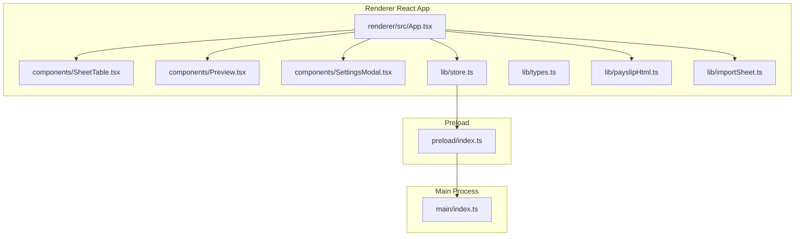
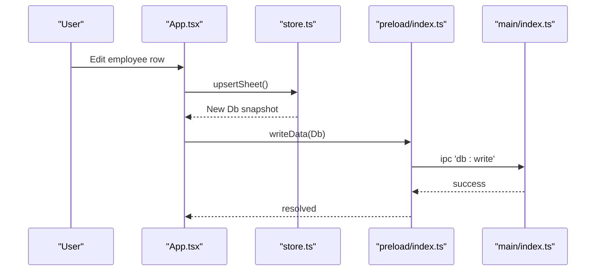
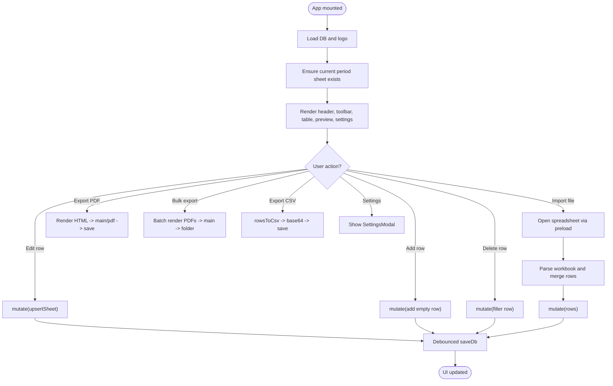
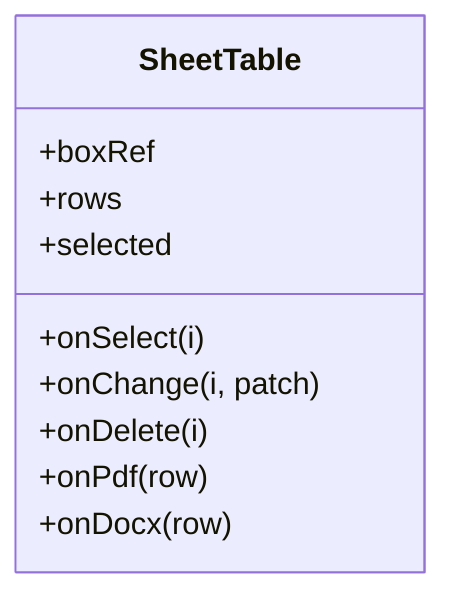
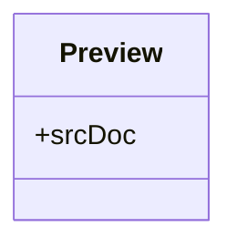
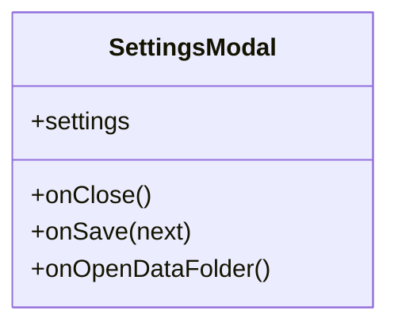
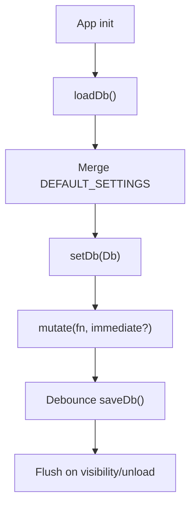
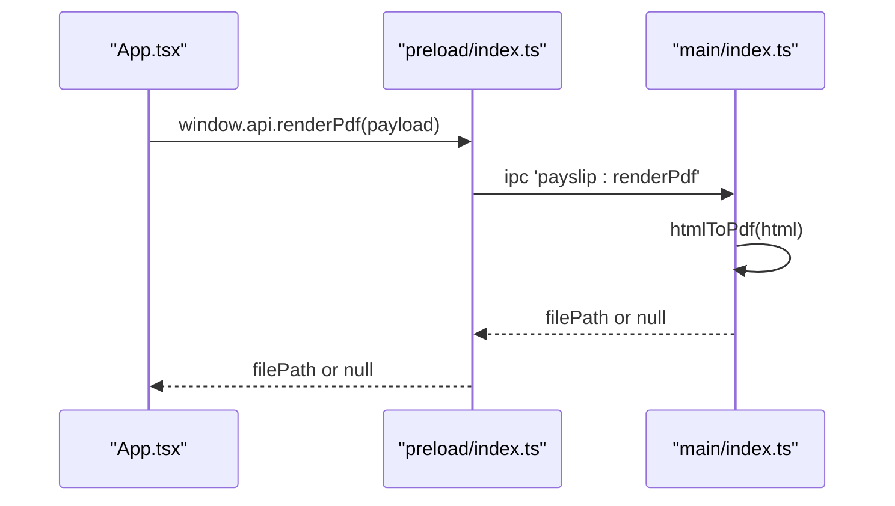
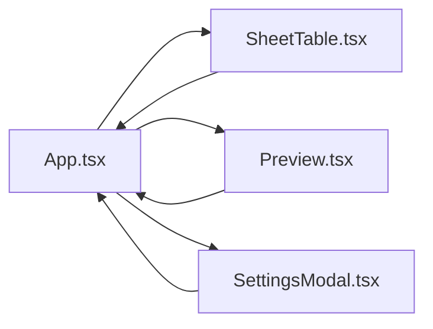

# Renderer Process Architecture

<cite>
**Referenced Files in This Document**
- [App.tsx](file://src/renderer/src/App.tsx)
- [SheetTable.tsx](file://src/renderer/src/components/SheetTable.tsx)
- [Preview.tsx](file://src/renderer/src/components/Preview.tsx)
- [SettingsModal.tsx](file://src/renderer/src/components/SettingsModal.tsx)
- [store.ts](file://src/renderer/src/lib/store.ts)
- [types.ts](file://src/renderer/src/types.ts)
- [payslipHtml.ts](file://src/renderer/src/lib/payslipHtml.ts)
- [importSheet.ts](file://src/renderer/src/lib/importSheet.ts)
- [index.ts (preload)](file://src/preload/index.ts)
- [index.ts (main)](file://src/main/index.ts)
</cite>

## Table of Contents
1. [Introduction](#introduction)
2. [Project Structure](#project-structure)
3. [Core Components](#core-components)
4. [Architecture Overview](#architecture-overview)
5. [Detailed Component Analysis](#detailed-component-analysis)
6. [State Management and Store Integration](#state-management-and-store-integration)
7. [Preload Bridge and Security Boundaries](#preload-bridge-and-security-boundaries)
8. [Component Communication Patterns](#component-communication-patterns)
9. [Performance Considerations](#performance-considerations)
10. [Troubleshooting Guide](#troubleshooting-guide)
11. [Conclusion](#conclusion)

## Introduction
This document explains the renderer process architecture for the payslip generator application. The React frontend is orchestrated by `App.tsx`, which manages employee data through `SheetTable`, renders a live payslip preview via `Preview`, and exposes configuration through `SettingsModal`. State is centralized in a small store module that persists data to the main process, while the preload script provides a secure IPC bridge exposing only necessary APIs to the renderer.

The goal is to make the component hierarchy, state flow, event handling, and security model clear for both developers and maintainers.

## Project Structure
At a high level:
- The main Electron process owns file system access, PDF generation, dialogs, and persistence.
- The preload script exposes a narrow API surface to the renderer.
- The renderer React app owns UI state, business logic for importing and exporting payslips, and rendering components.

**Diagram sources**
- [App.tsx:1-289](file://src/renderer/src/App.tsx#L1-L289)
- [store.ts:1-33](file://src/renderer/src/lib/store.ts#L1-L33)
- [index.ts (preload):1-25](file://src/preload/index.ts#L1-L25)
- [index.ts (main):1-200](file://src/main/index.ts#L1-L200)

**Section sources**
- [App.tsx:1-289](file://src/renderer/src/App.tsx#L1-L289)
- [index.ts (preload):1-25](file://src/preload/index.ts#L1-L25)
- [index.ts (main):1-200](file://src/main/index.ts#L1-L200)

## Core Components
- `App.tsx`: Orchestrates application state, user actions, import/export flows, and composes child components. It also coordinates with the store and preload API.
- `SheetTable.tsx`: Renders an editable table of employees for the selected month. It emits selection, edit, delete, and export events upward.
- `Preview.tsx`: Displays a scaled A4 iframe preview of the generated HTML payslip.
- `SettingsModal.tsx`: Provides a modal form for company settings and opens the data folder.

Key responsibilities:
- Data loading and persistence are delegated to `store.ts` and the preload/main IPC layer.
- Payslip HTML generation is handled by `payslipHtml.ts`.
- Spreadsheet import and CSV export are handled by `importSheet.ts`.

**Section sources**
- [App.tsx:13-289](file://src/renderer/src/App.tsx#L13-L289)
- [SheetTable.tsx:1-71](file://src/renderer/src/components/SheetTable.tsx#L1-L71)
- [Preview.tsx:1-29](file://src/renderer/src/components/Preview.tsx#L1-L29)
- [SettingsModal.tsx:1-43](file://src/renderer/src/components/SettingsModal.tsx#L1-L43)

## Architecture Overview
The renderer follows a unidirectional data flow:
- User interactions update local React state in `App.tsx`.
- Changes are persisted through `store.ts`, which calls the preload API.
- The preload script forwards IPC calls to the main process.
- The main process performs file operations, PDF rendering, and persistence.

**Diagram sources**
- [App.tsx:38-48](file://src/renderer/src/App.tsx#L38-L48)
- [store.ts:16-18](file://src/renderer/src/lib/store.ts#L16-L18)
- [index.ts (preload):4-5](file://src/preload/index.ts#L4-L5)
- [index.ts (main):95-99](file://src/main/index.ts#L95-L99)

## Detailed Component Analysis

### App.tsx: Main Orchestrator
Responsibilities:
- Loads initial database and logo from the main process.
- Manages current period, selected row, settings, status messages, and busy state.
- Provides a single write path (`mutate`) to avoid race conditions when multiple updates occur quickly.
- Coordinates import/export workflows using the preload API.
- Composes `SheetTable`, `Preview`, and `SettingsModal`.

Key behaviors:
- Debounced persistence: changes are saved after a short delay unless marked immediate.
- Period switching ensures a sheet exists for the selected month.
- Bulk PDF export uses the main process to render and save multiple files.
- CSV export and DOCX export use base64 conversion and the file save API.

**Diagram sources**
- [App.tsx:25-48](file://src/renderer/src/App.tsx#L25-L48)
- [App.tsx:76-101](file://src/renderer/src/App.tsx#L76-L101)
- [App.tsx:103-184](file://src/renderer/src/App.tsx#L103-L184)
- [App.tsx:208-285](file://src/renderer/src/App.tsx#L208-L285)

**Section sources**
- [App.tsx:13-289](file://src/renderer/src/App.tsx#L13-L289)

### SheetTable.tsx: Employee Data Editor
Responsibilities:
- Renders a scrollable grid of employee fields and computed gross pay.
- Emits selection, change, delete, and export callbacks to `App.tsx`.
- Uses column definitions for text and money fields.

Communication pattern:
- Props include `rows`, `selected`, `onSelect`, `onChange`, `onDelete`, `onPdf`, `onDocx`.
- No direct store or IPC usage; it remains a presentational component.

**Diagram sources**
- [SheetTable.tsx:4-13](file://src/renderer/src/components/SheetTable.tsx#L4-L13)
- [SheetTable.tsx:30-70](file://src/renderer/src/components/SheetTable.tsx#L30-L70)

**Section sources**
- [SheetTable.tsx:1-71](file://src/renderer/src/components/SheetTable.tsx#L1-L71)

### Preview.tsx: Payslip Visualization
Responsibilities:
- Scales an iframe containing the generated HTML payslip to fit the container width.
- Uses a ResizeObserver to recalculate scale on container size changes.

Integration:
- Receives `srcDoc` string from `App.tsx`, which is produced by `payslipHtml.ts`.

**Diagram sources**
- [Preview.tsx:5-27](file://src/renderer/src/components/Preview.tsx#L5-L27)

**Section sources**
- [Preview.tsx:1-29](file://src/renderer/src/components/Preview.tsx#L1-L29)

### SettingsModal.tsx: Configuration UI
Responsibilities:
- Presents a form bound to local state derived from `settings` prop.
- Calls `onSave(next)` with updated settings and `onClose()` to dismiss.
- Provides a link to open the data folder via `onOpenDataFolder`.

Integration:
- Controlled by `App.tsx`, which persists settings immediately through `mutate(..., true)`.

**Diagram sources**
- [SettingsModal.tsx:4-9](file://src/renderer/src/components/SettingsModal.tsx#L4-L9)
- [SettingsModal.tsx:11-41](file://src/renderer/src/components/SettingsModal.tsx#L11-L41)

**Section sources**
- [SettingsModal.tsx:1-43](file://src/renderer/src/components/SettingsModal.tsx#L1-L43)

## State Management and Store Integration
Centralized state:
- `Db` contains `sheets` (monthly sheets) and `settings`.
- `MonthSheet` holds `period`, `workingDays`, and `rows`.
- `SalaryRow` defines all payroll fields used by the table and payslip generator.

Store functions:
- `loadDb()`: Reads persisted data via preload IPC and merges defaults.
- `saveDb(db)`: Persists the full `Db` object.
- `findSheet(db, period)`: Returns the current month’s sheet or a default.
- `upsertSheet(db, sheet)`: Inserts or replaces a sheet and keeps periods sorted.

Persistence strategy:
- `App.tsx` maintains a ref to the latest `Db` and debounces writes to reduce I/O churn.
- On visibility changes or before unload, pending writes are flushed.

**Diagram sources**
- [store.ts:8-32](file://src/renderer/src/lib/store.ts#L8-L32)
- [App.tsx:25-48](file://src/renderer/src/App.tsx#L25-L48)
- [App.tsx:50-64](file://src/renderer/src/App.tsx#L50-L64)

**Section sources**
- [store.ts:1-33](file://src/renderer/src/lib/store.ts#L1-L33)
- [types.ts:1-117](file://src/renderer/src/types.ts#L1-L117)
- [App.tsx:25-64](file://src/renderer/src/App.tsx#L25-L64)

## Preload Bridge and Security Boundaries
The preload script exposes a minimal, typed API to the renderer:
- Database read/write
- Application paths and folder operations
- File open/save dialogs
- PDF rendering and bulk export
- Logo retrieval

Security model:
- Only explicitly exposed methods are available under `window.api`.
- The main process validates inputs and controls file system access.
- PDF rendering happens offscreen in a sandboxed window to isolate rendering workloads.

**Diagram sources**
- [index.ts (preload):14-15](file://src/preload/index.ts#L14-L15)
- [index.ts (main):176-186](file://src/main/index.ts#L176-L186)
- [index.ts (main):45-61](file://src/main/index.ts#L45-L61)

**Section sources**
- [index.ts (preload):1-25](file://src/preload/index.ts#L1-L25)
- [index.ts (main):45-61](file://src/main/index.ts#L45-L61)
- [index.ts (main):91-190](file://src/main/index.ts#L91-L190)

## Component Communication Patterns
- Prop drilling:
  - `App.tsx` passes `rows`, `selected`, and handlers down to `SheetTable`.
  - `App.tsx` passes `srcDoc` to `Preview`.
  - `App.tsx` passes `settings`, `onClose`, `onSave`, and `onOpenDataFolder` to `SettingsModal`.
- Context usage:
  - Not used in this codebase; props provide sufficient clarity and keep components simple.
- Event handling:
  - Child components emit callbacks rather than mutating shared state directly.
  - `App.tsx` centralizes side effects like saving and file operations.

**Diagram sources**
- [App.tsx:252-284](file://src/renderer/src/App.tsx#L252-L284)
- [SheetTable.tsx:30-70](file://src/renderer/src/components/SheetTable.tsx#L30-L70)
- [Preview.tsx:19-27](file://src/renderer/src/components/Preview.tsx#L19-L27)
- [SettingsModal.tsx:22-41](file://src/renderer/src/components/SettingsModal.tsx#L22-L41)

**Section sources**
- [App.tsx:208-285](file://src/renderer/src/App.tsx#L208-L285)

## Performance Considerations
- Debounced persistence:
  - `mutate` defers saves to reduce frequent disk writes during rapid edits.
- Memoization:
  - `useMemo` derives the current sheet from `db` and `period`.
- Efficient imports:
  - `parseSalaryWorkbook` maps headers flexibly and skips invalid rows.
- Rendering isolation:
  - PDF rendering occurs offscreen in the main process to avoid blocking the UI thread.
- Preview scaling:
  - `Preview` uses a ResizeObserver to adjust scale without re-rendering heavy content unnecessarily.

Recommendations:
- Keep large payloads (like base64 files) out of frequent state updates.
- Batch operations where possible (bulk export already does this).
- Consider virtualizing long tables if employee counts grow significantly.

[No sources needed since this section provides general guidance]

## Troubleshooting Guide
Common issues and resolutions:
- No employees shown:
  - Verify import succeeded and that rows contain required fields like name.
  - Check status message set by `App.tsx` after import.
- Negative net payable warnings:
  - Adjust advances or salary values; the app highlights negative gross amounts.
- Missing employee IDs:
  - Fill in employee codes to remove warnings.
- PDF export fails:
  - Ensure HTML generation succeeds and the main process can create a temporary offscreen window.
- Backup restore errors:
  - Confirm the backup file has a valid structure with a `sheets` array.

Relevant implementation areas:
- Status messaging and error handling in import/export flows.
- Validation helpers for money fields and mismatch detection.
- Main process dialog and file writing error paths.

**Section sources**
- [App.tsx:103-184](file://src/renderer/src/App.tsx#L103-L184)
- [types.ts:93-109](file://src/renderer/src/types.ts#L93-L109)
- [index.ts (main):114-125](file://src/main/index.ts#L114-L125)

## Conclusion
The renderer architecture centers on a single orchestrating component that manages state, delegates persistence to a thin store layer, and communicates securely with the main process through a constrained preload API. Components communicate via props and callbacks, keeping concerns clear and testable. The design balances simplicity with robustness by isolating file system and PDF operations in the main process while providing a responsive React interface.

[No sources needed since this section summarizes without analyzing specific files]