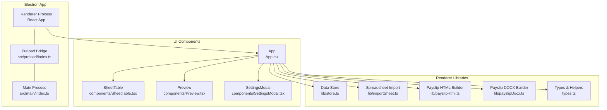
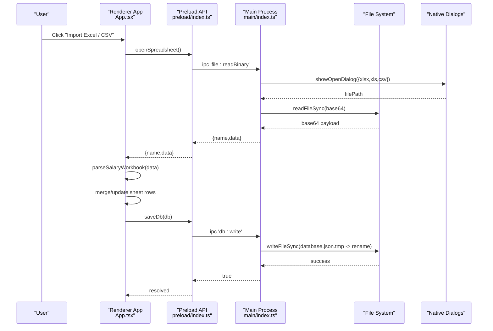
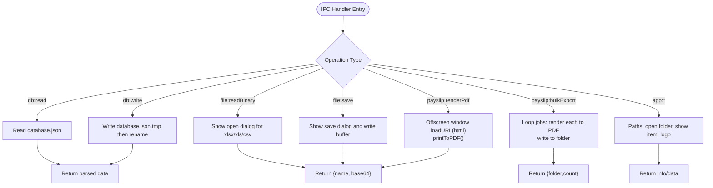
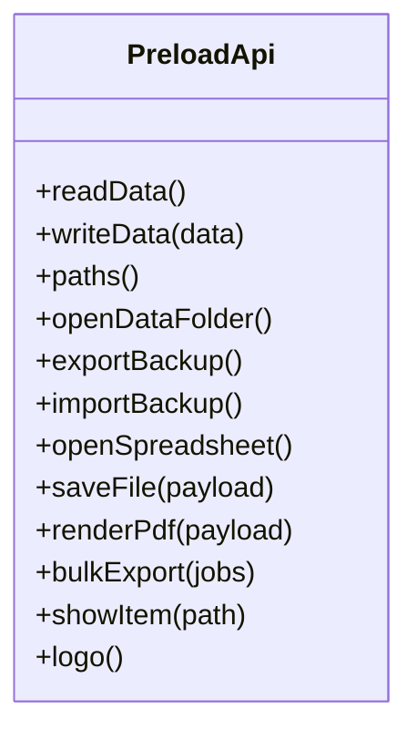
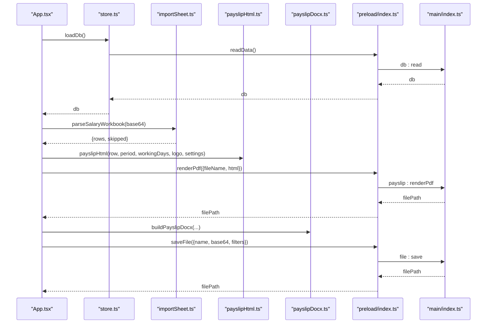
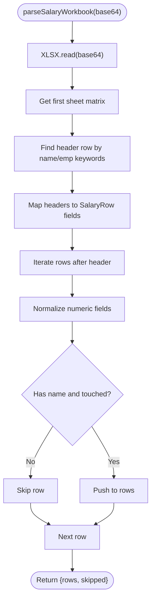
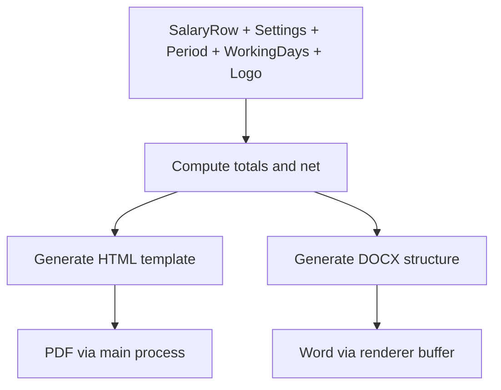
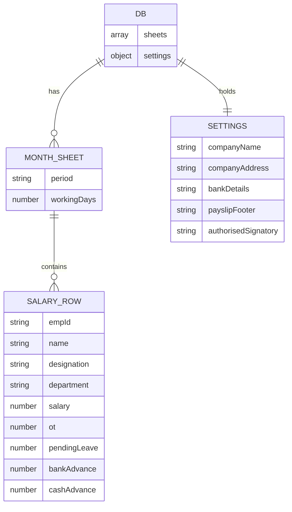
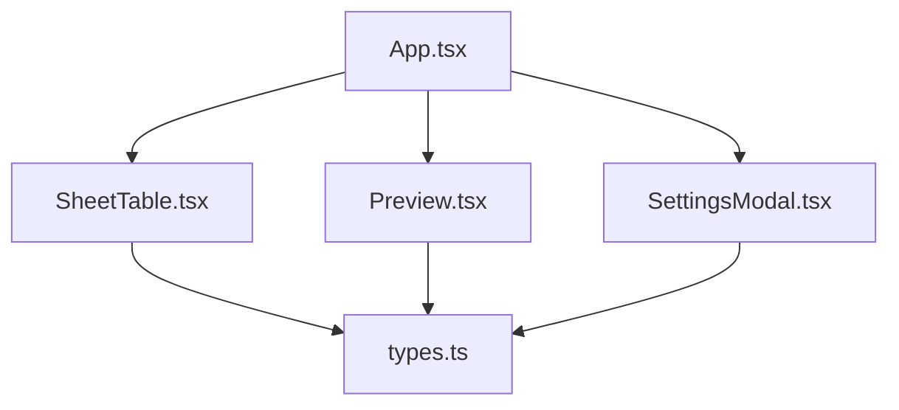
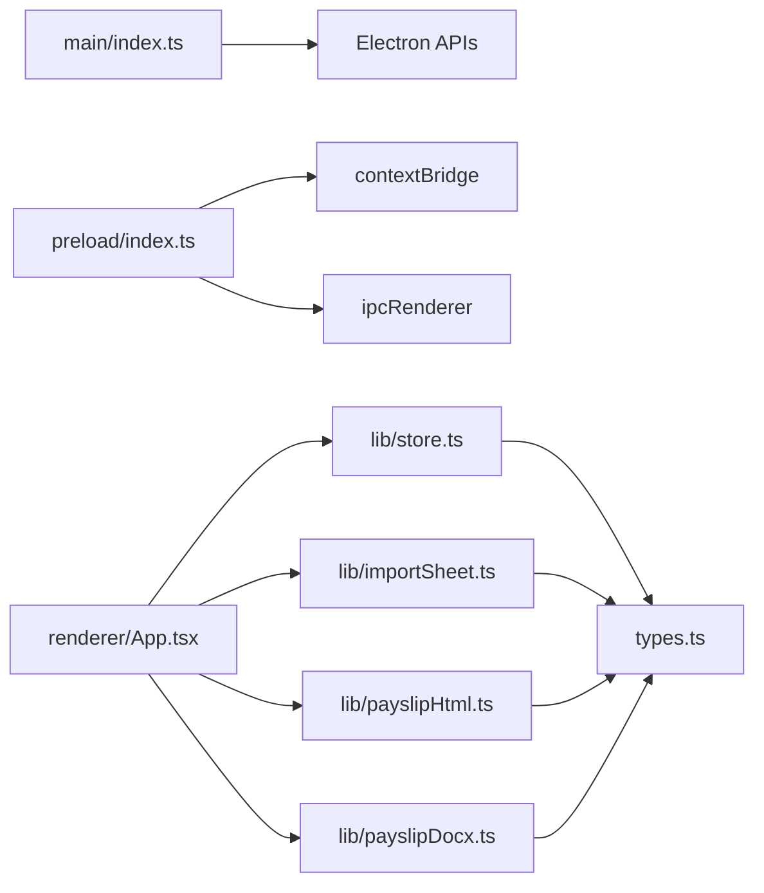

# Technical Architecture

<cite>
**Referenced Files in This Document**   
- [package.json](file://package.json)
- [README.md](file://README.md)
- [electron.vite.config.ts](file://electron.vite.config.ts)
- [src/main/index.ts](file://src/main/index.ts)
- [src/preload/index.ts](file://src/preload/index.ts)
- [src/renderer/src/App.tsx](file://src/renderer/src/App.tsx)
- [src/renderer/src/lib/store.ts](file://src/renderer/src/lib/store.ts)
- [src/renderer/src/lib/importSheet.ts](file://src/renderer/src/lib/importSheet.ts)
- [src/renderer/src/lib/payslipHtml.ts](file://src/renderer/src/lib/payslipHtml.ts)
- [src/renderer/src/lib/payslipDocx.ts](file://src/renderer/src/lib/payslipDocx.ts)
- [src/renderer/src/types.ts](file://src/renderer/src/types.ts)
- [src/renderer/src/components/SheetTable.tsx](file://src/renderer/src/components/SheetTable.tsx)
- [src/renderer/src/components/Preview.tsx](file://src/renderer/src/components/Preview.tsx)
- [src/renderer/src/components/SettingsModal.tsx](file://src/renderer/src/components/SettingsModal.tsx)
</cite>

## Table of Contents
1. [Introduction](#introduction)
2. [Project Structure](#project-structure)
3. [Core Components](#core-components)
4. [Architecture Overview](#architecture-overview)
5. [Detailed Component Analysis](#detailed-component-analysis)
6. [Dependency Analysis](#dependency-analysis)
7. [Performance Considerations](#performance-considerations)
8. [Troubleshooting Guide](#troubleshooting-guide)
9. [Conclusion](#conclusion)

## Introduction
This document describes the architecture of the Mabtech Payslip Generator, an offline Electron desktop application that imports monthly salary spreadsheets, renders payslips, and exports them as PDF or Word documents. The system separates system-level operations (file I/O, native dialogs, PDF rendering) into the Electron main process and user interface/business logic into a React renderer process. IPC is used to securely expose only necessary capabilities to the renderer through a preload bridge.

Key technical decisions:
- Electron provides cross-platform desktop capabilities with access to the file system and native dialogs.
- React powers a responsive UI for spreadsheet editing, live preview, and export actions.
- Vite via electron-vite optimizes builds for both main and renderer processes.
- Spreadsheet parsing and document generation are performed in-process within the renderer where possible, while heavy or sensitive operations (PDF rendering, file saving) run in the main process.

## Project Structure
The repository follows a standard Electron + Vite layout:
- Main process code under src/main.
- Preload bridge under src/preload.
- Renderer application under src/renderer, including React components and business libraries.
- Build configuration via electron-vite and TypeScript.

**Diagram sources**
- [src/main/index.ts:1-200](file://src/main/index.ts#L1-L200)
- [src/preload/index.ts:1-25](file://src/preload/index.ts#L1-L25)
- [src/renderer/src/App.tsx:1-289](file://src/renderer/src/App.tsx#L1-L289)
- [src/renderer/src/lib/store.ts:1-33](file://src/renderer/src/lib/store.ts#L1-L33)
- [src/renderer/src/lib/importSheet.ts:1-87](file://src/renderer/src/lib/importSheet.ts#L1-L87)
- [src/renderer/src/lib/payslipHtml.ts:1-164](file://src/renderer/src/lib/payslipHtml.ts#L1-L164)
- [src/renderer/src/lib/payslipDocx.ts:1-130](file://src/renderer/src/lib/payslipDocx.ts#L1-L130)
- [src/renderer/src/types.ts:1-61](file://src/renderer/src/types.ts#L1-L61)
- [src/renderer/src/components/SheetTable.tsx:1-71](file://src/renderer/src/components/SheetTable.tsx#L1-L71)
- [src/renderer/src/components/Preview.tsx:1-29](file://src/renderer/src/components/Preview.tsx#L1-L29)
- [src/renderer/src/components/SettingsModal.tsx:1-43](file://src/renderer/src/components/SettingsModal.tsx#L1-L43)

**Section sources**
- [package.json:1-59](file://package.json#L1-L59)
- [electron.vite.config.ts:1-11](file://electron.vite.config.ts#L1-L11)

## Core Components
- Main process: manages BrowserWindow lifecycle, exposes IPC handlers for database persistence, file dialogs, binary read/write, PDF rendering, bulk export, logo asset loading, and data folder operations.
- Preload bridge: exposes a typed API surface to the renderer using contextBridge, mapping renderer calls to IPC channels.
- Renderer App: orchestrates state, import flow, payslip generation, and export actions; composes UI components.
- Data store: loads/saves Db structure to main process storage and provides month sheet helpers.
- Spreadsheet importer: parses Excel/CSV files, maps headers to internal fields, and normalizes numeric values.
- Payslip builders: generate HTML templates for PDF rendering and DOCX documents for Word export.
- Types: define SalaryRow, MonthSheet, Settings, Db, and helper functions like grossOf and periodLabel.
- UI components: SheetTable for editable employee rows, Preview for live payslip preview, SettingsModal for company settings.

**Section sources**
- [src/main/index.ts:1-200](file://src/main/index.ts#L1-L200)
- [src/preload/index.ts:1-25](file://src/preload/index.ts#L1-L25)
- [src/renderer/src/App.tsx:1-289](file://src/renderer/src/App.tsx#L1-L289)
- [src/renderer/src/lib/store.ts:1-33](file://src/renderer/src/lib/store.ts#L1-L33)
- [src/renderer/src/lib/importSheet.ts:1-87](file://src/renderer/src/lib/importSheet.ts#L1-L87)
- [src/renderer/src/lib/payslipHtml.ts:1-164](file://src/renderer/src/lib/payslipHtml.ts#L1-L164)
- [src/renderer/src/lib/payslipDocx.ts:1-130](file://src/renderer/src/lib/payslipDocx.ts#L1-L130)
- [src/renderer/src/types.ts:1-61](file://src/renderer/src/types.ts#L1-L61)
- [src/renderer/src/components/SheetTable.tsx:1-71](file://src/renderer/src/components/SheetTable.tsx#L1-L71)
- [src/renderer/src/components/Preview.tsx:1-29](file://src/renderer/src/components/Preview.tsx#L1-L29)
- [src/renderer/src/components/SettingsModal.tsx:1-43](file://src/renderer/src/components/SettingsModal.tsx#L1-L43)

## Architecture Overview
The application uses a clear separation between main and renderer processes:
- Main process owns native resources: file system access, dialog prompts, PDF rendering via offscreen BrowserWindow, and logo asset caching.
- Renderer process owns UI and business logic: spreadsheet import, data modeling, template generation, and orchestration of export flows.
- IPC is strictly controlled via preload, exposing only necessary methods to the renderer.

**Diagram sources**
- [src/renderer/src/App.tsx:103-136](file://src/renderer/src/App.tsx#L103-L136)
- [src/preload/index.ts:10-11](file://src/preload/index.ts#L10-L11)
- [src/main/index.ts:127-135](file://src/main/index.ts#L127-L135)
- [src/main/index.ts:36-41](file://src/main/index.ts#L36-L41)
- [src/renderer/src/lib/importSheet.ts:41-80](file://src/renderer/src/lib/importSheet.ts#L41-L80)

## Detailed Component Analysis

### Main Process
Responsibilities:
- Create and manage the BrowserWindow, set preload path, and handle external link opening.
- Expose IPC handlers for:
  - Database read/write with atomic writes using temp file + rename.
  - Application paths and data folder operations.
  - Backup import/export via JSON.
  - Binary file reading (spreadsheet) and generic file saving.
  - PDF rendering from HTML using an offscreen BrowserWindow and printToPDF.
  - Bulk export of multiple payslips into a timestamped folder.
  - Logo asset loading as a base64 data URL.

Error handling:
- Graceful fallback when database file is missing or malformed.
- Validation on backup restore payload shape.
- Safe filename sanitization before writing.

**Diagram sources**
- [src/main/index.ts:27-41](file://src/main/index.ts#L27-L41)
- [src/main/index.ts:45-61](file://src/main/index.ts#L45-L61)
- [src/main/index.ts:95-189](file://src/main/index.ts#L95-L189)

**Section sources**
- [src/main/index.ts:1-200](file://src/main/index.ts#L1-L200)

### Preload Bridge
Responsibilities:
- Expose a minimal, typed API to the renderer via contextBridge.
- Map renderer calls to IPC channels for secure communication.

API surface includes:
- Database operations: readData, writeData.
- File operations: openSpreadsheet, saveFile.
- Export operations: renderPdf, bulkExport.
- Utilities: paths, openDataFolder, exportBackup, importBackup, showItem, logo.

**Diagram sources**
- [src/preload/index.ts:1-25](file://src/preload/index.ts#L1-L25)

**Section sources**
- [src/preload/index.ts:1-25](file://src/preload/index.ts#L1-L25)

### Renderer App
Responsibilities:
- Initialize DB state, ensure current period sheet exists, and load logo.
- Provide a single mutation function to avoid race conditions and debounce saves.
- Handle spreadsheet import, merging existing rows, and status feedback.
- Generate payslip HTML and DOCX, and trigger exports via preload API.
- Compose UI components: SheetTable, Preview, SettingsModal.

State management:
- Uses local React state plus a ref to hold the latest Db snapshot for consistent mutations.
- Debounced persistence to disk; flushes on visibility change and unload.

**Diagram sources**
- [src/renderer/src/App.tsx:25-48](file://src/renderer/src/App.tsx#L25-L48)
- [src/renderer/src/App.tsx:103-136](file://src/renderer/src/App.tsx#L103-L136)
- [src/renderer/src/App.tsx:138-184](file://src/renderer/src/App.tsx#L138-L184)
- [src/renderer/src/lib/store.ts:8-18](file://src/renderer/src/lib/store.ts#L8-L18)
- [src/renderer/src/lib/importSheet.ts:41-80](file://src/renderer/src/lib/importSheet.ts#L41-L80)
- [src/renderer/src/lib/payslipHtml.ts:41-164](file://src/renderer/src/lib/payslipHtml.ts#L41-L164)
- [src/renderer/src/lib/payslipDocx.ts:50-129](file://src/renderer/src/lib/payslipDocx.ts#L50-L129)
- [src/preload/index.ts:4-19](file://src/preload/index.ts#L4-L19)
- [src/main/index.ts:176-186](file://src/main/index.ts#L176-L186)

**Section sources**
- [src/renderer/src/App.tsx:1-289](file://src/renderer/src/App.tsx#L1-L289)

### Spreadsheet Import Logic
Responsibilities:
- Parse base64-encoded workbook using xlsx.
- Auto-match headers via normalized aliases and ignore computed columns.
- Normalize numeric fields and skip invalid rows.
- Provide CSV export utility for the current sheet.

Complexity:
- Header mapping is O(columns).
- Row processing is O(rows), with constant-time field assignments.

**Diagram sources**
- [src/renderer/src/lib/importSheet.ts:41-80](file://src/renderer/src/lib/importSheet.ts#L41-L80)

**Section sources**
- [src/renderer/src/lib/importSheet.ts:1-87](file://src/renderer/src/lib/importSheet.ts#L1-L87)

### Payslip Generation
HTML Builder:
- Computes paid days, earnings, deductions, net amount, and negative recoverable cases.
- Produces a styled HTML document suitable for PDF rendering.
- Includes amount-in-words conversion and optional bank details/signatures.

DOCX Builder:
- Builds a structured Word document using docx library.
- Mirrors HTML content with tables, headings, and styling.
- Supports optional logo image embedding.

**Diagram sources**
- [src/renderer/src/lib/payslipHtml.ts:41-164](file://src/renderer/src/lib/payslipHtml.ts#L41-L164)
- [src/renderer/src/lib/payslipDocx.ts:50-129](file://src/renderer/src/lib/payslipDocx.ts#L50-L129)

**Section sources**
- [src/renderer/src/lib/payslipHtml.ts:1-164](file://src/renderer/src/lib/payslipHtml.ts#L1-L164)
- [src/renderer/src/lib/payslipDocx.ts:1-130](file://src/renderer/src/lib/payslipDocx.ts#L1-L130)

### Data Model

**Diagram sources**
- [src/renderer/src/types.ts:1-61](file://src/renderer/src/types.ts#L1-L61)

**Section sources**
- [src/renderer/src/types.ts:1-61](file://src/renderer/src/types.ts#L1-L61)

### UI Component Hierarchy

**Diagram sources**
- [src/renderer/src/App.tsx:1-289](file://src/renderer/src/App.tsx#L1-L289)
- [src/renderer/src/components/SheetTable.tsx:1-71](file://src/renderer/src/components/SheetTable.tsx#L1-L71)
- [src/renderer/src/components/Preview.tsx:1-29](file://src/renderer/src/components/Preview.tsx#L1-L29)
- [src/renderer/src/components/SettingsModal.tsx:1-43](file://src/renderer/src/components/SettingsModal.tsx#L1-L43)
- [src/renderer/src/types.ts:1-61](file://src/renderer/src/types.ts#L1-L61)

**Section sources**
- [src/renderer/src/components/SheetTable.tsx:1-71](file://src/renderer/src/components/SheetTable.tsx#L1-L71)
- [src/renderer/src/components/Preview.tsx:1-29](file://src/renderer/src/components/Preview.tsx#L1-L29)
- [src/renderer/src/components/SettingsModal.tsx:1-43](file://src/renderer/src/components/SettingsModal.tsx#L1-L43)

## Dependency Analysis
High-level dependencies:
- Main process depends on Electron APIs (BrowserWindow, ipcMain, dialog, shell, fs).
- Preload bridge depends on contextBridge and ipcRenderer.
- Renderer depends on React, XLSX, docx, and the preload API.
- Business logic modules depend on shared types.

**Diagram sources**
- [src/main/index.ts:1-200](file://src/main/index.ts#L1-L200)
- [src/preload/index.ts:1-25](file://src/preload/index.ts#L1-L25)
- [src/renderer/src/App.tsx:1-289](file://src/renderer/src/App.tsx#L1-L289)
- [src/renderer/src/lib/store.ts:1-33](file://src/renderer/src/lib/store.ts#L1-L33)
- [src/renderer/src/lib/importSheet.ts:1-87](file://src/renderer/src/lib/importSheet.ts#L1-L87)
- [src/renderer/src/lib/payslipHtml.ts:1-164](file://src/renderer/src/lib/payslipHtml.ts#L1-L164)
- [src/renderer/src/lib/payslipDocx.ts:1-130](file://src/renderer/src/lib/payslipDocx.ts#L1-L130)
- [src/renderer/src/types.ts:1-61](file://src/renderer/src/types.ts#L1-L61)

**Section sources**
- [package.json:16-35](file://package.json#L16-L35)
- [electron.vite.config.ts:1-11](file://electron.vite.config.ts#L1-L11)

## Performance Considerations
- Debounced persistence: App debounces saves to reduce frequent disk writes during edits.
- Atomic file writes: Main process writes to a temporary file and renames to prevent partial corruption.
- Offscreen PDF rendering: PDF generation uses an offscreen BrowserWindow to avoid UI blocking.
- Efficient spreadsheet parsing: Header mapping and row iteration are linear in input size; ignored columns reduce overhead.
- Memoized sheet selection: useMemo ensures sheet lookup is efficient when period changes.

[No sources needed since this section provides general guidance]

## Troubleshooting Guide
Common issues and resolutions:
- Missing or malformed database file: Main process returns empty data structure; app initializes default period sheet.
- Invalid backup file: Restore validates payload shape; errors thrown if not valid.
- No employees imported: Status message indicates expected headers; verify spreadsheet format.
- Negative net salary: App warns about recoverable amounts; adjust advances or leave balance.
- Export failures: Ensure file dialogs complete successfully; check permissions and available disk space.

Operational tips:
- Use “Open data folder” to inspect database.json location.
- Use “Backup” and “Restore” to move data across machines.
- For bulk PDF export, choose a writable directory; app opens the resulting folder automatically.

**Section sources**
- [src/main/index.ts:27-41](file://src/main/index.ts#L27-L41)
- [src/main/index.ts:114-125](file://src/main/index.ts#L114-L125)
- [src/renderer/src/App.tsx:103-136](file://src/renderer/src/App.tsx#L103-L136)
- [src/renderer/src/App.tsx:162-173](file://src/renderer/src/App.tsx#L162-L173)

## Conclusion
The Mabtech Payslip Generator implements a clean separation between Electron’s main process and React-based renderer process, leveraging IPC through a secure preload bridge. The renderer handles spreadsheet import, data modeling, and template generation, while the main process manages native file operations and PDF rendering. This architecture enables a responsive UI, robust data persistence, and reliable document export workflows suitable for offline desktop usage.

[No sources needed since this section summarizes without analyzing specific files]