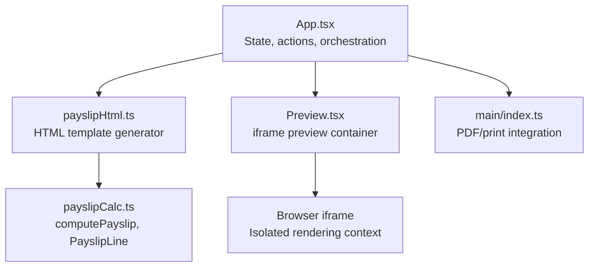
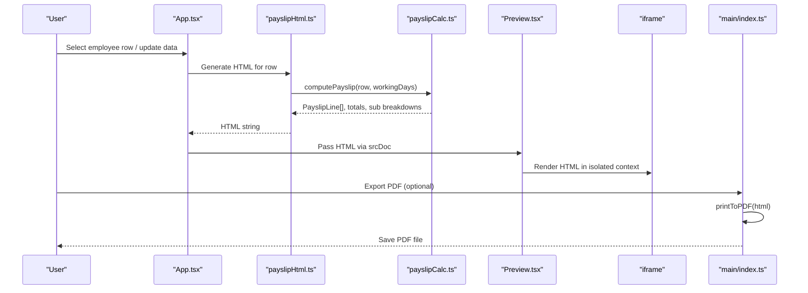
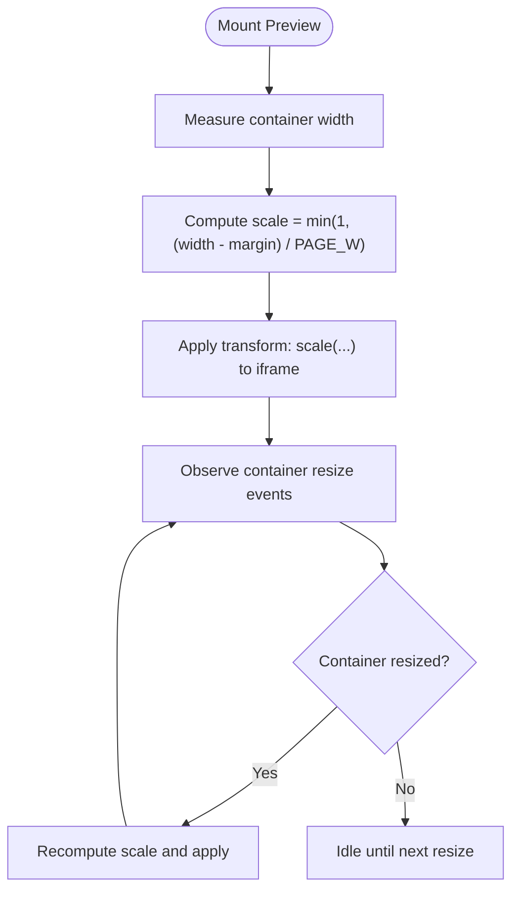
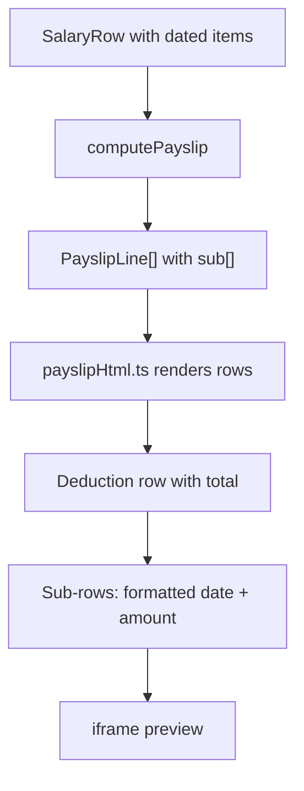
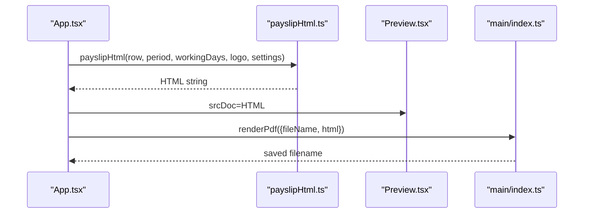
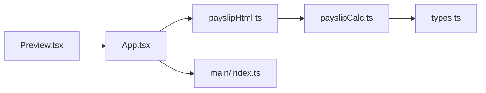

# Preview Component

<cite>
**Referenced Files in This Document**
- [Preview.tsx](file://src/renderer/src/components/Preview.tsx)
- [App.tsx](file://src/renderer/src/App.tsx)
- [payslipHtml.ts](file://src/renderer/src/lib/payslipHtml.ts)
- [payslipCalc.ts](file://src/renderer/src/lib/payslipCalc.ts)
- [types.ts](file://src/renderer/src/types.ts)
- [index.ts](file://src/main/index.ts)
</cite>

## Table of Contents
1. [Introduction](#introduction)
2. [Project Structure](#project-structure)
3. [Core Components](#core-components)
4. [Architecture Overview](#architecture-overview)
5. [Detailed Component Analysis](#detailed-component-analysis)
6. [Dependency Analysis](#dependency-analysis)
7. [Performance Considerations](#performance-considerations)
8. [Troubleshooting Guide](#troubleshooting-guide)
9. [Conclusion](#conclusion)

## Introduction
This document explains the Preview component that renders HTML-based payslip templates inside an isolated iframe. It covers how the component scales responsively, how it integrates with the payslip generation engine, how content is sanitized, and how print/PDF workflows are optimized. It also documents configuration options for iframe sizing, scrolling behavior, and security posture, along with performance considerations for large payslips and memory management strategies.

The preview displays the detailed dated advance breakdown beneath each deduction line using the same `PayslipLine` structure produced by the payslip calculation engine. Each dated entry is shown as a sub-row with its formatted date and amount, while the parent deduction row still shows the summed total.

## Project Structure
The Preview component lives in the renderer layer and consumes HTML generated by the payslip template engine. The application composes data from a spreadsheet-like sheet into a single employee row, generates HTML through `computePayslip`, and passes it to the Preview component as an inline document.



**Diagram sources**
- [App.tsx:138-169](file://src/renderer/src/App.tsx#L138-L169)
- [payslipHtml.ts:1-10](file://src/renderer/src/lib/payslipHtml.ts#L1-L10)
- [payslipHtml.ts:41-93](file://src/renderer/src/lib/payslipHtml.ts#L41-L93)
- [payslipCalc.ts:95-150](file://src/renderer/src/lib/payslipCalc.ts#L95-L150)
- [Preview.tsx:5-27](file://src/renderer/src/components/Preview.tsx#L5-L27)
- [index.ts:50-56](file://src/main/index.ts#L50-L56)

**Section sources**
- [App.tsx:13-289](file://src/renderer/src/App.tsx#L13-L289)
- [Preview.tsx:1-28](file://src/renderer/src/components/Preview.tsx#L1-L28)
- [payslipHtml.ts:1-178](file://src/renderer/src/lib/payslipHtml.ts#L1-L178)
- [payslipCalc.ts:1-150](file://src/renderer/src/lib/payslipCalc.ts#L1-L150)
- [types.ts:1-181](file://src/renderer/src/types.ts#L1-L181)
- [index.ts:50-56](file://src/main/index.ts#L50-L56)

## Core Components
- Preview component: Renders the generated HTML inside an iframe using `srcDoc`, applies responsive scaling to fit A4 dimensions, and disables scrolling to keep the page contained.
- Payslip HTML generator: Converts structured salary data into a self-contained HTML document with embedded styles, sanitizes user-provided text, and includes print-friendly `@page` rules.
- Payslip calculator: Produces the canonical `PayslipLine[]` representation, including optional `sub` arrays for dated advances, so screen and print output share the same layout logic.
- Application orchestrator: Builds the HTML for the selected employee row and passes it to Preview; coordinates PDF export via the main process.

Key responsibilities:
- Responsive scaling based on container width while preserving A4 proportions.
- Isolation of rendered content within an iframe.
- Safe rendering of user-supplied values through escaping.
- Print optimization via CSS `@page` and Electron’s `printToPDF`.
- Display of dated advance breakdowns under applicable deduction lines.

**Section sources**
- [Preview.tsx:5-27](file://src/renderer/src/components/Preview.tsx#L5-L27)
- [payslipHtml.ts:41-159](file://src/renderer/src/lib/payslipHtml.ts#L41-L159)
- [payslipCalc.ts:95-150](file://src/renderer/src/lib/payslipCalc.ts#L95-L150)
- [App.tsx:138-169](file://src/renderer/src/App.tsx#L138-L169)

## Architecture Overview
The Preview workflow connects four layers:
- Renderer UI (React): Holds state, builds HTML, and mounts Preview.
- Template engine: Converts structured salary data into a styled HTML document.
- Calculation engine: Defines the authoritative payslip shape, including sub-breakdown entries for dated advances.
- Browser iframe: Isolates the rendered HTML for safe display and printing.



**Diagram sources**
- [App.tsx:138-169](file://src/renderer/src/App.tsx#L138-L169)
- [payslipHtml.ts:1-10](file://src/renderer/src/lib/payslipHtml.ts#L1-L10)
- [payslipHtml.ts:41-93](file://src/renderer/src/lib/payslipHtml.ts#L41-L93)
- [payslipCalc.ts:95-150](file://src/renderer/src/lib/payslipCalc.ts#L95-L150)
- [Preview.tsx:19-27](file://src/renderer/src/components/Preview.tsx#L19-L27)
- [index.ts:50-56](file://src/main/index.ts#L50-L56)

## Detailed Component Analysis

### Preview Component
Responsibilities:
- Accepts an HTML string via `srcDoc` and renders it inside an iframe.
- Scales the iframe content to fit the available container width while maintaining A4 proportions.
- Disables scrolling to prevent overflow outside the preview area.

Scaling logic:
- Uses a fixed A4 width constant (`PAGE_W = 794`, matching 96dpi A4) and computes a scale factor based on the container’s `clientWidth` minus a small margin.
- Applies `transform: scale(...)` to the inner frame so the visual size matches the container without changing layout dimensions.
- Observes container size changes with `ResizeObserver` to recalculate scale dynamically.

Security posture:
- Uses `srcDoc` to inject HTML directly into the iframe, which isolates scripts and styles from the parent page.
- No `postMessage` or `window` access patterns are used between parent and child frames.

Configuration options exposed by the component:
- `srcDoc`: Required HTML string to render.
- Scrolling: Disabled via `scrolling="no"`.
- Title: Set to “Payslip preview” for accessibility.



**Diagram sources**
- [Preview.tsx:9-17](file://src/renderer/src/components/Preview.tsx#L9-L17)
- [Preview.tsx:19-27](file://src/renderer/src/components/Preview.tsx#L19-L27)

**Section sources**
- [Preview.tsx:1-28](file://src/renderer/src/components/Preview.tsx#L1-L28)

### Payslip HTML Generator
Responsibilities:
- Converts a `SalaryRow` and settings into a complete HTML document.
- Escapes user-provided strings to prevent injection.
- Embeds print-optimized CSS including `@page` rules for A4 output.
- Formats amounts and displays net payable/recoverable status.
- Renders dated advance breakdown rows beneath each applicable deduction line.

Sanitization measures:
- All user inputs are escaped before insertion into HTML attributes and text nodes.
- No external scripts or third-party resources are injected.

Print optimization:
- Includes `@page { size: A4; margin: 0; }` to ensure consistent print dimensions.
- Styles are designed for clean print output.

Deduction sub-breakdown rendering:
- Every deduction line comes from `computePayslip`, which produces `PayslipLine` objects.
- Deductions with dated items carry a `sub` array containing `{ label, amount }` entries.
- The generator prints one row per deduction, then iterates over `line.sub` to add indented sub-rows with formatted dates and amounts.
- Sub-row styling uses `.sub` rows, `.subdate`, and `.subamt` classes for compact, aligned presentation.

Data model usage:
- Consumes types such as `SalaryRow`, `Settings`, `PayslipLine`, and `PayslipCalc` to build the document.

```mermaid
classDiagram
class SalaryRow {
+string empId
+string name
+number salary
+number ot
+number bankAdvance
+number cashAdvance
+number pendingLeave
+AdvanceEntry[] bankAdvanceItems?
+AdvanceEntry[] cashAdvanceItems?
+AdvanceEntry[] bankSalaryItems?
}
class AdvanceEntry {
+string date
+number amount
}
class Settings {
+string companyName
+string companyAddress
+string bankDetails
+string payslipFooter
+string authorisedSignatory
}
class PayslipLine {
+string label
+number amount
+string text?
+{label:string; amount:number}[] sub?
}
class PayslipCalc {
+PayslipLine[] structureLines
+number salary
+PayslipLine[] earningsLines
+PayslipLine[] deductionLines
+number totalEarnings
+number totalDeductions
+number net
+boolean negative
+number paidDays
}
class PayslipHtmlGenerator {
+payslipHtml(input) string
+amountInWords(amount) string
+inr(n) string
}
SalaryRow <.. PayslipHtmlGenerator : "reads"
Settings <.. PayslipHtmlGenerator : "reads"
PayslipCalc <.. PayslipHtmlGenerator : "consumes"
PayslipLine <.. PayslipCalc : "produces"
AdvanceEntry <.. SalaryRow : "dated breakdown"
```

**Diagram sources**
- [types.ts:1-37](file://src/renderer/src/types.ts#L1-L37)
- [types.ts:11-18](file://src/renderer/src/types.ts#L11-L18)
- [types.ts:23-46](file://src/renderer/src/types.ts#L23-L46)
- [payslipCalc.ts:68-93](file://src/renderer/src/lib/payslipCalc.ts#L68-L93)
- [payslipCalc.ts:95-150](file://src/renderer/src/lib/payslipCalc.ts#L95-L150)
- [payslipHtml.ts:33-39](file://src/renderer/src/lib/payslipHtml.ts#L33-L39)
- [payslipHtml.ts:41-93](file://src/renderer/src/lib/payslipHtml.ts#L41-L93)
- [payslipHtml.ts:95-159](file://src/renderer/src/lib/payslipHtml.ts#L95-L159)

**Section sources**
- [payslipHtml.ts:1-178](file://src/renderer/src/lib/payslipHtml.ts#L1-L178)
- [payslipCalc.ts:1-150](file://src/renderer/src/lib/payslipCalc.ts#L1-L150)
- [types.ts:1-181](file://src/renderer/src/types.ts#L1-L181)

### Dated Advance Breakdown in the Preview
The preview now reflects the full dated breakdown carried behind each deduction total:

- The data model stores dated advance entries as `AdvanceEntry[]` (`date` + `amount`) behind fields such as `bankAdvanceItems`, `cashAdvanceItems`, and `bankSalaryItems`.
- `computePayslip` converts these entries into `PayslipLine` objects with an optional `sub` array.
- For `bankAdvance`, `cashAdvance`, and `bankSalary`, dated entries are mapped to sub-rows where each entry’s ISO date is reformatted to day-first form.
- The HTML generator iterates `deductionLines` and, for each line, renders its sub-items as indented rows with class `.sub`, `.subdate`, and `.subamt`.

Rendering behavior:
- Parent deduction rows show the computed total amount.
- Sub-rows show the formatted date and absolute amount for each dated item.
- Statutory deductions such as ESI and PF show “Not Eligible” instead of an amount when marked so by the sheet.
- The `sub` field is optional; only deductions with dated entries render sub-rows.



**Diagram sources**
- [types.ts:1-18](file://src/renderer/src/types.ts#L1-L18)
- [types.ts:23-46](file://src/renderer/src/types.ts#L23-L46)
- [payslipCalc.ts:117-144](file://src/renderer/src/lib/payslipCalc.ts#L117-L144)
- [payslipHtml.ts:64-93](file://src/renderer/src/lib/payslipHtml.ts#L64-L93)

**Section sources**
- [types.ts:1-18](file://src/renderer/src/types.ts#L1-L18)
- [types.ts:23-46](file://src/renderer/src/types.ts#L23-L46)
- [payslipCalc.ts:68-93](file://src/renderer/src/lib/payslipCalc.ts#L68-L93)
- [payslipCalc.ts:117-144](file://src/renderer/src/lib/payslipCalc.ts#L117-L144)
- [payslipHtml.ts:41-93](file://src/renderer/src/lib/payslipHtml.ts#L41-L93)

### Application Integration
Responsibilities:
- Generates HTML for the currently selected employee row.
- Passes the HTML to Preview via `srcDoc`.
- Coordinates PDF export by sending HTML to the main process for print-to-PDF.

Integration points:
- Calls the HTML generator with row, period, working days, logo, and settings.
- Invokes Electron APIs to save files and generate PDFs.



**Diagram sources**
- [App.tsx:138-144](file://src/renderer/src/App.tsx#L138-L144)
- [payslipHtml.ts:41-159](file://src/renderer/src/lib/payslipHtml.ts#L41-L159)
- [index.ts:50-56](file://src/main/index.ts#L50-L56)

**Section sources**
- [App.tsx:138-169](file://src/renderer/src/App.tsx#L138-L169)

## Dependency Analysis
- Preview depends on React hooks (`useEffect`, `useRef`, `useState`) and receives `srcDoc` from its parent.
- App composes state and calls the HTML generator to produce the preview content.
- The HTML generator depends on typed data structures and helper utilities for formatting, escaping, and computation.
- The calculation engine owns the authoritative payslip shape, including dated advance sub-entries.
- PDF export flows through Electron’s main process API.



**Diagram sources**
- [Preview.tsx:1-28](file://src/renderer/src/components/Preview.tsx#L1-L28)
- [App.tsx:138-169](file://src/renderer/src/App.tsx#L138-L169)
- [payslipHtml.ts:1-178](file://src/renderer/src/lib/payslipHtml.ts#L1-L178)
- [payslipCalc.ts:1-150](file://src/renderer/src/lib/payslipCalc.ts#L1-L150)
- [types.ts:1-181](file://src/renderer/src/types.ts#L1-L181)
- [index.ts:50-56](file://src/main/index.ts#L50-L56)

**Section sources**
- [Preview.tsx:1-28](file://src/renderer/src/components/Preview.tsx#L1-L28)
- [App.tsx:138-169](file://src/renderer/src/App.tsx#L138-L169)
- [payslipHtml.ts:1-178](file://src/renderer/src/lib/payslipHtml.ts#L1-L178)
- [payslipCalc.ts:1-150](file://src/renderer/src/lib/payslipCalc.ts#L1-L150)
- [types.ts:1-181](file://src/renderer/src/types.ts#L1-L181)
- [index.ts:50-56](file://src/main/index.ts#L50-L56)

## Performance Considerations
- Large payslips:
  - Avoid unnecessary re-renders by memoizing generated HTML where appropriate.
  - Keep iframe content minimal; avoid heavy images or excessive DOM nodes.
  - Use base64-encoded logos only when necessary; consider lazy loading if multiple pages are previewed.
- Scaling:
  - Scale calculations run on mount and on container resize; ensure containers have stable dimensions to avoid frequent recalculations.
- Memory management:
  - Disconnect `ResizeObserver` on unmount to prevent leaks.
  - Reuse generated HTML strings rather than regenerating them on every render if the underlying data has not changed.
- Printing:
  - Rely on `@page` rules and embedded styles for consistent print output.
  - Offload PDF generation to the main process to avoid blocking the UI thread.
- Dated breakdowns:
  - Only deductions with dated entries render additional sub-rows; avoid inflating the DOM with empty breakdowns.
  - Date formatting and sub-array mapping happen once in `computePayslip`, so the preview does not repeat expensive parsing.

[No sources needed since this section provides general guidance]

## Troubleshooting Guide
- Preview not visible:
  - Ensure the container has a non-zero width; scaling depends on container measurements.
  - Verify that `srcDoc` is a valid HTML string.
- Content overflow:
  - The iframe uses `scrolling="no"`; ensure the generated HTML fits within the scaled A4 dimensions.
- Incorrect print output:
  - Confirm that the HTML includes `@page` rules and that margins/styles are set for print.
- Security concerns:
  - Avoid injecting external scripts or untrusted resources into the HTML.
  - Use `srcDoc` to isolate content and rely on escaping provided by the generator.
- Missing dated breakdown:
  - Check whether the row carries dated items under `bankAdvanceItems`, `cashAdvanceItems`, or `bankSalaryItems`.
  - Without those entries, `computePayslip` will not populate the `sub` array, so no sub-rows are rendered.
- Unexpected sub-row formatting:
  - Dates must be in ISO `YYYY-MM-DD` format to be reformatted to day-first form; other values are passed through unchanged.
  - Sub-rows use `.sub`, `.subdate`, and `.subamt` classes; custom styles should not override their intended alignment.

**Section sources**
- [Preview.tsx:9-17](file://src/renderer/src/components/Preview.tsx#L9-L17)
- [payslipHtml.ts:30-31](file://src/renderer/src/lib/payslipHtml.ts#L30-L31)
- [payslipHtml.ts:71-71](file://src/renderer/src/lib/payslipHtml.ts#L71-L71)
- [payslipCalc.ts:117-144](file://src/renderer/src/lib/payslipCalc.ts#L117-L144)
- [types.ts:23-46](file://src/renderer/src/types.ts#L23-L46)

## Conclusion
The Preview component provides a secure, responsive, and print-ready iframe-based preview for HTML-generated payslips. It integrates cleanly with the application’s state and the template engine, ensuring safe rendering and consistent output across devices. The preview now displays the same `PayslipLine` structure used by the calculation engine, including dated advance breakdowns beneath applicable deduction lines. By following the recommended practices for scaling, sanitization, and memory management, you can deliver a smooth user experience even with large payslips.

[No sources needed since this section summarizes without analyzing specific files]