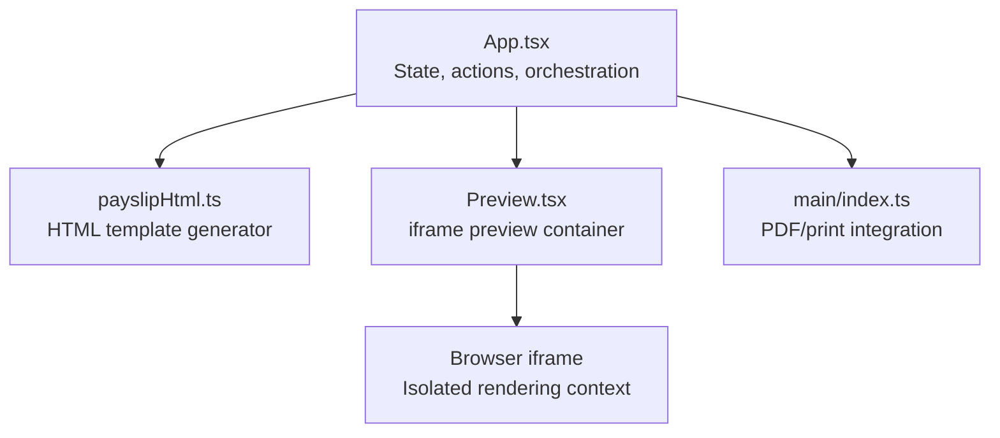
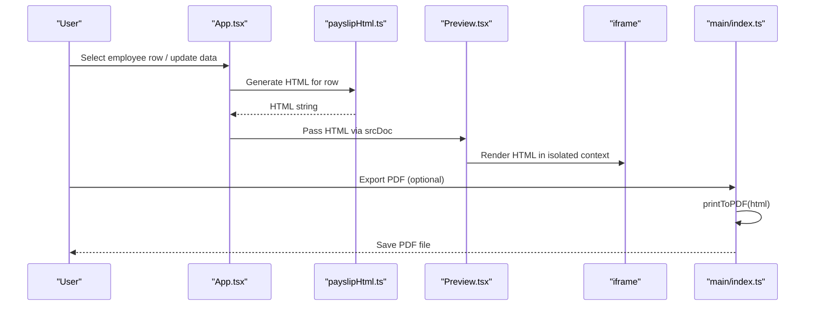
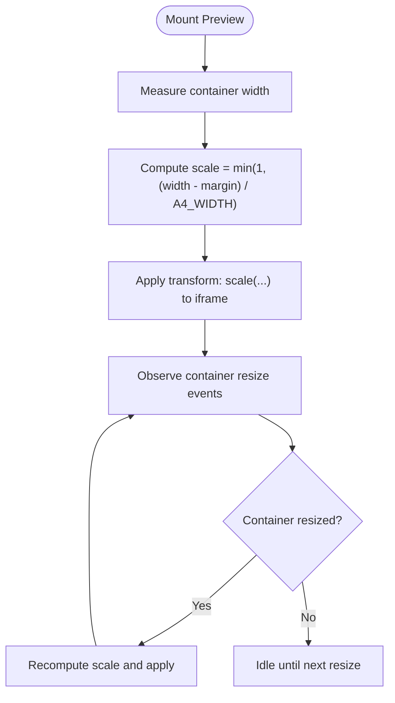
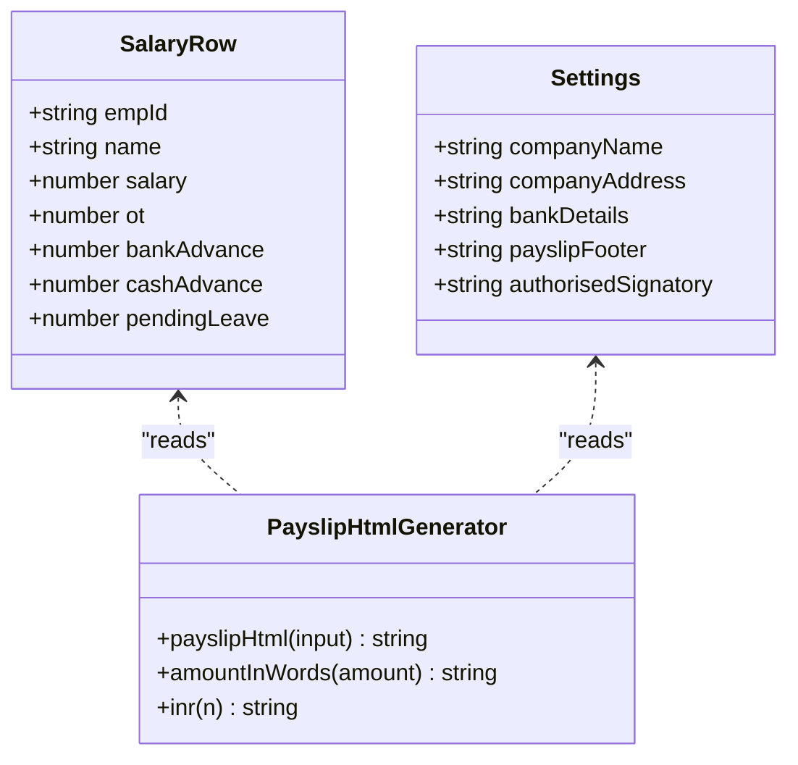
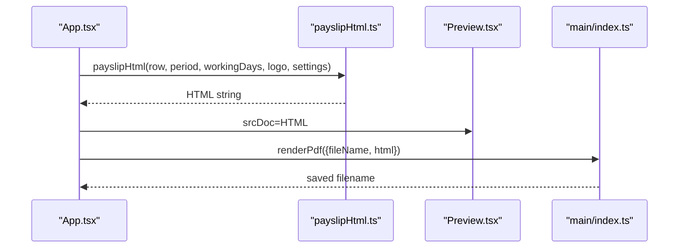
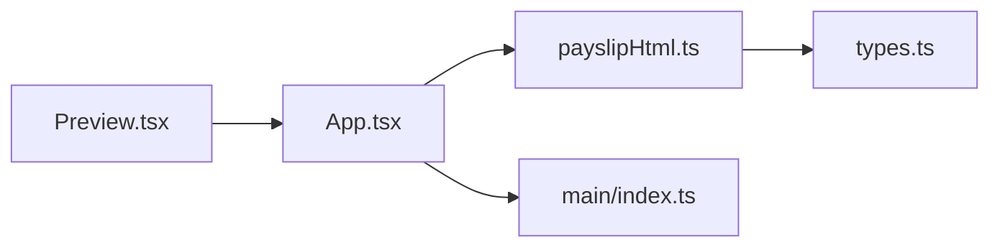

# Preview Component

<cite>
**Referenced Files in This Document**
- [Preview.tsx](file://src/renderer/src/components/Preview.tsx)
- [App.tsx](file://src/renderer/src/App.tsx)
- [payslipHtml.ts](file://src/renderer/src/lib/payslipHtml.ts)
- [types.ts](file://src/renderer/src/types.ts)
- [index.ts](file://src/main/index.ts)
</cite>

## Table of Contents
1. [Introduction](#introduction)
2. [Project Structure](#project-structure)
3. [Core Components](#core-components)
4. [Architecture Overview](#architecture-overview)
5. [Detailed Component Analysis](#detailed-component-analysis)
6. [Dependency Analysis](#dependency-analysis)
7. [Performance Considerations](#performance-considerations)
8. [Troubleshooting Guide](#troubleshooting-guide)
9. [Conclusion](#conclusion)

## Introduction
This document explains the Preview component that renders HTML-based payslip templates inside an isolated iframe. It covers how the component scales responsively, how it integrates with the payslip generation engine, how content is sanitized, and how print/PDF workflows are optimized. It also documents configuration options for iframe sizing, scrolling behavior, and security posture, along with performance considerations for large payslips and memory management strategies.

## Project Structure
The Preview component lives in the renderer layer and consumes HTML generated by the payslip template engine. The application composes data from a spreadsheet-like sheet into a single employee row, generates HTML, and passes it to the Preview component as an inline document.

**Diagram sources**
- [App.tsx:138-169](file://src/renderer/src/App.tsx#L138-L169)
- [payslipHtml.ts:41-159](file://src/renderer/src/lib/payslipHtml.ts#L41-L159)
- [Preview.tsx:5-27](file://src/renderer/src/components/Preview.tsx#L5-L27)
- [index.ts:50-56](file://src/main/index.ts#L50-L56)

**Section sources**
- [App.tsx:13-289](file://src/renderer/src/App.tsx#L13-L289)
- [Preview.tsx:1-29](file://src/renderer/src/components/Preview.tsx#L1-L29)
- [payslipHtml.ts:1-164](file://src/renderer/src/lib/payslipHtml.ts#L1-L164)
- [types.ts:1-117](file://src/renderer/src/types.ts#L1-L117)
- [index.ts:50-56](file://src/main/index.ts#L50-L56)

## Core Components
- Preview component: Renders the generated HTML inside an iframe using srcDoc, applies responsive scaling to fit A4 dimensions, and disables scrolling to keep the page contained.
- Payslip HTML generator: Produces a self-contained HTML document with embedded styles, sanitizes user-provided text, and includes print-friendly @page rules.
- Application orchestrator: Builds the HTML for the selected employee row and passes it to Preview; coordinates PDF export via the main process.

Key responsibilities:
- Responsive scaling based on container width while preserving A4 aspect ratio.
- Isolation of rendered content within an iframe.
- Safe rendering of user-supplied values through escaping.
- Print optimization via CSS @page and Electron’s printToPDF.

**Section sources**
- [Preview.tsx:5-27](file://src/renderer/src/components/Preview.tsx#L5-L27)
- [payslipHtml.ts:41-159](file://src/renderer/src/lib/payslipHtml.ts#L41-L159)
- [App.tsx:138-169](file://src/renderer/src/App.tsx#L138-L169)

## Architecture Overview
The Preview workflow connects three layers:
- Renderer UI (React): Holds state, builds HTML, and mounts Preview.
- Template engine: Converts structured salary data into a styled HTML document.
- Browser iframe: Isolates the rendered HTML for safe display and printing.

**Diagram sources**
- [App.tsx:138-169](file://src/renderer/src/App.tsx#L138-L169)
- [payslipHtml.ts:41-159](file://src/renderer/src/lib/payslipHtml.ts#L41-L159)
- [Preview.tsx:19-27](file://src/renderer/src/components/Preview.tsx#L19-L27)
- [index.ts:50-56](file://src/main/index.ts#L50-L56)

## Detailed Component Analysis

### Preview Component
Responsibilities:
- Accepts an HTML string via srcDoc and renders it inside an iframe.
- Scales the iframe content to fit the available container width while maintaining A4 proportions.
- Disables scrolling to prevent overflow outside the preview area.

Scaling logic:
- Uses a fixed A4 width constant and computes a scale factor based on the container’s clientWidth minus a small margin.
- Applies transform: scale(...) to the inner frame so the visual size matches the container without changing layout dimensions.
- Observes container size changes with ResizeObserver to recalculate scale dynamically.

Security posture:
- Uses srcDoc to inject HTML directly into the iframe, which isolates scripts and styles from the parent page.
- No postMessage or window access patterns are used between parent and child frames.

Configuration options exposed by the component:
- srcDoc: Required HTML string to render.
- Scrolling: Disabled via scrolling="no".
- Title: Set to “Payslip preview” for accessibility.

**Diagram sources**
- [Preview.tsx:9-17](file://src/renderer/src/components/Preview.tsx#L9-L17)
- [Preview.tsx:19-27](file://src/renderer/src/components/Preview.tsx#L19-L27)

**Section sources**
- [Preview.tsx:1-29](file://src/renderer/src/components/Preview.tsx#L1-L29)

### Payslip HTML Generator
Responsibilities:
- Converts a SalaryRow and settings into a complete HTML document.
- Escapes user-provided strings to prevent injection.
- Embeds print-optimized CSS including @page rules for A4 output.
- Formats amounts and displays net payable/recoverable status.

Sanitization measures:
- All user inputs are escaped before insertion into HTML attributes and text nodes.
- No external scripts or third-party resources are injected.

Print optimization:
- Includes @page { size: A4; margin: 0; } to ensure consistent print dimensions.
- Styles are designed for clean print output.

Data model usage:
- Consumes types such as SalaryRow and Settings to build the document.

**Diagram sources**
- [types.ts:1-37](file://src/renderer/src/types.ts#L1-L37)
- [payslipHtml.ts:33-39](file://src/renderer/src/lib/payslipHtml.ts#L33-L39)
- [payslipHtml.ts:41-159](file://src/renderer/src/lib/payslipHtml.ts#L41-L159)

**Section sources**
- [payslipHtml.ts:1-164](file://src/renderer/src/lib/payslipHtml.ts#L1-L164)
- [types.ts:1-117](file://src/renderer/src/types.ts#L1-L117)

### Application Integration
Responsibilities:
- Generates HTML for the currently selected employee row.
- Passes the HTML to Preview via srcDoc.
- Coordinates PDF export by sending HTML to the main process for print-to-PDF.

Integration points:
- Calls the HTML generator with row, period, working days, logo, and settings.
- Invokes Electron APIs to save files and generate PDFs.

**Diagram sources**
- [App.tsx:138-144](file://src/renderer/src/App.tsx#L138-L144)
- [payslipHtml.ts:41-159](file://src/renderer/src/lib/payslipHtml.ts#L41-L159)
- [index.ts:50-56](file://src/main/index.ts#L50-L56)

**Section sources**
- [App.tsx:138-169](file://src/renderer/src/App.tsx#L138-L169)

## Dependency Analysis
- Preview depends on React hooks (useEffect, useRef, useState) and receives srcDoc from its parent.
- App composes state and calls the HTML generator to produce the preview content.
- The HTML generator depends on typed data structures and helper utilities for formatting and escaping.
- PDF export flows through Electron’s main process API.

**Diagram sources**
- [Preview.tsx:1-29](file://src/renderer/src/components/Preview.tsx#L1-L29)
- [App.tsx:138-169](file://src/renderer/src/App.tsx#L138-L169)
- [payslipHtml.ts:1-164](file://src/renderer/src/lib/payslipHtml.ts#L1-L164)
- [types.ts:1-117](file://src/renderer/src/types.ts#L1-L117)
- [index.ts:50-56](file://src/main/index.ts#L50-L56)

**Section sources**
- [Preview.tsx:1-29](file://src/renderer/src/components/Preview.tsx#L1-L29)
- [App.tsx:138-169](file://src/renderer/src/App.tsx#L138-L169)
- [payslipHtml.ts:1-164](file://src/renderer/src/lib/payslipHtml.ts#L1-L164)
- [types.ts:1-117](file://src/renderer/src/types.ts#L1-L117)
- [index.ts:50-56](file://src/main/index.ts#L50-L56)

## Performance Considerations
- Large payslips:
  - Avoid unnecessary re-renders by memoizing generated HTML where appropriate.
  - Keep iframe content minimal; avoid heavy images or excessive DOM nodes.
  - Use base64-encoded logos only when necessary; consider lazy loading if multiple pages are previewed.
- Scaling:
  - Scale calculations run on mount and on container resize; ensure containers have stable dimensions to avoid frequent recalculations.
- Memory management:
  - Disconnect ResizeObserver on unmount to prevent leaks.
  - Reuse generated HTML strings rather than regenerating them on every render if the underlying data has not changed.
- Printing:
  - Rely on @page rules and embedded styles for consistent print output.
  - Offload PDF generation to the main process to avoid blocking the UI thread.

[No sources needed since this section provides general guidance]

## Troubleshooting Guide
- Preview not visible:
  - Ensure the container has a non-zero width; scaling depends on container measurements.
  - Verify that srcDoc is a valid HTML string.
- Content overflow:
  - The iframe uses scrolling="no"; ensure the generated HTML fits within the scaled A4 dimensions.
- Incorrect print output:
  - Confirm that the HTML includes @page rules and that margins/styles are set for print.
- Security concerns:
  - Avoid injecting external scripts or untrusted resources into the HTML.
  - Use srcDoc to isolate content and rely on escaping provided by the generator.

**Section sources**
- [Preview.tsx:9-17](file://src/renderer/src/components/Preview.tsx#L9-L17)
- [payslipHtml.ts:30-31](file://src/renderer/src/lib/payslipHtml.ts#L30-L31)
- [payslipHtml.ts:71-71](file://src/renderer/src/lib/payslipHtml.ts#L71-L71)

## Conclusion
The Preview component provides a secure, responsive, and print-ready iframe-based preview for HTML-generated payslips. It integrates cleanly with the application’s state and the template engine, ensuring safe rendering and consistent output across devices. By following the recommended practices for scaling, sanitization, and memory management, you can deliver a smooth user experience even with large payslips.

[No sources needed since this section summarizes without analyzing specific files]