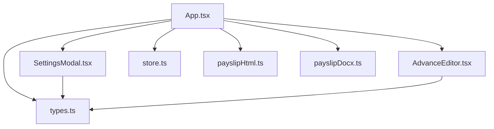
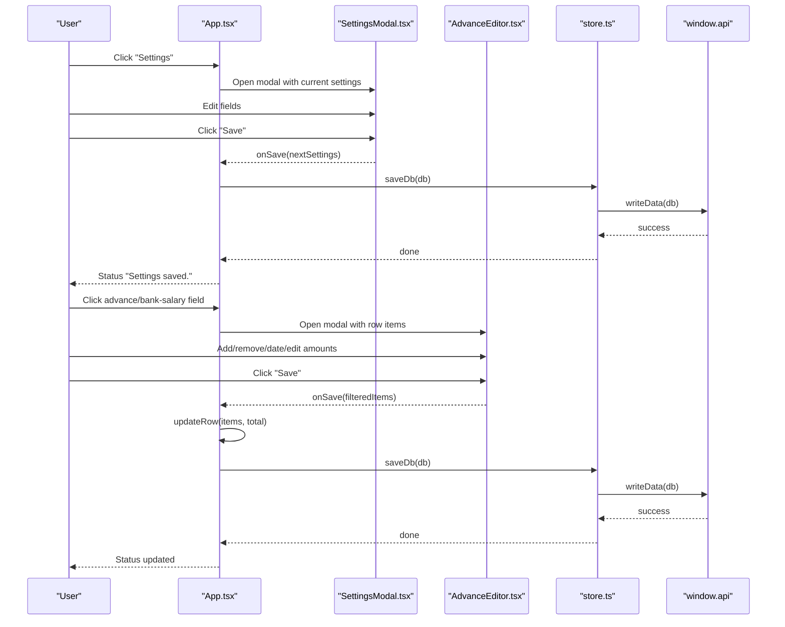
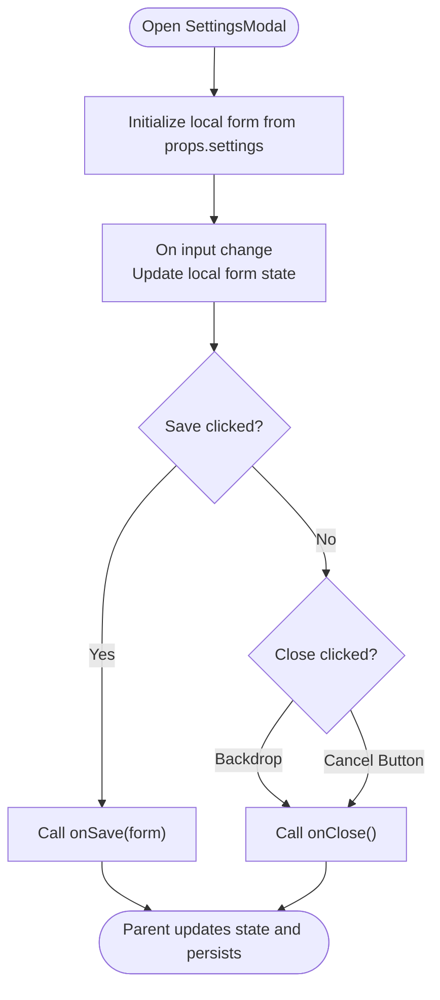
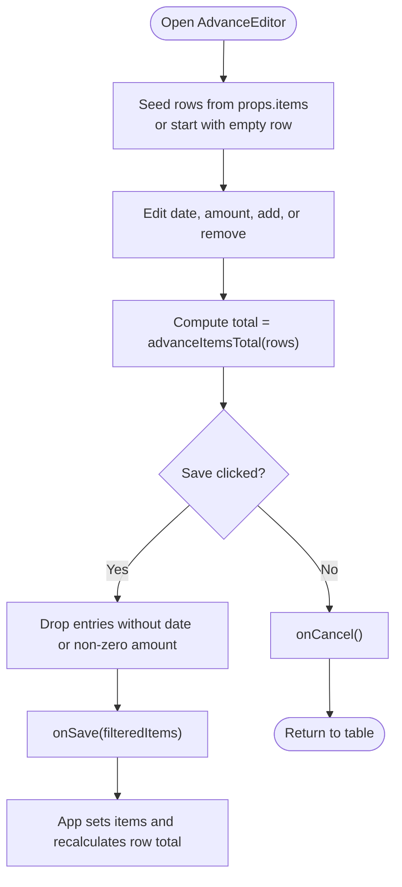
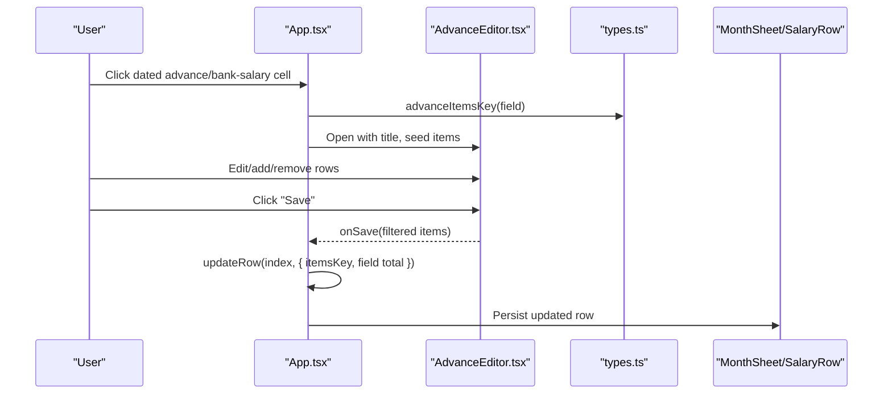
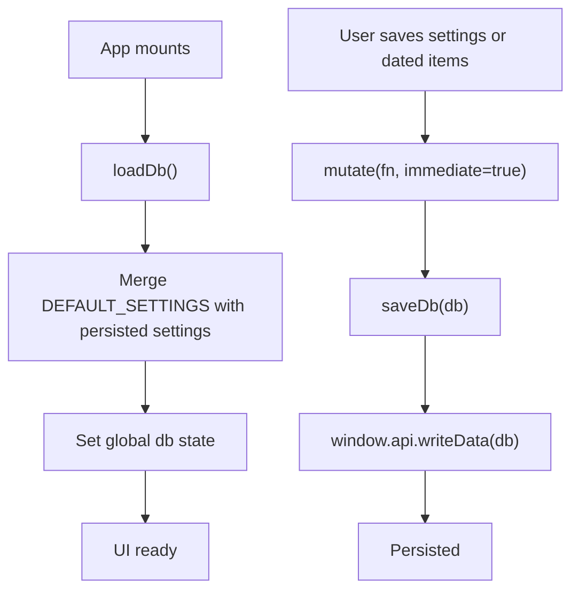
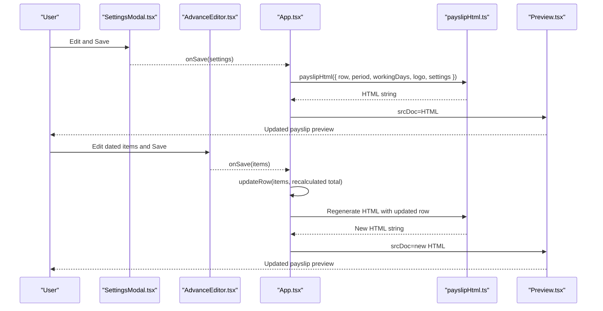
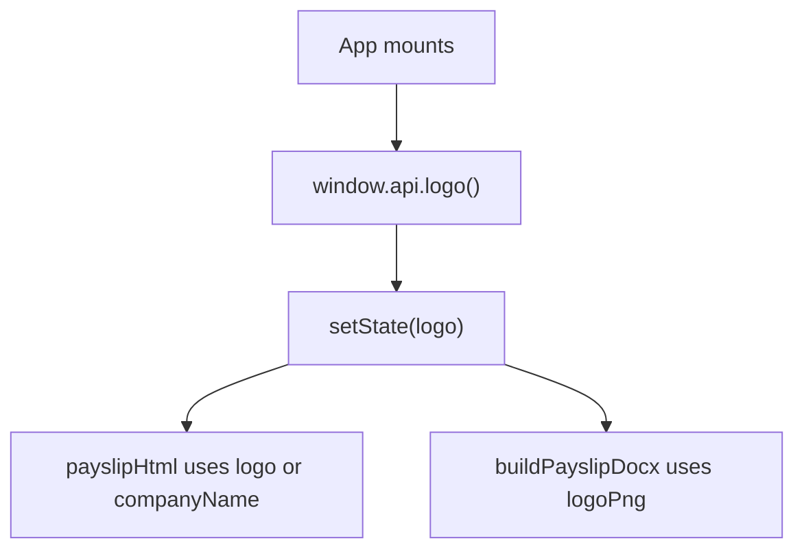
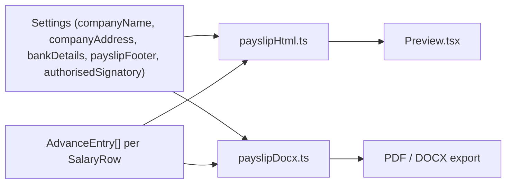
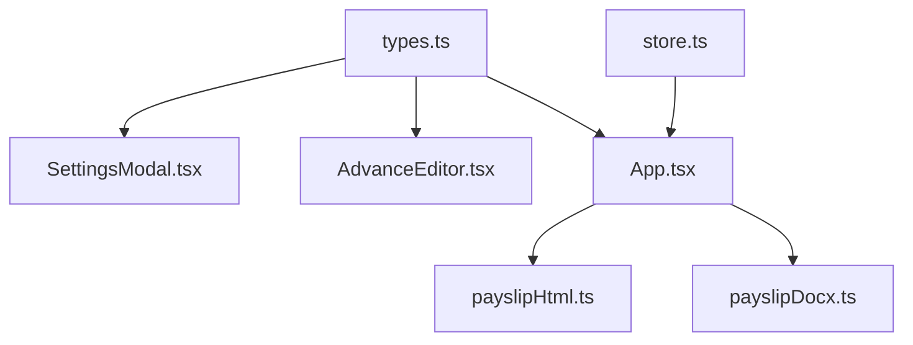

# SettingsModal Component

<cite>
**Referenced Files in This Document**
- [SettingsModal.tsx](file://src/renderer/src/components/SettingsModal.tsx)
- [AdvanceEditor.tsx](file://src/renderer/src/components/AdvanceEditor.tsx)
- [App.tsx](file://src/renderer/src/App.tsx)
- [store.ts](file://src/renderer/src/lib/store.ts)
- [types.ts](file://src/renderer/src/types.ts)
- [payslipHtml.ts](file://src/renderer/src/lib/payslipHtml.ts)
- [payslipDocx.ts](file://src/renderer/src/lib/payslipDocx.ts)
</cite>

## Table of Contents
1. [Introduction](#introduction)
2. [Project Structure](#project-structure)
3. [Core Components](#core-components)
4. [Architecture Overview](#architecture-overview)
5. [Detailed Component Analysis](#detailed-component-analysis)
6. [Dependency Analysis](#dependency-analysis)
7. [Performance Considerations](#performance-considerations)
8. [Troubleshooting Guide](#troubleshooting-guide)
9. [Conclusion](#conclusion)

## Introduction
The SettingsModal component is the user interface for managing company configuration and application settings that affect payslip rendering. It provides editable fields for company identity, address, bank details, disclaimer note, and signatory label. The modal integrates with the application’s data store to persist settings locally and supplies those settings to both HTML and Word payslip generators so that changes are reflected immediately in previews and exports.

This page also documents the related AdvanceEditor modal used by the same application shell. The App component now owns an additional modal for editing dated advances and bank-salary collections per employee row. That editor is not a company-settings form; it manages per-row financial breakdowns such as bank advance, cash advance, and bank salary entries.

## Project Structure
The SettingsModal lives under the renderer components and is consumed by the main application shell. Settings are typed centrally and persisted through a small store layer that reads/writes local data via the Electron API. Payslip templates consume the same settings object to render consistent output across formats.

Per-employee dated financial breakdowns live in the sheet rows rather than in global settings. App controls both the SettingsModal and the new AdvanceEditor modals.



**Diagram sources**
- [App.tsx:1-10](file://src/renderer/src/App.tsx#L1-L10)
- [SettingsModal.tsx:1-10](file://src/renderer/src/components/SettingsModal.tsx#L1-L10)
- [AdvanceEditor.tsx:1-10](file://src/renderer/src/components/AdvanceEditor.tsx#L1-L10)
- [store.ts:1-10](file://src/renderer/src/lib/store.ts#L1-L10)
- [types.ts:1-10](file://src/renderer/src/types.ts#L1-L10)
- [payslipHtml.ts:1-15](file://src/renderer/src/lib/payslipHtml.ts#L1-L15)
- [payslipDocx.ts:1-7](file://src/renderer/src/lib/payslipDocx.ts#L1-L7)

**Section sources**
- [SettingsModal.tsx:1-42](file://src/renderer/src/components/SettingsModal.tsx#L1-L42)
- [AdvanceEditor.tsx:1-65](file://src/renderer/src/components/AdvanceEditor.tsx#L1-L65)
- [App.tsx:1-21](file://src/renderer/src/App.tsx#L1-L21)
- [store.ts:1-10](file://src/renderer/src/lib/store.ts#L1-L10)
- [types.ts:1-10](file://src/renderer/src/types.ts#L1-L10)

## Core Components
- **SettingsModal**: A React functional component that renders a modal form bound to a local copy of the global settings object. It exposes props for closing, saving, and opening the data folder.
- **AdvanceEditor**: A smaller React modal that records several dated advances or bank-salary collections for one employee row. Its props are `title`, `items`, `onCancel`, and `onSave`.
- **App**: Owns the global database state, including settings and per-row advance/bank-salary items. It controls both modals, persists changes using a debounced write path, and retrieves the logo from the Electron API.
- **types**: Defines the Settings shape, DEFAULT_SETTINGS, AdvanceEntry, AdvanceField, helper keys, and totals.
- **store**: Loads and saves the full database, merging defaults with persisted settings.
- **payslipHtml and payslipDocx**: Render payslips using the same settings object, ensuring consistency across formats.

Key responsibilities:
- SettingsModal: UI only; no persistence logic.
- AdvanceEditor: Per-row UI only; no persistence logic.
- App: State ownership, modal lifecycles, and persistence coordination.
- store: Local data read/write abstraction.
- Templates: Rendering consumers of settings.

**Section sources**
- [SettingsModal.tsx:11-42](file://src/renderer/src/components/SettingsModal.tsx#L11-L42)
- [AdvanceEditor.tsx:1-65](file://src/renderer/src/components/AdvanceEditor.tsx#L1-L65)
- [App.tsx:13-21](file://src/renderer/src/App.tsx#L13-L21)
- [types.ts:1-45](file://src/renderer/src/types.ts#L1-L45)
- [store.ts:37-47](file://src/renderer/src/lib/store.ts#L37-L47)

## Architecture Overview
Both modals are presentational. The parent App owns all state and handles persistence. When the user edits settings in SettingsModal, the new settings are passed back to App via onSave, which updates the global state and triggers immediate persistence. When the user edits dated advances or bank-salary items in AdvanceEditor, App writes the edited items into the selected SalaryRow and recalculates the total.



**Diagram sources**
- [App.tsx:13-21](file://src/renderer/src/App.tsx#L13-L21)
- [App.tsx:332-344](file://src/renderer/src/App.tsx#L332-L344)
- [SettingsModal.tsx:35-41](file://src/renderer/src/components/SettingsModal.tsx#L35-L41)
- [AdvanceEditor.tsx:37-64](file://src/renderer/src/components/AdvanceEditor.tsx#L37-L64)
- [store.ts:45-47](file://src/renderer/src/lib/store.ts#L45-L47)

## Detailed Component Analysis

### SettingsModal Component
The modal renders a simple form with five settings fields:
- Company name on payslip
- Address (shown top-right of payslip)
- Payment/bank details line
- Disclaimer note
- Signatory label

It uses a helper function to generate input or textarea elements based on whether the field is multiline. On change, it updates a local state copy of the settings. Saving calls the parent’s onSave handler with the updated settings. Closing the modal either cancels changes or closes via backdrop click.



**Diagram sources**
- [SettingsModal.tsx:11-42](file://src/renderer/src/components/SettingsModal.tsx#L11-L42)

#### Form Fields and Behavior
- companyName: Single-line input. Used as header text when no logo is present.
- companyAddress: Multiline textarea. Displayed at the top-right of the payslip.
- bankDetails: Multiline textarea. Optional payment/bank details shown before signature area.
- payslipFooter: Multiline textarea. System-generated disclaimer note.
- authorisedSignatory: Single-line input. Label for the authorized signature line.

Validation:
- No explicit validation is implemented in the modal. All fields accept any string value.
- Default values are provided by the application’s type definitions and merged during load.

Persistence:
- The modal does not persist directly. It emits onSave with the new settings.
- The parent App updates its global state and persists immediately via saveDb.

Real-time preview:
- The modal itself does not render a live preview. However, because App passes settings into the payslip HTML generator, any saved settings will be reflected in the preview pane immediately after saving.

Accessibility:
- Inputs are wrapped in labels, improving screen reader association.
- There is no focus trap, keyboard navigation guidance, or aria attributes in the modal implementation.
- Backdrop click closes the modal, but there is no Escape key handling.

Error handling:
- The modal has no error handling. Errors during save are handled by the parent App’s status messaging.

Integration example:
- Parent opens the modal by setting showSettings to true.
- Parent passes current settings and handlers for onClose, onSave, and onOpenDataFolder.

**Section sources**
- [SettingsModal.tsx:11-42](file://src/renderer/src/components/SettingsModal.tsx#L11-L42)
- [types.ts:46-75](file://src/renderer/src/types.ts#L46-L75)

### AdvanceEditor Modal
The AdvanceEditor modal is not a settings editor. It is a focused per-row editor for dated advances and bank-salary collections. It is owned by App and opened for a specific employee row and field.

Props:
- title: Human-readable modal title, such as “Bank Advance — Employee Name”.
- items: Existing AdvanceEntry array for the selected field.
- onCancel: Called when the user clicks Cancel or dismisses the modal.
- onSave: Called with the filtered list of AdvanceEntry objects.

State:
- rows: Internal mutable copy of AdvanceEntry[] initialized from props.items. If no items exist, it starts with one empty entry `{ date: '', amount: 0 }`.

Operations:
- set(i, patch): Updates a single row by index.
- add(): Appends a new empty row.
- remove(i): Removes the row at index i.
- total: Computed using advanceItemsTotal(rows).

Filtering before save:
- The modal filters rows before calling onSave. Entries without both a date and a non-zero amount are dropped. In the current implementation this is `rows.filter((e) => e.date || e.amount)`.

Computed total:
- The footer displays the rupee total formatted with Indian locale grouping. The printed total is derived from the saved items.

Rendering behavior:
- Header shows Date and Amount (INR).
- Each row contains a date input, a numeric amount input with minimum zero, and a remove button.
- An empty state message appears when there are no rows.
- A link-style “Add advance” button adds another row.
- Cancel returns control to App without changing the row.
- Save emits the filtered items.



**Diagram sources**
- [AdvanceEditor.tsx:1-65](file://src/renderer/src/components/AdvanceEditor.tsx#L1-L65)

#### AdvanceEditor Integration with App
App controls the modal through an `advEdit` state holding the selected row index and AdvanceField. When a dated field such as bankAdvance, cashAdvance, or bankSalary is opened:
- App selects the corresponding items key via advanceItemsKey.
- It seeds the editor with existing items or creates a fallback item from the current total.
- On save, App writes the edited items back into the row and recalculates the field total using advanceItemsTotal.



**Diagram sources**
- [App.tsx:332-344](file://src/renderer/src/App.tsx#L332-L344)
- [AdvanceEditor.tsx:37-64](file://src/renderer/src/components/AdvanceEditor.tsx#L37-L64)
- [types.ts:1-20](file://src/renderer/src/types.ts#L1-L20)

**Section sources**
- [AdvanceEditor.tsx:1-65](file://src/renderer/src/components/AdvanceEditor.tsx#L1-L65)
- [App.tsx:21](file://src/renderer/src/App.tsx#L21)
- [App.tsx:332-344](file://src/renderer/src/App.tsx#L332-L344)
- [types.ts:1-20](file://src/renderer/src/types.ts#L1-L20)

### App Integration and State Management
App manages:
- Global Db state containing sheets and settings
- Modal visibility flags for both SettingsModal and AdvanceEditor
- Debounced persistence using a timer
- Logo retrieval from the Electron API
- Passing settings to payslip generators

When the user clicks “Settings”, App sets showSettings to true and renders SettingsModal with current settings. On save, App updates the settings in place and persists immediately. For AdvanceEditor, App tracks the active edit context and writes the resulting dated items back into the selected SalaryRow.

```mermaid
classDiagram
class App {
+db : Db | null
+period : string
+selected : number
+logo : string
+status : string
+showSettings : boolean
+advEdit : { index: number; field: AdvanceField } | null
+setShowSettings(flag)
+mutate(fn, immediate)
}
class SettingsModal {
+settings : Settings
+onClose()
+onSave(nextSettings)
+onOpenDataFolder()
}
class AdvanceEditor {
+title : string
+items : AdvanceEntry[]
+onCancel()
+onSave(items)
}
class Store {
+loadDb() Promise~Db~
+saveDb(db) Promise~void~
}
class Types {
<<type>> Settings
<<type>> Db
<<type>> AdvanceEntry
<<type>> AdvanceField
}
App --> SettingsModal : "renders"
App --> AdvanceEditor : "renders"
App --> Store : "persists"
SettingsModal --> Types : "uses"
AdvanceEditor --> Types : "uses"
App --> Types : "consumes"
```

**Diagram sources**
- [App.tsx:13-21](file://src/renderer/src/App.tsx#L13-L21)
- [store.ts:37-47](file://src/renderer/src/lib/store.ts#L37-L47)
- [types.ts:1-45](file://src/renderer/src/types.ts#L1-L45)

**Section sources**
- [App.tsx:13-21](file://src/renderer/src/App.tsx#L13-L21)
- [store.ts:37-47](file://src/renderer/src/lib/store.ts#L37-L47)

### Data Persistence Mechanisms
- Load: loadDb merges DEFAULT_SETTINGS with persisted settings, ensuring all keys exist.
- Save: saveDb writes the entire Db object to disk via window.api.writeData.
- Immediate vs debounced: For settings and most sheet mutations, App calls mutate with immediate=true, triggering an immediate save. Other sheet mutations use a debounce to reduce I/O.



**Diagram sources**
- [store.ts:37-47](file://src/renderer/src/lib/store.ts#L37-L47)
- [App.tsx:25-48](file://src/renderer/src/App.tsx#L25-L48)

**Section sources**
- [store.ts:37-47](file://src/renderer/src/lib/store.ts#L37-L47)
- [App.tsx:25-48](file://src/renderer/src/App.tsx#L25-L48)

### Real-Time Preview Capabilities
Neither modal provides a live preview inside itself. However, once settings are saved, they are included in the HTML generated by payslipHtml and used by the Preview component. Similarly, once dated advance or bank-salary items are saved, the affected SalaryRow total is recalculated and included in subsequent payslip generation.

Rendering usage:
- HTML generator receives settings and renders company name/address/signatory/bank details/disclaimer.
- Word generator also consumes settings for header, address, bank details, disclaimer, and signatory label.
- Dated items influence the corresponding deduction or collection total shown on the payslip.



**Diagram sources**
- [App.tsx:138-140](file://src/renderer/src/App.tsx#L138-L140)
- [App.tsx:332-344](file://src/renderer/src/App.tsx#L332-L344)
- [payslipHtml.ts:17-15](file://src/renderer/src/lib/payslipHtml.ts#L17-L15)

**Section sources**
- [App.tsx:138-140](file://src/renderer/src/App.tsx#L138-L140)
- [App.tsx:332-344](file://src/renderer/src/App.tsx#L332-L344)
- [payslipHtml.ts:17-15](file://src/renderer/src/lib/payslipHtml.ts#L17-L15)

### File Upload Handling for Logos, Image Processing, and Storage
Logo handling is managed by the parent App, not by SettingsModal or AdvanceEditor:
- On mount, App requests the current logo via window.api.logo().
- The logo is stored in App state and passed to payslipHtml and payslipDocx.
- HTML rendering shows the logo image if present; otherwise, it falls back to displaying the company name.
- Word generation embeds the logo bytes if provided.

Important notes:
- SettingsModal does not include logo upload fields.
- AdvanceEditor does not handle files or images.
- There is no client-side image processing or resizing in the analyzed files.
- Storage is delegated to the Electron API via window.api methods.



**Diagram sources**
- [App.tsx:25-36](file://src/renderer/src/App.tsx#L25-L36)
- [payslipHtml.ts:94-99](file://src/renderer/src/lib/payslipHtml.ts#L94-L99)
- [payslipDocx.ts:97-99](file://src/renderer/src/lib/payslipDocx.ts#L97-L99)

**Section sources**
- [App.tsx:25-36](file://src/renderer/src/App.tsx#L25-L36)
- [payslipHtml.ts:94-99](file://src/renderer/src/lib/payslipHtml.ts#L94-L99)
- [payslipDocx.ts:97-99](file://src/renderer/src/lib/payslipDocx.ts#L97-L99)

### Modal Open/Close State Management
SettingsModal:
- Opening: App toggles showSettings to true and renders SettingsModal.
- Closing: SettingsModal calls onClose, which sets showSettings to false.
- Backdrop click: Closes the modal without saving changes.
- No Escape key handling.

AdvanceEditor:
- Opening: App sets advEdit to the target row index and AdvanceField, then renders AdvanceEditor.
- Closing: AdvanceEditor calls onCancel, which clears advEdit.
- Backdrop click: Calls onCancel.
- No Escape key handling.

**Section sources**
- [App.tsx:21](file://src/renderer/src/App.tsx#L21)
- [App.tsx:332-344](file://src/renderer/src/App.tsx#L332-L344)
- [SettingsModal.tsx:23-41](file://src/renderer/src/components/SettingsModal.tsx#L23-L41)
- [AdvanceEditor.tsx:37-64](file://src/renderer/src/components/AdvanceEditor.tsx#L37-L64)

### Form Submission Handling
SettingsModal:
- Submitting the form triggers onSave with the current local form state.
- App updates the global settings and persists immediately.
- A status message confirms the save.
- No client-side validation before submission.

AdvanceEditor:
- Submitting the form filters out rows where neither a date nor a non-zero amount exists.
- App writes the filtered items into the selected row and recalculates the associated money field total.
- No explicit client-side validation beyond the filter and the numeric input constraints.

**Section sources**
- [SettingsModal.tsx:35-41](file://src/renderer/src/components/SettingsModal.tsx#L35-L41)
- [AdvanceEditor.tsx:37-64](file://src/renderer/src/components/AdvanceEditor.tsx#L37-L64)
- [App.tsx:332-344](file://src/renderer/src/App.tsx#L332-L344)

### Error Handling Patterns
- Neither modal handles errors internally.
- App uses a status message to communicate outcomes, such as successful saves or import/export errors.
- For settings and sheet mutations, save errors would propagate from the Electron API; the current code does not explicitly catch them around saveDb.

Recommendation: Add try/catch around save operations and surface user-friendly messages for both modals’ save flows.

**Section sources**
- [App.tsx:131-135](file://src/renderer/src/App.tsx#L131-L135)
- [App.tsx:278-282](file://src/renderer/src/App.tsx#L278-L282)

### Accessibility Features, Keyboard Navigation, and Screen Reader Support
Current state:
- Inputs are labeled, aiding screen readers.
- Neither modal implements a focus trap.
- Neither modal uses role="dialog", aria-modal, or aria-labelledby.
- Neither modal handles Escape key to close.
- Backdrop click closes each modal, but this may not be discoverable for keyboard users.

Recommended improvements:
- Add role="dialog", aria-modal="true", and aria-labelledby pointing to the modal title.
- Implement focus trap within each modal.
- Handle Escape key to close the modal.
- Move initial focus to the first input when the modal opens.
- Ensure color contrast and focus indicators meet accessibility guidelines.

**Section sources**
- [SettingsModal.tsx:14-41](file://src/renderer/src/components/SettingsModal.tsx#L14-L41)
- [AdvanceEditor.tsx:18-64](file://src/renderer/src/components/AdvanceEditor.tsx#L18-L64)

### Relationship Between Settings and Payslip Template Rendering
Settings influence both HTML and Word outputs consistently:
- HTML:
  - Uses logo if available; otherwise displays companyName.
  - Displays companyAddress when present.
  - Shows bankDetails before signature area.
  - Renders payslipFooter disclaimer.
  - Renders authorisedSignatory label.
- Word:
  - Embeds logo if provided; otherwise displays companyName.
  - Includes companyAddress when present.
  - Shows bankDetails when present.
  - Includes payslipFooter when present.
  - Uses authorisedSignatory label.

Dated advance and bank-salary items influence the corresponding row totals rendered by the payslip template. The editor keeps a list of dated entries while the SalaryRow stores the printed total and the optional breakdown behind it.



**Diagram sources**
- [payslipHtml.ts:94-139](file://src/renderer/src/lib/payslipHtml.ts#L94-L139)
- [payslipDocx.ts:97-143](file://src/renderer/src/lib/payslipDocx.ts#L97-L143)
- [types.ts:1-45](file://src/renderer/src/types.ts#L1-L45)

**Section sources**
- [payslipHtml.ts:94-139](file://src/renderer/src/lib/payslipHtml.ts#L94-L139)
- [payslipDocx.ts:97-143](file://src/renderer/src/lib/payslipDocx.ts#L97-L143)
- [types.ts:1-45](file://src/renderer/src/types.ts#L1-L45)

## Dependency Analysis
Settings flow:
- types.ts defines Settings, DEFAULT_SETTINGS, AdvanceEntry, AdvanceField, advanceItemsKey, and advanceItemsTotal.
- store.ts merges defaults with persisted settings during load.
- App.tsx holds the Db state and passes settings to templates.
- SettingsModal.tsx consumes Settings for form binding.
- AdvanceEditor.tsx consumes AdvanceEntry and advanceItemsTotal.
- payslipHtml.ts and payslipDocx.ts consume Settings for rendering.

Coupling:
- SettingsModal depends only on types for the Settings shape.
- AdvanceEditor depends on AdvanceEntry and advanceItemsTotal from types.
- App coordinates persistence, logo retrieval, and both modal lifecycles.
- Templates depend on Settings and SalaryRow.

Potential circular dependencies:
- None observed among these modules.

External integration points:
- window.api for logo retrieval, file operations, and data persistence.



**Diagram sources**
- [types.ts:1-75](file://src/renderer/src/types.ts#L1-L75)
- [SettingsModal.tsx:1-10](file://src/renderer/src/components/SettingsModal.tsx#L1-L10)
- [AdvanceEditor.tsx:1-10](file://src/renderer/src/components/AdvanceEditor.tsx#L1-L10)
- [App.tsx:1-10](file://src/renderer/src/App.tsx#L1-L10)
- [store.ts:1-10](file://src/renderer/src/lib/store.ts#L1-L10)
- [payslipHtml.ts:1-15](file://src/renderer/src/lib/payslipHtml.ts#L1-L15)
- [payslipDocx.ts:1-7](file://src/renderer/src/lib/payslipDocx.ts#L1-L7)

**Section sources**
- [types.ts:1-75](file://src/renderer/src/types.ts#L1-L75)
- [SettingsModal.tsx:1-10](file://src/renderer/src/components/SettingsModal.tsx#L1-L10)
- [AdvanceEditor.tsx:1-10](file://src/renderer/src/components/AdvanceEditor.tsx#L1-L10)
- [App.tsx:1-10](file://src/renderer/src/App.tsx#L1-L10)
- [store.ts:1-10](file://src/renderer/src/lib/store.ts#L1-L10)
- [payslipHtml.ts:1-15](file://src/renderer/src/lib/payslipHtml.ts#L1-L15)
- [payslipDocx.ts:1-7](file://src/renderer/src/lib/payslipDocx.ts#L1-L7)

## Performance Considerations
- Settings save is immediate to avoid losing configuration changes.
- Sheet mutations are debounced to reduce I/O; settings do not need debouncing due to low frequency.
- Both modals are lightweight and keep internal state local.
- Avoid heavy computations in either modal; keep them focused on UI.
- If adding logo upload, consider client-side resizing/compression to reduce payload size before sending to the backend.

[No sources needed since this section provides general guidance]

## Troubleshooting Guide
Common issues and resolutions:
- Settings changes not appearing in preview:
  - Ensure you clicked “Save” in SettingsModal.
  - Verify that App updated db.settings and re-rendered the preview.
- Dated advances or bank-salary totals not updating:
  - Ensure you clicked “Save” in AdvanceEditor.
  - Check that the filter kept at least one entry with a date and non-zero amount.
  - Verify that App wrote both items and the recalculated field total.
- Settings not persisted:
  - Check that saveDb is called and window.api.writeData succeeds.
  - Inspect browser console for API errors.
- Logo not showing:
  - Confirm window.api.logo returns a valid URL or base64.
  - Verify HTML generator receives the logo prop.
- Accessibility concerns:
  - Add dialog roles and focus management.
  - Implement Escape key handling.
  - Improve focus indication and keyboard navigation.

**Section sources**
- [App.tsx:332-344](file://src/renderer/src/App.tsx#L332-L344)
- [store.ts:45-47](file://src/renderer/src/lib/store.ts#L45-L47)
- [payslipHtml.ts:94-99](file://src/renderer/src/lib/payslipHtml.ts#L94-L99)

## Conclusion
The SettingsModal component provides a focused interface for editing company configuration that impacts payslip rendering. It currently lacks validation, accessibility enhancements, and logo upload capabilities, but it integrates cleanly with the application’s state and persistence layers. The application has expanded beyond settings-only configuration: App also owns the AdvanceEditor modal, which manages dated advances and bank-salary collections per employee row. Together, these modals keep UI concerns separate from persistence while sharing the central types and store. Future improvements should prioritize accessibility, validation, robust error handling, and clearer separation between global settings and per-row financial breakdowns.

[No sources needed since this section summarizes without analyzing specific files]