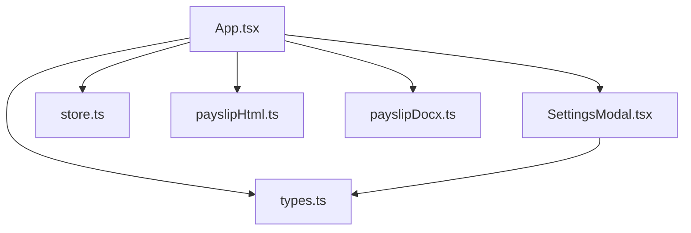
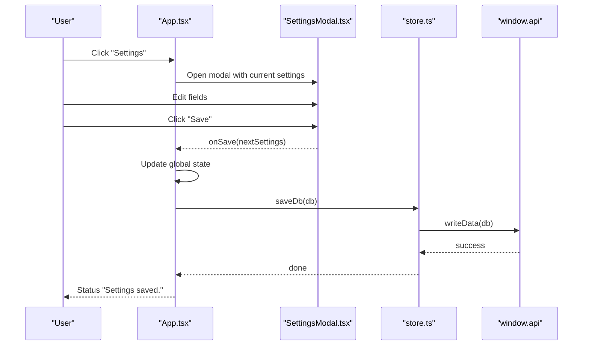
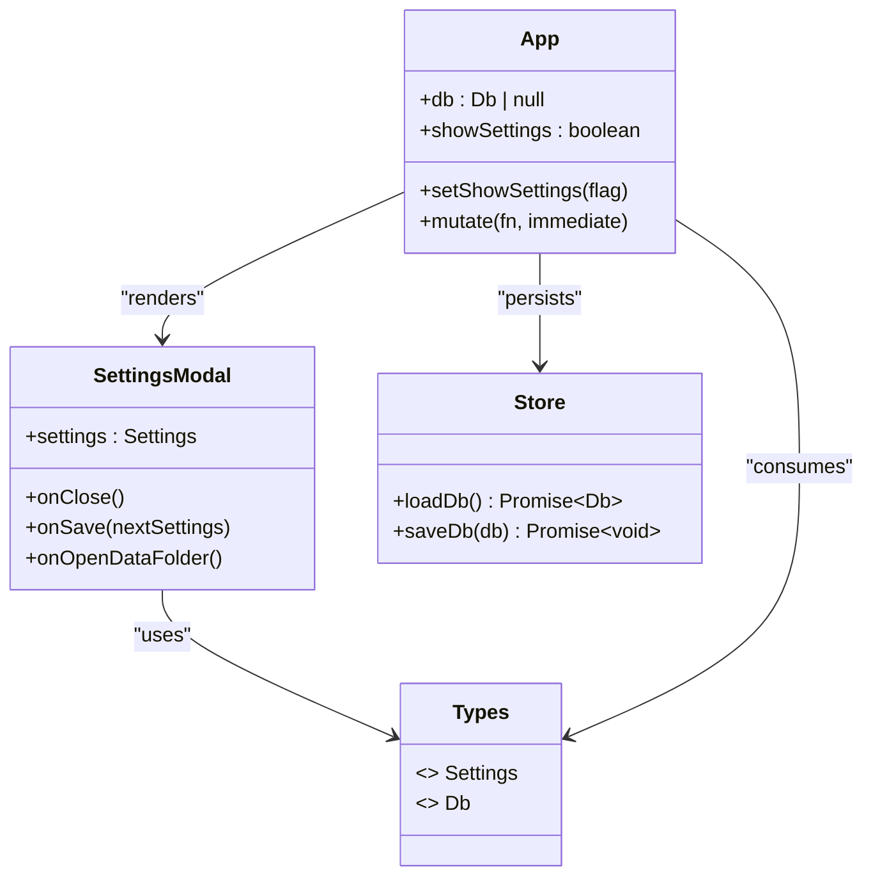
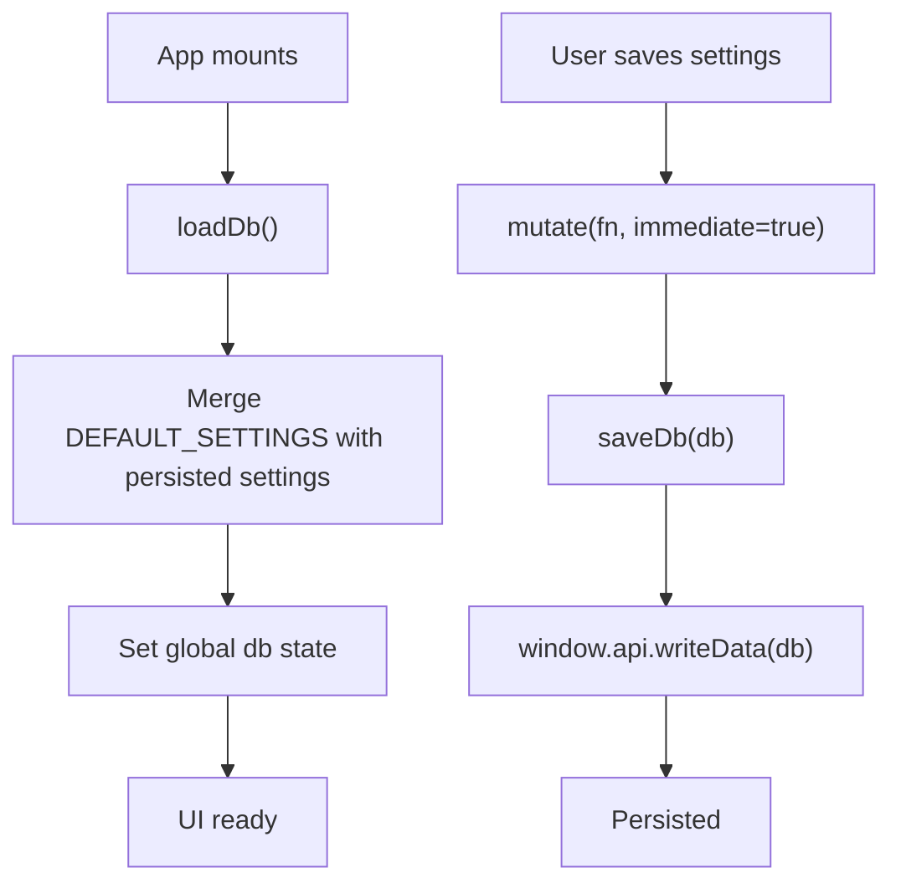
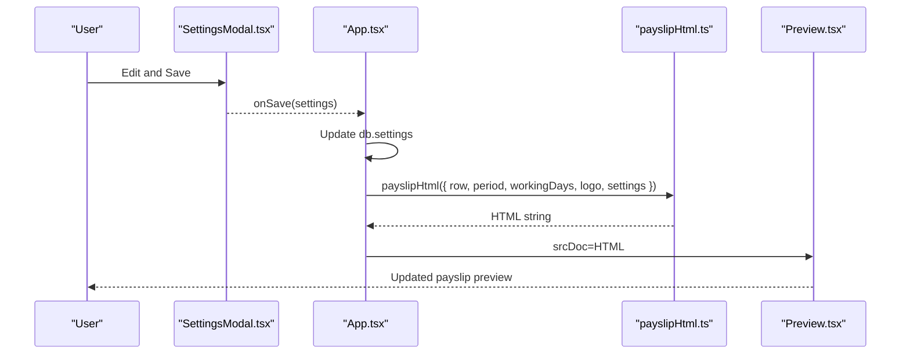
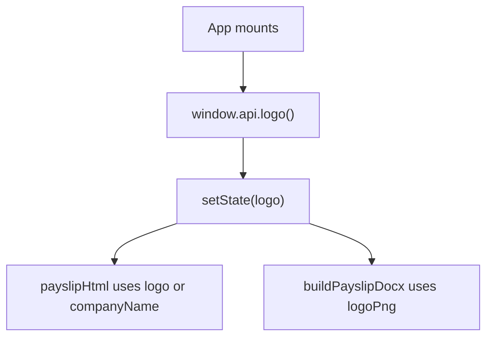
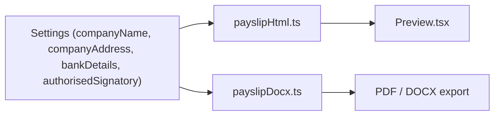
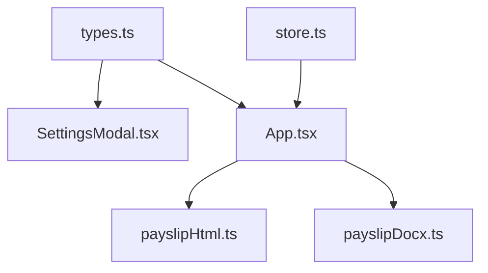

# SettingsModal Component

<cite>
**Referenced Files in This Document**
- [SettingsModal.tsx](file://src/renderer/src/components/SettingsModal.tsx)
- [App.tsx](file://src/renderer/src/App.tsx)
- [store.ts](file://src/renderer/src/lib/store.ts)
- [types.ts](file://src/renderer/src/types.ts)
- [payslipHtml.ts](file://src/renderer/src/lib/payslipHtml.ts)
- [payslipDocx.ts](file://src/renderer/src/lib/payslipDocx.ts)
</cite>

## Table of Contents
1. [Introduction](#introduction)
2. [Project Structure](#project-structure)
3. [Core Components](#core-components)
4. [Architecture Overview](#architecture-overview)
5. [Detailed Component Analysis](#detailed-component-analysis)
6. [Dependency Analysis](#dependency-analysis)
7. [Performance Considerations](#performance-considerations)
8. [Troubleshooting Guide](#troubleshooting-guide)
9. [Conclusion](#conclusion)

## Introduction
The SettingsModal component is the user interface for managing company configuration and application settings that affect payslip rendering. It provides editable fields for company identity, address, bank details, and signatory label. The modal integrates with the application’s data store to persist settings locally and supplies those settings to both HTML and Word payslip generators so that changes are reflected immediately in previews and exports.

This documentation explains:
- Form fields and their purpose
- Validation rules and current limitations
- Data persistence and real-time preview behavior
- File upload handling for logos (as used by the parent app)
- Modal open/close state management
- Error handling patterns
- Accessibility considerations
- Relationship between settings and payslip template rendering

## Project Structure
The SettingsModal lives under the renderer components and is consumed by the main application shell. Settings are typed centrally and persisted through a small store layer that reads/writes local data via the Electron API. Payslip templates consume the same settings object to render consistent output across formats.

**Diagram sources**
- [App.tsx:1-20](file://src/renderer/src/App.tsx#L1-L20)
- [SettingsModal.tsx:1-10](file://src/renderer/src/components/SettingsModal.tsx#L1-L10)
- [store.ts:1-10](file://src/renderer/src/lib/store.ts#L1-L10)
- [types.ts:26-45](file://src/renderer/src/types.ts#L26-L45)
- [payslipHtml.ts:1-15](file://src/renderer/src/lib/payslipHtml.ts#L1-L15)
- [payslipDocx.ts:1-7](file://src/renderer/src/lib/payslipDocx.ts#L1-L7)

**Section sources**
- [SettingsModal.tsx:1-41](file://src/renderer/src/components/SettingsModal.tsx#L1-L41)
- [App.tsx:1-20](file://src/renderer/src/App.tsx#L1-L20)
- [store.ts:1-10](file://src/renderer/src/lib/store.ts#L1-L10)
- [types.ts:26-45](file://src/renderer/src/types.ts#L26-L45)

## Core Components
- SettingsModal: A React functional component that renders a modal form bound to a local copy of the settings object. It exposes props for closing, saving, and opening the data folder.
- App: Owns the global database state, including settings, and controls the modal visibility. It persists changes using a debounced write path.
- types: Defines the Settings shape and default values.
- store: Loads and saves the full database, merging defaults with persisted settings.
- payslipHtml and payslipDocx: Render payslips using the same settings object, ensuring consistency across formats.

Key responsibilities:
- SettingsModal: UI only; no persistence logic.
- App: State ownership, modal lifecycle, and persistence coordination.
- store: Local data read/write abstraction.
- Templates: Rendering consumers of settings.

**Section sources**
- [SettingsModal.tsx:11-41](file://src/renderer/src/components/SettingsModal.tsx#L11-L41)
- [App.tsx:13-20](file://src/renderer/src/App.tsx#L13-L20)
- [types.ts:26-45](file://src/renderer/src/types.ts#L26-L45)
- [store.ts:37-47](file://src/renderer/src/lib/store.ts#L37-L47)
- [payslipHtml.ts:17-15](file://src/renderer/src/lib/payslipHtml.ts#L17-L15)
- [payslipDocx.ts:50-48](file://src/renderer/src/lib/payslipDocx.ts#L50-L48)

## Architecture Overview
The SettingsModal is a presentational component. The parent App owns the settings state and handles persistence. When the user edits fields in the modal, the new settings are passed back to App via onSave, which updates the global state and triggers immediate persistence.

**Diagram sources**
- [App.tsx:223-284](file://src/renderer/src/App.tsx#L223-L284)
- [SettingsModal.tsx:35-38](file://src/renderer/src/components/SettingsModal.tsx#L35-L38)
- [store.ts:45-47](file://src/renderer/src/lib/store.ts#L45-L47)

## Detailed Component Analysis

### SettingsModal Component
The modal renders a simple form with four settings fields:
- Company name on payslip
- Address (shown top-right of payslip)
- Payment/bank details line
- Signatory label

It uses a helper function to generate input or textarea elements based on whether the field is multiline. On change, it updates a local state copy of the settings. Saving calls the parent’s onSave handler with the updated settings. Closing the modal either cancels changes or closes via backdrop click.

**Diagram sources**
- [SettingsModal.tsx:11-41](file://src/renderer/src/components/SettingsModal.tsx#L11-L41)

#### Form Fields and Behavior
- companyName: Single-line input. Used as header text when no logo is present.
- companyAddress: Multiline textarea. Displayed at the top-right of the payslip.
- bankDetails: Multiline textarea. Optional payment/bank details shown before signature area.
- authorisedSignatory: Single-line input. Label for the authorized signature line.

Validation:
- No explicit validation is implemented in the modal. All fields accept any string value.
- Default values are provided by the application’s type definitions and merged during load.

Persistence:
- The modal does not persist directly. It emits onSave with the new settings.
- The parent App updates its global state and persists immediately via saveDb.

Real-time preview:
- The modal itself does not render a live preview. However, because App passes settings into the payslip HTML generator, any saved settings will be reflected in the preview pane immediately after saving.

Accessibility:
- Inputs are wrapped in labels, improving screen reader association.
- There is no focus trap, keyboard navigation guidance, or aria attributes in the modal implementation.
- Backdrop click closes the modal, but there is no Escape key handling.

Error handling:
- The modal has no error handling. Errors during save are handled by the parent App’s status messaging.

Integration example:
- Parent opens the modal by setting showSettings to true.
- Parent passes current settings and handlers for onClose, onSave, and onOpenDataFolder.

**Section sources**
- [SettingsModal.tsx:11-41](file://src/renderer/src/components/SettingsModal.tsx#L11-L41)
- [types.ts:26-45](file://src/renderer/src/types.ts#L26-L45)

### App Integration and State Management
App manages:
- Global Db state containing sheets and settings
- Modal visibility flag
- Debounced persistence using a timer
- Logo retrieval from the Electron API
- Passing settings to payslip generators

When the user clicks “Settings”, App sets showSettings to true and renders SettingsModal with current settings. On save, App updates the settings in place and persists immediately.

**Diagram sources**
- [App.tsx:13-48](file://src/renderer/src/App.tsx#L13-L48)
- [App.tsx:274-284](file://src/renderer/src/App.tsx#L274-L284)
- [store.ts:37-47](file://src/renderer/src/lib/store.ts#L37-L47)
- [types.ts:26-45](file://src/renderer/src/types.ts#L26-L45)

**Section sources**
- [App.tsx:13-48](file://src/renderer/src/App.tsx#L13-L48)
- [App.tsx:274-284](file://src/renderer/src/App.tsx#L274-L284)
- [store.ts:37-47](file://src/renderer/src/lib/store.ts#L37-L47)

### Data Persistence Mechanisms
- Load: loadDb merges DEFAULT_SETTINGS with persisted settings, ensuring all keys exist.
- Save: saveDb writes the entire Db object to disk via window.api.writeData.
- Immediate vs debounced: For settings, App calls mutate with immediate=true, triggering an immediate save. Other sheet mutations use a debounce to reduce I/O.

**Diagram sources**
- [store.ts:37-47](file://src/renderer/src/lib/store.ts#L37-L47)
- [App.tsx:25-48](file://src/renderer/src/App.tsx#L25-L48)
- [App.tsx:278-282](file://src/renderer/src/App.tsx#L278-L282)

**Section sources**
- [store.ts:37-47](file://src/renderer/src/lib/store.ts#L37-L47)
- [App.tsx:25-48](file://src/renderer/src/App.tsx#L25-L48)
- [App.tsx:278-282](file://src/renderer/src/App.tsx#L278-L282)

### Real-Time Preview Capabilities
The modal does not provide a live preview. However, once settings are saved, they are included in the HTML generated by payslipHtml and used by the Preview component. Therefore, changing and saving settings will update the preview accordingly.

Rendering usage:
- HTML generator receives settings and renders company name/address/signatory/bank details.
- Word generator also consumes settings for header, address, bank details, and signatory label.

**Diagram sources**
- [App.tsx:138-140](file://src/renderer/src/App.tsx#L138-L140)
- [App.tsx:265-268](file://src/renderer/src/App.tsx#L265-L268)
- [payslipHtml.ts:17-15](file://src/renderer/src/lib/payslipHtml.ts#L17-L15)

**Section sources**
- [App.tsx:138-140](file://src/renderer/src/App.tsx#L138-L140)
- [App.tsx:265-268](file://src/renderer/src/App.tsx#L265-L268)
- [payslipHtml.ts:17-15](file://src/renderer/src/lib/payslipHtml.ts#L17-L15)

### File Upload Handling for Logos, Image Processing, and Storage
Logo handling is managed by the parent App, not the SettingsModal:
- On mount, App requests the current logo via window.api.logo().
- The logo is stored in App state and passed to payslipHtml and payslipDocx.
- HTML rendering shows the logo image if present; otherwise, it falls back to displaying the company name.
- Word generation embeds the logo bytes if provided.

Important notes:
- The SettingsModal does not include logo upload fields.
- There is no client-side image processing or resizing in the analyzed files.
- Storage is delegated to the Electron API via window.api methods.

**Diagram sources**
- [App.tsx:25-36](file://src/renderer/src/App.tsx#L25-L36)
- [payslipHtml.ts:94-99](file://src/renderer/src/lib/payslipHtml.ts#L94-L99)
- [payslipDocx.ts:97-99](file://src/renderer/src/lib/payslipDocx.ts#L97-L99)

**Section sources**
- [App.tsx:25-36](file://src/renderer/src/App.tsx#L25-L36)
- [payslipHtml.ts:94-99](file://src/renderer/src/lib/payslipHtml.ts#L94-L99)
- [payslipDocx.ts:97-99](file://src/renderer/src/lib/payslipDocx.ts#L97-L99)

### Modal Open/Close State Management
- Opening: App toggles showSettings to true and renders SettingsModal.
- Closing: SettingsModal calls onClose, which sets showSettings to false.
- Backdrop click: Closes the modal without saving changes.

There is no Escape key handling in the modal.

**Section sources**
- [App.tsx:274-284](file://src/renderer/src/App.tsx#L274-L284)
- [SettingsModal.tsx:23-38](file://src/renderer/src/components/SettingsModal.tsx#L23-L38)

### Form Submission Handling
- Submitting the form triggers onSave with the current local form state.
- App updates the global settings and persists immediately.
- A status message confirms the save.

There is no client-side validation before submission.

**Section sources**
- [SettingsModal.tsx:35-38](file://src/renderer/src/components/SettingsModal.tsx#L35-L38)
- [App.tsx:278-282](file://src/renderer/src/App.tsx#L278-L282)

### Error Handling Patterns
- The modal itself does not handle errors.
- App uses a status message to communicate outcomes, such as successful saves or import/export errors.
- For settings, save errors would propagate from the Electron API; the current code does not explicitly catch them around saveDb.

Recommendation: Add try/catch around save operations and surface user-friendly messages.

**Section sources**
- [App.tsx:131-135](file://src/renderer/src/App.tsx#L131-L135)
- [App.tsx:278-282](file://src/renderer/src/App.tsx#L278-L282)

### Accessibility Features, Keyboard Navigation, and Screen Reader Support
Current state:
- Inputs are labeled, aiding screen readers.
- No focus trap inside the modal.
- No role="dialog", aria-modal, or aria-labelledby attributes.
- No Escape key handling to close the modal.
- Backdrop click closes the modal, but this may not be discoverable for keyboard users.

Recommended improvements:
- Add role="dialog", aria-modal="true", and aria-labelledby pointing to the modal title.
- Implement focus trap within the modal.
- Handle Escape key to close the modal.
- Move initial focus to the first input when the modal opens.
- Ensure color contrast and focus indicators meet accessibility guidelines.

**Section sources**
- [SettingsModal.tsx:14-38](file://src/renderer/src/components/SettingsModal.tsx#L14-L38)

### Relationship Between Settings and Payslip Template Rendering
Settings influence both HTML and Word outputs consistently:
- HTML:
  - Uses logo if available; otherwise displays companyName.
  - Displays companyAddress when present.
  - Shows bankDetails before signature area.
  - Renders authorisedSignatory label.
- Word:
  - Embeds logo if provided; otherwise displays companyName.
  - Includes companyAddress when present.
  - Shows bankDetails when present.
  - Uses authorisedSignatory label.

Both generators share the same calculation logic for earnings and deductions, ensuring consistent totals across formats.

**Diagram sources**
- [payslipHtml.ts:94-139](file://src/renderer/src/lib/payslipHtml.ts#L94-L139)
- [payslipDocx.ts:97-143](file://src/renderer/src/lib/payslipDocx.ts#L97-L143)

**Section sources**
- [payslipHtml.ts:94-139](file://src/renderer/src/lib/payslipHtml.ts#L94-L139)
- [payslipDocx.ts:97-143](file://src/renderer/src/lib/payslipDocx.ts#L97-L143)

## Dependency Analysis
Settings flow:
- types.ts defines Settings and DEFAULT_SETTINGS.
- store.ts merges defaults with persisted settings during load.
- App.tsx holds the Db state and passes settings to templates.
- SettingsModal.tsx consumes Settings for form binding.
- payslipHtml.ts and payslipDocx.ts consume Settings for rendering.

Coupling:
- SettingsModal depends only on types for the Settings shape.
- App coordinates persistence and UI state.
- Templates depend on Settings and SalaryRow.

Potential circular dependencies:
- None observed among these modules.

External integration points:
- window.api for logo retrieval, file operations, and data persistence.

**Diagram sources**
- [types.ts:26-45](file://src/renderer/src/types.ts#L26-L45)
- [SettingsModal.tsx:1-10](file://src/renderer/src/components/SettingsModal.tsx#L1-L10)
- [App.tsx:1-10](file://src/renderer/src/App.tsx#L1-L10)
- [store.ts:1-10](file://src/renderer/src/lib/store.ts#L1-L10)
- [payslipHtml.ts:1-15](file://src/renderer/src/lib/payslipHtml.ts#L1-L15)
- [payslipDocx.ts:1-7](file://src/renderer/src/lib/payslipDocx.ts#L1-L7)

**Section sources**
- [types.ts:26-45](file://src/renderer/src/types.ts#L26-L45)
- [SettingsModal.tsx:1-10](file://src/renderer/src/components/SettingsModal.tsx#L1-L10)
- [App.tsx:1-10](file://src/renderer/src/App.tsx#L1-L10)
- [store.ts:1-10](file://src/renderer/src/lib/store.ts#L1-L10)
- [payslipHtml.ts:1-15](file://src/renderer/src/lib/payslipHtml.ts#L1-L15)
- [payslipDocx.ts:1-7](file://src/renderer/src/lib/payslipDocx.ts#L1-L7)

## Performance Considerations
- Settings save is immediate to avoid losing configuration changes.
- Sheet mutations are debounced to reduce I/O; settings do not need debouncing due to low frequency.
- Avoid heavy computations in the modal; keep it lightweight.
- If adding logo upload, consider client-side resizing/compression to reduce payload size before sending to the backend.

[No sources needed since this section provides general guidance]

## Troubleshooting Guide
Common issues and resolutions:
- Changes not appearing in preview:
  - Ensure you clicked “Save” in the modal.
  - Verify that App updated db.settings and re-rendered the preview.
- Settings not persisted:
  - Check that saveDb is called and window.api.writeData succeeds.
  - Inspect browser console for API errors.
- Logo not showing:
  - Confirm window.api.logo returns a valid URL or base64.
  - Verify HTML generator receives the logo prop.
- Accessibility concerns:
  - Add dialog roles and focus management.
  - Implement Escape key handling.

**Section sources**
- [App.tsx:274-284](file://src/renderer/src/App.tsx#L274-L284)
- [store.ts:45-47](file://src/renderer/src/lib/store.ts#L45-L47)
- [payslipHtml.ts:94-99](file://src/renderer/src/lib/payslipHtml.ts#L94-L99)

## Conclusion
The SettingsModal component provides a focused interface for editing company configuration that impacts payslip rendering. While it currently lacks validation, accessibility enhancements, and logo upload capabilities, it integrates cleanly with the application’s state and persistence layers. By leveraging the shared Settings type and passing settings into both HTML and Word generators, the application ensures consistent output across formats. Future improvements should prioritize accessibility, validation, and robust error handling while maintaining the clear separation of concerns between UI, state, and persistence.

[No sources needed since this section summarizes without analyzing specific files]