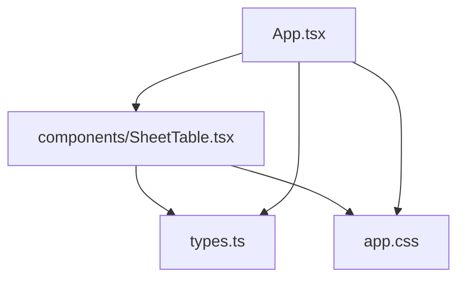
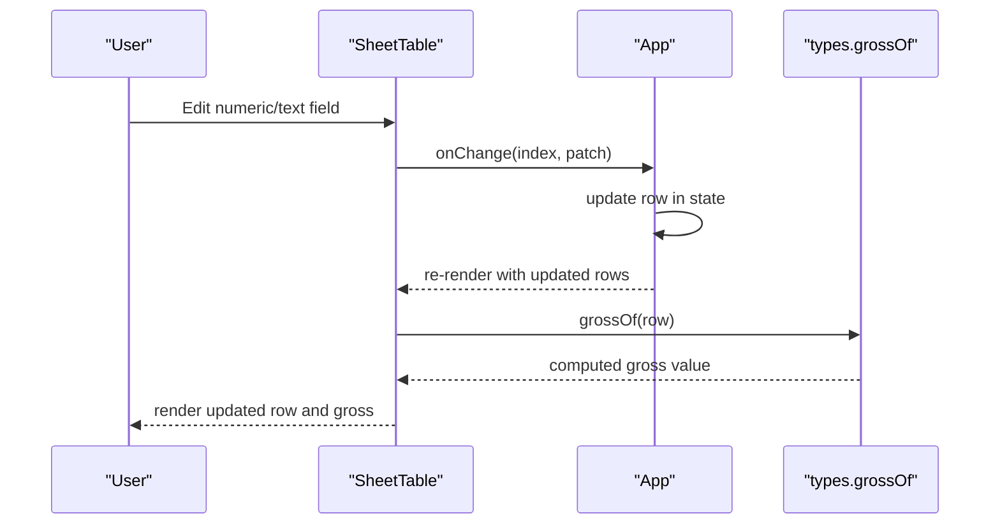
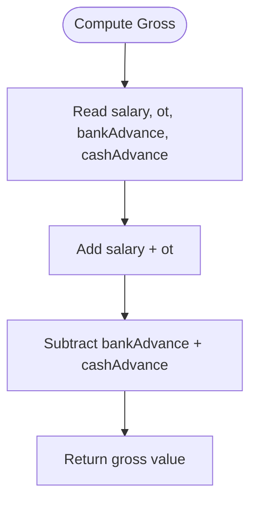
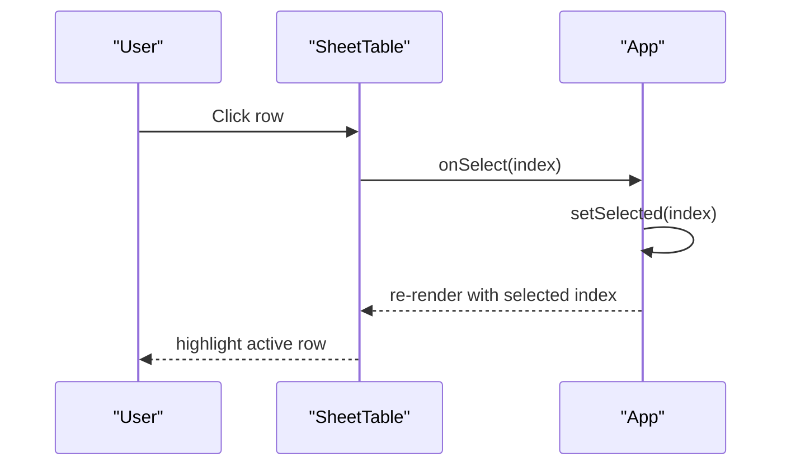
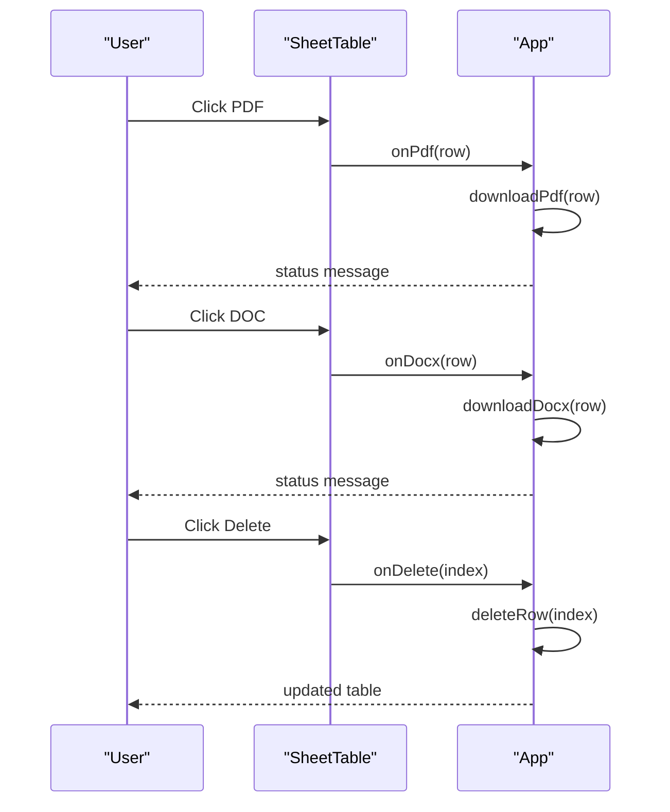
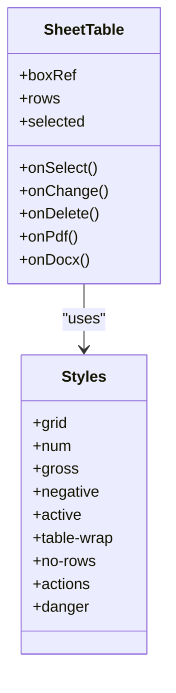
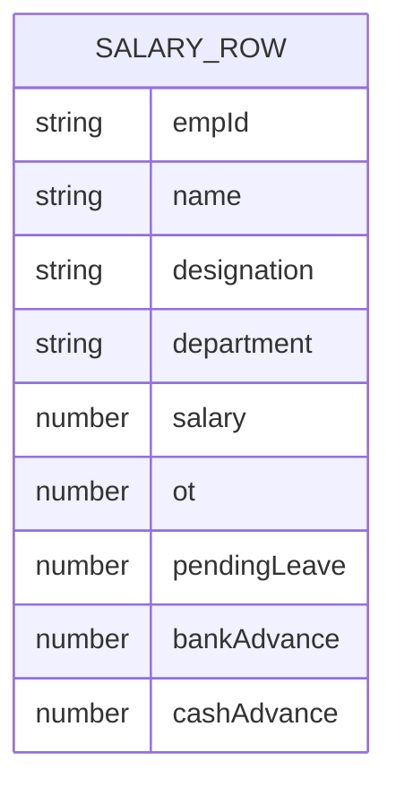
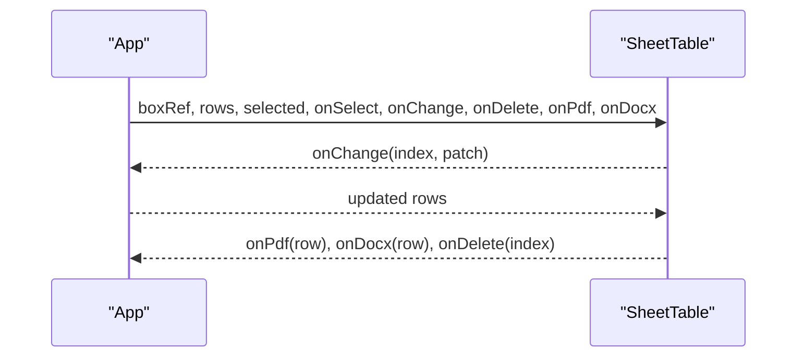
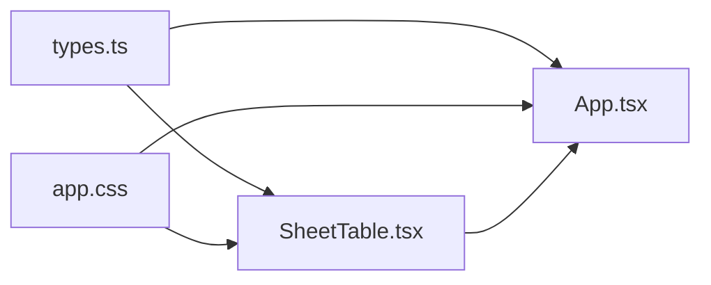

# SheetTable Component

<cite>
**Referenced Files in This Document**
- [SheetTable.tsx](file://src/renderer/src/components/SheetTable.tsx)
- [App.tsx](file://src/renderer/src/App.tsx)
- [types.ts](file://src/renderer/src/types.ts)
- [app.css](file://src/renderer/src/app.css)
</cite>

## Table of Contents
1. [Introduction](#introduction)
2. [Project Structure](#project-structure)
3. [Core Components](#core-components)
4. [Architecture Overview](#architecture-overview)
5. [Detailed Component Analysis](#detailed-component-analysis)
6. [Dependency Analysis](#dependency-analysis)
7. [Performance Considerations](#performance-considerations)
8. [Troubleshooting Guide](#troubleshooting-guide)
9. [Conclusion](#conclusion)

## Introduction
The SheetTable component is the primary employee data grid for the application. It renders a spreadsheet-like interface where users can view, edit, select, and manage rows representing employees. Each row includes text fields (employee ID, name, designation, department), numeric fields (salary, overtime, pending leave, bank advance, cash advance), a computed gross salary column, and action buttons to export a payslip as PDF or DOCX and to delete the row.

This document explains the component’s props, inline editing behavior, gross salary calculation, selection and deletion actions, styling classes, integration with the parent App component, accessibility considerations, and responsive design patterns.

## Project Structure
The SheetTable component lives under the renderer components folder and consumes shared types from the types module. The parent App component provides state, handlers, and wiring for exporting and persistence. Styling is centralized in the app CSS file.

**Diagram sources**
- [App.tsx:1-10](file://src/renderer/src/App.tsx#L1-L10)
- [SheetTable.tsx:1-3](file://src/renderer/src/components/SheetTable.tsx#L1-L3)
- [types.ts:1-17](file://src/renderer/src/types.ts#L1-L17)
- [app.css:65-91](file://src/renderer/src/app.css#L65-L91)

**Section sources**
- [SheetTable.tsx:1-71](file://src/renderer/src/components/SheetTable.tsx#L1-L71)
- [App.tsx:1-12](file://src/renderer/src/App.tsx#L1-L12)
- [types.ts:1-17](file://src/renderer/src/types.ts#L1-L17)
- [app.css:65-91](file://src/renderer/src/app.css#L65-L91)

## Core Components
- SheetTable: Renders the editable table, handles row selection, inline edits, gross display, and action buttons.
- App: Owns the sheet state, wires event handlers, and orchestrates exports and persistence.
- types: Defines SalaryRow, MonthSheet, Db, Settings, emptyRow, and grossOf utility.
- app.css: Provides layout, table grid styles, number alignment, active row highlighting, negative gross styling, and action button styles.

Key responsibilities:
- SheetTable focuses on presentation and local interactions.
- App manages global state and side effects (imports, exports, persistence).
- types centralizes data contracts and calculations.
- app.css ensures consistent UI and responsiveness.

**Section sources**
- [SheetTable.tsx:30-67](file://src/renderer/src/components/SheetTable.tsx#L30-L67)
- [App.tsx:13-21](file://src/renderer/src/App.tsx#L13-L21)
- [types.ts:1-17](file://src/renderer/src/types.ts#L1-L17)
- [app.css:65-91](file://src/renderer/src/app.css#L65-L91)

## Architecture Overview
At runtime, App holds the current month’s sheet and selected row index. It passes rows, selected index, and callbacks to SheetTable. When a user edits a cell, SheetTable calls onChange with the row index and a partial update. App updates its state and persists changes. Gross salary is computed via grossOf for each row and displayed in the grid. Export actions trigger App-level handlers that generate PDF or DOCX files.

**Diagram sources**
- [SheetTable.tsx:46-58](file://src/renderer/src/components/SheetTable.tsx#L46-L58)
- [App.tsx:76-80](file://src/renderer/src/App.tsx#L76-L80)
- [types.ts:52-53](file://src/renderer/src/types.ts#L52-L53)

## Detailed Component Analysis

### Props Interface
SheetTable accepts the following props:
- boxRef: A React ref to the container div used by the parent to control scrolling when switching periods.
- rows: Array of SalaryRow objects representing employees.
- selected: Index of the currently selected row.
- onSelect: Callback invoked when a row is clicked; receives the row index.
- onChange: Callback invoked when an input changes; receives the row index and a partial SalaryRow patch.
- onDelete: Callback invoked when the delete button is clicked; receives the row index.
- onPdf: Callback invoked when the PDF button is clicked; receives the row object.
- onDocx: Callback invoked when the DOCX button is clicked; receives the row object.

These props define a clear contract between SheetTable and App: SheetTable is presentational and delegates all mutations and side effects to App through callbacks.

**Section sources**
- [SheetTable.tsx:4-13](file://src/renderer/src/components/SheetTable.tsx#L4-L13)

### Inline Editing Behavior
Text fields:
- Fields: empId, name, designation, department.
- Inputs are plain text inputs bound to string values.
- On change, SheetTable calls onChange with the row index and a patch containing the new string value.

Numeric fields:
- Fields: salary, ot, pendingLeave, bankAdvance, cashAdvance.
- Inputs are type="number" and coerce values to numbers before calling onChange.
- If a value is missing, it defaults to 0 for rendering.

This separation ensures correct data types flow into the parent state and downstream calculations.

**Section sources**
- [SheetTable.tsx:15-28](file://src/renderer/src/components/SheetTable.tsx#L15-L28)
- [SheetTable.tsx:46-57](file://src/renderer/src/components/SheetTable.tsx#L46-L57)

### Gross Salary Calculation
Gross salary is calculated using the grossOf utility function imported from types. The formula adds base salary and overtime, then subtracts bank and cash advances. The result is formatted with Indian locale currency formatting and displayed in the Gross column.

**Diagram sources**
- [types.ts:52-53](file://src/renderer/src/types.ts#L52-L53)
- [SheetTable.tsx:58](file://src/renderer/src/components/SheetTable.tsx#L58)

Negative gross handling:
- If grossOf returns a negative value, the Gross cell receives an additional negative class to visually indicate a negative payable amount.

**Section sources**
- [SheetTable.tsx:58](file://src/renderer/src/components/SheetTable.tsx#L58)
- [types.ts:52-53](file://src/renderer/src/types.ts#L52-L53)

### Row Selection Behavior
- Clicking any cell in a row triggers onSelect with the row index.
- The selected row receives an active class for visual highlighting.
- The parent App maintains the selected index and scrolls the table to top when the period changes.

**Diagram sources**
- [SheetTable.tsx:47](file://src/renderer/src/components/SheetTable.tsx#L47)
- [App.tsx:16](file://src/renderer/src/App.tsx#L16)
- [App.tsx:71-74](file://src/renderer/src/App.tsx#L71-L74)

**Section sources**
- [SheetTable.tsx:47](file://src/renderer/src/components/SheetTable.tsx#L47)
- [App.tsx:71-74](file://src/renderer/src/App.tsx#L71-L74)

### Action Buttons: PDF, DOCX, Delete
- PDF button: Calls onPdf with the current row. In App, this triggers PDF generation and file saving.
- DOCX button: Calls onDocx with the current row. In App, this builds a DOCX payload and saves the file.
- Delete button: Calls onDelete with the row index. In App, this removes the row and adjusts the selected index.

Event propagation is handled so clicking action buttons does not trigger row selection.

**Diagram sources**
- [SheetTable.tsx:59-63](file://src/renderer/src/components/SheetTable.tsx#L59-L63)
- [App.tsx:141-160](file://src/renderer/src/App.tsx#L141-L160)
- [App.tsx:88-91](file://src/renderer/src/App.tsx#L88-L91)

**Section sources**
- [SheetTable.tsx:59-63](file://src/renderer/src/components/SheetTable.tsx#L59-L63)
- [App.tsx:141-160](file://src/renderer/src/App.tsx#L141-L160)
- [App.tsx:88-91](file://src/renderer/src/App.tsx#L88-L91)

### Styling Classes
- grid: Applied to the table element to establish grid layout, sticky headers, and consistent spacing.
- num: Applied to numeric columns and their inputs to right-align values.
- gross: Applied to the Gross column cell to emphasize the computed total.
- negative: Added conditionally to the Gross cell when grossOf returns a negative value to indicate negative payables.
- active: Applied to the selected row to highlight it.

Additional relevant classes:
- table-wrap: Container enabling horizontal and vertical scrolling for large datasets.
- no-rows: Message shown when there are no employee rows.
- actions: Container for action buttons within a row.
- danger: Visual style for destructive actions like delete.

**Diagram sources**
- [SheetTable.tsx:30-67](file://src/renderer/src/components/SheetTable.tsx#L30-L67)
- [app.css:65-91](file://src/renderer/src/app.css#L65-L91)

**Section sources**
- [app.css:65-91](file://src/renderer/src/app.css#L65-L91)

### Data Model and Utility Functions
- SalaryRow: Represents a single employee record with text and numeric fields.
- grossOf: Computes gross salary based on salary, overtime, and advances.
- emptyRow: Factory for creating a default SalaryRow.

**Diagram sources**
- [types.ts:1-11](file://src/renderer/src/types.ts#L1-L11)
- [types.ts:40-53](file://src/renderer/src/types.ts#L40-L53)

**Section sources**
- [types.ts:1-11](file://src/renderer/src/types.ts#L1-L11)
- [types.ts:40-53](file://src/renderer/src/types.ts#L40-L53)

### Integration with App
App provides:
- Rows: sheet.rows
- Selected index: selected
- Select handler: setSelected
- Change handler: updateRow
- Delete handler: deleteRow
- PDF handler: downloadPdf
- DOCX handler: downloadDocx

App also computes totals and warnings using grossOf and displays them in the toolbar and warning banner.

**Diagram sources**
- [App.tsx:252-261](file://src/renderer/src/App.tsx#L252-L261)
- [App.tsx:76-91](file://src/renderer/src/App.tsx#L76-L91)
- [App.tsx:141-160](file://src/renderer/src/App.tsx#L141-L160)

**Section sources**
- [App.tsx:252-261](file://src/renderer/src/App.tsx#L252-L261)
- [App.tsx:76-91](file://src/renderer/src/App.tsx#L76-L91)
- [App.tsx:141-160](file://src/renderer/src/App.tsx#L141-L160)

## Dependency Analysis
SheetTable depends on:
- types.SalaryRow and types.grossOf for data shape and computation.
- App for state management and side effects via props.
- app.css for visual presentation.

App depends on:
- SheetTable for rendering the grid.
- types for data models and utilities.
- lib modules for importing/exporting and binary conversions.

**Diagram sources**
- [SheetTable.tsx:1-3](file://src/renderer/src/components/SheetTable.tsx#L1-L3)
- [App.tsx:1-10](file://src/renderer/src/App.tsx#L1-L10)
- [app.css:65-91](file://src/renderer/src/app.css#L65-L91)

**Section sources**
- [SheetTable.tsx:1-3](file://src/renderer/src/components/SheetTable.tsx#L1-L3)
- [App.tsx:1-10](file://src/renderer/src/App.tsx#L1-L10)
- [app.css:65-91](file://src/renderer/src/app.css#L65-L91)

## Performance Considerations
- Rendering: SheetTable maps over rows and columns; keep rows arrays reasonably sized to avoid heavy re-renders.
- State updates: App uses a single write path with debounced persistence to reduce I/O overhead.
- Computation: grossOf is O(1) per row; computing totals across all rows is O(n).
- Input handling: Numeric inputs coerce values to numbers immediately, preventing type drift and reducing validation overhead.

[No sources needed since this section provides general guidance]

## Troubleshooting Guide
Common issues and resolutions:
- Negative gross values: Indicates advances exceed income. Review bankAdvance and cashAdvance fields. The Gross cell will be styled with negative to signal this condition.
- Missing employee IDs: App warns about rows without empId. Ensure empId is populated for accurate identification and merging during imports.
- No rows displayed: The table shows a “No employees” message if rows is empty. Import data or add a new row.
- Scroll position resets: Switching periods scrolls the table to top automatically; if you need different behavior, adjust the effect in App.

Actionable checks:
- Verify onChange patches contain correct keys and types.
- Confirm onPdf/onDocx handlers are wired in App.
- Validate CSS classes are applied correctly for grid, num, gross, negative, and active states.

**Section sources**
- [SheetTable.tsx:43-45](file://src/renderer/src/components/SheetTable.tsx#L43-L45)
- [SheetTable.tsx:58](file://src/renderer/src/components/SheetTable.tsx#L58)
- [App.tsx:237-248](file://src/renderer/src/App.tsx#L237-L248)
- [App.tsx:71-74](file://src/renderer/src/App.tsx#L71-L74)

## Conclusion
SheetTable provides a focused, accessible, and responsive employee data grid. It integrates cleanly with App through a well-defined props interface, supports inline editing for both text and numeric fields, and computes gross salary using grossOf. Styling classes ensure clarity for numeric alignment, active selection, and negative gross values. For robust usage, ensure proper prop wiring in App, handle data validation at the parent level, and leverage the provided CSS classes for consistent UI behavior.

[No sources needed since this section summarizes without analyzing specific files]