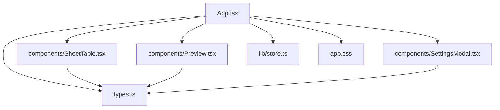
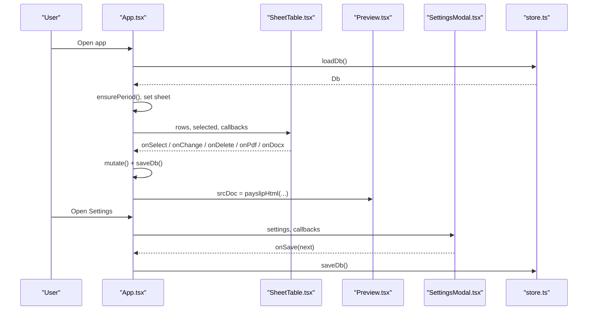
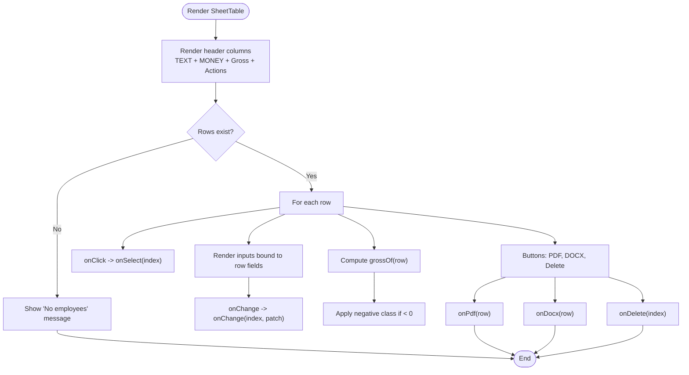
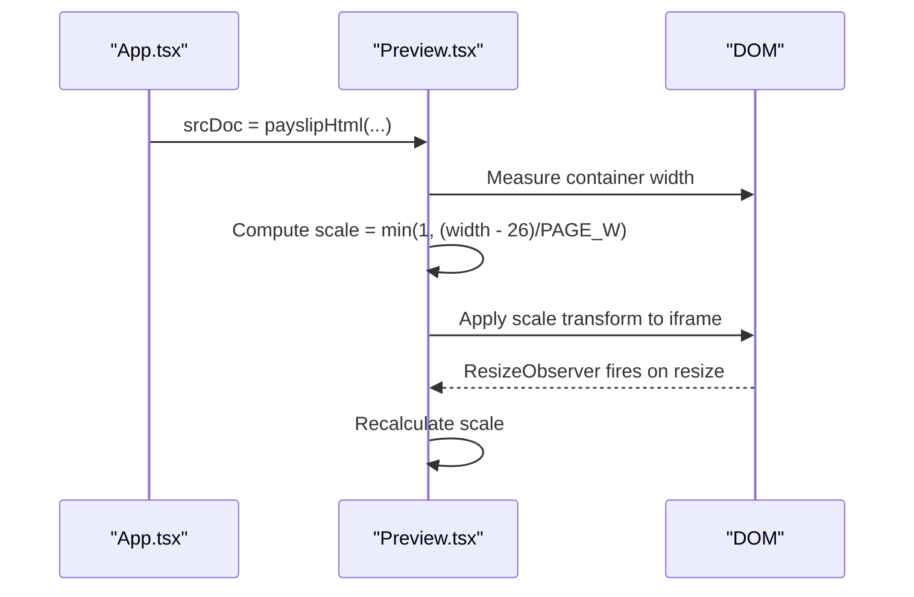
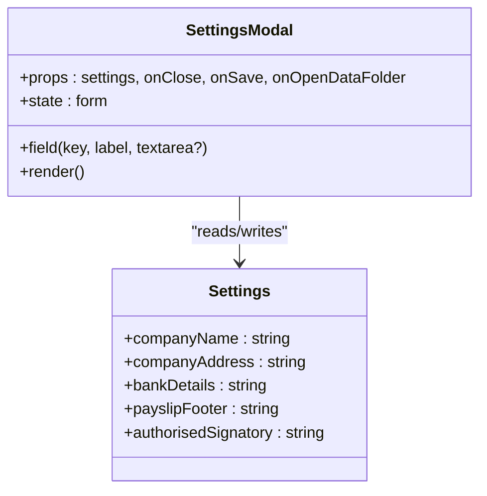
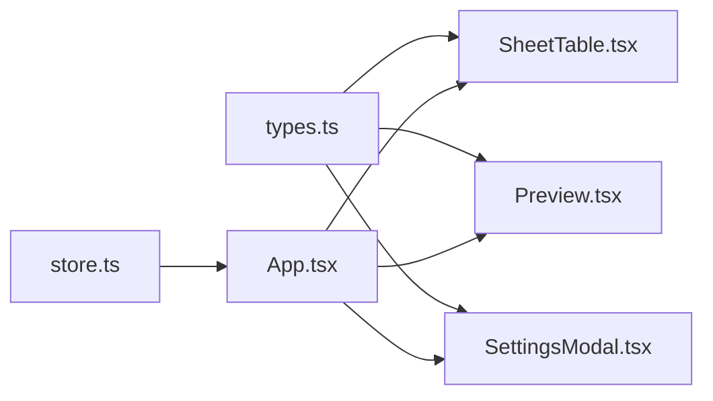

# UI Components

<cite>
**Referenced Files in This Document**
- [App.tsx](file://src/renderer/src/App.tsx)
- [SheetTable.tsx](file://src/renderer/src/components/SheetTable.tsx)
- [Preview.tsx](file://src/renderer/src/components/Preview.tsx)
- [SettingsModal.tsx](file://src/renderer/src/components/SettingsModal.tsx)
- [store.ts](file://src/renderer/src/lib/store.ts)
- [types.ts](file://src/renderer/src/types.ts)
- [app.css](file://src/renderer/src/app.css)
</cite>

## Table of Contents
1. [Introduction](#introduction)
2. [Project Structure](#project-structure)
3. [Core Components](#core-components)
4. [Architecture Overview](#architecture-overview)
5. [Detailed Component Analysis](#detailed-component-analysis)
6. [Dependency Analysis](#dependency-analysis)
7. [Performance Considerations](#performance-considerations)
8. [Troubleshooting Guide](#troubleshooting-guide)
9. [Conclusion](#conclusion)

## Introduction
This document explains the React user interface components that power the Mabtech Payslip Generator’s employee data grid, real-time payslip preview, and company settings modal. It focuses on:
- SheetTable: an inline-editable employee data grid with selection, row actions, and computed gross pay display.
- Preview: a responsive iframe-based payslip preview that scales to fit the container.
- SettingsModal: a modal for editing company configuration used when generating payslips.

It also covers how these components integrate with the application state store, event handling patterns, styling approach, accessibility considerations, and customization guidelines.

## Project Structure
The UI is implemented as a small React application under the renderer layer. The main application orchestrates state, file operations, and component composition. The three target components are located under the components directory and styled via a single CSS file.

**Diagram sources**
- [App.tsx:1-11](file://src/renderer/src/App.tsx#L1-L11)
- [SheetTable.tsx:1-3](file://src/renderer/src/components/SheetTable.tsx#L1-L3)
- [Preview.tsx:1-2](file://src/renderer/src/components/Preview.tsx#L1-L2)
- [SettingsModal.tsx:1-3](file://src/renderer/src/components/SettingsModal.tsx#L1-L3)
- [store.ts:1-2](file://src/renderer/src/lib/store.ts#L1-L2)
- [types.ts:1-30](file://src/renderer/src/types.ts#L1-L30)
- [app.css:1-10](file://src/renderer/src/app.css#L1-L10)

**Section sources**
- [App.tsx:1-11](file://src/renderer/src/App.tsx#L1-L11)
- [app.css:1-10](file://src/renderer/src/app.css#L1-L10)

## Core Components
This section summarizes each component’s purpose, props, events, internal state, styling hooks, and integration points.

### SheetTable
- Purpose: Displays the current month’s employee rows in a table with inline editing, selection highlighting, computed gross pay, and per-row export actions.
- Props:
  - boxRef: RefObject<HTMLDivElement> for scrolling control from parent.
  - rows: SalaryRow[] — the dataset to render.
  - selected: number — index of the active row.
  - onSelect(i: number): callback when a row is clicked.
  - onChange(i: number, patch: Partial<SalaryRow>): callback to update a field in a specific row.
  - onDelete(i: number): callback to remove a row by index.
  - onPdf(row: SalaryRow): callback to export PDF for a row.
  - onDocx(row: SalaryRow): callback to export DOCX for a row.
- Internal state: None; fully controlled by props.
- Events: Emits selection changes, field updates, deletions, and export requests through callbacks.
- Styling: Uses classes .table-wrap, .grid, .num, .gross, .negative, .actions, .active, and .no-rows defined in app.css.
- Integration: Relies on types.ts for SalaryRow and grossOf calculation. Parent (App.tsx) manages persistence and business logic.

**Section sources**
- [SheetTable.tsx:1-71](file://src/renderer/src/components/SheetTable.tsx#L1-L71)
- [types.ts:1-11](file://src/renderer/src/types.ts#L1-L11)
- [types.ts:52-53](file://src/renderer/src/types.ts#L52-L53)
- [app.css:68-91](file://src/renderer/src/app.css#L68-L91)

### Preview
- Purpose: Renders a generated HTML payslip inside an iframe and scales it to fit the available width while preserving A4 proportions.
- Props:
  - srcDoc: string — HTML content to render in the iframe.
- Internal state:
  - scale: number — computed scaling factor based on container width.
- Effects:
  - Observes container size using ResizeObserver and recalculates scale to keep the iframe within bounds.
- Styling: Uses .preview-box and .preview-frame classes from app.css.
- Integration: Receives HTML from App.tsx which composes payslip HTML using business logic modules.

**Section sources**
- [Preview.tsx:1-29](file://src/renderer/src/components/Preview.tsx#L1-L29)
- [app.css:94-97](file://src/renderer/src/app.css#L94-L97)

### SettingsModal
- Purpose: Provides a modal form to edit company settings used during payslip generation.
- Props:
  - settings: Settings — current company configuration.
  - onClose(): callback to close the modal without saving.
  - onSave(next: Settings): callback to persist updated settings.
  - onOpenDataFolder(): callback to open the local data folder.
- Internal state:
  - form: Settings — local copy of settings being edited.
- Events: Emits save or cancel actions via callbacks.
- Styling: Uses .modal-backdrop, .modal, .field, .hint, and .modal-actions classes from app.css.
- Integration: Reads/writes settings through App.tsx, which persists them immediately via the store.

**Section sources**
- [SettingsModal.tsx:1-43](file://src/renderer/src/components/SettingsModal.tsx#L1-L43)
- [types.ts:19-25](file://src/renderer/src/types.ts#L19-L25)
- [app.css:99-109](file://src/renderer/src/app.css#L99-L109)

## Architecture Overview
The application follows a unidirectional data flow:
- App.tsx owns global state (Db, period, selected row, logo, status, modals).
- Components receive data via props and emit events back to App.tsx.
- App.tsx uses lib/store.ts to load/save Db and compute derived values like MonthSheet.
- Business logic modules (payslipHtml, payslipDocx, importSheet, binary) are invoked by App.tsx to generate outputs and handle files.

**Diagram sources**
- [App.tsx:25-48](file://src/renderer/src/App.tsx#L25-L48)
- [App.tsx:66-80](file://src/renderer/src/App.tsx#L66-L80)
- [App.tsx:138-160](file://src/renderer/src/App.tsx#L138-L160)
- [App.tsx:250-285](file://src/renderer/src/App.tsx#L250-L285)
- [store.ts:8-18](file://src/renderer/src/lib/store.ts#L8-L18)

## Detailed Component Analysis

### SheetTable: Employee Data Grid
SheetTable renders a scrollable table with fixed column widths, inline inputs for text and numeric fields, a computed gross column, and per-row action buttons.

Key behaviors:
- Selection: Clicking a row triggers onSelect(index), highlighted via .active class.
- Inline editing: Text fields use value binding and onChange to emit partial updates. Numeric fields coerce input to numbers.
- Computed gross: Gross is calculated using grossOf(row) and displayed with negative styling when below zero.
- Actions: Buttons trigger onPdf(row), onDocx(row), and onDelete(index). Event propagation is managed so row clicks do not conflict with action button clicks.

Styling:
- .table-wrap provides horizontal scrolling.
- .grid defines table layout and sticky headers.
- .num aligns numeric columns right.
- .gross and .negative style the computed total.
- .actions groups row-level buttons.
- .no-rows displays a message when there are no employees.

Integration:
- Depends on SalaryRow type and grossOf utility from types.ts.
- Controlled by App.tsx, which handles persistence and business logic.

**Diagram sources**
- [SheetTable.tsx:30-70](file://src/renderer/src/components/SheetTable.tsx#L30-L70)
- [types.ts:52-53](file://src/renderer/src/types.ts#L52-L53)

**Section sources**
- [SheetTable.tsx:1-71](file://src/renderer/src/components/SheetTable.tsx#L1-L71)
- [types.ts:1-11](file://src/renderer/src/types.ts#L1-L11)
- [types.ts:52-53](file://src/renderer/src/types.ts#L52-L53)
- [app.css:68-91](file://src/renderer/src/app.css#L68-L91)

### Preview: Real-Time Payslip Display
Preview renders the generated HTML payslip in an iframe and scales it to fit the container while maintaining A4 aspect ratio.

Key behaviors:
- Scaling: Computes scale based on container width vs A4 width (794px at 96dpi).
- Resize observation: Uses ResizeObserver to recalculate scale when container size changes.
- iframe rendering: Sets srcDoc to the provided HTML string and disables scrolling.

Styling:
- .preview-box provides background and padding.
- .preview-frame applies transform-origin and shadow.
- iframe fills the frame with no border.

Integration:
- App.tsx generates HTML via payslipHtml and passes it as srcDoc.

**Diagram sources**
- [Preview.tsx:5-28](file://src/renderer/src/components/Preview.tsx#L5-L28)
- [App.tsx:138-139](file://src/renderer/src/App.tsx#L138-L139)

**Section sources**
- [Preview.tsx:1-29](file://src/renderer/src/components/Preview.tsx#L1-L29)
- [app.css:94-97](file://src/renderer/src/app.css#L94-L97)

### SettingsModal: Company Configuration
SettingsModal presents a modal dialog with fields for company name, address, bank details, signatory label, and footer note.

Key behaviors:
- Local form state: Maintains a local copy of settings to avoid re-renders until save.
- Field helper: Reuses a field function to render input or textarea depending on the field.
- Save/cancel: Emits onSave(updatedSettings) or onClose.
- Data folder link: Calls onOpenDataFolder to open the local data directory.

Styling:
- .modal-backdrop overlays the page.
- .modal contains the dialog content.
- .field styles labels and inputs/textareas.
- .hint provides contextual help.
- .modal-actions aligns buttons.

Integration:
- App.tsx opens the modal, passes current settings, and persists changes immediately via mutate(true).

**Diagram sources**
- [SettingsModal.tsx:4-42](file://src/renderer/src/components/SettingsModal.tsx#L4-L42)
- [types.ts:19-25](file://src/renderer/src/types.ts#L19-L25)

**Section sources**
- [SettingsModal.tsx:1-43](file://src/renderer/src/components/SettingsModal.tsx#L1-L43)
- [types.ts:19-25](file://src/renderer/src/types.ts#L19-L25)
- [app.css:99-109](file://src/renderer/src/app.css#L99-L109)

## Dependency Analysis
Components depend on shared types and are orchestrated by App.tsx. The store module abstracts persistence and sheet management.

**Diagram sources**
- [types.ts:1-30](file://src/renderer/src/types.ts#L1-L30)
- [store.ts:1-33](file://src/renderer/src/lib/store.ts#L1-L33)
- [App.tsx:1-11](file://src/renderer/src/App.tsx#L1-L11)

**Section sources**
- [types.ts:1-30](file://src/renderer/src/types.ts#L1-L30)
- [store.ts:1-33](file://src/renderer/src/lib/store.ts#L1-L33)
- [App.tsx:1-11](file://src/renderer/src/App.tsx#L1-L11)

## Performance Considerations
- SheetTable:
  - Inline editing emits frequent onChange events; App.tsx debounces persistence via a timer to reduce I/O.
  - Avoid unnecessary re-renders by keeping components controlled and passing stable callbacks where possible.
- Preview:
  - ResizeObserver recalculates scale only when container dimensions change; this is efficient but should be monitored if nested deeply.
- App.tsx:
  - Uses useMemo for deriving the current sheet to minimize recomputation.
  - Debounced saves prevent excessive writes to storage.

[No sources needed since this section provides general guidance]

## Troubleshooting Guide
Common issues and resolutions:
- No employees shown:
  - Ensure a salary sheet has been imported or add a new row. The table displays a “No employees” message when rows are empty.
- Negative gross pay warnings:
  - Advances exceeding salary result in negative gross. Correct advances or carry over balances before exporting.
- Preview not scaling correctly:
  - Verify container width and CSS classes (.preview-box, .preview-frame). Check that ResizeObserver is not blocked by hidden containers.
- Settings not saved:
  - Confirm onSave is called and App.tsx invokes mutate with immediate persistence.
- Accessibility:
  - Ensure all interactive elements have appropriate roles and labels. Add aria attributes to custom controls if extended.
  - Keyboard navigation for the modal and table should be considered when extending functionality.

**Section sources**
- [SheetTable.tsx:43-63](file://src/renderer/src/components/SheetTable.tsx#L43-L63)
- [App.tsx:237-248](file://src/renderer/src/App.tsx#L237-L248)
- [Preview.tsx:9-17](file://src/renderer/src/components/Preview.tsx#L9-L17)
- [SettingsModal.tsx:22-40](file://src/renderer/src/components/SettingsModal.tsx#L22-L40)

## Conclusion
The UI components provide a focused, controllable interface for managing employee payroll data, previewing payslips, and configuring company settings. SheetTable offers inline editing and row actions, Preview delivers a responsive iframe-based payslip view, and SettingsModal centralizes company configuration. App.tsx coordinates state, persistence, and business logic, while shared types and the store module define contracts and data flows. Styling is centralized in app.css, enabling consistent appearance across components.

[No sources needed since this section summarizes without analyzing specific files]