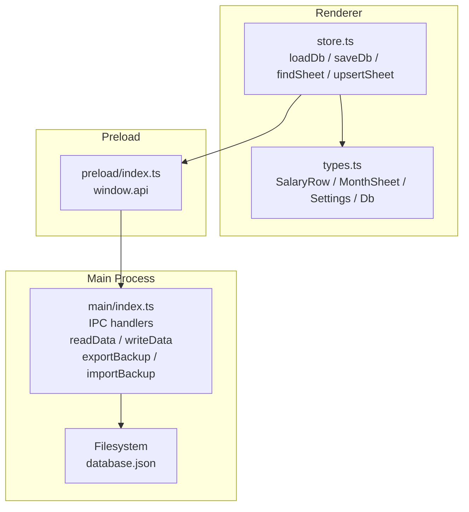
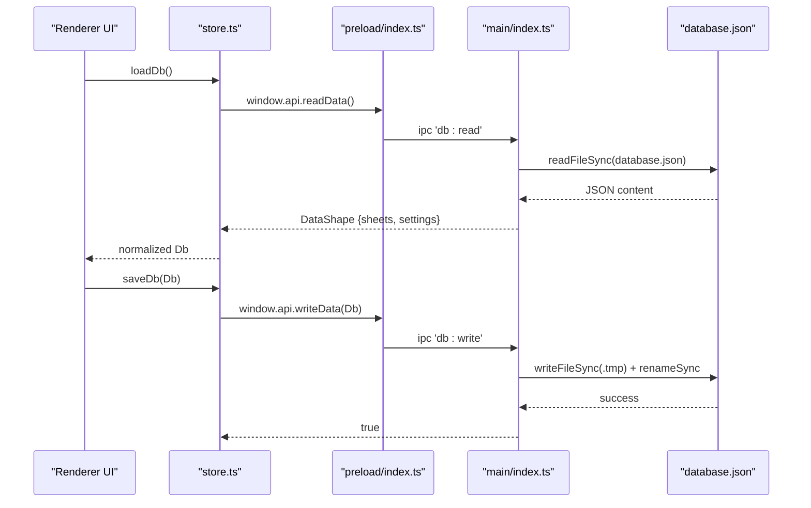
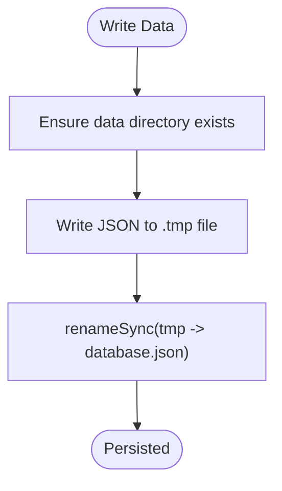
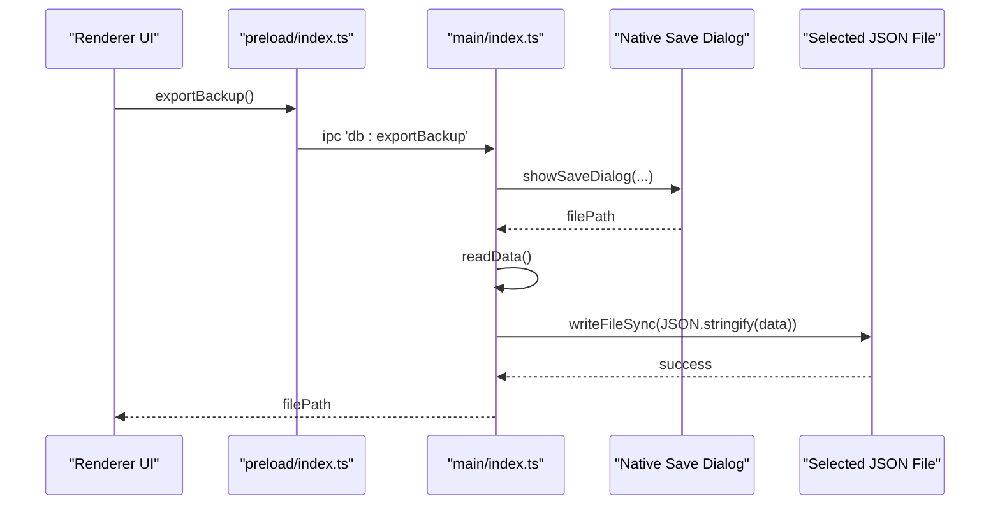
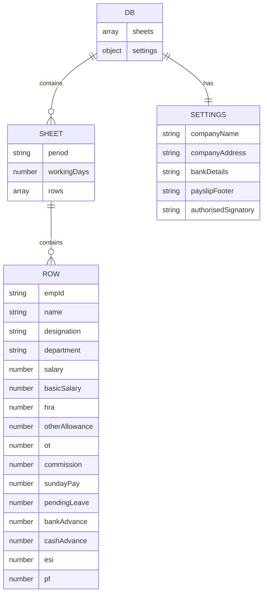
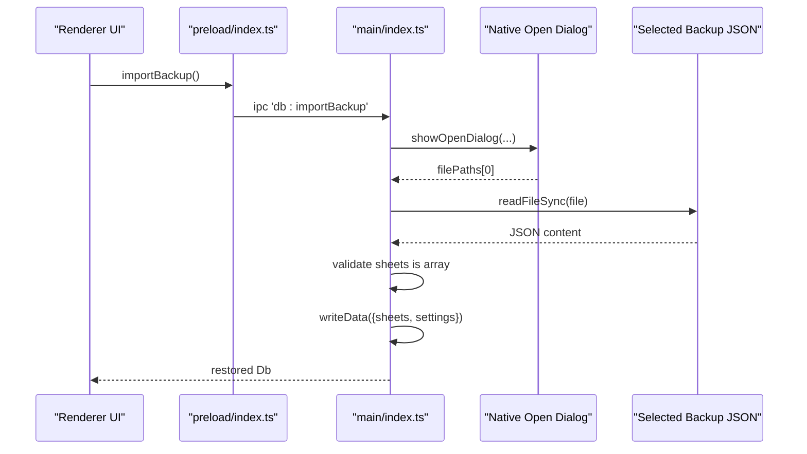
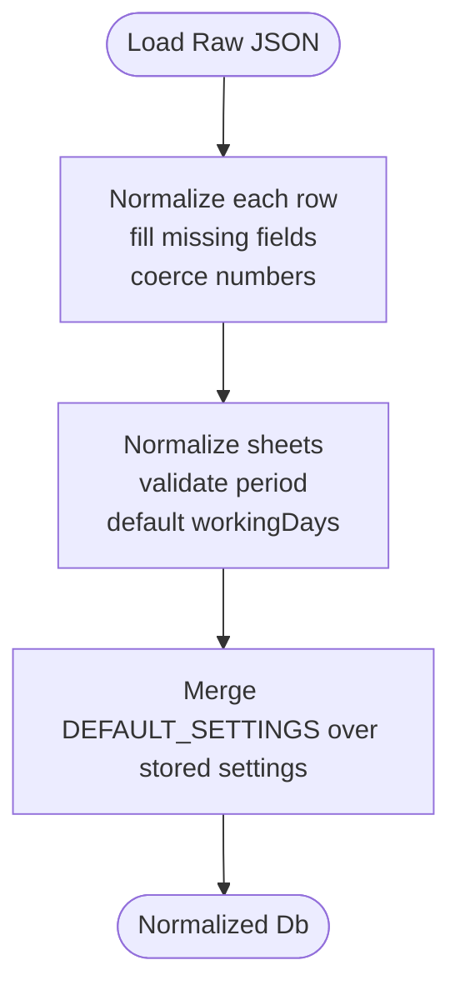
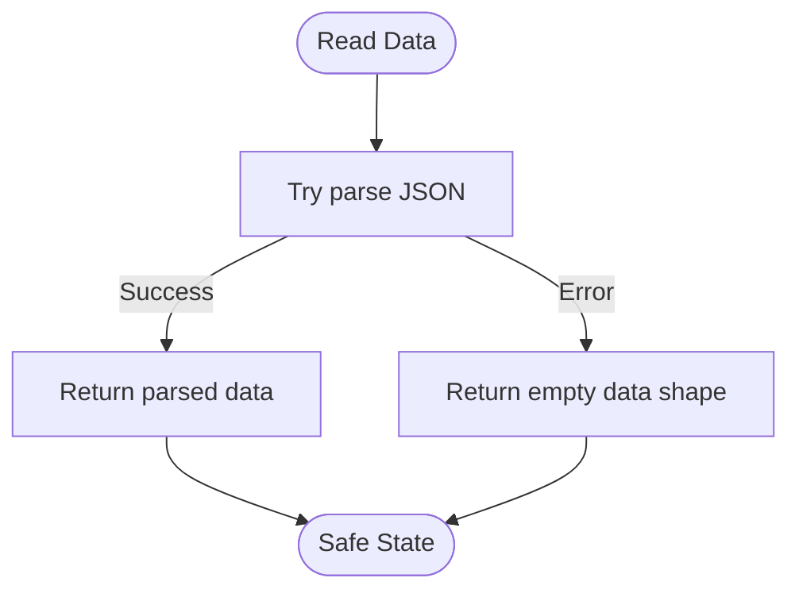
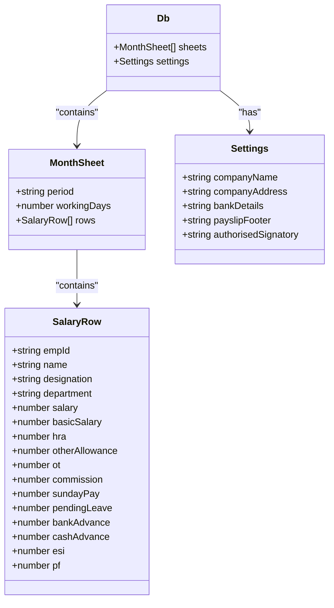
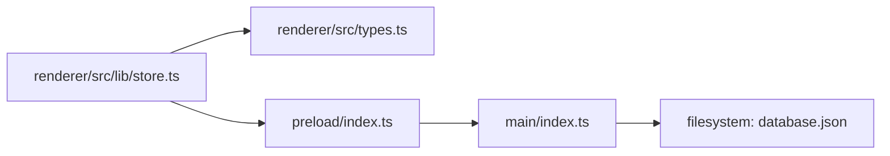

# Data Management

<cite>
**Referenced Files in This Document**
- [src/main/index.ts](file://src/main/index.ts)
- [src/preload/index.ts](file://src/preload/index.ts)
- [src/renderer/src/lib/store.ts](file://src/renderer/src/lib/store.ts)
- [src/renderer/src/types.ts](file://src/renderer/src/types.ts)
- [README.md](file://README.md)
</cite>

## Table of Contents
1. [Introduction](#introduction)
2. [Project Structure](#project-structure)
3. [Core Components](#core-components)
4. [Architecture Overview](#architecture-overview)
5. [Detailed Component Analysis](#detailed-component-analysis)
6. [Dependency Analysis](#dependency-analysis)
7. [Performance Considerations](#performance-considerations)
8. [Troubleshooting Guide](#troubleshooting-guide)
9. [Conclusion](#conclusion)
10. [Appendices](#appendices)

## Introduction
This document explains the data management features of the application, focusing on local JSON storage, backup and restore operations, data migration behavior, handling of corrupted data, best practices for backups and security, and the database schema structure. The app is an offline Electron desktop application that stores all user data in a single JSON file under the platform-specific application data directory. It exposes IPC endpoints to read, write, export, and import this data safely from the renderer process.

## Project Structure
The data management implementation spans four main areas:
- Main process: filesystem access, IPC handlers, backup/export/restore logic.
- Preload bridge: secure API surface exposed to the renderer.
- Renderer store: normalization, defaulting, and in-memory database helpers.
- Types: domain model for salary rows, monthly sheets, settings, and the root database object.

**Diagram sources**
- [src/main/index.ts:22-41](file://src/main/index.ts#L22-L41)
- [src/main/index.ts:95-125](file://src/main/index.ts#L95-L125)
- [src/preload/index.ts:3-19](file://src/preload/index.ts#L3-L19)
- [src/renderer/src/lib/store.ts:37-59](file://src/renderer/src/lib/store.ts#L37-L59)
- [src/renderer/src/types.ts:1-37](file://src/renderer/src/types.ts#L1-L37)

**Section sources**
- [README.md:7-15](file://README.md#L7-L15)
- [src/main/index.ts:22-41](file://src/main/index.ts#L22-L41)
- [src/main/index.ts:95-125](file://src/main/index.ts#L95-L125)
- [src/preload/index.ts:3-19](file://src/preload/index.ts#L3-L19)
- [src/renderer/src/lib/store.ts:37-59](file://src/renderer/src/lib/store.ts#L37-L59)
- [src/renderer/src/types.ts:1-37](file://src/renderer/src/types.ts#L1-L37)

## Core Components
- Local JSON storage: The application persists all data in a single JSON file named `database.json` inside the platform-specific application data folder. On Windows, this is `%APPDATA%\mabtech-payslip\data\database.json`; on Linux, it is `~/.config/mabtech-payslip/data/database.json`.
- Persistence layer: The main process reads and writes the JSON file using safe patterns (atomic rename via `.tmp`).
- Backup and restore: Export creates a portable JSON backup; Import validates and replaces the current store with the selected backup.
- Renderer store: Normalizes loaded data, merges defaults, and provides helpers to query and update monthly sheets.
- Domain types: Define the shape of stored data, including employee rows, monthly sheets, settings, and the root database object.

**Section sources**
- [README.md:7-15](file://README.md#L7-L15)
- [src/main/index.ts:22-41](file://src/main/index.ts#L22-L41)
- [src/main/index.ts:95-125](file://src/main/index.ts#L95-L125)
- [src/renderer/src/lib/store.ts:37-59](file://src/renderer/src/lib/store.ts#L37-L59)
- [src/renderer/src/types.ts:1-37](file://src/renderer/src/types.ts#L1-L37)

## Architecture Overview
The data flow uses a strict separation between renderer and main processes:
- The renderer calls `window.api.readData()` or `window.api.writeData()`.
- The preload bridge forwards these calls over IPC to the main process.
- The main process performs filesystem operations and backup/restore actions.
- The renderer store normalizes data and manages in-memory state.

**Diagram sources**
- [src/renderer/src/lib/store.ts:37-47](file://src/renderer/src/lib/store.ts#L37-L47)
- [src/preload/index.ts:3-6](file://src/preload/index.ts#L3-L6)
- [src/main/index.ts:95-99](file://src/main/index.ts#L95-L99)
- [src/main/index.ts:27-41](file://src/main/index.ts#L27-L41)

## Detailed Component Analysis

### Local JSON Storage System
- Location: The data directory is derived from the Electron app’s user data path, and the file name is `database.json`.
- Read semantics: Reads the JSON file and returns a safe shape even if parsing fails.
- Write semantics: Creates the directory if missing, writes to a temporary file, then atomically renames it to the final filename.
- Paths exposure: The renderer can request the absolute paths of the data file and folder through IPC.

**Diagram sources**
- [src/main/index.ts:22-41](file://src/main/index.ts#L22-L41)

**Section sources**
- [src/main/index.ts:22-41](file://src/main/index.ts#L22-L41)
- [README.md:7-15](file://README.md#L7-L15)

### Backup Creation Process
- Trigger: User initiates “Save backup” from the UI.
- Flow:
  - A save dialog prompts for a destination file.
  - The current store is read and serialized to JSON.
  - The file is written to the chosen location.
- Default naming: Includes a timestamp-based prefix for easy identification.

**Diagram sources**
- [src/preload/index.ts:8-8](file://src/preload/index.ts#L8-L8)
- [src/main/index.ts:103-112](file://src/main/index.ts#L103-L112)

**Section sources**
- [src/main/index.ts:103-112](file://src/main/index.ts#L103-L112)

### Backup File Format
- Format: Plain JSON with two top-level keys:
  - `sheets`: Array of monthly sheet objects.
  - `settings`: Application settings object.
- Validation on restore: The importer checks that `sheets` is an array before accepting the file.

**Diagram sources**
- [src/renderer/src/types.ts:1-37](file://src/renderer/src/types.ts#L1-L37)
- [src/main/index.ts:17-20](file://src/main/index.ts#L17-L20)
- [src/main/index.ts:121-124](file://src/main/index.ts#L121-L124)

**Section sources**
- [src/main/index.ts:17-20](file://src/main/index.ts#L17-L20)
- [src/main/index.ts:121-124](file://src/main/index.ts#L121-L124)
- [src/renderer/src/types.ts:1-37](file://src/renderer/src/types.ts#L1-L37)

### Restoration Procedures
- Trigger: User selects a backup file via “Restore backup”.
- Flow:
  - Open dialog allows selection of a JSON file.
  - File is parsed and validated (`sheets` must be an array).
  - Current store is replaced with the imported data.
  - Restored data is returned to the caller.

**Diagram sources**
- [src/preload/index.ts:9-9](file://src/preload/index.ts#L9-L9)
- [src/main/index.ts:114-125](file://src/main/index.ts#L114-L125)

**Section sources**
- [src/main/index.ts:114-125](file://src/main/index.ts#L114-L125)

### Data Migration Between Versions
- Backward compatibility:
  - Row normalization fills missing fields with safe defaults and coerces numeric values to prevent NaN propagation.
  - Sheet normalization ensures required fields like `period` exist and sets sensible defaults for `workingDays`.
  - Settings are merged with defaults so new settings keys do not break older stores.
- Forward compatibility:
  - Unknown fields in rows are ignored by normalization, reducing risk when newer versions add fields.
- Practical effect: Older JSON files remain usable after upgrades without manual intervention.

**Diagram sources**
- [src/renderer/src/lib/store.ts:13-35](file://src/renderer/src/lib/store.ts#L13-L35)
- [src/renderer/src/lib/store.ts:37-43](file://src/renderer/src/lib/store.ts#L37-L43)

**Section sources**
- [src/renderer/src/lib/store.ts:13-35](file://src/renderer/src/lib/store.ts#L13-L35)
- [src/renderer/src/lib/store.ts:37-43](file://src/renderer/src/lib/store.ts#L37-L43)

### Handling Corrupted Data Files
- Read resilience: If reading or parsing the JSON file fails, the system returns an empty data shape rather than crashing.
- Restore validation: Import rejects files where `sheets` is not an array.
- Normalization safety: Numeric coercion prevents NaN accumulation during calculations.

**Diagram sources**
- [src/main/index.ts:27-34](file://src/main/index.ts#L27-L34)
- [src/main/index.ts:121-124](file://src/main/index.ts#L121-L124)
- [src/renderer/src/lib/store.ts:13-24](file://src/renderer/src/lib/store.ts#L13-L24)

**Section sources**
- [src/main/index.ts:27-34](file://src/main/index.ts#L27-L34)
- [src/main/index.ts:121-124](file://src/main/index.ts#L121-L124)
- [src/renderer/src/lib/store.ts:13-24](file://src/renderer/src/lib/store.ts#L13-L24)

### Best Practices for Regular Backups and Security
- Regular backups:
  - Export backups periodically, especially before major edits or version upgrades.
  - Use descriptive filenames and store copies outside the application data directory.
- Data integrity:
  - Prefer restoring only from trusted backups.
  - Validate backups before restoration if possible.
- Security considerations:
  - Treat the JSON file as sensitive payroll data; restrict file permissions where possible.
  - Avoid sharing backups over untrusted channels.
  - Keep the application updated to benefit from improved safeguards.

[No sources needed since this section provides general guidance]

### Database Schema Structure and Data Types
- Root database object:
  - `sheets`: Array of monthly sheets.
  - `settings`: Application settings.
- Monthly sheet:
  - `period`: String identifier for the month/year.
  - `workingDays`: Number of working days used for calculations.
  - `rows`: Array of employee salary rows.
- Salary row:
  - Employee identifiers and names.
  - Earnings, deductions, and breakdown fields.
  - All monetary fields are numbers; missing or invalid values are normalized to zero.
- Settings:
  - Company identity and payslip footer/signatory information.

**Diagram sources**
- [src/renderer/src/types.ts:1-37](file://src/renderer/src/types.ts#L1-L37)

**Section sources**
- [src/renderer/src/types.ts:1-37](file://src/renderer/src/types.ts#L1-L37)

## Dependency Analysis
The following diagram shows how components depend on each other for data management:

**Diagram sources**
- [src/renderer/src/lib/store.ts:37-59](file://src/renderer/src/lib/store.ts#L37-L59)
- [src/renderer/src/types.ts:1-37](file://src/renderer/src/types.ts#L1-L37)
- [src/preload/index.ts:3-19](file://src/preload/index.ts#L3-L19)
- [src/main/index.ts:22-41](file://src/main/index.ts#L22-L41)

**Section sources**
- [src/renderer/src/lib/store.ts:37-59](file://src/renderer/src/lib/store.ts#L37-L59)
- [src/preload/index.ts:3-19](file://src/preload/index.ts#L3-L19)
- [src/main/index.ts:22-41](file://src/main/index.ts#L22-L41)

## Performance Considerations
- Atomic writes: Using a temporary file plus rename reduces corruption risk during crashes.
- Minimal I/O: Backup and restore operate on a single JSON file, simplifying performance characteristics.
- Normalization cost: Row and sheet normalization run on load; keep datasets reasonable in size to avoid long startup times.

[No sources needed since this section provides general guidance]

## Troubleshooting Guide
- App cannot read data:
  - Cause: Corrupted or inaccessible JSON file.
  - Behavior: Returns empty data shape; check file permissions and integrity.
- Restore fails:
  - Cause: Selected file does not contain a valid `sheets` array.
  - Action: Re-export a valid backup or verify the file format.
- Unexpected zeros in pay calculations:
  - Cause: Missing or non-numeric fields in old data.
  - Behavior: Normalization coerces invalid values to zero; review imported rows.

**Section sources**
- [src/main/index.ts:27-34](file://src/main/index.ts#L27-L34)
- [src/main/index.ts:121-124](file://src/main/index.ts#L121-L124)
- [src/renderer/src/lib/store.ts:13-24](file://src/renderer/src/lib/store.ts#L13-L24)

## Conclusion
The application implements a robust, simple data management strategy centered around a single JSON file. It provides safe read/write operations, resilient normalization for backward compatibility, and straightforward backup and restore workflows. By following the recommended backup practices and understanding the schema, users can maintain data integrity across versions and environments.

[No sources needed since this section summarizes without analyzing specific files]

## Appendices
- Platform-specific data locations:
  - Windows: `%APPDATA%\mabtech-payslip\data\database.json`
  - Linux: `~/.config/mabtech-payslip/data/database.json`

**Section sources**
- [README.md:7-15](file://README.md#L7-L15)