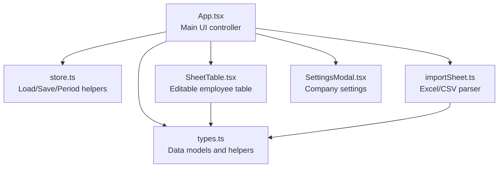
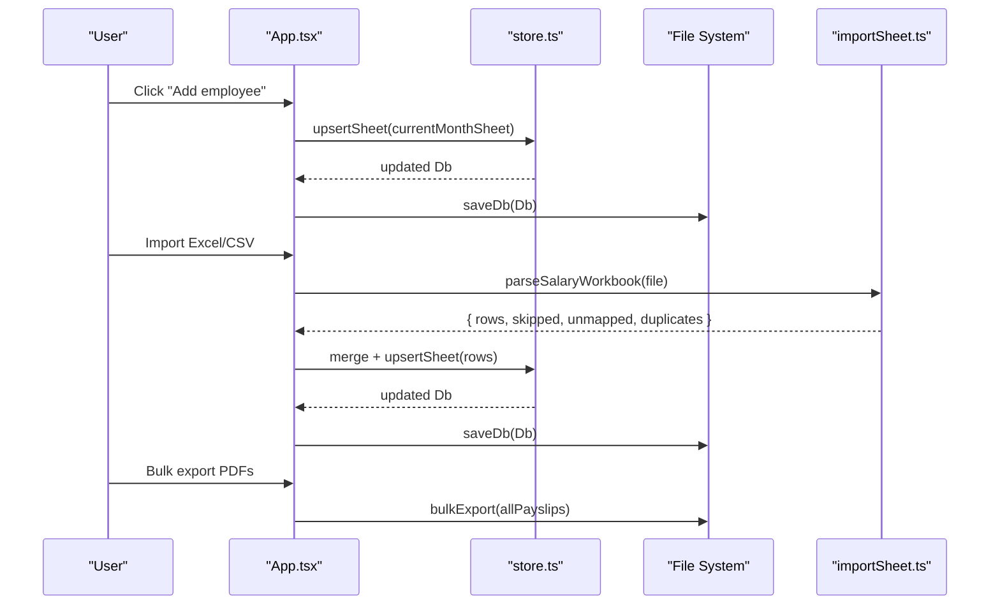
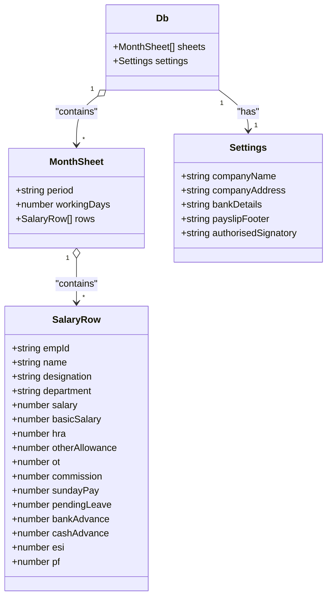
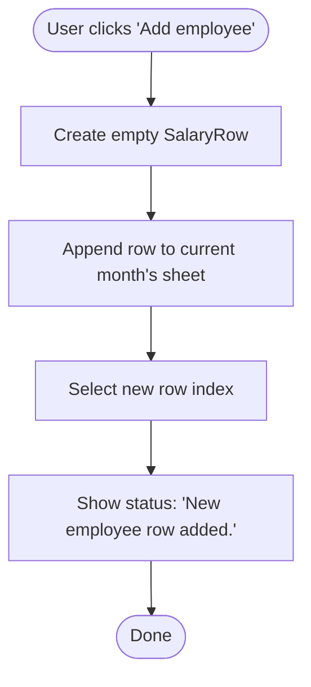
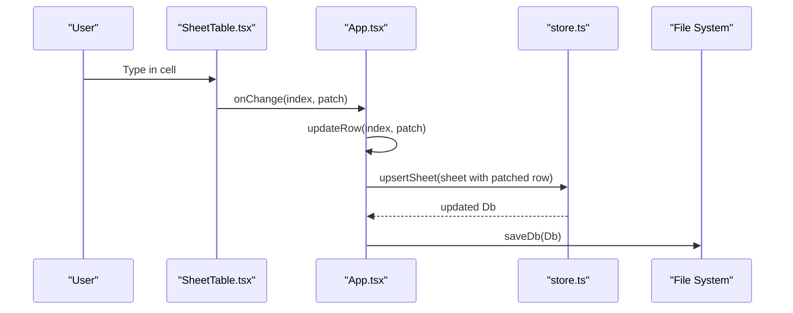
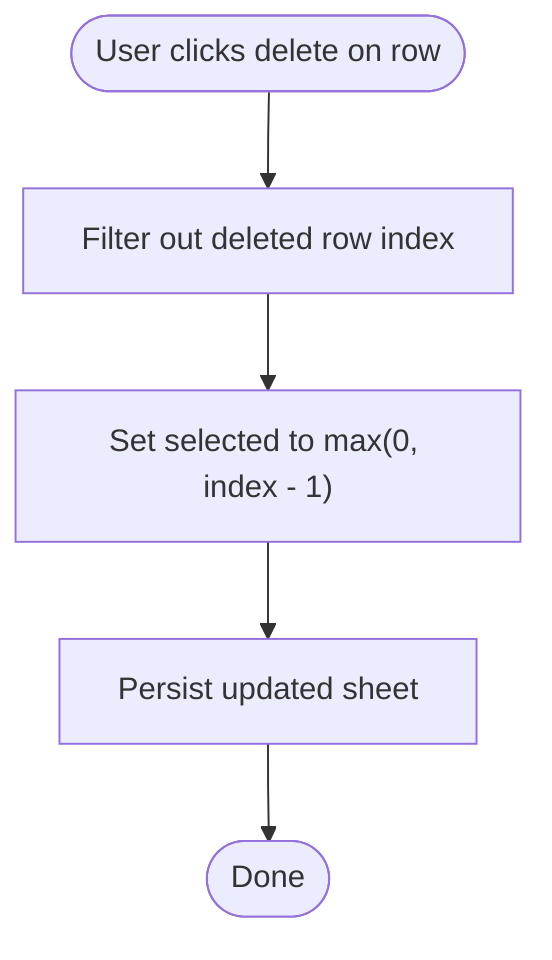
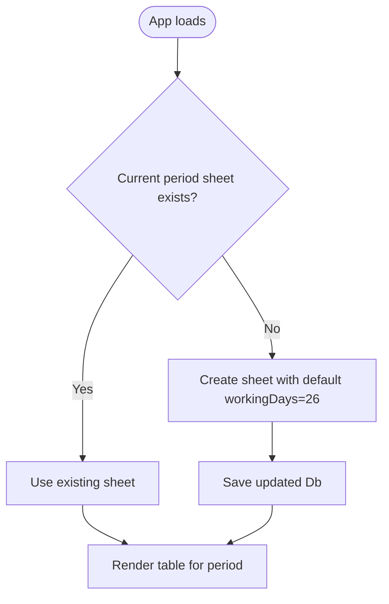
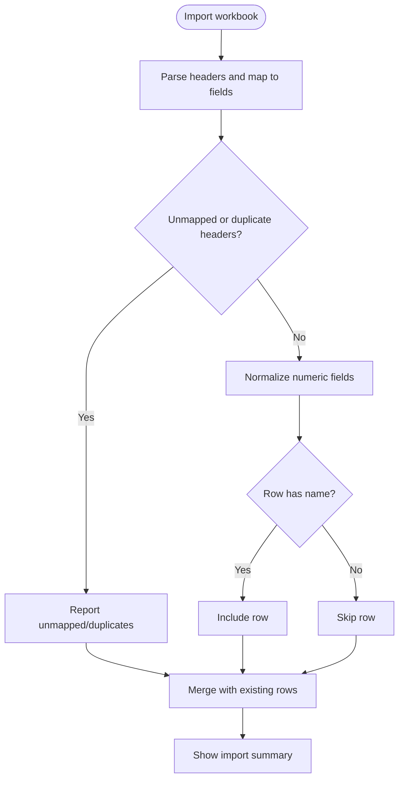
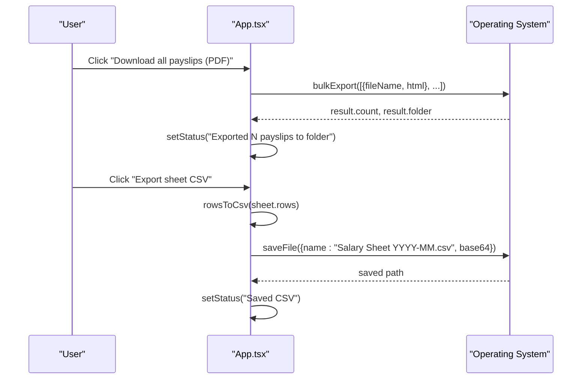
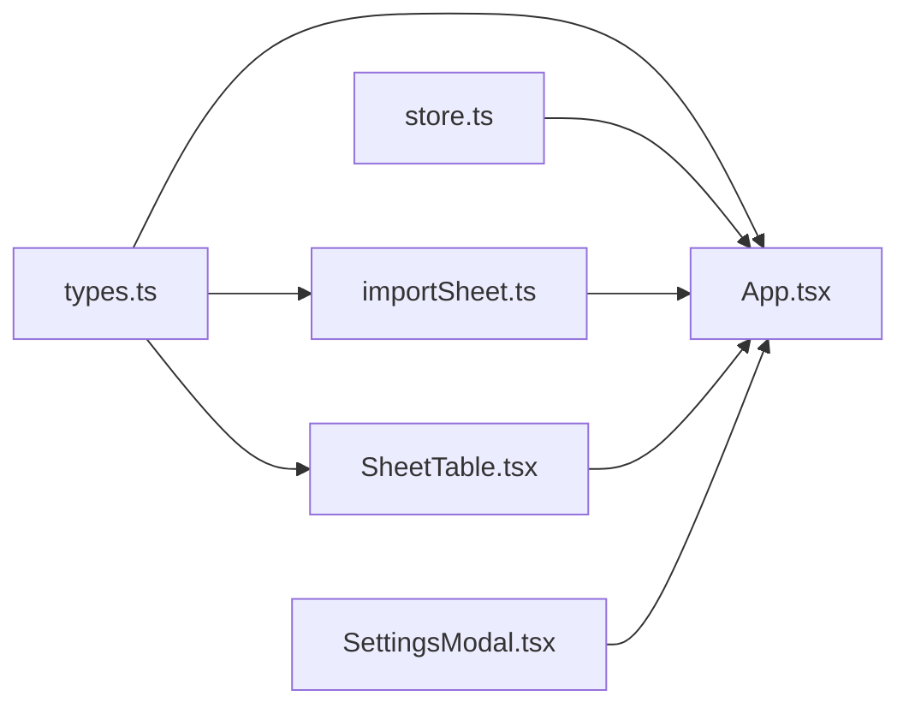

# Employee Data Management

<cite>
**Referenced Files in This Document**
- [README.md](file://README.md)
- [types.ts](file://src/renderer/src/types.ts)
- [store.ts](file://src/renderer/src/lib/store.ts)
- [App.tsx](file://src/renderer/src/App.tsx)
- [SheetTable.tsx](file://src/renderer/src/components/SheetTable.tsx)
- [importSheet.ts](file://src/renderer/src/lib/importSheet.ts)
- [SettingsModal.tsx](file://src/renderer/src/components/SettingsModal.tsx)
</cite>

## Table of Contents
1. [Introduction](#introduction)
2. [Project Structure](#project-structure)
3. [Core Components](#core-components)
4. [Architecture Overview](#architecture-overview)
5. [Detailed Component Analysis](#detailed-component-analysis)
6. [Dependency Analysis](#dependency-analysis)
7. [Performance Considerations](#performance-considerations)
8. [Troubleshooting Guide](#troubleshooting-guide)
9. [Conclusion](#conclusion)

## Introduction
This document explains how employee data is managed in the application, including adding new employees, editing existing records, and deleting entries. It documents the employee data structure, validation rules, error handling, monthly payroll period organization, and bulk operations for managing multiple employees efficiently. The system stores all data locally in a JSON file and organizes employee records by payroll periods (months).

## Project Structure
The employee management features are implemented in the renderer layer using React components and TypeScript types:
- Types define the employee record, payroll period sheet, settings, and database model.
- Store utilities load, save, and organize data by month.
- App orchestrates user actions such as adding, editing, deleting, importing, exporting, and bulk operations.
- SheetTable renders the editable employee grid with inline editing and row deletion.
- ImportSheet parses Excel/CSV files into employee rows with flexible header mapping.
- SettingsModal manages company-level configuration used on payslips.

**Diagram sources**
- [App.tsx:1-289](file://src/renderer/src/App.tsx#L1-L289)
- [store.ts:1-33](file://src/renderer/src/lib/store.ts#L1-L33)
- [types.ts:1-117](file://src/renderer/src/types.ts#L1-L117)
- [SheetTable.tsx:1-71](file://src/renderer/src/components/SheetTable.tsx#L1-L71)
- [importSheet.ts:1-131](file://src/renderer/src/lib/importSheet.ts#L1-L131)
- [SettingsModal.tsx:1-43](file://src/renderer/src/components/SettingsModal.tsx#L1-L43)

**Section sources**
- [README.md:1-71](file://README.md#L1-L71)
- [types.ts:1-117](file://src/renderer/src/types.ts#L1-L117)
- [store.ts:1-33](file://src/renderer/src/lib/store.ts#L1-L33)
- [App.tsx:1-289](file://src/renderer/src/App.tsx#L1-L289)
- [SheetTable.tsx:1-71](file://src/renderer/src/components/SheetTable.tsx#L1-L71)
- [importSheet.ts:1-131](file://src/renderer/src/lib/importSheet.ts#L1-L131)
- [SettingsModal.tsx:1-43](file://src/renderer/src/components/SettingsModal.tsx#L1-L43)

## Core Components
- Employee record type defines required and optional fields for each employee’s monthly payroll data.
- Monthly sheet groups employee rows under a payroll period with working days metadata.
- Database model holds an array of monthly sheets plus company settings.
- Store provides functions to find or create a sheet for a given period and upsert it into the database.
- App implements add/edit/delete operations, import/export, and bulk PDF generation.
- SheetTable renders the editable grid and exposes change and delete handlers.
- ImportSheet maps various Excel/CSV headers to the internal field names and validates numeric fields.
- SettingsModal allows configuring company details printed on payslips.

Key responsibilities:
- Add employee: creates a new empty row in the current month’s sheet.
- Edit employee: updates fields inline via the table component.
- Delete employee: removes a row from the current month’s sheet.
- Import: merges imported rows with existing ones based on employee identity.
- Export: generates CSV or PDFs per employee; supports bulk export.

**Section sources**
- [types.ts:1-117](file://src/renderer/src/types.ts#L1-L117)
- [store.ts:1-33](file://src/renderer/src/lib/store.ts#L1-L33)
- [App.tsx:76-101](file://src/renderer/src/App.tsx#L76-L101)
- [SheetTable.tsx:1-71](file://src/renderer/src/components/SheetTable.tsx#L1-L71)
- [importSheet.ts:1-131](file://src/renderer/src/lib/importSheet.ts#L1-L131)
- [SettingsModal.tsx:1-43](file://src/renderer/src/components/SettingsModal.tsx#L1-L43)

## Architecture Overview
Employee data flows through a simple client-side architecture:
- User interactions in App trigger state mutations via a single write path that debounces saves.
- SheetTable reflects current rows and forwards edits/deletes back to App.
- ImportSheet transforms spreadsheets into typed employee rows.
- Store persists changes to disk and organizes them by period.
- Settings influence generated payslips but do not alter core employee data.

**Diagram sources**
- [App.tsx:82-136](file://src/renderer/src/App.tsx#L82-L136)
- [store.ts:20-30](file://src/renderer/src/lib/store.ts#L20-L30)
- [importSheet.ts:65-116](file://src/renderer/src/lib/importSheet.ts#L65-L116)

## Detailed Component Analysis

### Employee Data Model
The employee record includes identification, descriptive attributes, salary components, deductions, and statutory contributions. Money fields are categorized into earnings, deductions, and non-additive breakdowns of base salary. Helpers compute net pay and detect mismatches between base salary and its breakdown.

- Identification and description: empId, name, designation, department.
- Salary components: salary, basicSalary, hra, otherAllowance, ot, commission, sundayPay.
- Deductions: bankAdvance, cashAdvance, esi, pf.
- Leave adjustment: pendingLeave.
- Net pay calculation sums earnings and subtracts absolute deduction values.
- Breakup mismatch detection warns when basicSalary + hra + otherAllowance does not equal salary.

**Diagram sources**
- [types.ts:1-37](file://src/renderer/src/types.ts#L1-L37)

**Section sources**
- [types.ts:1-117](file://src/renderer/src/types.ts#L1-L117)

### Adding New Employees
Users can add a new employee row directly in the current month’s sheet. The action appends an empty row initialized with default values and selects the new row for immediate editing. A status message confirms the addition.

**Diagram sources**
- [App.tsx:82-86](file://src/renderer/src/App.tsx#L82-L86)
- [types.ts:47-64](file://src/renderer/src/types.ts#L47-L64)

**Section sources**
- [App.tsx:82-86](file://src/renderer/src/App.tsx#L82-L86)
- [types.ts:47-64](file://src/renderer/src/types.ts#L47-L64)

### Editing Existing Employee Records
Editing is performed inline in the table. Each cell dispatches a change handler that patches the corresponding field in the selected row. Numeric inputs coerce values to numbers; text inputs store strings. Changes are merged into the current month’s sheet and persisted with debounced writes.

**Diagram sources**
- [SheetTable.tsx:46-57](file://src/renderer/src/components/SheetTable.tsx#L46-L57)
- [App.tsx:79-80](file://src/renderer/src/App.tsx#L79-L80)
- [store.ts:24-30](file://src/renderer/src/lib/store.ts#L24-L30)

**Section sources**
- [SheetTable.tsx:46-57](file://src/renderer/src/components/SheetTable.tsx#L46-L57)
- [App.tsx:79-80](file://src/renderer/src/App.tsx#L79-L80)

### Deleting Employee Entries
Deleting a row removes it from the current month’s sheet and adjusts the selected index to avoid out-of-range selection. A confirmation is implicit via immediate persistence.

**Diagram sources**
- [App.tsx:88-91](file://src/renderer/src/App.tsx#L88-L91)
- [SheetTable.tsx:59-63](file://src/renderer/src/components/SheetTable.tsx#L59-L63)

**Section sources**
- [App.tsx:88-91](file://src/renderer/src/App.tsx#L88-L91)
- [SheetTable.tsx:59-63](file://src/renderer/src/components/SheetTable.tsx#L59-L63)

### Monthly Period Organization
Employee data is organized by payroll periods (month-year). The app ensures the current month’s sheet exists and initializes it with a default number of working days if missing. Users can switch periods via a month picker, and each period maintains its own set of employee rows.

**Diagram sources**
- [App.tsx:25-34](file://src/renderer/src/App.tsx#L25-L34)
- [store.ts:20-30](file://src/renderer/src/lib/store.ts#L20-L30)

**Section sources**
- [App.tsx:25-34](file://src/renderer/src/App.tsx#L25-L34)
- [store.ts:20-30](file://src/renderer/src/lib/store.ts#L20-L30)

### Data Validation Rules and Error Handling
Validation and normalization occur primarily during import:
- Header mapping supports many aliases for each field; unknown headers are reported as unmapped.
- Duplicate columns are detected and reported.
- Numeric fields are parsed robustly; deductions are always treated as positive amounts.
- Rows without a name are skipped.
- The importer returns counts for skipped rows and lists unmapped/duplicate headers so users can correct their spreadsheets.

At runtime, the app displays warnings:
- Negative gross pay indicates advances exceed salary; affected employees are listed.
- Missing employee codes are counted and shown.

**Diagram sources**
- [importSheet.ts:33-48](file://src/renderer/src/lib/importSheet.ts#L33-L48)
- [importSheet.ts:50-54](file://src/renderer/src/lib/importSheet.ts#L50-L54)
- [importSheet.ts:91-116](file://src/renderer/src/lib/importSheet.ts#L91-L116)
- [App.tsx:103-136](file://src/renderer/src/App.tsx#L103-L136)

**Section sources**
- [importSheet.ts:33-48](file://src/renderer/src/lib/importSheet.ts#L33-L48)
- [importSheet.ts:50-54](file://src/renderer/src/lib/importSheet.ts#L50-L54)
- [importSheet.ts:91-116](file://src/renderer/src/lib/importSheet.ts#L91-L116)
- [App.tsx:103-136](file://src/renderer/src/App.tsx#L103-L136)
- [App.tsx:237-247](file://src/renderer/src/App.tsx#L237-L247)

### Bulk Operations
Bulk operations enable efficient management of multiple employees:
- Bulk PDF export generates one payslip per employee for the current month.
- CSV export exports the entire current month’s employee sheet.
- Import merges incoming rows with existing ones, preserving certain fields like salary, overtime, and advances when not provided in the import.

**Diagram sources**
- [App.tsx:162-184](file://src/renderer/src/App.tsx#L162-L184)
- [importSheet.ts:118-130](file://src/renderer/src/lib/importSheet.ts#L118-L130)

**Section sources**
- [App.tsx:162-184](file://src/renderer/src/App.tsx#L162-L184)
- [importSheet.ts:118-130](file://src/renderer/src/lib/importSheet.ts#L118-L130)

## Dependency Analysis
The following diagram shows how modules depend on each other for employee data management:

**Diagram sources**
- [types.ts:1-117](file://src/renderer/src/types.ts#L1-L117)
- [store.ts:1-33](file://src/renderer/src/lib/store.ts#L1-L33)
- [importSheet.ts:1-131](file://src/renderer/src/lib/importSheet.ts#L1-L131)
- [App.tsx:1-289](file://src/renderer/src/App.tsx#L1-L289)
- [SheetTable.tsx:1-71](file://src/renderer/src/components/SheetTable.tsx#L1-L71)
- [SettingsModal.tsx:1-43](file://src/renderer/src/components/SettingsModal.tsx#L1-L43)

**Section sources**
- [types.ts:1-117](file://src/renderer/src/types.ts#L1-L117)
- [store.ts:1-33](file://src/renderer/src/lib/store.ts#L1-L33)
- [importSheet.ts:1-131](file://src/renderer/src/lib/importSheet.ts#L1-L131)
- [App.tsx:1-289](file://src/renderer/src/App.tsx#L1-L289)
- [SheetTable.tsx:1-71](file://src/renderer/src/components/SheetTable.tsx#L1-L71)
- [SettingsModal.tsx:1-43](file://src/renderer/src/components/SettingsModal.tsx#L1-L43)

## Performance Considerations
- Debounced persistence: The app batches writes to avoid excessive disk I/O while editing.
- Single write path: All mutations go through a centralized function to prevent race conditions.
- Efficient merging: Import uses a Map keyed by employee identity to merge rows quickly.
- Minimal re-renders: State updates are scoped to the current month’s sheet.

[No sources needed since this section provides general guidance]

## Troubleshooting Guide
Common issues and resolutions:
- No employees for the month: Use “Import Excel / CSV” or “Add employee”.
- Imported file has no recognized headers: Ensure headers include at least NAME and an identifier like EMP ID.
- Unmapped or duplicate headers: Review the import summary and rename columns to match supported aliases.
- Negative net pay: Advances exceed salary; adjust deductions or carry over recoverable amounts before exporting.
- Missing employee code: Add an empId to ensure unique identification and proper merging.

Operational tips:
- Backup and restore: Use the Backup and Restore buttons to copy or reload the local database.
- Open data folder: From Settings, open the data directory to inspect or manually edit the JSON file.

**Section sources**
- [App.tsx:103-136](file://src/renderer/src/App.tsx#L103-L136)
- [App.tsx:237-247](file://src/renderer/src/App.tsx#L237-L247)
- [SettingsModal.tsx:31-34](file://src/renderer/src/components/SettingsModal.tsx#L31-L34)

## Conclusion
The employee data management system provides a straightforward interface for adding, editing, and deleting employee records within monthly payroll periods. It supports flexible spreadsheet imports with robust header mapping and validation, offers clear warnings for negative pay and missing identifiers, and enables efficient bulk operations for exporting payslips and sheets. All data is stored locally and organized by period, ensuring clarity and ease of maintenance across months.

[No sources needed since this section summarizes without analyzing specific files]