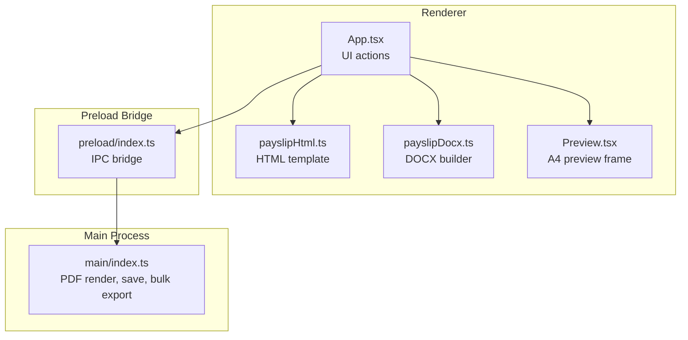
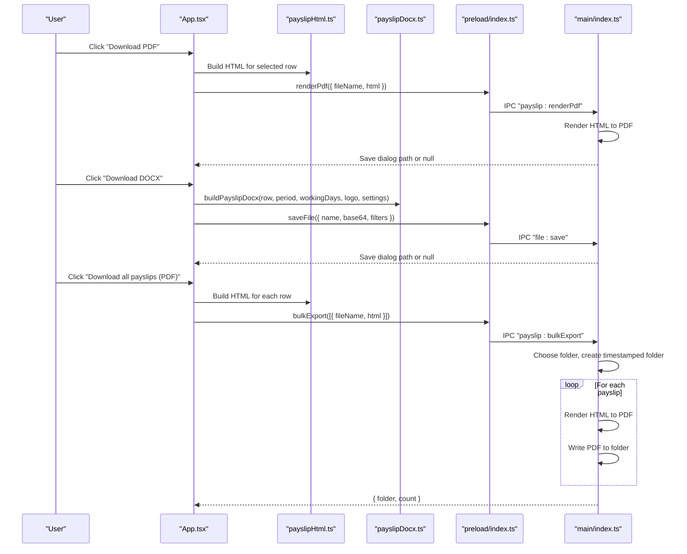
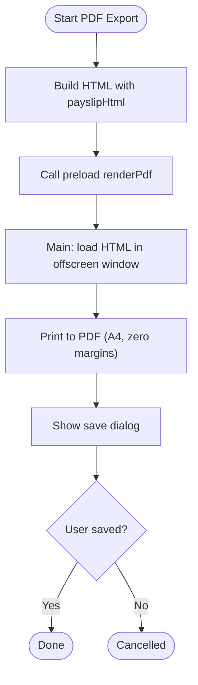
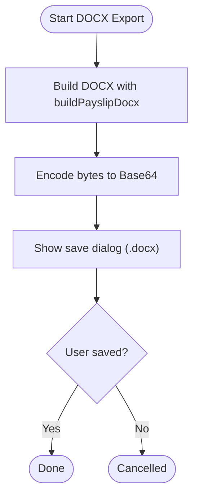
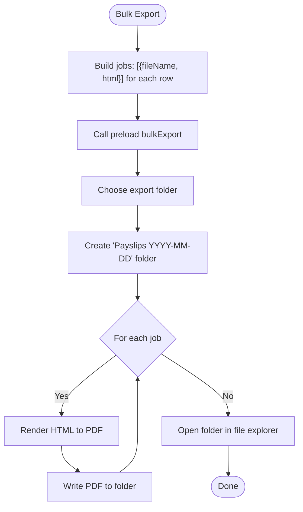
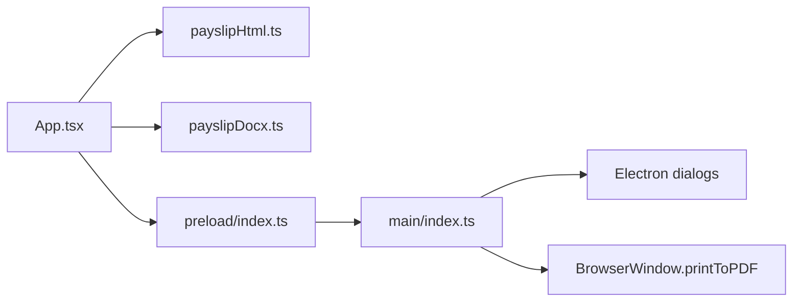

# Export Options

<cite>
**Referenced Files in This Document**
- [README.md](file://README.md)
- [App.tsx](file://src/renderer/src/App.tsx)
- [Preview.tsx](file://src/renderer/src/components/Preview.tsx)
- [payslipHtml.ts](file://src/renderer/src/lib/payslipHtml.ts)
- [payslipDocx.ts](file://src/renderer/src/lib/payslipDocx.ts)
- [preload/index.ts](file://src/preload/index.ts)
- [main/index.ts](file://src/main/index.ts)
</cite>

## Table of Contents
1. [Introduction](#introduction)
2. [Project Structure](#project-structure)
3. [Core Components](#core-components)
4. [Architecture Overview](#architecture-overview)
5. [Detailed Component Analysis](#detailed-component-analysis)
6. [Dependency Analysis](#dependency-analysis)
7. [Performance Considerations](#performance-considerations)
8. [Troubleshooting Guide](#troubleshooting-guide)
9. [Conclusion](#conclusion)

## Introduction
This document explains all export capabilities in the Mabtech Payslip Generator. It covers:
- Individual payslip export to PDF and DOCX formats
- Quality settings, customization options, and output differences
- Bulk export for multiple payslips at once
- Export location selection, file naming conventions, and batch processing behavior
- Performance considerations and best practices

The application is an offline Electron + React desktop app that imports monthly salary sheets, previews payslips live, and exports one payslip per employee as PDF or Word. All data remains on your PC in a local JSON database.

**Section sources**
- [README.md:1-7](file://README.md#L1-L7)
- [README.md:9-15](file://README.md#L9-L15)

## Project Structure
Export functionality spans three layers:
- Renderer layer (React UI): builds HTML, triggers PDF/DOCX generation, and calls native APIs
- Preload bridge: exposes IPC methods to the renderer
- Main process: performs PDF rendering, file saving, folder selection, and bulk export

**Diagram sources**
- [App.tsx:144-179](file://src/renderer/src/App.tsx#L144-L179)
- [payslipHtml.ts:17-145](file://src/renderer/src/lib/payslipHtml.ts#L17-L145)
- [payslipDocx.ts:50-149](file://src/renderer/src/lib/payslipDocx.ts#L50-L149)
- [Preview.tsx:5-28](file://src/renderer/src/components/Preview.tsx#L5-L28)
- [preload/index.ts:3-20](file://src/preload/index.ts#L3-L20)
- [main/index.ts:45-61](file://src/main/index.ts#L45-L61)

**Section sources**
- [App.tsx:144-179](file://src/renderer/src/App.tsx#L144-L179)
- [preload/index.ts:3-20](file://src/preload/index.ts#L3-L20)
- [main/index.ts:45-61](file://src/main/index.ts#L45-L61)

## Core Components
- Single payslip PDF export: renders HTML to PDF via Electron’s print-to-PDF and prompts for a save location.
- Single payslip DOCX export: builds a DOCX document with company branding, summary table, earnings/deductions breakdown, net amount, signature lines, and optional bank details.
- Bulk PDF export: exports every employee’s current month as individual PDFs into a timestamped folder chosen by the user.
- File naming: consistent naming across single and bulk exports using employee code, name, and period.
- Settings-driven customization: company name/address, authorized signatory, bank details, footer text, and logo.

Key responsibilities:
- `App.tsx`: orchestrates export flows, computes HTML/DOCX, and invokes native APIs.
- `payslipHtml.ts`: generates the A4 HTML used for screen preview and PDF rendering.
- `payslipDocx.ts`: generates a structured DOCX document.
- `main/index.ts`: handles PDF rendering, file dialogs, and bulk export logic.
- `preload/index.ts`: bridges renderer calls to main process IPC handlers.

**Section sources**
- [App.tsx:147-179](file://src/renderer/src/App.tsx#L147-L179)
- [payslipHtml.ts:17-145](file://src/renderer/src/lib/payslipHtml.ts#L17-L145)
- [payslipDocx.ts:50-149](file://src/renderer/src/lib/payslipDocx.ts#L50-L149)
- [main/index.ts:156-186](file://src/main/index.ts#L156-L186)
- [preload/index.ts:12-17](file://src/preload/index.ts#L12-L17)

## Architecture Overview
The export architecture separates concerns between UI orchestration, content generation, and platform-level operations.

**Diagram sources**
- [App.tsx:147-179](file://src/renderer/src/App.tsx#L147-L179)
- [payslipHtml.ts:17-145](file://src/renderer/src/lib/payslipHtml.ts#L17-L145)
- [payslipDocx.ts:50-149](file://src/renderer/src/lib/payslipDocx.ts#L50-L149)
- [preload/index.ts:12-17](file://src/preload/index.ts#L12-L17)
- [main/index.ts:156-186](file://src/main/index.ts#L156-L186)

## Detailed Component Analysis

### Individual Payslip Export to PDF
- Triggered from the row action or toolbar.
- The renderer builds HTML using `payslipHtml`, then calls the preload bridge to render and save the PDF.
- The main process creates an offscreen BrowserWindow, loads the HTML, and prints it to PDF with A4 page size and zero margins.
- The user selects the destination file through a save dialog.

Quality and layout characteristics:
- Page size: A4
- Margins: zero (top/bottom/left/right)
- Background printing enabled
- HTML is designed for A4 dimensions and uses CSS `@page` rules for print fidelity.

Customization options affecting PDF:
- Company name and address
- Logo (optional)
- Authorized signatory label
- Bank details line
- Footer text
- Working days and computed totals

File naming:
- Uses `payslipFileName`, which combines employee code, employee name, and period.

**Diagram sources**
- [App.tsx:147-150](file://src/renderer/src/App.tsx#L147-L150)
- [payslipHtml.ts:17-145](file://src/renderer/src/lib/payslipHtml.ts#L17-L145)
- [main/index.ts:45-61](file://src/main/index.ts#L45-L61)
- [main/index.ts:176-186](file://src/main/index.ts#L176-L186)

**Section sources**
- [App.tsx:147-150](file://src/renderer/src/App.tsx#L147-L150)
- [payslipHtml.ts:17-145](file://src/renderer/src/lib/payslipHtml.ts#L17-L145)
- [main/index.ts:45-61](file://src/main/index.ts#L45-L61)
- [main/index.ts:176-186](file://src/main/index.ts#L176-L186)

### Individual Payslip Export to DOCX
- Triggered from the row action.
- The renderer builds a DOCX document using `buildPayslipDocx`.
- The document includes:
  - Optional logo image or company name header
  - Employee metadata table
  - Earnings and deductions table with totals
  - Net payable/recoverable line and amount in words
  - Optional bank details
  - Signature blocks and footer
- The generated bytes are converted to Base64 and saved via the main process save dialog.

Customization options affecting DOCX:
- Company name and address
- Logo PNG (embedded if provided)
- Authorized signatory label
- Bank details
- Footer text
- Working days and computed totals

Output format characteristics:
- Structured Word document with tables and styled sections
- No direct “print quality” settings; formatting is defined by docx library constructs

File naming:
- Same base name as PDF plus `.docx` extension.

**Diagram sources**
- [App.tsx:152-166](file://src/renderer/src/App.tsx#L152-L166)
- [payslipDocx.ts:50-149](file://src/renderer/src/lib/payslipDocx.ts#L50-L149)
- [main/index.ts:137-146](file://src/main/index.ts#L137-L146)

**Section sources**
- [App.tsx:152-166](file://src/renderer/src/App.tsx#L152-L166)
- [payslipDocx.ts:50-149](file://src/renderer/src/lib/payslipDocx.ts#L50-L149)
- [main/index.ts:137-146](file://src/main/index.ts#L137-L146)

### Bulk Export Functionality
- Triggered by the “Download all payslips (PDF)” button.
- Builds HTML for every employee row in the current month.
- Sends jobs to the main process via `bulkExport`.
- The main process asks the user to choose an export folder (optionally creating a new directory).
- Creates a timestamped folder named like `Payslips YYYY-MM-DD`.
- Renders each HTML to PDF and writes files sequentially into the folder.
- Opens the resulting folder after completion.

Batch processing behavior:
- Sequential rendering and writing per job
- Folder creation handled automatically
- Returns count and folder path to the renderer

Best practices:
- Use bulk export when exporting many employees for the same period
- Ensure the target drive has sufficient free space
- Avoid running other heavy disk operations concurrently during large batches

**Diagram sources**
- [App.tsx:168-179](file://src/renderer/src/App.tsx#L168-L179)
- [main/index.ts:156-174](file://src/main/index.ts#L156-L174)

**Section sources**
- [App.tsx:168-179](file://src/renderer/src/App.tsx#L168-L179)
- [main/index.ts:156-174](file://src/main/index.ts#L156-L174)

### PDF vs DOCX Output Formats
- PDF:
  - Best for finalized, printable documents
  - Fixed layout optimized for A4 printing
  - Generated from HTML via Electron’s print-to-PDF
  - Zero margins and background printing enabled
- DOCX:
  - Best for editable reports or further processing in Word
  - Built with structured tables and paragraphs
  - Includes optional logo and bank details
  - Not intended for direct print optimization

When to use each:
- Use PDF for official distribution and archival
- Use DOCX when recipients need to edit or reformat the document

**Section sources**
- [payslipHtml.ts:44-145](file://src/renderer/src/lib/payslipHtml.ts#L44-L145)
- [payslipDocx.ts:92-149](file://src/renderer/src/lib/payslipDocx.ts#L92-L149)
- [main/index.ts:45-61](file://src/main/index.ts#L45-L61)

### Export Location Selection
- Single PDF: user chooses a specific file path via save dialog.
- DOCX: user chooses a specific file path via save dialog.
- Bulk PDF: user chooses a folder; the app creates a timestamped subfolder inside it.

Behavior:
- If the user cancels any dialog, the operation returns null and no file is written.
- Bulk export opens the resulting folder after writing completes.

**Section sources**
- [main/index.ts:137-146](file://src/main/index.ts#L137-L146)
- [main/index.ts:148-154](file://src/main/index.ts#L148-L154)
- [main/index.ts:156-174](file://src/main/index.ts#L156-L174)
- [main/index.ts:176-186](file://src/main/index.ts#L176-L186)

### File Naming Conventions
- Base name: `Payslip_<EmployeeCode><Name>_<Period>`
- Spaces in names are removed or replaced with underscores
- PDF suffix: `.pdf`
- DOCX suffix: `.docx`
- Bulk export folder: `Payslips YYYY-MM-DD`

Examples:
- Single PDF: `Payslip_1001JohnDoe_2024-05.pdf`
- Single DOCX: `Payslip_1001JohnDoe_2024-05.docx`
- Bulk folder: `Payslips 2024-05-15`

**Section sources**
- [payslipHtml.ts:143-145](file://src/renderer/src/lib/payslipHtml.ts#L143-L145)
- [App.tsx:152-166](file://src/renderer/src/App.tsx#L152-L166)
- [main/index.ts:163-173](file://src/main/index.ts#L163-L173)

### Customization Options
Settings affect both PDF and DOCX outputs:
- Company name and address
- Optional logo image
- Authorized signatory label
- Bank details
- Footer text
- Working days (affects paid days and totals)

These values are passed into HTML generation and DOCX building, ensuring consistent content across formats.

**Section sources**
- [payslipHtml.ts:17-145](file://src/renderer/src/lib/payslipHtml.ts#L17-L145)
- [payslipDocx.ts:50-149](file://src/renderer/src/lib/payslipDocx.ts#L50-L149)
- [App.tsx:144-166](file://src/renderer/src/App.tsx#L144-L166)

## Dependency Analysis
Export-related dependencies flow from the renderer to the main process through the preload bridge.

**Diagram sources**
- [App.tsx:144-179](file://src/renderer/src/App.tsx#L144-L179)
- [preload/index.ts:3-20](file://src/preload/index.ts#L3-L20)
- [main/index.ts:45-61](file://src/main/index.ts#L45-L61)
- [main/index.ts:137-186](file://src/main/index.ts#L137-L186)

**Section sources**
- [App.tsx:144-179](file://src/renderer/src/App.tsx#L144-L179)
- [preload/index.ts:3-20](file://src/preload/index.ts#L3-L20)
- [main/index.ts:45-61](file://src/main/index.ts#L45-L61)

## Performance Considerations
- Single PDF export:
  - Creates an offscreen BrowserWindow per render
  - Suitable for occasional use
- DOCX export:
  - Builds a document in memory and converts to Base64 before saving
  - Memory usage scales with document complexity
- Bulk export:
  - Processes jobs sequentially
  - Each job renders HTML to PDF and writes to disk
  - Large batches can be I/O bound; ensure adequate disk speed and free space
- Preview scaling:
  - The preview component scales the A4 iframe to fit the container, not increasing actual PDF resolution

Recommendations:
- Prefer bulk export for full-month runs instead of clicking individual rows repeatedly
- Close other applications that may compete for disk I/O during large exports
- Keep the number of concurrent operations low; the app already serializes bulk work

[No sources needed since this section provides general guidance]

## Troubleshooting Guide
Common issues and resolutions:
- Export cancelled:
  - Occurs when the user cancels a save or folder selection dialog
  - The operation returns null and no file is written
- Empty month:
  - Bulk export shows a status message when there are no employees for the selected period
- Negative net salary:
  - The app warns when deductions exceed earnings; correct data before exporting
- Missing employee codes:
  - Rows without employee codes trigger warnings; add codes to improve file naming
- Breakup mismatch:
  - When Basic + HRA + Other Allowance does not equal monthly salary, the app notes that net follows the salary column

Operational checks:
- Verify the target folder exists and is writable
- Ensure sufficient disk space for bulk exports
- Confirm that the logo file is present if you expect it in DOCX/PDF

**Section sources**
- [App.tsx:168-179](file://src/renderer/src/App.tsx#L168-L179)
- [App.tsx:244-261](file://src/renderer/src/App.tsx#L244-L261)
- [main/index.ts:156-174](file://src/main/index.ts#L156-L174)

## Conclusion
The export system provides reliable, customizable PDF and DOCX outputs for individual payslips and efficient bulk PDF export for entire months. PDF is ideal for fixed-layout printing, while DOCX supports editable workflows. File naming is consistent, locations are user-selected, and bulk processing is sequential and safe. Follow the best practices above to ensure smooth performance and predictable results.

[No sources needed since this section summarizes without analyzing specific files]