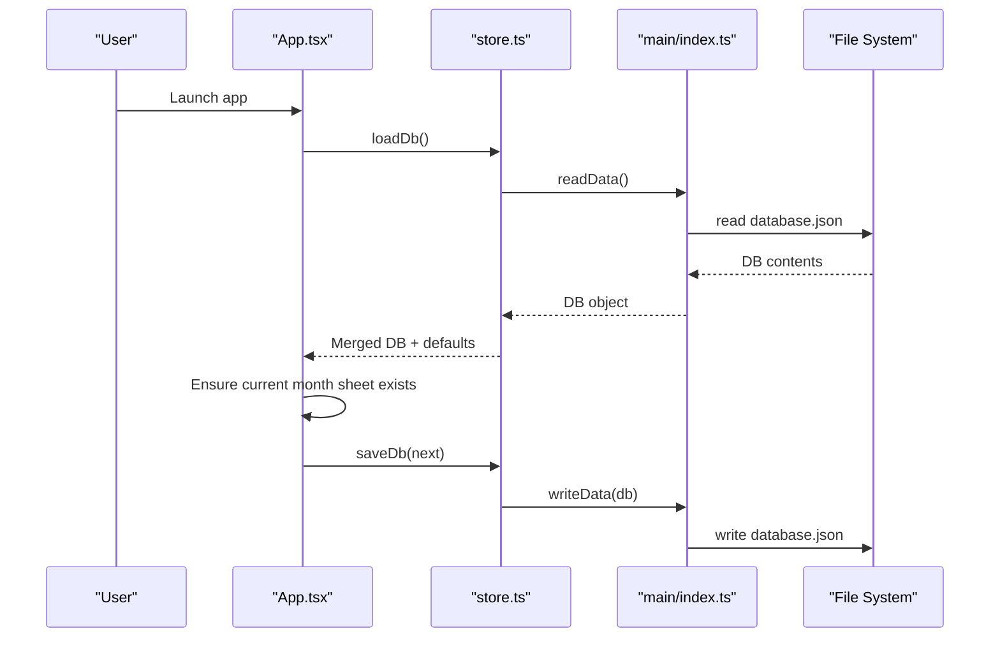
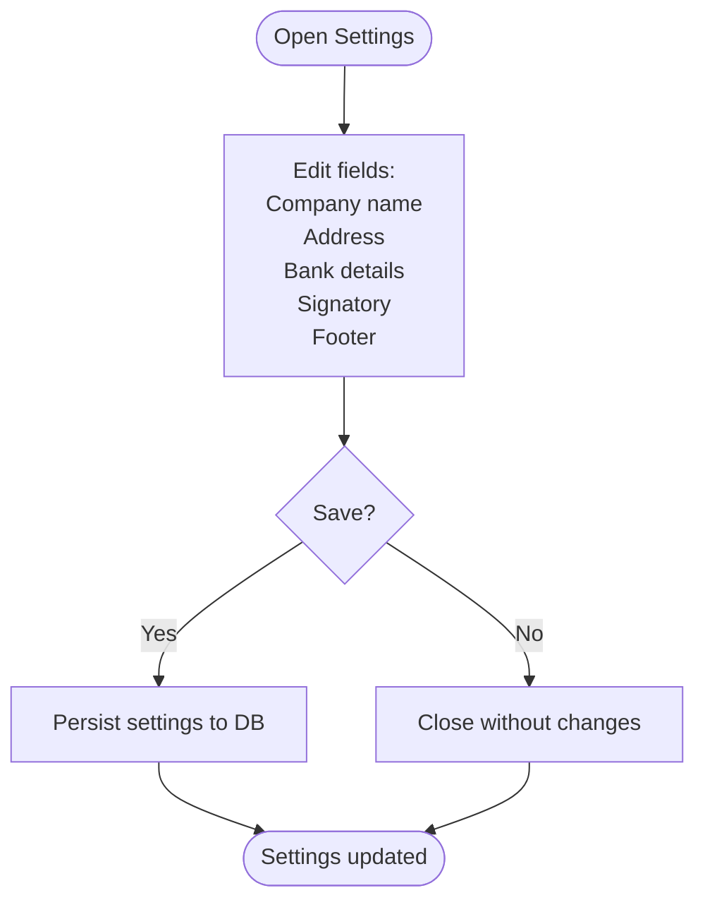
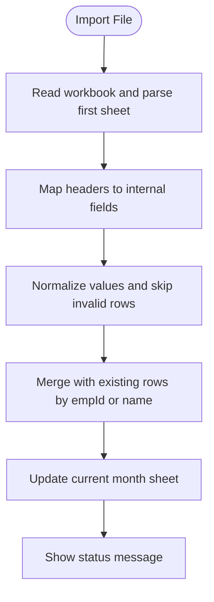
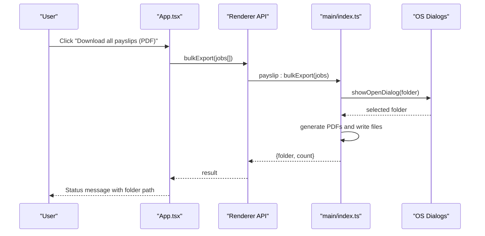

# Getting Started

<cite>
**Referenced Files in This Document**
- [README.md](file://README.md)
- [package.json](file://package.json)
- [electron.vite.config.js](file://electron.vite.config.js)
- [src/main/index.ts](file://src/main/index.ts)
- [src/renderer/src/App.tsx](file://src/renderer/src/App.tsx)
- [src/renderer/src/types.ts](file://src/renderer/src/types.ts)
- [src/renderer/src/lib/store.ts](file://src/renderer/src/lib/store.ts)
- [src/renderer/src/lib/importSheet.ts](file://src/renderer/src/lib/importSheet.ts)
</cite>

## Table of Contents
1. [Introduction](#introduction)
2. [System Requirements](#system-requirements)
3. [Installation](#installation)
4. [First Launch and Initial Setup](#first-launch-and-initial-setup)
5. [Basic Interface Overview](#basic-interface-overview)
6. [Essential Configuration](#essential-configuration)
7. [Add Your First Employee](#add-your-first-employee)
8. [Generate a Sample Payslip](#generate-a-sample-payslip)
9. [Troubleshooting](#troubleshooting)
10. [Additional Resources](#additional-resources)

## Introduction
Mabtech Payslip Generator is an offline desktop application built with Electron and React. It imports monthly salary sheets (Excel or CSV), shows a live payslip preview, and exports one payslip per employee as PDF or Word. All data remains on your local machine in a single JSON file. There is no internet requirement, no server, and no hosting.

Key capabilities:
- Import Excel/CSV salary sheets with automatic header matching
- Live preview of each employee’s payslip
- Export individual or bulk PDFs; export Word documents
- Configure company details and optional payment/bank lines
- Backup and restore your data

Data storage locations:
- Windows: `%APPDATA%\mabtech-payslip\data\database.json`
- Linux: `~/.config/mabtech-payslip/data/database.json`

**Section sources**
- [README.md:1-15](file://README.md#L1-L15)

## System Requirements
- Operating systems: Windows, macOS, Linux
- Runtime environment for development: Node.js-compatible toolchain via Bun
- Desktop environment capable of running Electron applications
- Sufficient disk space for the application bundle and generated files

Notes:
- The app uses Electron 31.x and React 18.x internally.
- Development scripts use Bun. If you prefer another package manager, adjust accordingly.

**Section sources**
- [package.json:29-35](file://package.json#L29-L35)
- [README.md:17-25](file://README.md#L17-L25)

## Installation

### Install from Source (Development)
Use Bun to install dependencies and run the app in development mode:
- Install dependencies: `bun install`
- Run the app: `bun run dev`

If your terminal has `ELECTRON_RUN_AS_NODE=1` set, prefix the command with `env -u ELECTRON_RUN_AS_NODE`.

### Build the Windows Installer
On a Windows machine:
- Install dependencies: `bun install`
- Build installer: `bun run dist:win`
- Output: `release\Mabtech Payslip Setup 1.0.0.exe`

Building the `.exe` from Linux requires Wine:
- Install Wine: `sudo apt install wine64`
- Build: `bun run dist:win`

The resulting installer is self-contained and can be copied to any Windows PC.

**Section sources**
- [README.md:17-37](file://README.md#L17-L37)
- [README.md:67-70](file://README.md#L67-L70)
- [package.json:9-14](file://package.json#L9-L14)

## First Launch and Initial Setup
When you launch the app for the first time:
- A main window opens with a top bar containing controls for month selection, working days, settings, backup, and restore.
- The app automatically creates a sheet for the current month if none exists.
- Data is stored locally in a JSON file under the platform-specific data directory.

What happens behind the scenes:
- On startup, the renderer loads the database and merges default settings.
- If the current month’s sheet does not exist, it is created with default working days and an empty row list.
- Changes are saved with a short debounce to avoid excessive writes.

**Diagram sources**
- [src/renderer/src/App.tsx:25-36](file://src/renderer/src/App.tsx#L25-L36)
- [src/renderer/src/lib/store.ts:8-18](file://src/renderer/src/lib/store.ts#L8-L18)
- [src/main/index.ts:27-41](file://src/main/index.ts#L27-L41)

**Section sources**
- [src/renderer/src/App.tsx:25-36](file://src/renderer/src/App.tsx#L25-L36)
- [src/renderer/src/lib/store.ts:8-18](file://src/renderer/src/lib/store.ts#L8-L18)
- [src/main/index.ts:27-41](file://src/main/index.ts#L27-L41)

## Basic Interface Overview
Top bar:
- Company logo/name area
- Salary month selector
- Working days input
- Settings button
- Backup and Restore buttons

Toolbar:
- Import Excel / CSV
- Add employee
- Export sheet CSV
- Count summary and payroll total
- Download all payslips (PDF)

Main area:
- Left pane: editable table of employees for the selected month
- Right pane: live preview of the selected employee’s payslip

Status line:
- Displays import results, warnings, and action confirmations

Warnings:
- Highlights employees with advances exceeding salary (negative net payable)
- Alerts when rows lack an employee code

**Section sources**
- [src/renderer/src/App.tsx:208-285](file://src/renderer/src/App.tsx#L208-L285)

## Essential Configuration
Open Settings to configure company information that appears on payslips:
- Company name on payslip
- Address (shown top-right)
- Payment/bank details line (optional)
- Signatory label
- Disclaimer footer

You can also open the data folder directly from the modal to inspect or back up the JSON file manually.

Important notes:
- Settings are merged with defaults on load.
- Changes are saved immediately when using the Save action in the modal.

**Diagram sources**
- [src/renderer/src/components/SettingsModal.tsx:11-41](file://src/renderer/src/components/SettingsModal.tsx#L11-L41)
- [src/renderer/src/types.ts:19-38](file://src/renderer/src/types.ts#L19-L38)

**Section sources**
- [src/renderer/src/components/SettingsModal.tsx:11-41](file://src/renderer/src/components/SettingsModal.tsx#L11-L41)
- [src/renderer/src/types.ts:19-38](file://src/renderer/src/types.ts#L19-L38)

## Add Your First Employee
You can add employees either by importing a salary sheet or by adding a row manually.

Option A: Import Excel/CSV
- Click Import Excel / CSV.
- Select a spreadsheet or CSV file.
- The importer auto-matches headers such as EMP ID, NAME, DESIGNATION, DEPARTMENT, SALARY, OT, PENDING LEAVE, BANK ADVANCE, CASH ADVANCE.
- Rows are merged into the current month’s sheet. New employees are added; existing ones are updated where possible.
- Status messages report how many were imported, new, updated, or skipped.

Option B: Manual Entry
- Click Add employee to create a blank row.
- Fill in required fields (at least NAME).
- Adjust numeric fields like SALARY, OT, PENDING LEAVE, BANK ADVANCE, CASH ADVANCE.

Header mapping highlights:
- The importer supports multiple aliases for each field.
- Gross/total columns are ignored because the app computes them.

**Diagram sources**
- [src/renderer/src/lib/importSheet.ts:4-31](file://src/renderer/src/lib/importSheet.ts#L4-L31)
- [src/renderer/src/lib/importSheet.ts:41-79](file://src/renderer/src/lib/importSheet.ts#L41-L79)
- [src/renderer/src/App.tsx:103-136](file://src/renderer/src/App.tsx#L103-L136)

**Section sources**
- [README.md:39-59](file://README.md#L39-L59)
- [src/renderer/src/lib/importSheet.ts:4-31](file://src/renderer/src/lib/importSheet.ts#L4-L31)
- [src/renderer/src/lib/importSheet.ts:41-79](file://src/renderer/src/lib/importSheet.ts#L41-L79)
- [src/renderer/src/App.tsx:103-136](file://src/renderer/src/App.tsx#L103-L136)

## Generate a Sample Payslip
After adding or importing employees:
- Select an employee in the table.
- Preview the payslip in the right pane.
- Choose an export method:
  - Download PDF for the selected employee
  - Download Word document for the selected employee
  - Download all payslips (PDF) for the entire month

Bulk PDF export:
- Click Download all payslips (PDF).
- Choose a destination folder.
- The app generates a dated folder named “Payslips YYYY-MM-DD” and opens it after completion.

Individual PDF export:
- Click the PDF action for a specific employee.
- Choose a location and filename.

Word export:
- Click the Word action for a specific employee.
- Choose a location and filename.

**Diagram sources**
- [src/renderer/src/App.tsx:162-173](file://src/renderer/src/App.tsx#L162-L173)
- [src/main/index.ts:156-174](file://src/main/index.ts#L156-L174)

**Section sources**
- [src/renderer/src/App.tsx:141-184](file://src/renderer/src/App.tsx#L141-L184)
- [src/main/index.ts:127-186](file://src/main/index.ts#L127-L186)

## Troubleshooting
Common issues and resolutions:

- Terminal error about `ELECTRON_RUN_AS_NODE`:
  - Cause: Environment variable forces Node execution instead of Electron.
  - Resolution: Prefix the dev command with `env -u ELECTRON_RUN_AS_NODE`.

- Cannot build Windows installer from Linux:
  - Cause: Missing Wine dependency.
  - Resolution: Install Wine (`sudo apt install wine64`) and rerun `bun run dist:win`.

- No employees appear after import:
  - Cause: Headers do not match expected names or aliases.
  - Resolution: Ensure at least NAME is present and other fields map to supported aliases. Check status messages for skipped rows.

- Negative net payable warnings:
  - Meaning: Advances exceed salary for some employees.
  - Action: Correct deductions or carry over balances before exporting.

- Data persistence:
  - Data is stored in a local JSON file. Use Backup to copy it elsewhere and Restore to load it on another PC.
  - You can open the data folder from Settings to inspect or manage the file manually.

**Section sources**
- [README.md:17-25](file://README.md#L17-L25)
- [README.md:27-37](file://README.md#L27-L37)
- [src/renderer/src/App.tsx:237-248](file://src/renderer/src/App.tsx#L237-L248)

## Additional Resources
- Data format and behavior:
  - Data storage paths and backup/restore guidance
  - Salary sheet header mapping and ignored columns
  - Formula used for gross/net calculations

- Build and packaging:
  - Scripts for development, building, and distribution
  - Electron configuration for Vite and React

**Section sources**
- [README.md:7-15](file://README.md#L7-L15)
- [README.md:39-65](file://README.md#L39-L65)
- [package.json:9-14](file://package.json#L9-L14)
- [electron.vite.config.js:1-10](file://electron.vite.config.js#L1-L10)