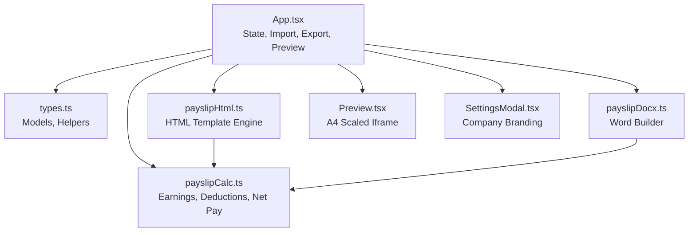
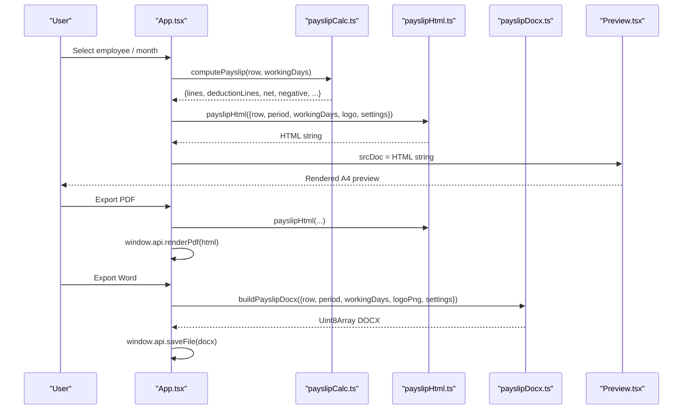
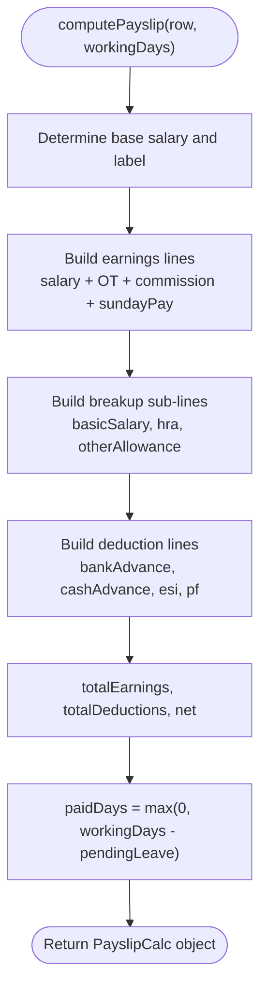
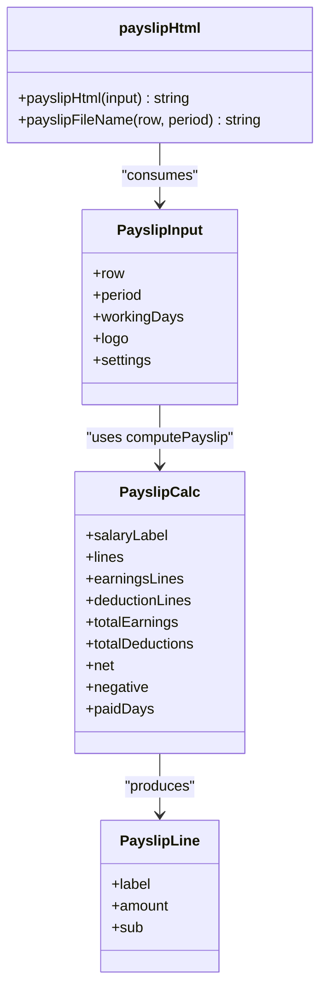
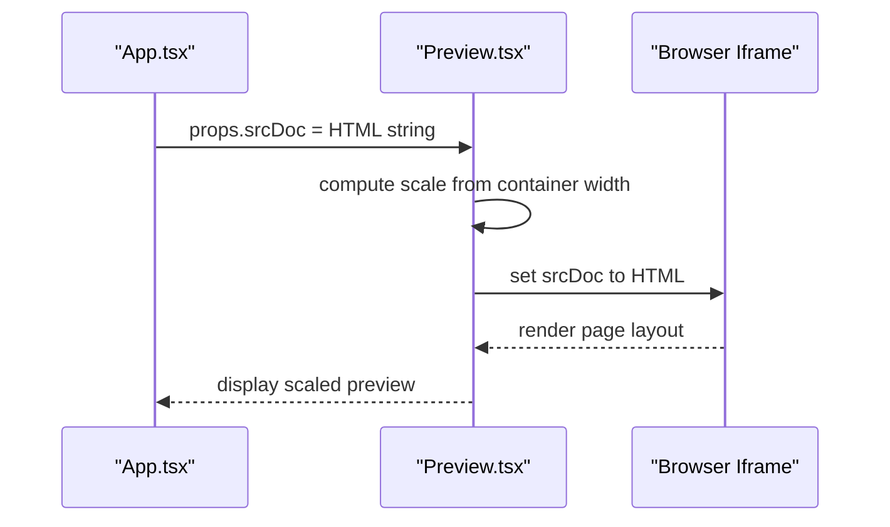
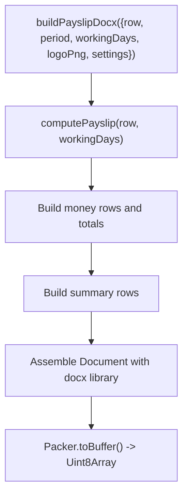
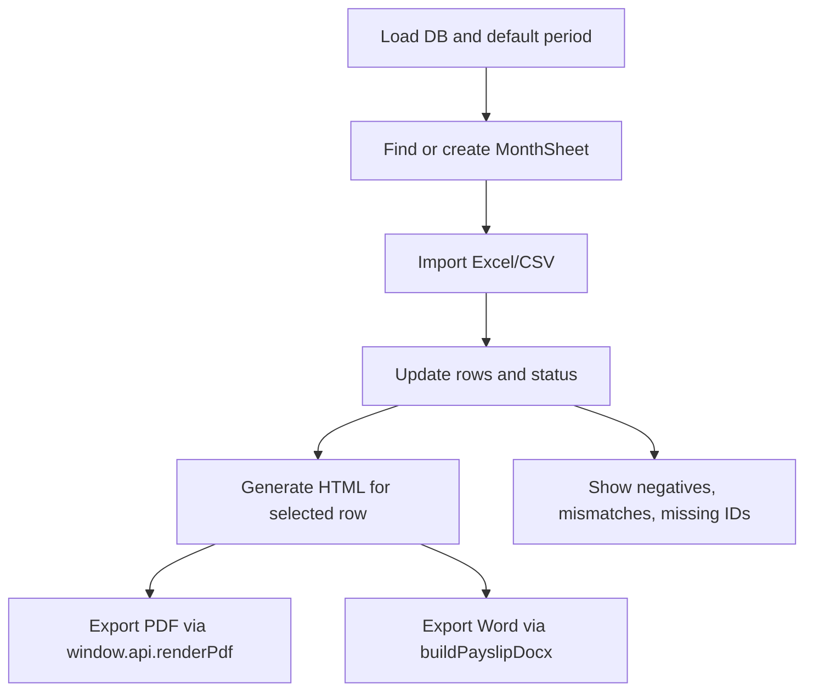
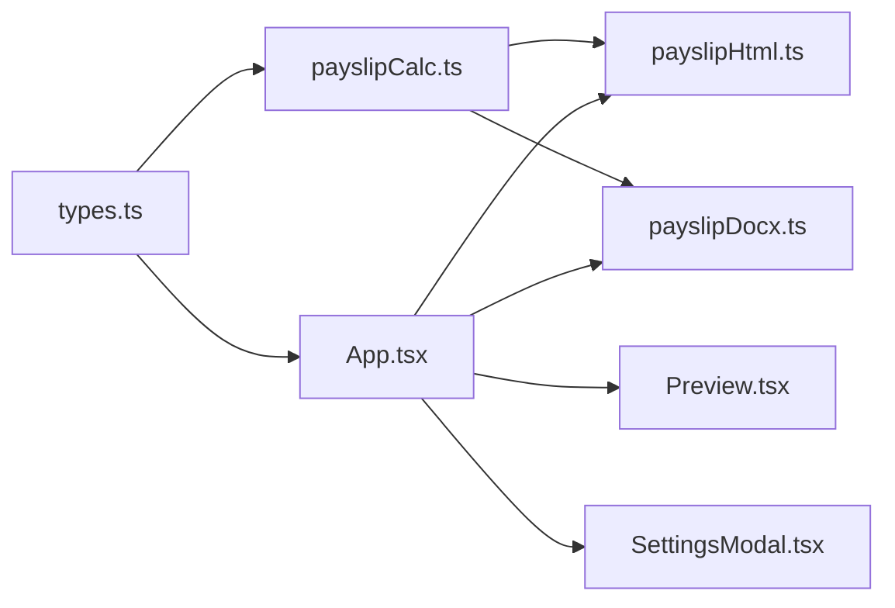

# Payslip Generation

<cite>
**Referenced Files in This Document**
- [README.md](file://README.md)
- [App.tsx](file://src/renderer/src/App.tsx)
- [types.ts](file://src/renderer/src/types.ts)
- [payslipCalc.ts](file://src/renderer/src/lib/payslipCalc.ts)
- [payslipHtml.ts](file://src/renderer/src/lib/payslipHtml.ts)
- [payslipDocx.ts](file://src/renderer/src/lib/payslipDocx.ts)
- [Preview.tsx](file://src/renderer/src/components/Preview.tsx)
- [SettingsModal.tsx](file://src/renderer/src/components/SettingsModal.tsx)
</cite>

## Table of Contents
1. [Introduction](#introduction)
2. [Project Structure](#project-structure)
3. [Core Components](#core-components)
4. [Architecture Overview](#architecture-overview)
5. [Detailed Component Analysis](#detailed-component-analysis)
6. [Dependency Analysis](#dependency-analysis)
7. [Performance Considerations](#performance-considerations)
8. [Troubleshooting Guide](#troubleshooting-guide)
9. [Conclusion](#conclusion)
10. [Appendices](#appendices)

## Introduction
This document explains the payslip generation system used by the Mabtech Payslip Generator. It covers:
- The HTML template engine that renders professional, print-ready payslips.
- How company branding and settings are applied to both screen previews and exported documents.
- The preview workflow that lets users review a payslip before exporting it as PDF or Word.
- The calculation engine that processes salary components, deductions, net pay, and amount-in-words formatting.
- Examples for customizing templates and handling complex salary structures with multiple allowances and deductions.

The application is an offline Electron + React desktop app. It imports monthly salary sheets, computes payslips, previews them live, and exports one payslip per employee as PDF or Word. All data remains local on the user’s machine.

**Section sources**
- [README.md:1-71](file://README.md#L1-L71)

## Project Structure
The payslip generation logic lives in the renderer layer:
- `App.tsx` orchestrates state, import, export, preview, and settings.
- `types.ts` defines the salary row model, settings, and shared helpers.
- `payslipCalc.ts` is the single source of truth for earnings, deductions, totals, and number formatting.
- `payslipHtml.ts` generates the HTML/CSS payslip template used by the preview and PDF export.
- `payslipDocx.ts` builds a Word document using the same calculation results.
- `Preview.tsx` renders the generated HTML inside a scaled iframe for accurate A4 preview.
- `SettingsModal.tsx` edits company branding and footer text.

**Diagram sources**
- [App.tsx:1-303](file://src/renderer/src/App.tsx#L1-L303)
- [types.ts:1-117](file://src/renderer/src/types.ts#L1-L117)
- [payslipCalc.ts:1-122](file://src/renderer/src/lib/payslipCalc.ts#L1-L122)
- [payslipHtml.ts:1-145](file://src/renderer/src/lib/payslipHtml.ts#L1-L145)
- [payslipDocx.ts:1-150](file://src/renderer/src/lib/payslipDocx.ts#L1-L150)
- [Preview.tsx:1-29](file://src/renderer/src/components/Preview.tsx#L1-L29)
- [SettingsModal.tsx:1-43](file://src/renderer/src/components/SettingsModal.tsx#L1-L43)

**Section sources**
- [App.tsx:1-303](file://src/renderer/src/App.tsx#L1-L303)
- [types.ts:1-117](file://src/renderer/src/types.ts#L1-L117)

## Core Components
- Calculation engine (`payslipCalc.ts`)
  - Computes earnings lines, deduction lines, total earnings, total deductions, net pay, paid days, and whether net is negative.
  - Formats amounts in Indian currency and converts numbers to words (Crore/Lakh/Thousand).
  - Treats Basic/HRA/Other Allowance as sub-lines of Monthly Salary rather than extra pay.
- HTML template engine (`payslipHtml.ts`)
  - Produces a complete HTML document with embedded CSS for A4 printing.
  - Uses computed values from `computePayslip`, so screen and paper always agree.
  - Applies company logo or name, address, period label, employee details, earnings/deductions table, net pay, amount in words, bank details, signature lines, and footer.
- Word builder (`payslipDocx.ts`)
  - Builds a DOCX document using the same calculation results.
  - Supports optional PNG logo and company settings.
- Preview component (`Preview.tsx`)
  - Renders the generated HTML inside a scaled iframe sized to A4 at 96 DPI.
  - Automatically rescales when the container changes size.
- Application controller (`App.tsx`)
  - Loads/saves database, imports salary sheets, updates rows, and triggers exports.
  - Generates HTML for preview and PDF export; builds DOCX for Word export.
  - Shows warnings for negative net pay, missing IDs, and break-up mismatches.
- Settings modal (`SettingsModal.tsx`)
  - Edits company name, address, bank details, authorized signatory, and footer text.

**Section sources**
- [payslipCalc.ts:1-122](file://src/renderer/src/lib/payslipCalc.ts#L1-L122)
- [payslipHtml.ts:1-145](file://src/renderer/src/lib/payslipHtml.ts#L1-L145)
- [payslipDocx.ts:1-150](file://src/renderer/src/lib/payslipDocx.ts#L1-L150)
- [Preview.tsx:1-29](file://src/renderer/src/components/Preview.tsx#L1-L29)
- [App.tsx:1-303](file://src/renderer/src/App.tsx#L1-L303)
- [SettingsModal.tsx:1-43](file://src/renderer/src/components/SettingsModal.tsx#L1-L43)

## Architecture Overview
The system follows a clear separation between computation and presentation:
- Computation is centralized in `payslipCalc.ts`.
- Presentation is split into two outputs:
  - HTML/CSS for screen preview and PDF rendering.
  - DOCX structure for Word export.
- The UI coordinates data import, editing, preview, and export.

**Diagram sources**
- [App.tsx:144-166](file://src/renderer/src/App.tsx#L144-L166)
- [payslipCalc.ts:77-121](file://src/renderer/src/lib/payslipCalc.ts#L77-L121)
- [payslipHtml.ts:17-141](file://src/renderer/src/lib/payslipHtml.ts#L17-L141)
- [payslipDocx.ts:50-148](file://src/renderer/src/lib/payslipDocx.ts#L50-L148)
- [Preview.tsx:19-26](file://src/renderer/src/components/Preview.tsx#L19-L26)

## Detailed Component Analysis

### Calculation Engine
The calculation engine is the single source of truth for all payslip figures. It:
- Determines the base salary label: “Monthly Salary” when a salary column exists, otherwise “Basic Salary”.
- Adds additive earnings such as overtime, commission, and Sunday work only when they have positive values.
- Shows Basic/HRA/Other Allowance as sub-lines under the salary line, not as additional pay.
- Adds deductions like Bank Advance, Cash Advance, ESI, and PF, always treating them as positive reductions.
- Computes total earnings, total deductions, and net pay.
- Calculates paid days by subtracting pending leave from working days.
- Provides formatted currency strings and English words for the net amount.

**Diagram sources**
- [payslipCalc.ts:77-121](file://src/renderer/src/lib/payslipCalc.ts#L77-L121)

Key behaviors:
- Additive fields are defined explicitly; non-additive break-up fields are never double-counted.
- Negative net pay is flagged and labeled “Net Salary Recoverable.”
- Amounts are formatted consistently across HTML and Word outputs.

**Section sources**
- [payslipCalc.ts:1-122](file://src/renderer/src/lib/payslipCalc.ts#L1-L122)
- [types.ts:66-117](file://src/renderer/src/types.ts#L66-L117)

### HTML Template Engine
The HTML template engine produces a self-contained HTML document with embedded styles suitable for A4 printing and PDF conversion. It:
- Calls `computePayslip` to obtain earnings, deductions, totals, and net pay.
- Escapes dynamic content to avoid injection issues.
- Renders a header with either a company logo image or company name, plus period and optional address.
- Displays employee metadata: code, name, department, designation, working days, paid days, pending leave, and overtime.
- Builds a two-column table pairing earnings and deductions, including sub-lines for salary breakdown.
- Shows total earnings and total deductions.
- Highlights negative net pay and shows the amount in words.
- Optionally prints bank details and signature lines.
- Includes a footer with disclaimer and generation date.

**Diagram sources**
- [payslipHtml.ts:9-15](file://src/renderer/src/lib/payslipHtml.ts#L9-L15)
- [payslipHtml.ts:17-141](file://src/renderer/src/lib/payslipHtml.ts#L17-L141)
- [payslipCalc.ts:39-75](file://src/renderer/src/lib/payslipCalc.ts#L39-L75)

Branding and customization:
- Company logo is rendered if provided; otherwise, the company name is shown.
- Company address appears below the title when configured.
- Authorized signatory label and footer text come from settings.
- Bank details can be printed as a multi-line note.

**Section sources**
- [payslipHtml.ts:1-145](file://src/renderer/src/lib/payslipHtml.ts#L1-L145)

### Preview Functionality
The preview component renders the generated HTML in an iframe and scales it to fit the available space while preserving A4 proportions. It:
- Sets a fixed A4 width in pixels based on 96 DPI.
- Observes container resize events and recalculates scale.
- Wraps the iframe in a transform-scaled container to maintain aspect ratio.

**Diagram sources**
- [Preview.tsx:1-29](file://src/renderer/src/components/Preview.tsx#L1-L29)
- [App.tsx:279-285](file://src/renderer/src/App.tsx#L279-L285)

**Section sources**
- [Preview.tsx:1-29](file://src/renderer/src/components/Preview.tsx#L1-L29)

### Word Export Builder
The Word builder constructs a DOCX document using the same calculation results as the HTML template. It:
- Builds summary rows for employee details and component amounts.
- Creates an earnings/deductions table with aligned columns.
- Adds a note about salary components when applicable.
- Prints net pay and amount in words.
- Optionally includes bank details and signature placeholders.
- Embeds a PNG logo when provided; otherwise, uses the company name.

**Diagram sources**
- [payslipDocx.ts:50-148](file://src/renderer/src/lib/payslipDocx.ts#L50-L148)

**Section sources**
- [payslipDocx.ts:1-150](file://src/renderer/src/lib/payslipDocx.ts#L1-L150)

### Application Controller and Data Flow
`App.tsx` ties everything together:
- Loads the local database and ensures a sheet exists for the current period.
- Imports Excel/CSV files, merges existing rows, and updates the active sheet.
- Generates HTML for preview and PDF export.
- Builds DOCX for Word export.
- Exports CSV, backs up, and restores data.
- Shows warnings for negative net pay, missing employee IDs, and mismatched salary break-ups.

**Diagram sources**
- [App.tsx:25-48](file://src/renderer/src/App.tsx#L25-L48)
- [App.tsx:103-142](file://src/renderer/src/App.tsx#L103-L142)
- [App.tsx:144-179](file://src/renderer/src/App.tsx#L144-L179)
- [App.tsx:244-262](file://src/renderer/src/App.tsx#L244-L262)

**Section sources**
- [App.tsx:1-303](file://src/renderer/src/App.tsx#L1-L303)

## Dependency Analysis
The following diagram shows how modules depend on each other during payslip generation:

**Diagram sources**
- [types.ts:1-117](file://src/renderer/src/types.ts#L1-L117)
- [payslipCalc.ts:1-122](file://src/renderer/src/lib/payslipCalc.ts#L1-L122)
- [payslipHtml.ts:1-145](file://src/renderer/src/lib/payslipHtml.ts#L1-L145)
- [payslipDocx.ts:1-150](file://src/renderer/src/lib/payslipDocx.ts#L1-L150)
- [App.tsx:1-303](file://src/renderer/src/App.tsx#L1-L303)
- [Preview.tsx:1-29](file://src/renderer/src/components/Preview.tsx#L1-L29)
- [SettingsModal.tsx:1-43](file://src/renderer/src/components/SettingsModal.tsx#L1-L43)

Coupling and cohesion:
- `payslipCalc.ts` is cohesive and independent of UI concerns.
- `payslipHtml.ts` and `payslipDocx.ts` depend only on `payslipCalc.ts` and types, ensuring consistent output.
- `App.tsx` is the integration point but delegates computation and formatting to dedicated modules.

Potential circular dependencies:
- None observed; imports flow from UI toward calculation and formatting modules.

External integrations:
- Electron APIs accessed through `window.api` for file dialogs, PDF rendering, and file saving.
- DOCX library used to build Word documents.

**Section sources**
- [App.tsx:1-303](file://src/renderer/src/App.tsx#L1-L303)
- [payslipCalc.ts:1-122](file://src/renderer/src/lib/payslipCalc.ts#L1-L122)
- [payslipHtml.ts:1-145](file://src/renderer/src/lib/payslipHtml.ts#L1-L145)
- [payslipDocx.ts:1-150](file://src/renderer/src/lib/payslipDocx.ts#L1-L150)

## Performance Considerations
- Calculation is lightweight and runs synchronously per row.
- HTML generation is synchronous and suitable for single-row preview and batch PDF export.
- DOCX building is asynchronous due to packing; bulk export should be used judiciously for large datasets.
- Preview scaling uses ResizeObserver to avoid unnecessary reflows.
- Avoid excessive DOM updates by batching UI changes where possible.

[No sources needed since this section provides general guidance]

## Troubleshooting Guide
Common issues and resolutions:
- No employees imported:
  - Ensure the spreadsheet contains recognized headers such as EMP ID, NAME, SALARY.
  - Check status messages for skipped rows, unmapped columns, or duplicates.
- Negative net pay:
  - Deductions exceed earnings; the app labels it “Net Salary Recoverable.”
  - Review advances and statutory deductions; correct before exporting.
- Missing employee IDs:
  - The app warns about rows without an employee code.
  - Fill in EMP ID to ensure unique identification.
- Mismatched salary break-up:
  - When Basic + HRA + Other Allowance does not equal the monthly salary, the app warns that net follows the salary column, not the break-up.
  - Align break-up values with the salary column or remove break-up fields if not applicable.
- Preview not visible:
  - Select an employee row to generate HTML for preview.
  - Verify that the container has sufficient width for A4 scaling.

**Section sources**
- [App.tsx:103-142](file://src/renderer/src/App.tsx#L103-L142)
- [App.tsx:244-262](file://src/renderer/src/App.tsx#L244-L262)
- [README.md:39-65](file://README.md#L39-L65)

## Conclusion
The payslip generation system separates concerns cleanly:
- A single calculation module guarantees consistency across outputs.
- The HTML template engine delivers a professional, branded, print-ready payslip.
- The preview component provides accurate A4 visualization before export.
- The Word builder mirrors the HTML structure using the same calculations.
- Settings allow flexible branding and footer customization.
By following the documented flows and configuration options, users can handle complex salary structures, customize payslip appearance, and reliably export PDFs and Word documents.

[No sources needed since this section summarizes without analyzing specific files]

## Appendices

### Customization Examples

- Applying company branding:
  - Set company name, address, authorized signatory, and footer in the settings modal.
  - Provide a logo to appear at the top of the payslip; otherwise, the company name is displayed.
  - Add bank details to include payment instructions on the payslip.

- Handling complex salary structures:
  - Use the salary column as the base monthly pay.
  - Add overtime, commission, and Sunday work as separate earnings lines.
  - Show Basic/HRA/Other Allowance as sub-lines under Monthly Salary to avoid double-paying.
  - Include Bank Advance, Cash Advance, ESI, and PF as deductions.
  - Adjust working days and pending leave to reflect actual attendance.

- Generating outputs:
  - Preview the selected employee’s payslip in the right pane.
  - Export a single PDF or Word document per employee.
  - Use bulk export to generate all PDFs for the current month.

**Section sources**
- [SettingsModal.tsx:11-40](file://src/renderer/src/components/SettingsModal.tsx#L11-L40)
- [payslipCalc.ts:46-63](file://src/renderer/src/lib/payslipCalc.ts#L46-L63)
- [payslipCalc.ts:77-121](file://src/renderer/src/lib/payslipCalc.ts#L77-L121)
- [App.tsx:144-179](file://src/renderer/src/App.tsx#L144-L179)