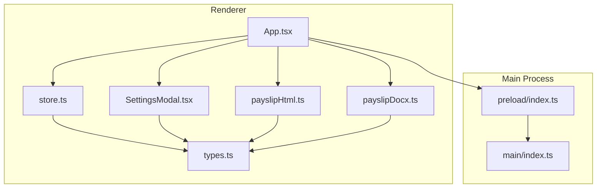
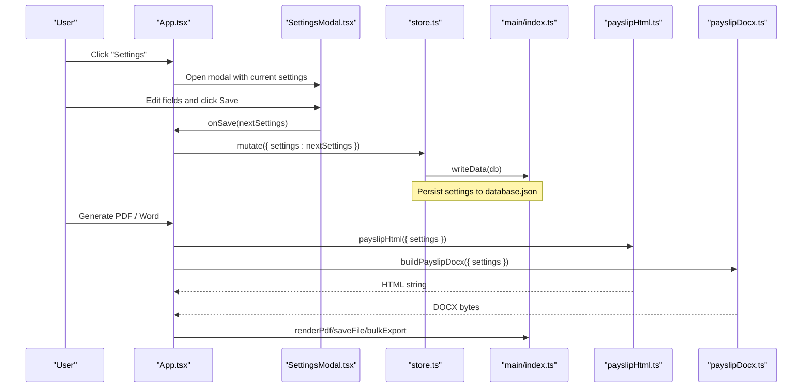
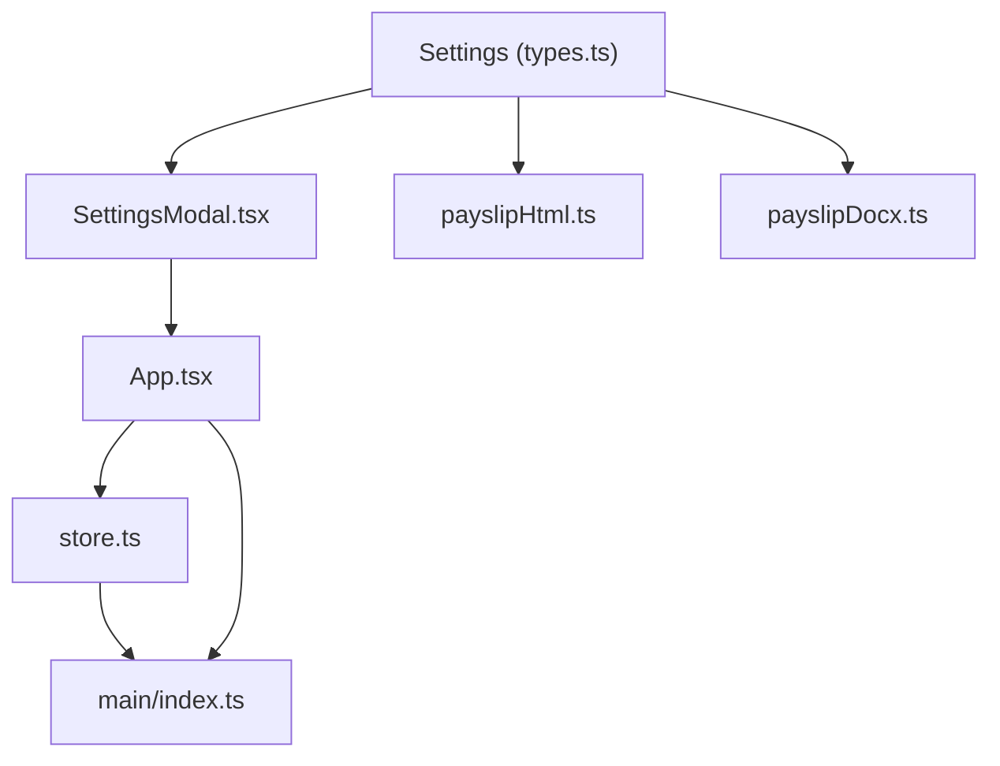

# Settings and Customization

<cite>
**Referenced Files in This Document**
- [App.tsx](file://src/renderer/src/App.tsx)
- [SettingsModal.tsx](file://src/renderer/src/components/SettingsModal.tsx)
- [types.ts](file://src/renderer/src/types.ts)
- [store.ts](file://src/renderer/src/lib/store.ts)
- [payslipHtml.ts](file://src/renderer/src/lib/payslipHtml.ts)
- [payslipDocx.ts](file://src/renderer/src/lib/payslipDocx.ts)
- [index.ts](file://src/main/index.ts)
- [preload/index.ts](file://src/preload/index.ts)
- [README.md](file://README.md)
</cite>

## Table of Contents
1. [Introduction](#introduction)
2. [Project Structure](#project-structure)
3. [Core Components](#core-components)
4. [Architecture Overview](#architecture-overview)
5. [Detailed Component Analysis](#detailed-component-analysis)
6. [Dependency Analysis](#dependency-analysis)
7. [Performance Considerations](#performance-considerations)
8. [Troubleshooting Guide](#troubleshooting-guide)
9. [Conclusion](#conclusion)
10. [Appendices](#appendices)

## Introduction
This document explains how to configure application settings and customize payslip output. It covers:
- Company information setup (company name, address, bank details, signatory label, footer text)
- How the logo is loaded and displayed
- Template customization options visible in the UI and generated outputs
- Advanced behavior such as default export formats, file naming patterns, and regional formatting
- Examples of common customization scenarios and their effect on final PDF and Word payslips

The app stores all data locally on your PC in a JSON database file. Settings are persisted alongside monthly salary sheets.

**Section sources**
- [README.md:7-15](file://README.md#L7-L15)

## Project Structure
The settings system spans the renderer UI, type definitions, persistence layer, and export generators:
- Renderer UI provides the Settings modal and passes settings into HTML and Word exports
- Types define the Settings shape and defaults
- Store merges defaults with saved settings and persists changes
- Export modules render company info, footer, and signatory fields into PDFs and Word documents
- Main process handles local file I/O and exposes IPC methods for reading/writing data and opening the data folder

**Diagram sources**
- [App.tsx:1-303](file://src/renderer/src/App.tsx#L1-L303)
- [SettingsModal.tsx:1-43](file://src/renderer/src/components/SettingsModal.tsx#L1-L43)
- [types.ts:26-45](file://src/renderer/src/types.ts#L26-L45)
- [store.ts:37-47](file://src/renderer/src/lib/store.ts#L37-L47)
- [payslipHtml.ts:17-145](file://src/renderer/src/lib/payslipHtml.ts#L17-L145)
- [payslipDocx.ts:50-149](file://src/renderer/src/lib/payslipDocx.ts#L50-L149)
- [index.ts:91-195](file://src/main/index.ts#L91-L195)
- [preload/index.ts:1-25](file://src/preload/index.ts#L1-L25)

**Section sources**
- [App.tsx:1-303](file://src/renderer/src/App.tsx#L1-L303)
- [SettingsModal.tsx:1-43](file://src/renderer/src/components/SettingsModal.tsx#L1-L43)
- [types.ts:26-45](file://src/renderer/src/types.ts#L26-L45)
- [store.ts:37-47](file://src/renderer/src/lib/store.ts#L37-L47)
- [payslipHtml.ts:17-145](file://src/renderer/src/lib/payslipHtml.ts#L17-L145)
- [payslipDocx.ts:50-149](file://src/renderer/src/lib/payslipDocx.ts#L50-L149)
- [index.ts:91-195](file://src/main/index.ts#L91-L195)
- [preload/index.ts:1-25](file://src/preload/index.ts#L1-L25)

## Core Components
- Settings model: Defines company name, address, bank details, footer text, and authorized signatory label. Defaults are provided and merged with saved values.
- Settings UI: A modal that lets you edit these fields and save them immediately.
- Persistence: The store loads existing settings from disk and merges them with defaults; saves are debounced and flushed on close.
- Logo handling: The main process reads a bundled PNG and returns it as a base64 data URL to the renderer.
- Export integration: Both HTML-to-PDF and Word builders consume settings to render header, address, bank details, signatory line, and footer.

Key behaviors:
- If no logo exists at runtime, the company name is shown as styled text instead.
- Bank details appear only when configured.
- Footer text appears at the bottom of both PDF and Word payslips.
- Authorized signatory label appears next to the signature line.

**Section sources**
- [types.ts:26-45](file://src/renderer/src/types.ts#L26-L45)
- [SettingsModal.tsx:11-42](file://src/renderer/src/components/SettingsModal.tsx#L11-L42)
- [store.ts:37-47](file://src/renderer/src/lib/store.ts#L37-L47)
- [index.ts:6-15](file://src/main/index.ts#L6-L15)
- [payslipHtml.ts:92-139](file://src/renderer/src/lib/payslipHtml.ts#L92-L139)
- [payslipDocx.ts:92-143](file://src/renderer/src/lib/payslipDocx.ts#L92-L143)

## Architecture Overview
The settings flow connects user input, persistence, and export generation:

**Diagram sources**
- [App.tsx:288-299](file://src/renderer/src/App.tsx#L288-L299)
- [store.ts:45-47](file://src/renderer/src/lib/store.ts#L45-L47)
- [index.ts:95-101](file://src/main/index.ts#L95-L101)
- [payslipHtml.ts:17-145](file://src/renderer/src/lib/payslipHtml.ts#L17-L145)
- [payslipDocx.ts:50-149](file://src/renderer/src/lib/payslipDocx.ts#L50-L149)

## Detailed Component Analysis

### Company Information Setup
You can configure:
- Company name: Shown in the payslip header if no logo is present.
- Company address: Printed below the header when provided.
- Bank details: Optional payment/bank line printed near the net amount.
- Authorized signatory: Label used beside the signature line.
- Payslip footer: Disclaimer or note printed at the bottom.

Where they appear:
- HTML/PDF: Header shows logo or company name; address appears under the header; bank details appear after the amount-in-words section; footer appears at the bottom.
- Word: Similar structure; logo takes precedence if present; otherwise company name is rendered.

Example scenarios:
- Add a bank transfer line so employees know where to deposit or receive payments.
- Update the footer to include a compliance statement.
- Change the signatory label to match your organization’s convention.

Impact on output:
- Without a logo, the company name becomes the visual header.
- Leaving bank details empty hides that section.
- Footer text always appears at the bottom of each payslip.

**Section sources**
- [types.ts:26-45](file://src/renderer/src/types.ts#L26-L45)
- [SettingsModal.tsx:22-38](file://src/renderer/src/components/SettingsModal.tsx#L22-L38)
- [payslipHtml.ts:92-139](file://src/renderer/src/lib/payslipHtml.ts#L92-L139)
- [payslipDocx.ts:92-143](file://src/renderer/src/lib/payslipDocx.ts#L92-L143)

### Logo Upload and Display
- The app looks for a bundled PNG named mabtech-logo.png inside the resources directory.
- If found, it is embedded as a base64 data URL and displayed in the payslip header.
- If not found, the company name is displayed as styled text instead.

How to customize:
- Replace the bundled PNG with your own logo image while keeping the same filename and format.
- Ensure the file is included in the packaged app’s resources directory.

Effect on output:
- With logo: Header displays the logo image.
- Without logo: Header displays the company name.

**Section sources**
- [index.ts:6-15](file://src/main/index.ts#L6-L15)
- [App.tsx:35-36](file://src/renderer/src/App.tsx#L35-L36)
- [payslipHtml.ts:92-99](file://src/renderer/src/lib/payslipHtml.ts#L92-L99)
- [payslipDocx.ts:97-104](file://src/renderer/src/lib/payslipDocx.ts#L97-L104)

### Template Customization Options
Visible in the Settings modal:
- Company name on payslip
- Address (shown top-right of payslip)
- Payment/bank details line (optional)
- Signatory label
- Disclaimer note (footer)

Layout preferences:
- Working days per month: Configurable per period and affects paid days calculation.
- Period selection: Choose the salary month to preview and export.

Color scheme and branding:
- Colors and layout are fixed in the templates (HTML/CSS and DOCX builder).
- Branding is primarily controlled by logo presence and company name display.

Note: There are no UI controls for changing colors or layout beyond what is already defined in the templates.

**Section sources**
- [SettingsModal.tsx:22-38](file://src/renderer/src/components/SettingsModal.tsx#L22-L38)
- [App.tsx:221-228](file://src/renderer/src/App.tsx#L221-L228)
- [payslipHtml.ts:46-91](file://src/renderer/src/lib/payslipHtml.ts#L46-L91)
- [payslipDocx.ts:8-18](file://src/renderer/src/lib/payslipDocx.ts#L8-L18)

### Advanced Settings and Behavior

#### Default Export Formats
- Single employee PDF: Uses the built-in PDF generator via the main process.
- Single employee Word: Uses the DOCX builder and saves as .docx.
- Bulk export: Generates one PDF per employee into a selected folder.

These behaviors are triggered by UI actions and do not require additional configuration.

**Section sources**
- [App.tsx:147-179](file://src/renderer/src/App.tsx#L147-L179)
- [index.ts:156-186](file://src/main/index.ts#L156-L186)

#### File Naming Patterns
- Individual PDFs and Word files use a pattern based on employee ID, employee name, and period.
- Bulk PDFs are written into a folder named with the current date.

Pattern highlights:
- Spaces in names are collapsed or replaced to ensure safe filenames.
- Employee ID is preferred when available; otherwise, a fallback is used.

**Section sources**
- [payslipHtml.ts:143-145](file://src/renderer/src/lib/payslipHtml.ts#L143-L145)
- [index.ts:43](file://src/main/index.ts#L43)
- [index.ts:156-173](file://src/main/index.ts#L156-L173)

#### Regional Settings
- Currency formatting uses INR conventions in generated outputs.
- Date formatting for “Generated” timestamp uses en-GB locale in HTML.
- Period labels are formatted as Month Year using English month names.

**Section sources**
- [payslipHtml.ts:136-139](file://src/renderer/src/lib/payslipHtml.ts#L136-L139)
- [types.ts:111-116](file://src/renderer/src/types.ts#L111-L116)

### Data Storage and Backup
- All data (sheets and settings) is stored in a single JSON file under the app’s user data directory.
- Paths differ by OS but are consistent within each platform.
- Backup and restore functions allow exporting/importing the entire database.

Common tasks:
- Open the data folder to inspect or back up database.json manually.
- Use Backup/Restore buttons to move data between machines.

**Section sources**
- [README.md:7-15](file://README.md#L7-L15)
- [index.ts:22-41](file://src/main/index.ts#L22-L41)
- [index.ts:103-125](file://src/main/index.ts#L103-L125)
- [App.tsx:192-205](file://src/renderer/src/App.tsx#L192-L205)

## Dependency Analysis
Settings affect multiple parts of the system:

- Changes to settings propagate to both HTML and DOCX generators.
- The store ensures defaults are applied and persisted.
- The main process handles file operations and exposes IPC endpoints.

**Diagram sources**
- [types.ts:26-45](file://src/renderer/src/types.ts#L26-L45)
- [SettingsModal.tsx:11-42](file://src/renderer/src/components/SettingsModal.tsx#L11-L42)
- [payslipHtml.ts:17-145](file://src/renderer/src/lib/payslipHtml.ts#L17-L145)
- [payslipDocx.ts:50-149](file://src/renderer/src/lib/payslipDocx.ts#L50-L149)
- [store.ts:37-47](file://src/renderer/src/lib/store.ts#L37-L47)
- [index.ts:95-101](file://src/main/index.ts#L95-L101)

**Section sources**
- [types.ts:26-45](file://src/renderer/src/types.ts#L26-L45)
- [store.ts:37-47](file://src/renderer/src/lib/store.ts#L37-L47)
- [index.ts:95-101](file://src/main/index.ts#L95-L101)

## Performance Considerations
- Settings are small and loaded once at startup; merging defaults is negligible.
- Debounced saves reduce frequent disk writes during editing.
- Bulk PDF export processes each payslip sequentially; large batches may take time proportional to the number of employees.

Recommendations:
- Keep settings concise to avoid unnecessary reflows in previews.
- For bulk exports, choose a destination folder with sufficient free space.

[No sources needed since this section provides general guidance]

## Troubleshooting Guide
- Settings not appearing in exported files:
  - Verify you clicked Save in the Settings modal.
  - Check that the data folder contains updated settings.
- Logo not showing:
  - Confirm the logo PNG exists in the resources directory and is readable.
- Bank details missing:
  - Ensure the bank details field is filled in Settings.
- Footer not visible:
  - Footer is always rendered; verify the text is not blank.
- File naming issues:
  - Names are sanitized; spaces are collapsed or replaced.
- Data corruption or unexpected values:
  - Use Backup/Restore to recover a known-good state.

**Section sources**
- [App.tsx:288-299](file://src/renderer/src/App.tsx#L288-L299)
- [index.ts:6-15](file://src/main/index.ts#L6-L15)
- [index.ts:103-125](file://src/main/index.ts#L103-L125)
- [payslipHtml.ts:143-145](file://src/renderer/src/lib/payslipHtml.ts#L143-L145)

## Conclusion
The application’s settings provide essential customization for company identity and payslip presentation. While color schemes and layout are fixed, you can control company branding through the logo and company name, add bank details, set a signatory label, and include a footer disclaimer. File naming and export behaviors are standardized to ensure consistency across PDF and Word outputs. Use backup and restore features to manage data safely across devices.

[No sources needed since this section summarizes without analyzing specific files]

## Appendices

### Settings Fields Reference
- Company name: Header text when no logo is present.
- Company address: Printed below the header.
- Bank details: Optional payment/bank line near the net amount.
- Authorized signatory: Label beside the signature line.
- Payslip footer: Disclaimer or note at the bottom.

**Section sources**
- [types.ts:26-45](file://src/renderer/src/types.ts#L26-L45)
- [SettingsModal.tsx:22-38](file://src/renderer/src/components/SettingsModal.tsx#L22-L38)