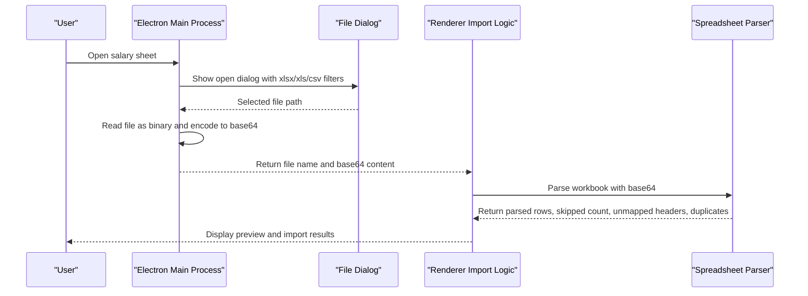

# Spreadsheet Import

<cite>
**Referenced Files in This Document**
- [importSheet.ts](file://src/renderer/src/lib/importSheet.ts)
- [types.ts](file://src/renderer/src/types.ts)
- [index.ts](file://src/main/index.ts)
- [README.md](file://README.md)
</cite>

## Table of Contents
1. [Introduction](#introduction)
2. [Supported Formats and Requirements](#supported-formats-and-requirements)
3. [Automatic Header Mapping System](#automatic-header-mapping-system)
4. [Customizing Field Mappings](#customizing-field-mappings)
5. [Input File Examples](#input-file-examples)
6. [Data Validation During Import](#data-validation-during-import)
7. [Error Handling for Malformed Data](#error-handling-for-malformed-data)
8. [Handling Missing or Invalid Values](#handling-missing-or-invalid-values)
9. [Advanced Import Options](#advanced-import-options)
10. [Import Workflow Overview](#import-workflow-overview)
11. [Troubleshooting Guide](#troubleshooting-guide)
12. [Conclusion](#conclusion)

## Introduction
This document explains the spreadsheet import functionality used by the payslip application. It covers supported file formats, automatic header mapping, customization options, validation rules, error handling, and advanced formatting behavior. The goal is to help you prepare salary spreadsheets that import cleanly and produce accurate payslips.

## Supported Formats and Requirements
The application supports:
- Excel files: `.xlsx` and `.xls`
- CSV files: `.csv`

The Electron main process opens a file dialog that filters these extensions when importing a salary sheet. Internally, Excel files are parsed using the `xlsx` library, while CSV export is implemented with a simple CSV writer.

Key points:
- Each month should be in its own sheet when using Excel.
- The importer reads the first sheet automatically.
- CSV export uses a fixed column order and quoting rules.

**Section sources**
- [index.ts:127-135](file://src/main/index.ts#L127-L135)
- [importSheet.ts:1-2](file://src/renderer/src/lib/importSheet.ts#L1-L2)
- [importSheet.ts:68-72](file://src/renderer/src/lib/importSheet.ts#L68-L72)
- [importSheet.ts:121-133](file://src/renderer/src/lib/importSheet.ts#L121-L133)

## Automatic Header Mapping System
The importer does not require columns to appear in a specific order. Instead, it maps headers to internal fields using an alias system.

How mapping works:
- Headers are normalized by lowercasing and removing non-alphanumeric characters.
- A predefined set of aliases maps many common header names to internal fields such as employee ID, name, designation, department, salary components, overtime, leave days, and deductions.
- If no exact alias matches, the system tries substring matching and prefers the longest matching alias to avoid shorter aliases swallowing longer ones.
- Certain computed or ignored headers are skipped entirely.

Ignored headers include terms like gross, total, net, payable, remarks, note, and balance amount. These are not imported because the app computes totals itself.

Internal field types:
- Text fields: employee ID, name, designation, department.
- Numeric money fields: monthly salary, basic salary, HRA, other allowance, overtime, commission, Sunday pay, pending leave, bank advance, cash advance, ESI deduction, PF deduction.

**Section sources**
- [importSheet.ts:4-21](file://src/renderer/src/lib/importSheet.ts#L4-L21)
- [importSheet.ts:23-31](file://src/renderer/src/lib/importSheet.ts#L23-L31)
- [importSheet.ts:33-48](file://src/renderer/src/lib/importSheet.ts#L33-L48)
- [types.ts:1-18](file://src/renderer/src/types.ts#L1-L18)
- [types.ts:66-91](file://src/renderer/src/types.ts#L66-L91)

## Customizing Field Mappings
The current implementation uses a fixed alias map inside the importer. There is no user-facing configuration UI for customizing mappings. To customize mappings, you would need to modify the alias definitions in the source code.

Practical guidance:
- Use one of the recognized aliases for your column headers so they map correctly without changes.
- Keep headers concise and unambiguous; long or unusual headers may fall back to substring matching and can sometimes match unintended fields.
- Avoid adding extra “computed” columns such as gross or net in the input file; the app calculates those values.

If you must support a new header variant:
- Add the new alias to the field alias map in the importer.
- Ensure the target internal field exists in the salary row type.
- Test with representative spreadsheets before deploying.

**Section sources**
- [importSheet.ts:4-21](file://src/renderer/src/lib/importSheet.ts#L4-L21)
- [types.ts:1-18](file://src/renderer/src/types.ts#L1-L18)

## Input File Examples
Below are examples of properly formatted inputs.

### Excel Example
A typical Excel file should have:
- One sheet per month.
- A header row containing recognizable column names.
- One row per employee.
- Numeric values for salary components and deductions.

Recommended headers (order does not matter):
- EMP ID
- NAME
- DESIGNATION
- DEPARTMENT
- SALARY
- BASIC SALARY
- HRA
- OTHER ALLOWANCE
- OT
- COMMISSION
- SUNDAY PAY
- PENDING LEAVE
- BANK ADVANCE
- CASH ADVANCE
- ESI DEDUCTION
- PF DEDUCTION

You can also use alternative aliases such as:
- Employee ID, Employee Code, Emp No
- Full Name, Employee Name
- Title, Role, Post
- Dept, Section
- Monthly Salary, Wages
- Basic Pay, Basic Wages
- House Rent Allowance, Rent Allowance
- Overtime Amount, OT Amount
- Incentive, Sales Commission
- Sunday Work, Sunday Duty
- Leave Balance, Absent Days
- Bank Deduction, Advance
- Cash Deduction, Advance Cash
- ESIC Contribution, Employee ESI
- Provident Fund, Employee PF

### CSV Example
CSV files should follow the same logical structure as Excel but use comma-separated values. The exporter writes CSVs with this fixed header order:
EMP ID, NAME, DESIGNATION, DEPARTMENT, SALARY, BASIC SALARY, HRA, OTHER ALLOWANCE, OT, COMMISSION, SUNDAY, PENDING LEAVE, BANK ADVANCE, CASH ADVANCE, ESI DEDUCTION, PF DEDUCTION

Quoting rules:
- Fields containing commas, double quotes, or newlines are wrapped in double quotes.
- Double quotes inside a field are escaped by doubling them.

**Section sources**
- [README.md:39-59](file://README.md#L39-L59)
- [importSheet.ts:121-133](file://src/renderer/src/lib/importSheet.ts#L121-L133)

## Data Validation During Import
During import, the application performs several validations and normalizations:

- Header detection:
  - The importer looks for a header row that contains recognizable keywords such as “name” or “emp”.
  - If found, data rows start after that header row.
  - If not found, the first row is treated as the header.

- Column mapping:
  - Each header is mapped to an internal field.
  - Unrecognized headers are tracked as unmapped columns.
  - Duplicate mappings are tracked so the same field is not imported twice from different columns.

- Row processing:
  - Empty cells are ignored.
  - Money fields are parsed into numbers.
  - Deductions are always stored as positive amounts, even if the source cell contains a negative value.
  - Rows without a valid employee name are skipped.

- Output summary:
  - Imported rows.
  - Number of skipped rows.
  - List of unmapped headers.
  - List of duplicate headers.

**Section sources**
- [importSheet.ts:68-118](file://src/renderer/src/lib/importSheet.ts#L68-L118)
- [types.ts:1-18](file://src/renderer/src/types.ts#L1-L18)

## Error Handling for Malformed Data
The importer is designed to be forgiving rather than failing on minor issues:

- Non-numeric money values:
  - The parser removes non-numeric characters except minus signs and decimal points, then converts to a number.
  - If conversion fails, the value becomes zero.

- Negative deductions:
  - Deductions are always treated as positive amounts. A negative sign in the source is ignored for deduction fields.

- Missing required fields:
  - Rows missing a name are skipped.
  - Other missing fields remain empty or zero depending on their type.

- Ignored computed columns:
  - Columns labeled as gross, total, net, payable, remarks, note, or balance amount are ignored during import.

- Duplicate or unknown headers:
  - Unknown headers are reported as unmapped.
  - Duplicate headers are reported and ignored after the first occurrence.

These behaviors reduce the chance of import failure due to small inconsistencies in source spreadsheets.

**Section sources**
- [importSheet.ts:23-31](file://src/renderer/src/lib/importSheet.ts#L23-L31)
- [importSheet.ts:50-57](file://src/renderer/src/lib/importSheet.ts#L50-L57)
- [importSheet.ts:80-118](file://src/renderer/src/lib/importSheet.ts#L80-L118)

## Handling Missing or Invalid Values
Missing values are handled as follows:

- Text fields:
  - Empty or whitespace-only values become empty strings.

- Numeric fields:
  - Empty or invalid numeric values become zero.
  - Currency-like text is cleaned by removing non-numeric characters before parsing.

- Deductions:
  - Always stored as positive values.
  - If the source contains a negative value, the absolute value is used.

- Rows without a name:
  - Entire rows are skipped because the name is required for identification.

- Unmapped columns:
  - Columns whose headers do not match any alias are not imported.
  - Their names are returned so you can identify which columns were ignored.

- Duplicate columns:
  - Only the first column mapping a given field is used.
  - Later duplicates are ignored and reported.

**Section sources**
- [importSheet.ts:50-57](file://src/renderer/src/lib/importSheet.ts#L50-L57)
- [importSheet.ts:80-118](file://src/renderer/src/lib/importSheet.ts#L80-L118)

## Advanced Import Options
### Date Format Handling
The current importer does not parse date fields. Dates are treated as plain text. If your spreadsheet includes dates, they will be imported as strings unless they happen to match a recognized alias.

Recommendations:
- Do not rely on automatic date parsing.
- If you need date information in payslips, add a dedicated column with a recognized alias or extend the alias map.
- Keep date formats consistent across months to avoid inconsistent string representations.

### Currency Formatting
Money fields are normalized by stripping non-numeric characters before parsing. This means:
- Currency symbols such as dollar signs or rupee symbols are removed.
- Thousands separators may be removed depending on how they are represented.
- Locale-specific formatting is not preserved.

Best practices:
- Use plain numeric values where possible.
- Remove currency symbols and thousands separators before import if parsing fails.
- Verify that large numbers are not being misinterpreted due to locale differences.

### Computed Totals
Do not include gross salary, total, net, payable, remarks, note, or balance amount in the input file. The application computes:
- Gross earnings from earning fields.
- Net pay by subtracting deductions from earnings.
- Breakup mismatches between base salary and its component parts.

**Section sources**
- [importSheet.ts:23-31](file://src/renderer/src/lib/importSheet.ts#L23-L31)
- [importSheet.ts:50-57](file://src/renderer/src/lib/importSheet.ts#L50-L57)
- [types.ts:80-109](file://src/renderer/src/types.ts#L80-L109)

## Import Workflow Overview
The import workflow connects the Electron main process with the renderer’s spreadsheet parser.

**Diagram sources**
- [index.ts:127-135](file://src/main/index.ts#L127-L135)
- [importSheet.ts:68-118](file://src/renderer/src/lib/importSheet.ts#L68-L118)

## Troubleshooting Guide
Common issues and resolutions:

| Symptom | Likely Cause | Resolution |
|---|---|---|
| Some columns are not imported | Headers do not match any alias | Rename headers to a recognized alias or add a new alias in the source code |
| Two columns map to the same field | Duplicate mapping detected | Remove the extra column or rename one of them |
| Gross or total columns are ignored | They are computed by the app | Remove them from the input file |
| Deductions appear positive even if negative in source | Deductions are normalized to positive values | Enter deductions as positive amounts |
| Numbers contain unexpected zeros | Currency symbols or formatting prevented parsing | Use plain numbers or remove symbols and separators |
| Rows are skipped | Missing employee name | Ensure every row has a non-empty name |
| CSV export looks different from expected | Export uses fixed headers and quoting rules | Adjust expectations or regenerate CSV from the app |

**Section sources**
- [importSheet.ts:23-31](file://src/renderer/src/lib/importSheet.ts#L23-L31)
- [importSheet.ts:50-57](file://src/renderer/src/lib/importSheet.ts#L50-L57)
- [importSheet.ts:80-118](file://src/renderer/src/lib/importSheet.ts#L80-L118)
- [importSheet.ts:121-133](file://src/renderer/src/lib/importSheet.ts#L121-L133)

## Conclusion
The spreadsheet import system prioritizes flexibility and resilience. It accepts multiple Excel and CSV formats, auto-maps headers through a robust alias system, and handles malformed or missing data gracefully. For best results, use recognized headers, provide clean numeric values for money fields, avoid including computed totals, and keep each month in its own sheet. When needed, customize the alias map in the importer to support new header variants.