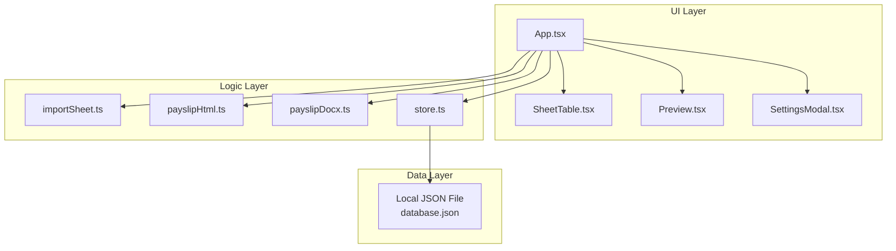
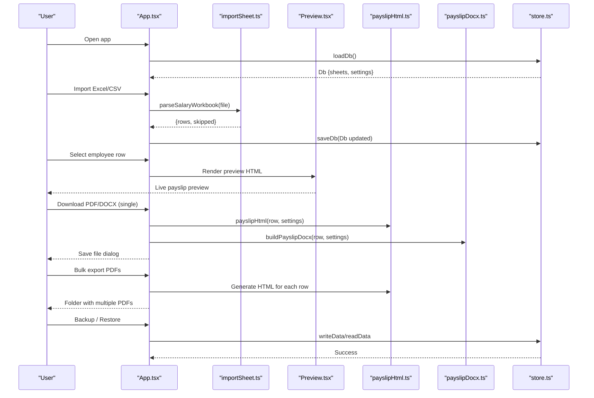
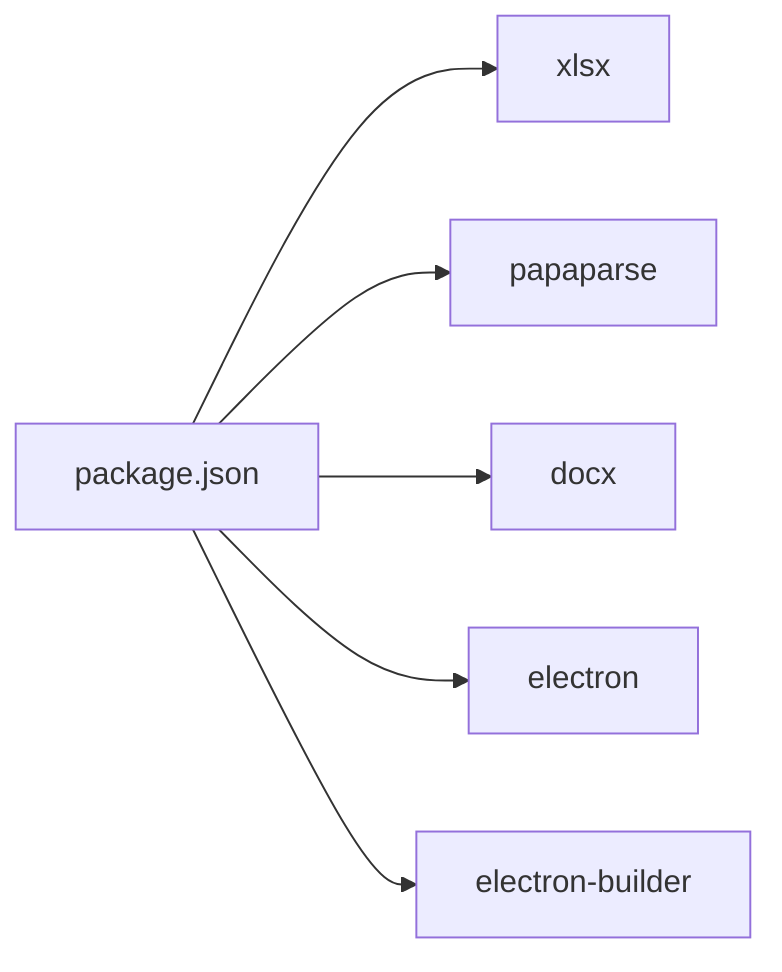

# User Guide

<cite>
**Referenced Files in This Document**
- [README.md](file://README.md)
- [package.json](file://package.json)
- [App.tsx](file://src/renderer/src/App.tsx)
- [types.ts](file://src/renderer/src/types.ts)
- [store.ts](file://src/renderer/src/lib/store.ts)
- [importSheet.ts](file://src/renderer/src/lib/importSheet.ts)
- [payslipHtml.ts](file://src/renderer/src/lib/payslipHtml.ts)
- [payslipDocx.ts](file://src/renderer/src/lib/payslipDocx.ts)
- [SheetTable.tsx](file://src/renderer/src/components/SheetTable.tsx)
- [Preview.tsx](file://src/renderer/src/components/Preview.tsx)
- [SettingsModal.tsx](file://src/renderer/src/components/SettingsModal.tsx)
</cite>

## Table of Contents
1. Introduction
2. Project Structure
3. Core Components
4. Architecture Overview
5. Detailed Component Analysis
6. Dependency Analysis
7. Performance Considerations
8. Troubleshooting Guide
9. Conclusion

## Introduction
Mabtech Payslip Generator is an offline Windows desktop application built with Electron and React. It imports monthly salary data from Excel or CSV files, organizes records by payroll period, lets you edit employee details inline, previews professional payslips, and exports them as PDF or Word documents. All data is stored locally on your computer in a single JSON file. You can back up and restore this data to move it between machines.

Key capabilities:
- Employee data management: add, edit, and delete employees per month
- Spreadsheet import: Excel/CSV with automatic header mapping
- Monthly payroll periods: organize data by month
- Payslip generation: live preview and export to PDF or DOCX
- Bulk operations: download all payslips at once
- Backup and restore: copy or load the entire database

Data location:
- Windows: %APPDATA%\mabtech-payslip\data\database.json
- Linux: ~/.config/mabtech-payslip/data/database.json

**Section sources**
- [README.md:1-15](file://README.md#L1-L15)

## Project Structure
The app follows a clear separation between UI components, business logic, and data handling:
- UI layer (React): App shell, employee table, preview pane, settings modal
- Logic layer: spreadsheet parsing, HTML/DOCX generation, store utilities
- Data layer: local JSON persistence via Electron API

**Diagram sources**
- [App.tsx:1-20](file://src/renderer/src/App.tsx#L1-L20)
- [SheetTable.tsx:1-13](file://src/renderer/src/components/SheetTable.tsx#L1-L13)
- [Preview.tsx:1-10](file://src/renderer/src/components/Preview.tsx#L1-L10)
- [SettingsModal.tsx:1-9](file://src/renderer/src/components/SettingsModal.tsx#L1-L9)
- [importSheet.ts:1-14](file://src/renderer/src/lib/importSheet.ts#L1-L14)
- [payslipHtml.ts:1-39](file://src/renderer/src/lib/payslipHtml.ts#L1-L39)
- [payslipDocx.ts:1-48](file://src/renderer/src/lib/payslipDocx.ts#L1-L48)
- [store.ts:1-18](file://src/renderer/src/lib/store.ts#L1-L18)

**Section sources**
- [package.json:1-23](file://package.json#L1-L23)
- [App.tsx:1-20](file://src/renderer/src/App.tsx#L1-L20)

## Core Components
- App shell: Loads data, manages current month, orchestrates import/export, bulk actions, backup/restore, and renders the main layout.
- Employee table: Inline editable grid for adding, editing, deleting rows; shows computed gross pay and quick actions per row.
- Preview pane: Live A4-sized payslip preview based on the selected employee and current settings.
- Settings modal: Company branding and payment details that appear on payslips.
- Import engine: Parses Excel/CSV, auto-maps headers, merges with existing records, and reports skipped rows.
- Export engines: Generates HTML-based PDFs and DOCX documents with consistent styling and company branding.
- Store utilities: Load/save database, manage monthly sheets, and default period handling.

**Section sources**
- [App.tsx:13-289](file://src/renderer/src/App.tsx#L13-L289)
- [SheetTable.tsx:30-70](file://src/renderer/src/components/SheetTable.tsx#L30-L70)
- [Preview.tsx:5-28](file://src/renderer/src/components/Preview.tsx#L5-L28)
- [SettingsModal.tsx:11-42](file://src/renderer/src/components/SettingsModal.tsx#L11-L42)
- [importSheet.ts:41-86](file://src/renderer/src/lib/importSheet.ts#L41-L86)
- [payslipHtml.ts:41-164](file://src/renderer/src/lib/payslipHtml.ts#L41-L164)
- [payslipDocx.ts:50-129](file://src/renderer/src/lib/payslipDocx.ts#L50-L129)
- [store.ts:8-32](file://src/renderer/src/lib/store.ts#L8-L32)

## Architecture Overview
High-level workflow:
- On startup, the app loads the local database and ensures the current month sheet exists.
- Users import monthly salary sheets; the importer maps headers and merges with existing records.
- The employee table displays editable fields and computed totals.
- Selecting a row updates the preview pane with a formatted payslip.
- Exports are generated either per employee (PDF/DOCX) or in bulk (PDF).
- Backup/Restore copies the entire database to/from a file.

**Diagram sources**
- [App.tsx:25-36](file://src/renderer/src/App.tsx#L25-L36)
- [App.tsx:103-136](file://src/renderer/src/App.tsx#L103-L136)
- [App.tsx:141-184](file://src/renderer/src/App.tsx#L141-L184)
- [App.tsx:186-199](file://src/renderer/src/App.tsx#L186-L199)
- [importSheet.ts:41-86](file://src/renderer/src/lib/importSheet.ts#L41-L86)
- [payslipHtml.ts:41-164](file://src/renderer/src/lib/payslipHtml.ts#L41-L164)
- [payslipDocx.ts:50-129](file://src/renderer/src/lib/payslipDocx.ts#L50-L129)
- [store.ts:8-18](file://src/renderer/src/lib/store.ts#L8-L18)

## Detailed Component Analysis

### Employee Data Management
- Add employee: Adds a new empty row and selects it for immediate editing.
- Edit employee: Inline edits in the table update the underlying record and refresh the preview.
- Delete employee: Removes the row and adjusts selection safely.
- Computed gross pay: Salary + Overtime − Bank Advance − Cash Advance; negative values are highlighted.

Practical tips:
- Use “Add employee” to create manual entries when no spreadsheet is available.
- Keep Employee Code unique so imported rows merge correctly with existing records.

**Section sources**
- [App.tsx:79-91](file://src/renderer/src/App.tsx#L79-L91)
- [types.ts:52-53](file://src/renderer/src/types.ts#L52-L53)
- [SheetTable.tsx:46-64](file://src/renderer/src/components/SheetTable.tsx#L46-L64)

### Spreadsheet Import (Excel/CSV)
- Automatic header mapping recognizes many common column names.
- Ignores computed columns like Gross/Total/Net/Payable.
- Merges imported rows with existing records using Employee Code or Name as key.
- Reports how many rows were added, updated, or skipped.

Supported mappings include:
- Employee identifiers: EMP ID, Employee ID, Emp Code, etc.
- Names: NAME, Employee Name, Full Name
- Designation: DESIGNATION, Post, Role, Title
- Department: DEPARTMENT, Dept, Section
- Salary: SALARY, Basic Salary, Monthly Salary, Wages
- Overtime: OT, Overtime, OT Amount
- Leave: Pending Leave, Leave, Absent Days
- Advances: Bank Advance, Cash Advance

Notes:
- Each month is a separate sheet; import the correct month’s file.
- If a header cannot be mapped, the column is ignored.

**Section sources**
- [README.md:39-59](file://README.md#L39-L59)
- [importSheet.ts:4-31](file://src/renderer/src/lib/importSheet.ts#L4-L31)
- [importSheet.ts:41-86](file://src/renderer/src/lib/importSheet.ts#L41-L86)
- [App.tsx:103-136](file://src/renderer/src/App.tsx#L103-L136)

### Monthly Payroll Period Organization
- Use the “Salary month” control to switch between months.
- Each month has its own set of employee rows and working days.
- Working days affect paid days calculation on the payslip.

Best practices:
- Set working days per month to reflect actual schedule.
- Keep one sheet per month in your spreadsheets.

**Section sources**
- [App.tsx:93-101](file://src/renderer/src/App.tsx#L93-L101)
- [App.tsx:214-221](file://src/renderer/src/App.tsx#L214-L221)
- [store.ts:3-6](file://src/renderer/src/lib/store.ts#L3-L6)

### Payslip Generation Workflow
- Single export: Choose PDF or DOCX for the selected employee.
- Bulk export: Generate PDFs for all employees in the current month.
- Preview: See a live A4-formatted payslip before exporting.

Export naming:
- Files are named using Employee Code, Name, and the payroll period.

Branding:
- Company name, address, bank details, signatory label, and footer text come from Settings.

**Section sources**
- [App.tsx:138-184](file://src/renderer/src/App.tsx#L138-L184)
- [payslipHtml.ts:162-164](file://src/renderer/src/lib/payslipHtml.ts#L162-L164)
- [payslipHtml.ts:41-164](file://src/renderer/src/lib/payslipHtml.ts#L41-L164)
- [payslipDocx.ts:50-129](file://src/renderer/src/lib/payslipDocx.ts#L50-L129)

### Export Options (PDF and DOCX)
- PDF: Generated from HTML template; suitable for printing and archiving.
- DOCX: Built programmatically with consistent styling and optional logo image.

When to use which:
- PDF for final distribution and archival.
- DOCX if you need to edit the document later.

**Section sources**
- [App.tsx:141-160](file://src/renderer/src/App.tsx#L141-L160)
- [payslipHtml.ts:41-164](file://src/renderer/src/lib/payslipHtml.ts#L41-L164)
- [payslipDocx.ts:50-129](file://src/renderer/src/lib/payslipDocx.ts#L50-L129)

### Bulk Operations
- Bulk PDF export generates one PDF per employee in the current month.
- Useful for end-of-month payroll runs.

Tips:
- Ensure all rows have valid Employee Codes for clean filenames.
- Negative net amounts will still export; consider correcting advances first.

**Section sources**
- [App.tsx:162-173](file://src/renderer/src/App.tsx#L162-L173)

### Backup and Restore
- Backup: Exports the entire database to a file.
- Restore: Imports a previously saved database, replacing current data.

Use cases:
- Move data to another PC.
- Create a snapshot before major changes.

**Section sources**
- [App.tsx:186-199](file://src/renderer/src/App.tsx#L186-L199)
- [README.md:7-15](file://README.md#L7-L15)

### Interface Components

#### Employee Table
- Columns: Employee Code, Name, Designation, Department, Salary, OT, Leave, Bank Advance, Cash Advance, Gross, Actions.
- Actions per row: Download PDF, Download DOCX, Delete.
- Gross is computed and highlighted red when negative.

**Section sources**
- [SheetTable.tsx:15-28](file://src/renderer/src/components/SheetTable.tsx#L15-L28)
- [SheetTable.tsx:46-64](file://src/renderer/src/components/SheetTable.tsx#L46-L64)
- [types.ts:52-53](file://src/renderer/src/types.ts#L52-L53)

#### Preview Pane
- Displays a live A4-sized payslip for the selected employee.
- Scales to fit the container while preserving print dimensions.

**Section sources**
- [Preview.tsx:3-28](file://src/renderer/src/components/Preview.tsx#L3-L28)

#### Settings Modal
- Fields: Company name, Address, Payment/Bank details line, Signatory label, Footer disclaimer.
- Opens data folder for direct access to the local database file.

**Section sources**
- [SettingsModal.tsx:11-42](file://src/renderer/src/components/SettingsModal.tsx#L11-L42)
- [types.ts:19-38](file://src/renderer/src/types.ts#L19-L38)

## Dependency Analysis
Core runtime dependencies:
- xlsx: Parsing Excel workbooks
- papaparse: CSV support
- docx: Building Word documents
- electron/electron-builder: Desktop packaging and native APIs

**Diagram sources**
- [package.json:16-35](file://package.json#L16-L35)

**Section sources**
- [package.json:16-35](file://package.json#L16-L35)

## Performance Considerations
- Auto-save throttling: Database writes are debounced to avoid excessive disk I/O during rapid edits.
- Large datasets: For very large monthly sheets, prefer CSV import and batch processing; avoid unnecessary re-renders by limiting visible rows.
- Bulk export: Generating many PDFs sequentially may take time; allow the process to complete without closing the app.

[No sources needed since this section provides general guidance]

## Troubleshooting Guide
Common issues and resolutions:
- No employees after import:
  - Verify headers match supported names or aliases.
  - Check that the first row contains identifiable headers (e.g., NAME or EMP ID).
  - Review the status message for skipped rows count.
- Negative net salary:
  - Deductions exceed earnings; adjust advances or leave balance.
  - The app highlights affected rows and labels net as recoverable.
- Missing Employee Code:
  - Some rows may lack codes; fill them to ensure proper merging and file naming.
- Cannot open spreadsheet:
  - Ensure the file is not corrupted and uses supported formats (.xlsx, .csv).
- Data loss risk:
  - Use Backup regularly. Restore replaces current data, so back up before restoring.

**Section sources**
- [importSheet.ts:41-86](file://src/renderer/src/lib/importSheet.ts#L41-L86)
- [App.tsx:103-136](file://src/renderer/src/App.tsx#L103-L136)
- [App.tsx:237-248](file://src/renderer/src/App.tsx#L237-L248)

## Conclusion
Mabtech Payslip Generator streamlines monthly payroll by combining flexible data import, inline editing, live preview, and professional exports. With robust header mapping, monthly organization, and reliable backup/restore, it supports efficient, error-aware payroll workflows. Configure company branding once in Settings and reuse it across all payslips.

[No sources needed since this section summarizes without analyzing specific files]